# AFL源码分析

此文档是对于AFL部分源码进行分析并调试的笔记,通过学习AFL源码来学习fuzz,掌握部分fuzzer的要领


## **简介**

AFL（American Fuzzy Lop）的核心原理可以概括为：**通过编译时插桩记录程序执行路径，再用遗传算法不断变异输入，让那些能触发新路径的输入进入队列继续变异，从而自动探索更深层的代码逻辑**

它的工作流程大致分为四个环节：

1. **编译插桩**
   AFL 提供的 `afl-gcc` / `afl-clang` 会在程序的分支跳转处插入“探针”。程序运行时，这些探针会记录当前分支跳转的“边”（源块 → 目标块），并累加到一个共享内存位图中

2. **输入队列驱动**
   Fuzzer 从输入队列中取一个种子，施加各种确定性变异（如位翻转、加减常数等）或随机破坏性变异（如随机字节插入/删除、交叉拼接等），生成海量测试用例

3. **覆盖度引导**
   每执行一个变异后的输入，AFL 都会检查共享内存位图：

   (1) 如果触发了**新的执行边**（位图出现新命中），说明这个输入走到了前所未见的代码路径 → **保留该输入，加入队列**

   (2) 即使没有新边，但如果某个已有边的命中次数**成倍增加**（如从 1→2, 2→4），也可能保留，这有助于探索循环的更多边界

   (3) 否则丢弃该输入，继续变异

4. **循环与加速**

   **Fork Server**：AFL 通过 `fork` 创建子进程来执行每次测试，避免重复加载程序的开销

   **确定性变异**：先对所有输入做少量确定的位变异，快速筛选有效变异

   **破坏性变异**：之后才进行拼接、随机大块修改等操作

   **自学习**：根据执行速度自动调整超时时间，记录使程序崩溃或挂起的用例到专门的目录，供后续分析


## 环境配置

大部分人学习都是用的windows系统,那么我们要运行AFL的话需要linux环境,使用vmware虚拟机搭建ubuntu或者使用wsl搭建都可

此处我使用的是wsl配置ubuntu24,搭建AFL,在window上通过vscode来分析AFL源码,使用pwndbg来调试


## fuzz简易流程

搭建好AFL后我们创建一个含有漏洞的文件并使用AFL编译插桩

需要创建一个inout文件夹存放种子文件以及一个output文件夹存放fuzz后输出的内容

此处选择的是在AFL文件夹下建立/study/input文件夹与/study/output文件夹

/study/input文件夹中存放seed.txt种子文件,内容为"hello"


**vuln.c**

```c
#include <unistd.h>
#include <stdio.h>

int main()
{
    char input[8] = {0};
    read(STDIN_FILENO, input, 8);

    if (input[0] == 'A') {
        puts("AAA");
        if (input[1] == 'B') {
            puts("BBB");
            if (input[2] == 'C') {
                *((unsigned int *)0) = 0xdeadbeef; // bug
            }
        }
    }
    return 0;
}

```

在这段代码中只要我们输入了"ABC"即可使得程序崩溃


**编译vuln.c**

```
afl-gcc -o /home/chipfesen/Fuzz/study/vuln_fuzz /home/chipfesen/Fuzz/study/vuln.c
```


**运行AFL**

```
afl-fuzz -i /home/chipfesen/Fuzz/study/input -o /home/chipfesen/Fuzz/study/output /home/chipfesen/Fuzz/study/vuln_fuzz
```

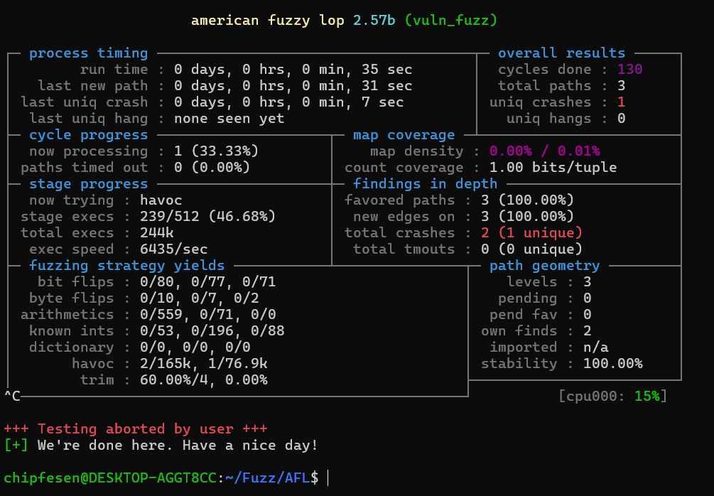

右上角的"uniq crashes"为1说明找到了使得程序崩溃的输入

我们可以找到自己指定的/output/crashes文件夹,里面存在一个名叫"id:000000,sig:11,src:000002,op:havoc,rep:2"的文件,内容为"ABC"

与源码中预期会崩溃的输入相同

```
ls /home/chipfesen/Fuzz/study/output/crashes
cat /home/chipfesen/Fuzz/study/output/crashes/id:000000,sig:11,src:000002,op:havoc,rep:2
```

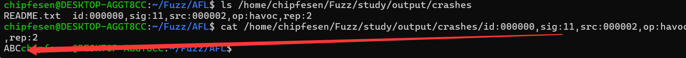


## 1.  afl-gcc.c

下面我们来开始分析一下源码,从afl-gcc.c开始进行分析


### 1.1 main函数

这段代码本质上是 GCC/Clang 的**包装器（wrapper）**，用于在编译目标程序时自动插入 AFL 的覆盖率追踪代码（插桩）


**整体功能**

afl-cc（通常通过 `afl-gcc`、`afl-g++`、`afl-clang` 等符号链接调用）负责：

1. 接收原本传给 gcc/clang 的参数
2. 自动添加必要的编译/链接标志，以便在生成的二进制中注入 AFL 的插桩逻辑
3. 然后调用底层真正的编译器完成编译


此处调用了三个函数

```c
/* Main entry point */

int main(int argc, char** argv) {

  if (isatty(2) && !getenv("AFL_QUIET")) {

    SAYF(cCYA "afl-cc " cBRI VERSION cRST " by <lcamtuf@google.com>\n");

  } else be_quiet = 1;

  if (argc < 2) {

    SAYF("\n"
         "This is a helper application for afl-fuzz. It serves as a drop-in replacement\n"
         "for gcc or clang, letting you recompile third-party code with the required\n"
         "runtime instrumentation. A common use pattern would be one of the following:\n\n"

         "  CC=%s/afl-gcc ./configure\n"
         "  CXX=%s/afl-g++ ./configure\n\n"

         "You can specify custom next-stage toolchain via AFL_CC, AFL_CXX, and AFL_AS.\n"
         "Setting AFL_HARDEN enables hardening optimizations in the compiled code.\n\n",
         BIN_PATH, BIN_PATH);

    exit(1);

  }

  find_as(argv[0]);

  edit_params(argc, argv);

  execvp(cc_params[0], (char**)cc_params);

  FATAL("Oops, failed to execute '%s' - check your PATH", cc_params[0]);

  return 0;

}
```


**第一个if判断**

```c
if (isatty(2) && !getenv("AFL_QUIET")) {
    SAYF(cCYA "afl-cc " cBRI VERSION cRST " by <lcamtuf@google.com>\n");
} else be_quiet = 1;
```

`isatty(2)` 检查标准错误（stderr，文件描述符 2）是否指向一个终端（即是否交互式运行）

`!getenv("AFL_QUIET")` 检查环境变量 `AFL_QUIET` 是否未设置（即未被要求安静模式）

如果两个条件都满足，则打印版本信息（带颜色）；否则将 `be_quiet` 置为 1，抑制后续非必要输出


**第二个if判断**

```c
if (argc < 2) {
    SAYF("\n"
         "This is a helper application for afl-fuzz...\n"
         "  CC=%s/afl-gcc ./configure\n"
         "  CXX=%s/afl-g++ ./configure\n\n"
         "You can specify custom next-stage toolchain via AFL_CC, AFL_CXX, and AFL_AS.\n"
         "Setting AFL_HARDEN enables hardening optimizations in the compiled code.\n\n",
         BIN_PATH, BIN_PATH);
    exit(1);
}
```

如果没有传递任何参数（`argc < 2`），则打印使用说明并退出。这帮助用户了解如何配置编译环境（例如用 `CC=afl-gcc ./configure`）


**find_as函数**

```c
find_as(argv[0]);
```

`find_as` 函数查找 GNU 汇编器 `as` 的路径。AFL 需要通过替换汇编器或在汇编阶段插入代码来实现插桩。该函数会根据 `argv[0]`（程序名，例如 `afl-gcc`）和系统环境找到合适的 `as`


**edit_params函数**

```c
edit_params(argc, argv);
```

核心函数：修改编译参数

​	解析用户传入的 `-O`、`-f` 等标志

​	添加必要的插桩选项（如 `-B` 指定汇编器路径，或 `-fplugin` 等）

​	处理环境变量 `AFL_CC`、`AFL_CXX`、`AFL_AS` 等，用于指定底层的真实编译器/汇编器

​	最终构造一个 `cc_params` 数组，包含真正的编译器名称及其参数


**execvp函数**

```c
execvp(cc_params[0], (char**)cc_params);
```

执行真正的编译器（如 `gcc`、`clang`），并传入修改后的参数。`execvp` 会替换当前进程，不再返回


**FATAL**

```c
FATAL("Oops, failed to execute '%s' - check your PATH", cc_params[0]);
```

如果 `execvp` 失败（例如找不到真实编译器），打印错误信息并退出


#### 1.1.1 **pwndbg调试**

```
gdb --args afl-gcc /home/chipfesen/Fuzz/study/vuln.c -fno-stack-protector -g -o /home/chipfesen/Fuzz/study/vuln
```

在main函数处下断点,然后输入r运行

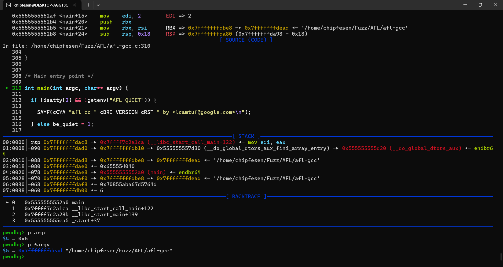

我们可以看到argc存放的是0x6,argv数组中第一个元素里面存放的是指向afl-gcc的文件路径,而find_as函数则需要用到argv[0]


### 1.2 find_as函数

该函数的目的是找到 AFL 提供的用于插桩的汇编器包装程序（通常名为 `afl-as`），以便在编译过程中替换系统的 `as`，从而插入覆盖率追踪代码

```c
/* Try to find our "fake" GNU assembler in AFL_PATH or at the location derived
   from argv[0]. If that fails, abort. */

static void find_as(u8* argv0) {

  u8 *afl_path = getenv("AFL_PATH");
  u8 *slash, *tmp;

  if (afl_path) {

    tmp = alloc_printf("%s/as", afl_path);

    if (!access(tmp, X_OK)) {
      as_path = afl_path;
      ck_free(tmp);
      return;
    }

    ck_free(tmp);

  }

  slash = strrchr(argv0, '/');

  if (slash) {

    u8 *dir;

    *slash = 0;
    dir = ck_strdup(argv0);
    *slash = '/';

    tmp = alloc_printf("%s/afl-as", dir);

    if (!access(tmp, X_OK)) {
      as_path = dir;
      ck_free(tmp);
      return;
    }

    ck_free(tmp);
    ck_free(dir);

  }

  if (!access(AFL_PATH "/as", X_OK)) {
    as_path = AFL_PATH;
    return;
  }

  FATAL("Unable to find AFL wrapper binary for 'as'. Please set AFL_PATH");
 
}
```


#### 1.2.1 **检查环境变量 AFL_PATH**

```c
u8 *afl_path = getenv("AFL_PATH");
if (afl_path) {
    tmp = alloc_printf("%s/as", afl_path);
    if (!access(tmp, X_OK)) {
        as_path = afl_path;
        ck_free(tmp);
        return;
    }
    ck_free(tmp);
}
```

如果设置了 `AFL_PATH` 环境变量，则尝试在该目录下寻找 `as` 可执行文件（注意：是 `as`，不是 `afl-as`）

`access(tmp, X_OK)` 检查文件是否存在且可执行

成功则把 `as_path` 设为 `afl_path`（即目录路径）并返回

若不存在，则释放临时字符串继续尝试


#### 1.2.2 **从 argv[0] 推导路径**

```c
slash = strrchr(argv0, '/');
if (slash) {
    u8 *dir;
    *slash = 0;               // 临时截断字符串，得到目录部分
    dir = ck_strdup(argv0);   // 复制目录路径
    *slash = '/';             // 恢复原 argv0

    tmp = alloc_printf("%s/afl-as", dir);
    if (!access(tmp, X_OK)) {
        as_path = dir;        // 记录目录（不含 afl-as）
        ck_free(tmp);
        return;
    }
    ck_free(tmp);
    ck_free(dir);
}
```

如果 argv0 包含路径分隔符 /（即不是仅命令名），则取出其所在目录，并在该目录下寻找 afl-as 文件

例如 argv0 = /home/chipfesen/Fuzz/AFL/afl-gcc → 目录为 /home/chipfesen/Fuzz/AFL → 检查 /home/chipfesen/Fuzz/AFL/afl-as

如果找到可执行的 afl-as，则记录目录（as_path = dir）并返回


#### 1.2.3 **AFL_PATH 宏**

```c
if (!access(AFL_PATH "/as", X_OK)) {
    as_path = AFL_PATH;
    return;
}
```

如果上述都失败，尝试编译时预定义的宏 AFL_PATH（通常是 /usr/local/lib/afl 或安装目录），检查该目录下的 as 是否存在且可执行，若成功则使用该路径


#### 1.2.4 **FATAL**

```c
FATAL("Unable to find AFL wrapper binary for 'as'. Please set AFL_PATH");
```

有尝试都失败，打印错误并退出。用户需要设置 `AFL_PATH` 环境变量指向 AFL 的辅助二进制目录


#### 1.2.5 **pwndbg调试**

```
gdb --args afl-gcc /home/chipfesen/Fuzz/study/vuln.c -fno-stack-protector -g -o /home/chipfesen/Fuzz/study/vuln
```

find_as函数位于第64行,于是我们直接将断点下在第64行调试

单步步过到第69行后可以看到afl_path的值为0,因为我们没有设置AFL_PATH 环境变量,所以值为0,那么下面的if判断不会执行

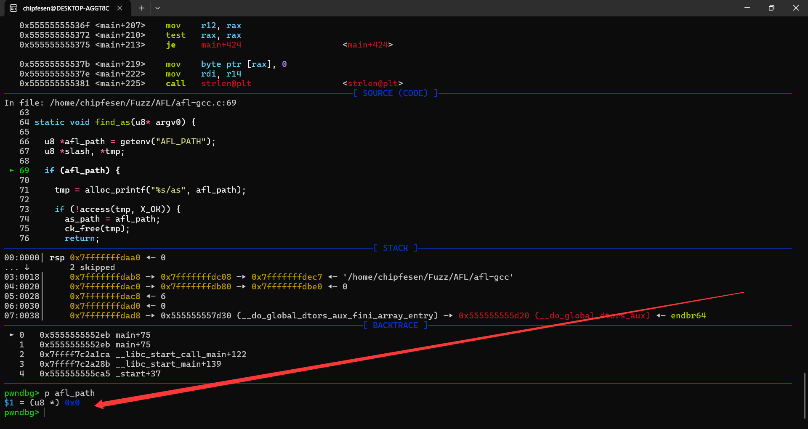


继续单步步过到第95行可以发现dir从argv中获取了AFL的目录路径,而tmp在路径后加上了afl-as

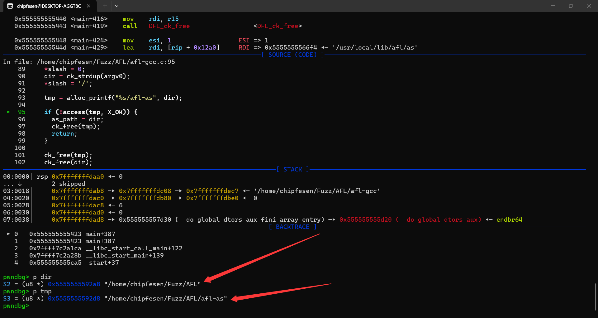


我们在第98行下断点,查看可发现as_path被赋值为dir中的路径

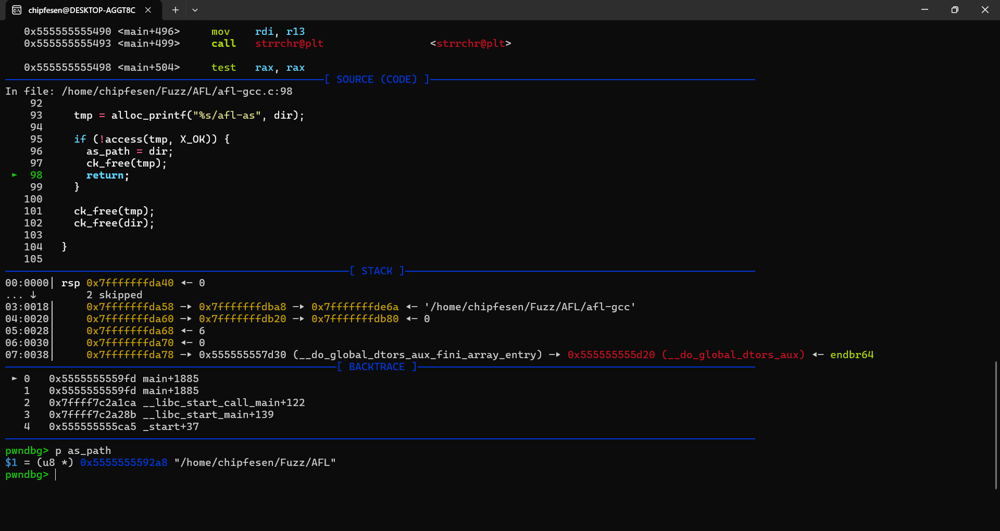


### 1.3 edit_params函数

这段 `edit_params` 函数负责**解析并修改**用户传递给编译器的命令行参数，自动添加 AFL 插桩所需的编译选项，最终构造出调用底层编译器（如 `gcc`/`clang`）的参数数组 `cc_params`，实现**透明的编译时插桩**

此处代码过多,我们只对关键部分分析

```c
/* Copy argv to cc_params, making the necessary edits. */

static void edit_params(u32 argc, char** argv) {

  u8 fortify_set = 0, asan_set = 0;
  u8 *name;

#if defined(__FreeBSD__) && defined(__x86_64__)
  u8 m32_set = 0;
#endif

  cc_params = ck_alloc((argc + 128) * sizeof(u8*));

  name = strrchr(argv[0], '/');
  if (!name) name = argv[0]; else name++;

  if (!strncmp(name, "afl-clang", 9)) {

    clang_mode = 1;

    setenv(CLANG_ENV_VAR, "1", 1);

    if (!strcmp(name, "afl-clang++")) {
      u8* alt_cxx = getenv("AFL_CXX");
      cc_params[0] = alt_cxx ? alt_cxx : (u8*)"clang++";
    } else {
      u8* alt_cc = getenv("AFL_CC");
      cc_params[0] = alt_cc ? alt_cc : (u8*)"clang";
    }

  } else {

    /* With GCJ and Eclipse installed, you can actually compile Java! The
       instrumentation will work (amazingly). Alas, unhandled exceptions do
       not call abort(), so afl-fuzz would need to be modified to equate
       non-zero exit codes with crash conditions when working with Java
       binaries. Meh. */

#ifdef __APPLE__

    if (!strcmp(name, "afl-g++")) cc_params[0] = getenv("AFL_CXX");
    else if (!strcmp(name, "afl-gcj")) cc_params[0] = getenv("AFL_GCJ");
    else cc_params[0] = getenv("AFL_CC");

    if (!cc_params[0]) {

      SAYF("\n" cLRD "[-] " cRST
           "On Apple systems, 'gcc' is usually just a wrapper for clang. Please use the\n"
           "    'afl-clang' utility instead of 'afl-gcc'. If you really have GCC installed,\n"
           "    set AFL_CC or AFL_CXX to specify the correct path to that compiler.\n");

      FATAL("AFL_CC or AFL_CXX required on MacOS X");

    }

#else

    if (!strcmp(name, "afl-g++")) {
      u8* alt_cxx = getenv("AFL_CXX");
      cc_params[0] = alt_cxx ? alt_cxx : (u8*)"g++";
    } else if (!strcmp(name, "afl-gcj")) {
      u8* alt_cc = getenv("AFL_GCJ");
      cc_params[0] = alt_cc ? alt_cc : (u8*)"gcj";
    } else {
      u8* alt_cc = getenv("AFL_CC");
      cc_params[0] = alt_cc ? alt_cc : (u8*)"gcc";
    }

#endif /* __APPLE__ */

  }

  while (--argc) {
    u8* cur = *(++argv);

    if (!strncmp(cur, "-B", 2)) {

      if (!be_quiet) WARNF("-B is already set, overriding");

      if (!cur[2] && argc > 1) { argc--; argv++; }
      continue;

    }

    if (!strcmp(cur, "-integrated-as")) continue;

    if (!strcmp(cur, "-pipe")) continue;

#if defined(__FreeBSD__) && defined(__x86_64__)
    if (!strcmp(cur, "-m32")) m32_set = 1;
#endif

    if (!strcmp(cur, "-fsanitize=address") ||
        !strcmp(cur, "-fsanitize=memory")) asan_set = 1;

    if (strstr(cur, "FORTIFY_SOURCE")) fortify_set = 1;

    cc_params[cc_par_cnt++] = cur;

  }

  cc_params[cc_par_cnt++] = "-B";
  cc_params[cc_par_cnt++] = as_path;

  if (clang_mode)
    cc_params[cc_par_cnt++] = "-no-integrated-as";

  if (getenv("AFL_HARDEN")) {

    cc_params[cc_par_cnt++] = "-fstack-protector-all";

    if (!fortify_set)
      cc_params[cc_par_cnt++] = "-D_FORTIFY_SOURCE=2";

  }

  if (asan_set) {

    /* Pass this on to afl-as to adjust map density. */

    setenv("AFL_USE_ASAN", "1", 1);

  } else if (getenv("AFL_USE_ASAN")) {

    if (getenv("AFL_USE_MSAN"))
      FATAL("ASAN and MSAN are mutually exclusive");

    if (getenv("AFL_HARDEN"))
      FATAL("ASAN and AFL_HARDEN are mutually exclusive");

    cc_params[cc_par_cnt++] = "-U_FORTIFY_SOURCE";
    cc_params[cc_par_cnt++] = "-fsanitize=address";

  } else if (getenv("AFL_USE_MSAN")) {

    if (getenv("AFL_USE_ASAN"))
      FATAL("ASAN and MSAN are mutually exclusive");

    if (getenv("AFL_HARDEN"))
      FATAL("MSAN and AFL_HARDEN are mutually exclusive");

    cc_params[cc_par_cnt++] = "-U_FORTIFY_SOURCE";
    cc_params[cc_par_cnt++] = "-fsanitize=memory";


  }

  if (!getenv("AFL_DONT_OPTIMIZE")) {

#if defined(__FreeBSD__) && defined(__x86_64__)

    /* On 64-bit FreeBSD systems, clang -g -m32 is broken, but -m32 itself
       works OK. This has nothing to do with us, but let's avoid triggering
       that bug. */

    if (!clang_mode || !m32_set)
      cc_params[cc_par_cnt++] = "-g";

#else

      cc_params[cc_par_cnt++] = "-g";

#endif

    cc_params[cc_par_cnt++] = "-O3";
    cc_params[cc_par_cnt++] = "-funroll-loops";

    /* Two indicators that you're building for fuzzing; one of them is
       AFL-specific, the other is shared with libfuzzer. */

    cc_params[cc_par_cnt++] = "-D__AFL_COMPILER=1";
    cc_params[cc_par_cnt++] = "-DFUZZING_BUILD_MODE_UNSAFE_FOR_PRODUCTION=1";

  }

  if (getenv("AFL_NO_BUILTIN")) {

    cc_params[cc_par_cnt++] = "-fno-builtin-strcmp";
    cc_params[cc_par_cnt++] = "-fno-builtin-strncmp";
    cc_params[cc_par_cnt++] = "-fno-builtin-strcasecmp";
    cc_params[cc_par_cnt++] = "-fno-builtin-strncasecmp";
    cc_params[cc_par_cnt++] = "-fno-builtin-memcmp";
    cc_params[cc_par_cnt++] = "-fno-builtin-strstr";
    cc_params[cc_par_cnt++] = "-fno-builtin-strcasestr";

  }

  cc_params[cc_par_cnt] = NULL;

}
```


#### 1.3.1 初始化与编译器选

```c
cc_params = ck_alloc((argc + 128) * sizeof(u8*));
name = strrchr(argv[0], '/');
if (!name) name = argv[0]; else name++;
```

分配足够大的参数数组（原始参数 + 128 个预留位置）

从 argv[0]（程序名，如 afl-gcc 或 afl-clang-fast）中提取基础名称，用于判断当前是哪种编译器包装器


**判断 Clang 模式还是 GCC 模式**

```c
if (!strncmp(name, "afl-clang", 9)) {
    clang_mode = 1;
    setenv(CLANG_ENV_VAR, "1", 1);
    // 设置 cc_params[0] 为 clang/clang++（优先使用环境变量 AFL_CC/AFL_CXX）
} else {
    // GCC 或 GCJ 模式，类似逻辑
}
```

如果程序名以 afl-clang 开头，则启用 clang_mode，并设置环境变量 AFL_CC_COMPILER=1（实际宏为 CLANG_ENV_VAR）

底层编译器的路径优先由环境变量 AFL_CC/AFL_CXX/AFL_GCJ 指定，否则使用系统默认的 clang/gcc/g++ 等

在 macOS 上由于 gcc 通常是 clang 的包装，会强制要求使用 afl-clang 或设置 AFL_CC


#### 1.3.2 **扫描并过滤原始参数**

```c
while (--argc) {
    u8* cur = *(++argv);
    // 处理 -B, -integrated-as, -pipe, -m32, -fsanitize=* 等
}
```

遍历用户传入的所有编译参数（如 -O2、-g、-Iinclude 等）。

特殊处理：

```
-B：覆盖 AFL 自己将要添加的 -B 参数，给出警告并跳过原有值，避免冲突。

-integrated-as（clang 集成汇编器）：直接忽略，因为 AFL 需要使用外部的 afl-as 进行插桩。

-pipe：忽略（可能影响插桩流程）。

-m32（FreeBSD 上记录标志，用于 Bug 规避）。

-fsanitize=address 或 -fsanitize=memory：记录 asan_set，后续可能向 afl-as 传递信息。

检查是否包含 FORTIFY_SOURCE 宏定义（记录 fortify_set）。

```

其他参数原样保留到 cc_params 数组中。


#### 1.3.4 插入 AFL 特有的参数

1. **指定汇编器路径**

```c
cc_params[cc_par_cnt++] = "-B";
cc_params[cc_par_cnt++] = as_path;
```

`-B as_path` 告诉编译器优先在 `as_path` 目录下寻找汇编器 `as`

`as_path` 由 `find_as()` 函数获得，指向包含 `afl-as` 脚本的目录。这样编译器会调用 `afl-as` 而非系统的 `/usr/bin/as`，从而在汇编代码中插入探针


2. **Clang 模式关闭集成汇编器**

```c
if (clang_mode) cc_params[cc_par_cnt++] = "-no-integrated-as";
```

Clang 默认使用内部集成汇编器，需要强制使用外部 GNU 汇编器（即 `afl-as`），因此添加 `-no-integrated-as`


3. **加固选项（`AFL_HARDEN`）**

```c
if (getenv("AFL_HARDEN")) {
    cc_params[cc_par_cnt++] = "-fstack-protector-all";
    if (!fortify_set)
        cc_params[cc_par_cnt++] = "-D_FORTIFY_SOURCE=2";
}
```

开启栈保护、源强化（_FORTIFY_SOURCE），提高测试目标的安全性，也更容易检测到某些溢出


4. **处理 Sanitizer（ASAN / MSAN）**

```c
if (asan_set) {
    setenv("AFL_USE_ASAN", "1", 1);   // 通知 afl-as
} else if (getenv("AFL_USE_ASAN")) {
    // 添加 -fsanitize=address
} else if (getenv("AFL_USE_MSAN")) {
    // 添加 -fsanitize=memory
}
```

如果用户在参数中已经指定了 -fsanitize=address，则仅设置环境变量 AFL_USE_ASAN，让 afl-as 知道需要调整地图密度

如果用户通过环境变量请求 ASAN/MSAN，且未在命令行中指定，则自动添加相应的 sanitizer 参数，并移除 _FORTIFY_SOURCE（因为两者冲突）

ASAN 和 MSAN 互斥，且不能与 AFL_HARDEN 同时使用


5. **优化与调试（默认开启）**

```c
if (!getenv("AFL_DONT_OPTIMIZE")) {
    cc_params[cc_par_cnt++] = "-g";
    cc_params[cc_par_cnt++] = "-O3";
    cc_params[cc_par_cnt++] = "-funroll-loops";
    cc_params[cc_par_cnt++] = "-D__AFL_COMPILER=1";
    cc_params[cc_par_cnt++] = "-DFUZZING_BUILD_MODE_UNSAFE_FOR_PRODUCTION=1";
}
```

默认添加调试信息 (`-g`)、最高优化 (`-O3`)、循环展开等，提升 fuzzing 性能

定义两个宏：`__AFL_COMPILER=1` 供代码条件编译；`FUZZING_BUILD_MODE_UNSAFE_FOR_PRODUCTION=1` 提示这是 fuzzing 构建，不应在生产环境使用

若设置了 `AFL_DONT_OPTIMIZE` 环境变量，则跳过这些选项（保留用户自己的优化级别）


**6. 禁用内置函数（可选）**

```c
if (getenv("AFL_NO_BUILTIN")) {
    cc_params[cc_par_cnt++] = "-fno-builtin-strcmp";
    // ... 依次添加多个字符串/内存函数的禁用选项
}
```

防止编译器将某些比较操作优化为内置实现，导致插桩无法准确捕获路径。通常用于需要精细控制代码生成时


#### 1.3.5 执行

```c
cc_params[cc_par_cnt] = NULL;
```

最终 `cc_params` 数组以 `NULL` 结尾，可直接作为 `execvp` 的参数列表。`edit_params` 返回后，`main` 函数会调用 `execvp(cc_params[0], (char**)cc_params)` 执行真正的编译器


### 1.4 **pwndbg调试**

```
gdb --args afl-gcc /home/chipfesen/Fuzz/study/vuln.c -fno-stack-protector -g -o /home/chipfesen/Fuzz/study/vuln
```

判断当前属于是afl-gcc编译器包装器

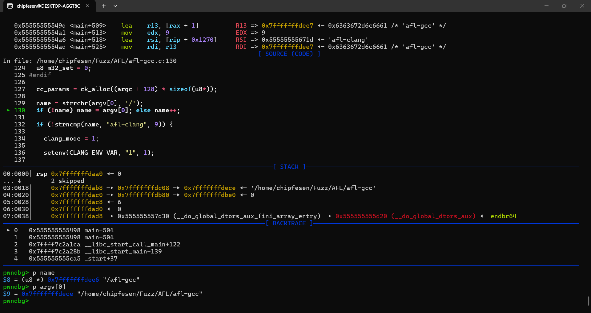


由于name为afl-gcc,所以不会进入下面的if判断,直接跳转到第173行

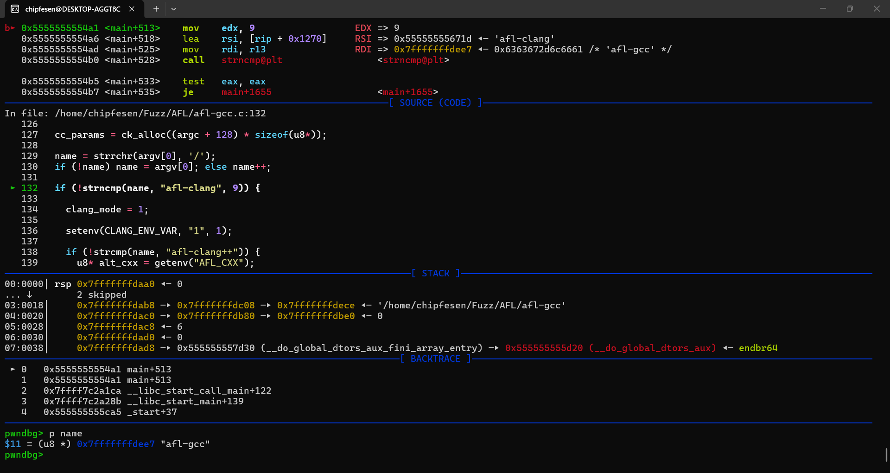


由于都不满足判断条件,所以我们进入else分支,步过到188行可看到cc_params[0]设置为了gcc

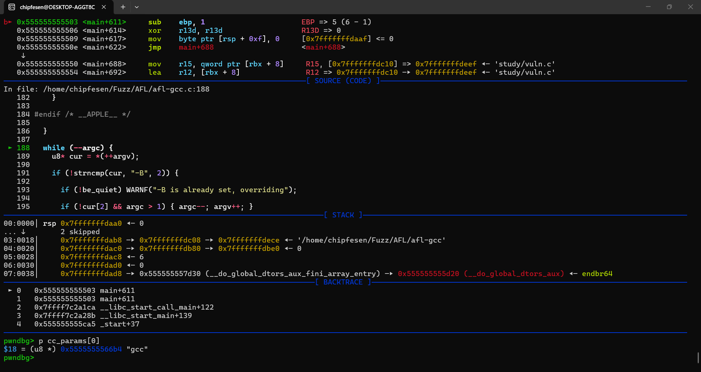


后续都是对cc_grams数组修改,我们直接在303行下断点调试

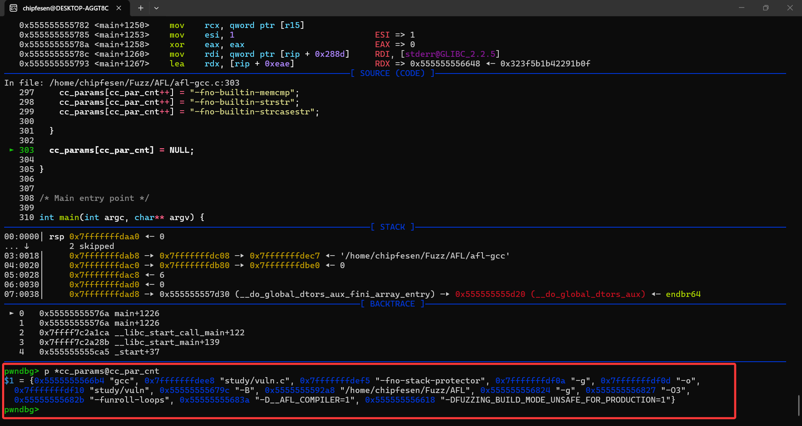

最后我们可以发现afl-gcc的作用就是如下

    劫持汇编器：找到 afl-as，通过 -B 参数让编译器优先使用它来替换系统 as。
    
    修改参数：自动添加优化标志（-O3）、调试信息（-g）、宏定义（__AFL_COMPILER=1）等。
    
    调用真实编译器：最终执行 gcc/clang 完成插桩编译。


## 2.  afl-as.c

`afl-as.c` 是 AFL 的**汇编器包装器**，核心作用是在汇编代码层面插入覆盖率探针


### 普通插桩

### 2.1 main函数

这段 `main` 函数是 `afl-as` 的入口，主要做了 **5 件事**：

1. **初始化**：读取环境变量（`AFL_INST_RATIO`、`AFL_USE_ASAN` 等），设置随机种子，判断是否为 Clang 模式
2. **参数处理**：调用 `edit_params` 解析参数，找到系统真正的汇编器 `as`
3. **核心插桩**：调用 `add_instrumentation`，逐行读取输入汇编文件，在分支、函数入口等位置插入覆盖率探针代码，生成临时文件
4. **执行真汇编器**：`fork` 子进程，用 `execvp` 调用系统 `as` 汇编临时文件
5. **清理与退出**：除非设置了 `AFL_KEEP_ASSEMBLY`，否则删除临时文件，并以 `as` 的退出状态退出

```c
/* Main entry point */

int main(int argc, char** argv) {

  s32 pid;
  u32 rand_seed;
  int status;
  u8* inst_ratio_str = getenv("AFL_INST_RATIO");

  struct timeval tv;
  struct timezone tz;

  clang_mode = !!getenv(CLANG_ENV_VAR);

  if (isatty(2) && !getenv("AFL_QUIET")) {

    SAYF(cCYA "afl-as " cBRI VERSION cRST " by <lcamtuf@google.com>\n");
 
  } else be_quiet = 1;

  if (argc < 2) {

    SAYF("\n"
         "This is a helper application for afl-fuzz. It is a wrapper around GNU 'as',\n"
         "executed by the toolchain whenever using afl-gcc or afl-clang. You probably\n"
         "don't want to run this program directly.\n\n"

         "Rarely, when dealing with extremely complex projects, it may be advisable to\n"
         "set AFL_INST_RATIO to a value less than 100 in order to reduce the odds of\n"
         "instrumenting every discovered branch.\n\n");

    exit(1);

  }

  gettimeofday(&tv, &tz);

  rand_seed = tv.tv_sec ^ tv.tv_usec ^ getpid();

  srandom(rand_seed);

  edit_params(argc, argv);

  if (inst_ratio_str) {

    if (sscanf(inst_ratio_str, "%u", &inst_ratio) != 1 || inst_ratio > 100) 
      FATAL("Bad value of AFL_INST_RATIO (must be between 0 and 100)");

  }

  if (getenv(AS_LOOP_ENV_VAR))
    FATAL("Endless loop when calling 'as' (remove '.' from your PATH)");

  setenv(AS_LOOP_ENV_VAR, "1", 1);

  /* When compiling with ASAN, we don't have a particularly elegant way to skip
     ASAN-specific branches. But we can probabilistically compensate for
     that... */

  if (getenv("AFL_USE_ASAN") || getenv("AFL_USE_MSAN")) {
    sanitizer = 1;
    inst_ratio /= 3;
  }

  if (!just_version) add_instrumentation();

  if (!(pid = fork())) {

    execvp(as_params[0], (char**)as_params);
    FATAL("Oops, failed to execute '%s' - check your PATH", as_params[0]);

  }

  if (pid < 0) PFATAL("fork() failed");

  if (waitpid(pid, &status, 0) <= 0) PFATAL("waitpid() failed");

  if (!getenv("AFL_KEEP_ASSEMBLY")) unlink(modified_file);

  exit(WEXITSTATUS(status));

}
```


**变量声明与初始化**

```c
s32 pid;
u32 rand_seed;
int status;
u8* inst_ratio_str = getenv("AFL_INST_RATIO");

struct timeval tv;
struct timezone tz;

clang_mode = !!getenv(CLANG_ENV_VAR);
```

`pid`：用于存储 `fork()` 返回的进程 ID

`rand_seed`：随机种子，用于可能需要的随机化（例如插桩密度随机采样）

`inst_ratio_str`：读取环境变量 `AFL_INST_RATIO`，该变量控制插桩比例（0-100），默认 100（即每个分支都插桩）。减小它可以降低插桩密度，适用于非常大的程序

`clang_mode`：通过检查环境变量 `CLANG_ENV_VAR`（通常是 `AFL_CC_COMPILER`）判断是否处于 Clang 模式（Clang 的集成汇编器行为与 GCC 不同）


**输出 Banner**

```c
if (isatty(2) && !getenv("AFL_QUIET")) {
    SAYF(cCYA "afl-as " cBRI VERSION cRST " by <lcamtuf@google.com>\n");
} else be_quiet = 1;
```

如果标准错误（文件描述符 2）指向终端（即交互式运行）且未设置 `AFL_QUIET`，则打印版本信息

否则 `be_quiet = 1`，抑制后续非必要的警告信息


**参数检查**

```c
if (argc < 2) {
    SAYF("\nThis is a helper application...\n");
    exit(1);
}
```

没有传递参数时打印使用说明并退出。`afl-as` 通常由 `afl-gcc` 或 `afl-clang` 调用，不会直接手动运行


**随机种子初始化**

```c
gettimeofday(&tv, &tz);
rand_seed = tv.tv_sec ^ tv.tv_usec ^ getpid();
srandom(rand_seed);
```

利用当前时间（秒、微秒）和进程 ID 生成随机种子

`srandom()` 设置随机数生成器，后续可能在插桩时用于随机采样（尽管当前代码中未直接使用，但在某些实验版本中有随机插桩功能）


 **修改参数**

```c
edit_params(argc, argv);
```

`edit_params` 函数（在本文件后面定义）负责：

​	解析原始参数（例如输入汇编文件、输出目标文件等）

​	找到真正的系统汇编器 `as` 的路径（通常从 `PATH` 中查找）

​	构造最终要传给 `as` 的参数数组 `as_params`

​	同时也会处理一些特殊情况，例如在 Clang 模式下添加 `-Q` 等标志


**处理 `AFL_INST_RATIO`**

```c
if (inst_ratio_str) {
    if (sscanf(inst_ratio_str, "%u", &inst_ratio) != 1 || inst_ratio > 100) 
        FATAL("Bad value of AFL_INST_RATIO (must be between 0 and 100)");
}
```

如果环境变量存在，则解析为整数 `inst_ratio`（全局变量）。范围 0~100

默认值在不设置时为 100（在 `add_instrumentation` 中会使用）


**防止递归调用**

```c
if (getenv(AS_LOOP_ENV_VAR))
    FATAL("Endless loop when calling 'as' (remove '.' from your PATH)");

setenv(AS_LOOP_ENV_VAR, "1", 1);
```

`AS_LOOP_ENV_VAR` 通常定义为 `"AFL_AS_LOOP"`

如果已经设置了这个环境变量，说明 `afl-as` 递归调用了自己（可能是因为 `PATH` 中包含当前目录且 `as` 指向了 `afl-as` 脚本），此时报错退出

否则，设置该环境变量，以防止后续调用真 `as` 时再次进入 `afl-as`


**Sanitizer 模式调整插桩密度**

```c
if (getenv("AFL_USE_ASAN") || getenv("AFL_USE_MSAN")) {
    sanitizer = 1;
    inst_ratio /= 3;
}
```

如果启用了 AddressSanitizer 或 MemorySanitizer，则设置 `sanitizer = 1` 标志（影响 `add_instrumentation` 中的某些分支判断）

同时将插桩比例除以 3，因为 ASAN/MSAN 会生成大量额外的分支，如果全插桩会导致性能严重下降


**核心插桩：`add_instrumentation()`**

```c
if (!just_version) add_instrumentation();
```

`just_version` 通常为 0（通过 `--version` 参数可能会设置它为 1）

`add_instrumentation()` 是 **本文件最关键的函数**，它：

​	打开输入的汇编文件（由 `edit_params` 保存在全局变量 `input_file` 中）

​	逐行读取，并写入一个临时文件（`modified_file`）

​	在读取过程中，识别需要插桩的代码行（条件跳转、函数入口、分支标签等）

​	在合适的位置写入预定义的桩代码（`trampoline` 宏，定义在 `afl-as.h`），这些代码会在运行时更新共享内存中的分支命中计数

​	同时维护一个映射表，记录每个插桩点的位置（用于后续 `afl-fuzz` 解析覆盖率）

​	最终关闭文件，并更新输出文件名供后续调用真实 `as` 使用


**分叉子进程执行真正的 `as`**

```c
if (!(pid = fork())) {
    execvp(as_params[0], (char**)as_params);
    FATAL("Oops, failed to execute '%s' - check your PATH", as_params[0]);
}
```

使用 `fork()` 创建子进程

在子进程中，调用 `execvp` 执行真正的汇编器（路径及参数由 `as_params` 提供，该数组在 `edit_params` 中构造）

如果 `execvp` 失败（例如找不到 `as`），则打印错误并退出

父进程继续执行


**等待子进程结束**

```c
if (pid < 0) PFATAL("fork() failed");
if (waitpid(pid, &status, 0) <= 0) PFATAL("waitpid() failed");
```

检查 `fork` 是否成功，然后等待子进程结束，获取其退出状态


**清理临时文件**

```c
if (!getenv("AFL_KEEP_ASSEMBLY")) unlink(modified_file);
```

如果未设置 `AFL_KEEP_ASSEMBLY` 环境变量，则删除由 `add_instrumentation` 生成的临时汇编文件（`modified_file`）

保留这个文件可以用于调试，查看插桩后的汇编代码


**退出**

```c
exit(WEXITSTATUS(status));
```

以真实汇编器的退出码退出，这样 `afl-gcc` 能够得知编译是否成功


#### 2.1.1 **pwndbg调试**

调试afl-as

```
1. 通过afl-gcc生成未插桩的vuls.s
afl-gcc -S /home/chipfesen/Fuzz/study/vuln.c -o /home/chipfesen/Fuzz/study/vuln.s

2. 将 vuln.s 复制到 /tmp
cp /home/chipfesen/Fuzz/study/vuln.s /tmp/

3. 运行 afl-as 生成插桩后的 .s 文件
cd /tmp
AFL_KEEP_ASSEMBLY=1 ~/Fuzz/AFL/afl-as -o /tmp/vuln.o /tmp/vuln.s

4. 自动复制最新生成的插桩文件到 study,方便后续分析
cp $(ls -t /tmp/.afl-*.s | head -1) /home/chipfesen/Fuzz/study/vuln_instrumented.s

5. 调试
gdb --args ./afl-as -o /tmp/vuln.o /tmp/vuln.s
```


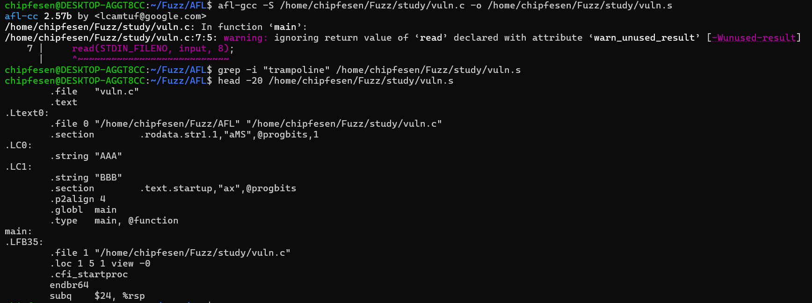


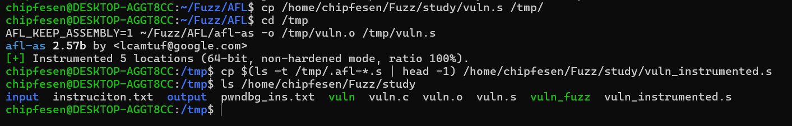


inst_ratio_str为0表示**没有设置 `AFL_INST_RATIO` 环境变量**，因此插桩比例会使用默认值 100%（即所有符合条件的分支都会插桩）

clang_mode也为0表示**当前不是 Clang 模式**，即汇编器按照 GCC / GNU as 的语法和规则处理输入文件

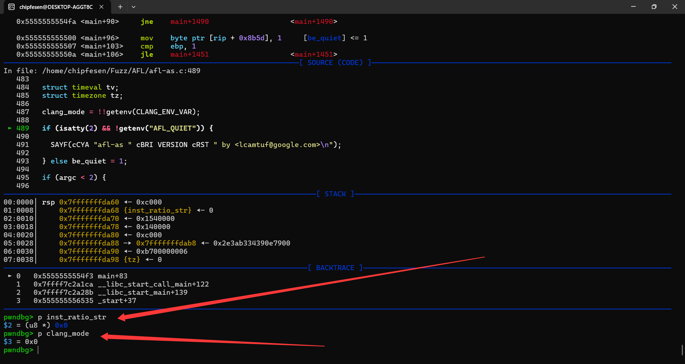


在539行会进入add_instrumentation,我们在这里先不分析

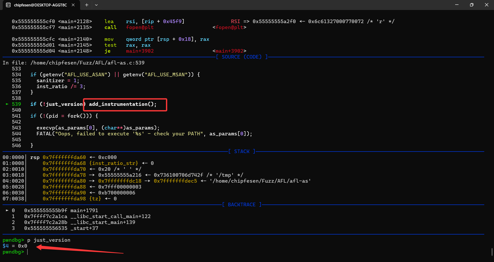


此处会通过 execvp来启动as

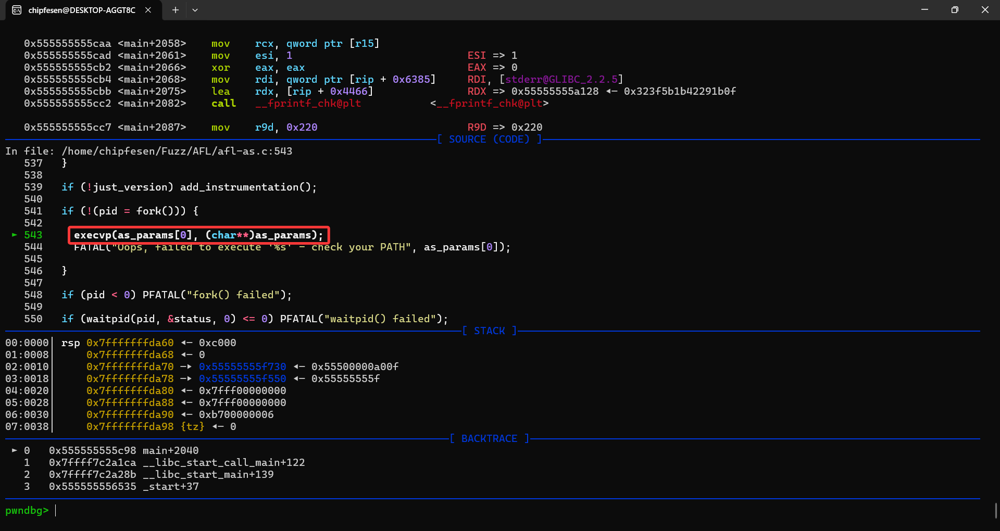


### 2.2 add_instrumentation函数

`add_instrumentation` 函数是 `afl-as` 的核心，负责逐行分析汇编代码并决定在何处插入覆盖率探针（trampoline）

**函数原型与变量声明**

```c
static void add_instrumentation(void) {
  static u8 line[MAX_LINE];
  FILE* inf;
  FILE* outf;
  s32 outfd;
  u32 ins_lines = 0;
  u8 instr_ok = 0, skip_csect = 0, skip_next_label = 0,
      skip_intel = 0, skip_app = 0, instrument_next = 0;
#ifdef __APPLE__
  u8* colon_pos;
#endif
```

**line[MAX_LINE]**：缓冲区，用于逐行读取汇编文件。

**inf / outf**：输入文件（原始汇编）和输出文件（插桩后的临时汇编）

**ins_lines**：统计实际插入的 trampoline 数量

**instr_ok**：当前是否处于需要插桩的代码段（通常是 .text 节）

**skip_csect**：跳过 .code32 / .code64 不匹配的代码块

**skip_next_label**：用于避免在某些特殊标签（如对齐指令后的标签）前插入 trampoline

**skip_intel**：跳过 Intel 语法汇编块（AFL 仅支持 AT&T 语法）

**skip_app**：跳过 #APP / #NO_APP 之间的内联汇编块

**instrument_next**：延迟插入标志，遇到分支目标标签时，不立即插入 trampoline，而是等到下一条有效指令前再插入，以避免破坏异常处理表（如 .Lfunc_begin0）


**打开输入/输出文件**

```c
if (input_file) inf = fopen(input_file, "r");
else inf = stdin;

outfd = open(modified_file, O_WRONLY | O_EXCL | O_CREAT, 0600);
outf = fdopen(outfd, "w");
```

如果 `input_file` 存在（即用户指定了输入汇编文件），则打开；否则从标准输入读取

创建一个临时文件（`modified_file`），用于写入插桩后的汇编代码。`O_EXCL | O_CREAT` 确保文件是新创建的，不会被意外覆盖

将文件描述符转换为 `FILE*` 流


#### 2.2.1 主循环：逐行处理输入

```c
while (fgets(line, MAX_LINE, inf)) {
```

**1.延迟插入处理（trampoline 写入时机）**

```c
if (!pass_thru && !skip_intel && !skip_app && !skip_csect && instr_ok &&
    instrument_next && line[0] == '\t' && isalpha(line[1])) {
  fprintf(outf, use_64bit ? trampoline_fmt_64 : trampoline_fmt_32,
          R(MAP_SIZE));
  instrument_next = 0;
  ins_lines++;
}
```

`instrument_next` 标志先前被设置（表示上一个标签是分支目标），此时遇到一条以 `\t` 开头且第二个字符是字母的指令（即有效的汇编指令），才真正插入 trampoline

这样可以确保 trampoline 插入在指令之前，而不是直接跟在标签后面，避免破坏某些编译器生成的调试信息（如 .Lfunc_begin0）


**2.输出当前行（即使未插桩，也原样输出）**

```c
fputs(line, outf);
if (pass_thru) continue;
```

始终输出原始代码行

如果处于 `pass_thru` 模式（通常用于处理非 .text 节或某些特殊段），跳过后续所有分析


**3.识别 `.text` 节（设置 `instr_ok`）**

```c
if (line[0] == '\t' && line[1] == '.') {
  if (!clang_mode && instr_ok && !strncmp(line+2, "p2align ", 8) && ...)
    skip_next_label = 1;

  if (!strncmp(line+2, "text\n",5) || !strncmp(line+2, "section\t.text",13) ...) {
    instr_ok = 1;
    continue;
  }
  if (!strncmp(line+2, "section\t",8) || !strncmp(line+2, "bss\n",4) ...) {
    instr_ok = 0;
    continue;
  }
}
```

遇到 `.text` 或 `section .text` 等指令时，设置 `instr_ok = 1`，表示后续行可以插桩

遇到其他节（如 `.data`、`.bss`）时，设置 `instr_ok = 0`，禁止插桩


**4.检测 `.code32` / `.code64` 切换**

```c
if (strstr(line, ".code")) {
  if (strstr(line, ".code32")) skip_csect = use_64bit;
  if (strstr(line, ".code64")) skip_csect = !use_64bit;
}
```

当汇编代码中显式切换指令集时，如果切换后的模式与当前目标（64 位）不匹配，则设置 `skip_csect` 跳过插桩


**5.检测 Intel 语法块（`.intel_syntax` / `.att_syntax`）**

```c
if (strstr(line, ".intel_syntax")) skip_intel = 1;
if (strstr(line, ".att_syntax")) skip_intel = 0;
```

AFL 的插桩代码使用 AT&T 语法，因此遇到 Intel 语法块时跳过插桩


**6.检测内联汇编块（`#APP` / `#NO_APP`）**

```c
if (line[0] == '#' || line[1] == '#') {
  if (strstr(line, "#APP")) skip_app = 1;
  if (strstr(line, "#NO_APP")) skip_app = 0;
}
```

GCC 内联汇编以 `#APP` 开头，以 `#NO_APP` 结束，期间的内容不应被插桩


**7.筛选需要插桩的行**

```c
if (skip_intel || skip_app || skip_csect || !instr_ok ||
    line[0] == '#' || line[0] == ' ') continue;
```

如果处于任何跳过模式、不在 .text 节、或者是注释/空行，则跳过插桩判断


**8.处理条件跳转指令**

```c
if (line[0] == '\t') {
  if (line[1] == 'j' && line[2] != 'm' && R(100) < inst_ratio) {
    fprintf(outf, use_64bit ? trampoline_fmt_64 : trampoline_fmt_32,
            R(MAP_SIZE));
    ins_lines++;
  }
  continue;
}
```

识别以 `j` 开头但不是 `jmp` 的指令（即 `je`, `jne`, `jg`, `jl` 等条件跳转）

根据 `inst_ratio`（默认 100）随机决定是否插桩（可实现部分插桩）

在条件跳转指令**之后**立即插入 trampoline，用于记录“未跳转”路径


**9.处理标签（分支目标或函数入口）**

```c
#ifdef __APPLE__
  /* Apple: L<whatever><digit>: */
  if ((colon_pos = strstr(line, ":"))) {
    if (line[0] == 'L' && isdigit(*(colon_pos - 1))) {
#else
  /* Everybody else: .L<whatever>: */
  if (strstr(line, ":")) {
    if (line[0] == '.') {
#endif
```

不同平台标签格式不同：

​	Linux/ELF: `.L0:`, `.LBB0_0:`

​	macOS: `L0:`, `LBB0_0:` （无前导点）

**分支目标标签（例如 `.L0:`）**

```c
if ((isdigit(...) || (clang_mode && !strncmp(...))) && R(100) < inst_ratio) {
  if (!skip_next_label) instrument_next = 1;
  else skip_next_label = 0;
}
```

如果标签是数字开头（或 Clang 模式下的 `LBB`），并且随机数落在插桩比例内，则设置 `instrument_next = 1`，表示在遇到下一条有效指令时插入 trampoline

如果 `skip_next_label` 为真（例如前面遇到了 `p2align` 指令），则忽略此标签，防止在数据对齐指令前插桩


**函数入口标签（例如 `main:`）**

```c
} else {
  instrument_next = 1;
}
```

任何不以点开头（且不是数字开头）的标签，一律视为函数入口，无论是否 Clang 模式，均设置 `instrument_next = 1`


#### 2.2.2 循环结束后：写入主载荷

```c
if (ins_lines)
  fputs(use_64bit ? main_payload_64 : main_payload_32, outf);
```

在所有插桩完成后，在文件末尾追加**主载荷**（`main_payload_64/32`）。这个载荷包含了：

​	初始化共享内存（`__afl_area_ptr`）的代码

​	一个 `__afl_maybe_log` 函数，实际更新分支计数器

​	以及一些辅助函数（如 `__afl_store`）

​	这些代码会链接到最终二进制中，供 `afl-fuzz` 读取覆盖率


**关闭文件与输出统计**

```c
if (input_file) fclose(inf);
fclose(outf);

if (!be_quiet) {
  if (!ins_lines) WARNF("No instrumentation targets found...");
  else OKF("Instrumented %u locations...", ins_lines);
}
```

关闭文件

若插桩数量为 0 则警告，否则打印成功信息


#### 2.2.3 **pwndbg**调试

```
gdb --args ./afl-as -o /tmp/vuln.o /tmp/vuln.s
```

我们要以/tmp路径来运行,否则会进入**透传模式**

可以看到input_file为我们输入的指令中vuln.s的路径,且pass_thru为0,正常执行插桩逻辑

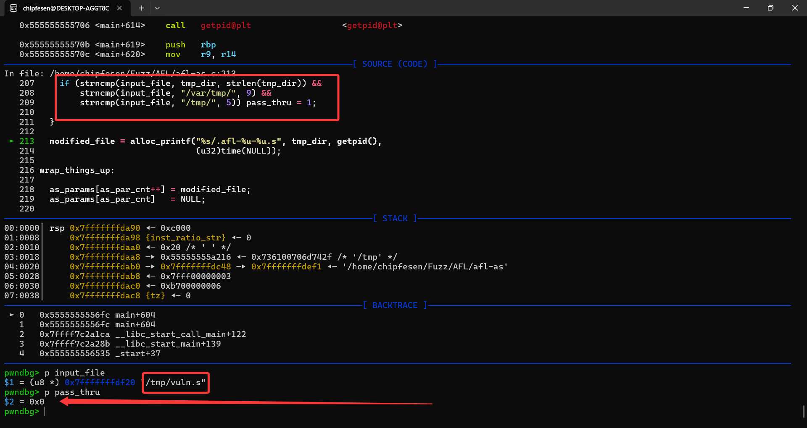


使用别的路径来实验一下,可以发现pass_thru变为了1

```
gdb --args ./afl-as -o /home/chipfesen/Fuzz/study/vuln.o /home/chipfesen/Fuzz/study/vuln.s
```

如果 `pass_thru` 被设置为 `1`，`afl-as` 会进入**透传模式**，即**完全跳过插桩逻辑**，仅将输入的汇编文件原样复制到输出文件中，不插入任何 `trampoline` 或 `main_payload` 代码

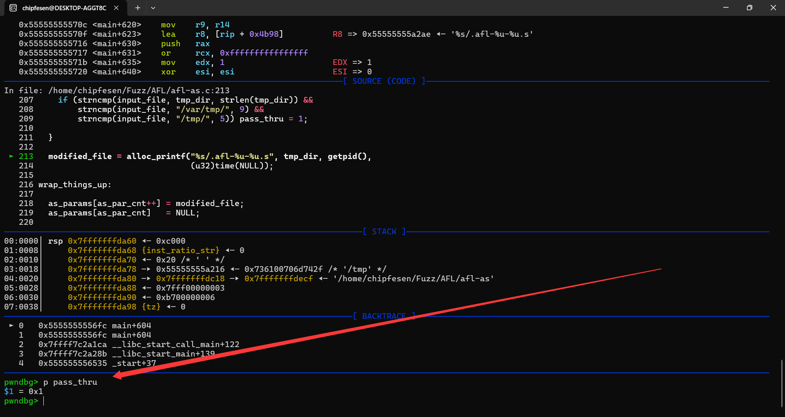


继续在add_instrumentation函数调试while循环会逐行读取输入汇编文件,始终原样输出每一行到输出临时文件,然后在特定位置（条件跳转后、分支标签前、函数入口）插入 `trampoline` 代码

读取的这一行不会进行插桩

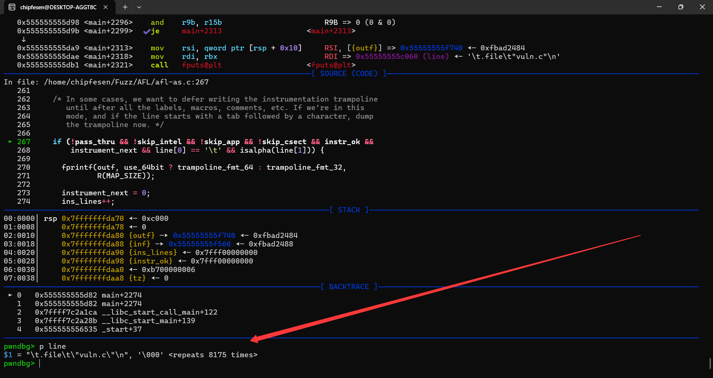

这一行为.text开头,所以会将instr_ok设置为1

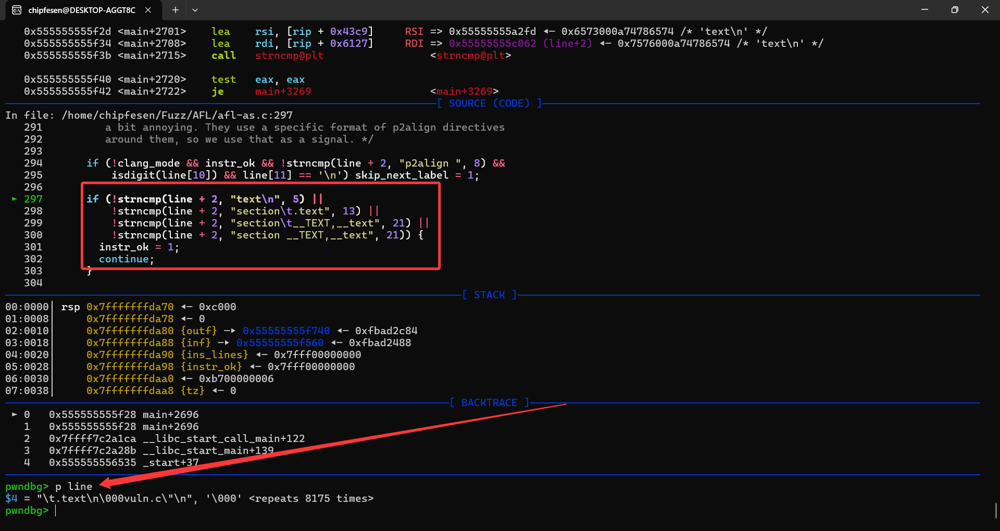

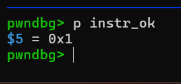


line指向section,所以接下来instr_ok会设置为0,后续都是读取汇编然后进行相应的修改

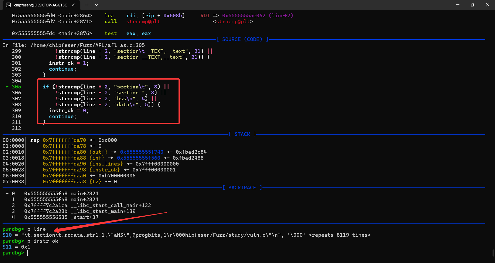


我们在第454行下断点,分析循环结束后的流程,因为我们的插桩点大于0,所以下一行会在文件末尾添加主载荷,因为我们是64位的,所以主载荷模板为main_payload_64

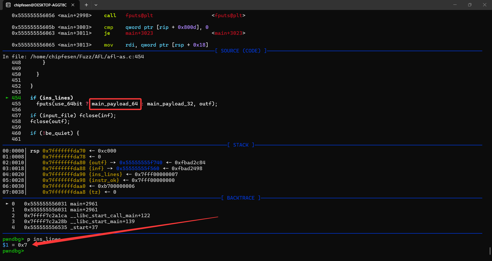


模板对应的就是afl-as.h里面的定义

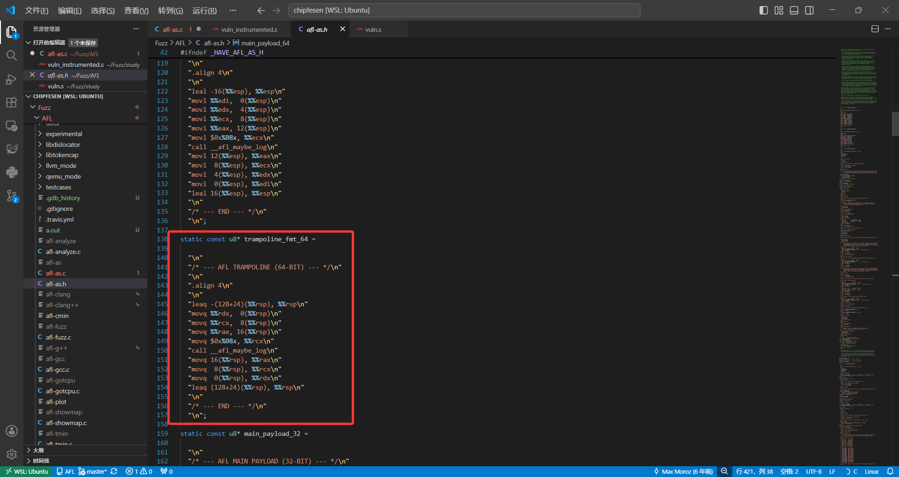


编译后的载荷入下图所示

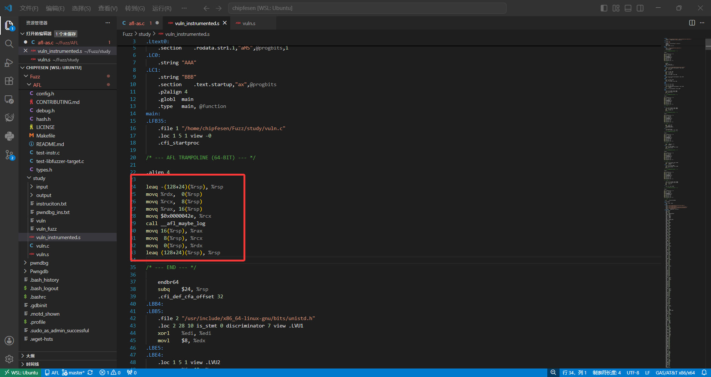


我们在第457行查看inf与outf

**inf**

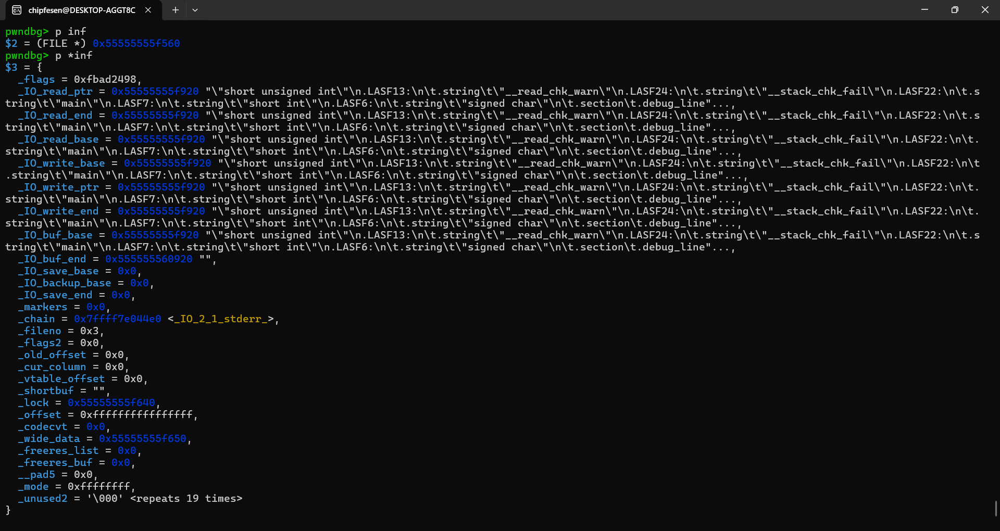

```
_flags = 0xfbad2498
_fileno = 3
_IO_read_ptr = _IO_read_end = _IO_read_base = 0x55555555f920
_IO_buf_base = 0x55555555f920
_IO_buf_end = 0x555555560920
```

**`_flags`**：`0xfbad2498` 表示文件已打开、可读、未出错，当前缓冲区已填充数据。

**`_fileno = 3`**：正常打开的文件描述符。

**缓冲区指针**：`_IO_read_ptr` 与 `_IO_read_end` 相等，指向缓冲区中**当前未读数据的起始位置**。由于它们相等且指向 `0x55555555f920`，说明**缓冲区中已经没有未读取的字节**，即所有已加载到缓冲区的数据都已被 `fgets` 读取完毕。

**缓冲区内容**：从 `_IO_buf_base` 指向的内容看，当前缓冲区包含的是**调试信息**（如 `.LASF` 标签、`.debug_line` 段等），而不再是 `.text` 或条件跳转指令。这意味着 `while` 循环已经越过 `.text` 段，进入了汇编文件的尾部（可能包括 `.debug_*` 段、`.file` 指令等）


**outf**

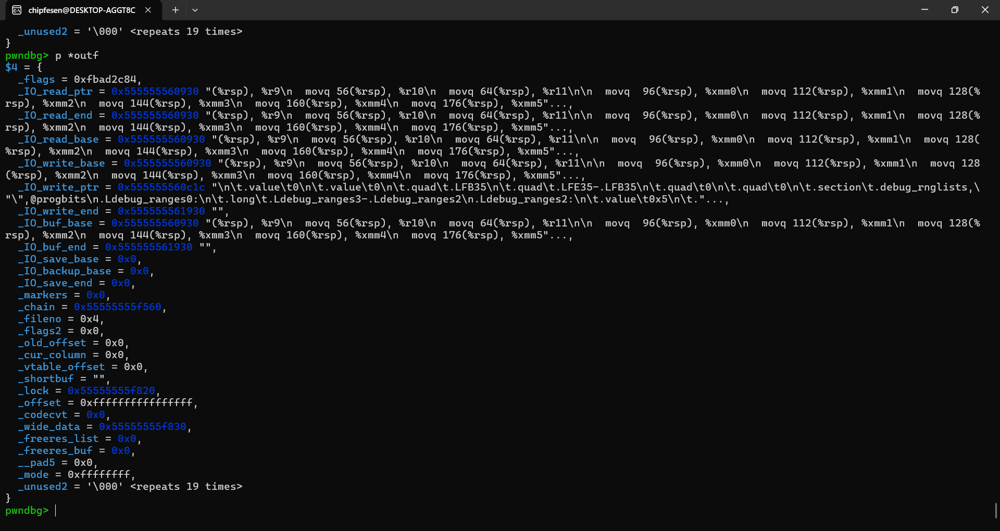

```
_flags = 0xfbad2c84
_fileno = 4
_IO_write_ptr = 0x555555560c1c
_IO_write_base = 0x555555560930
_IO_buf_base = 0x555555560930
_IO_buf_end = 0x555555561930
```

**`_flags`**：`0xfbad2c84` 表示文件已打开、可写、当前处于“正在输出”状态（`_IO_CURRENTLY_PUTTING` 位被设置）。

**`_fileno = 4`**：另一个打开的文件描述符（输出临时文件）。

**写指针**：`_IO_write_ptr`（`0x555555560c1c`）比 `_IO_write_base`（`0x555555560930`）大，说明已向缓冲区写入了部分数据。计算写入量：`0x560c1c - 0x560930 = 0x2ec` 字节（约 748 字节）。

**缓冲区内容**：从 `_IO_write_base` 指向的内容看，当前缓冲区中已经包含了**主载荷（main_payload）的恢复寄存器部分**（如 `movq 56(%rsp), %r10` 等），以及后续的调试信息（如 `.value 0`、`.quad .LFB35` 等）。这表明：

- `while` 循环已经完成了所有插桩和原始行输出。
- `fputs(main_payload, outf)` 已经执行，将主载荷写入了输出缓冲区。
- 后续的 `fclose(outf)` 尚未调用，缓冲区尚未刷新到磁盘


458行之后则关闭输出文件

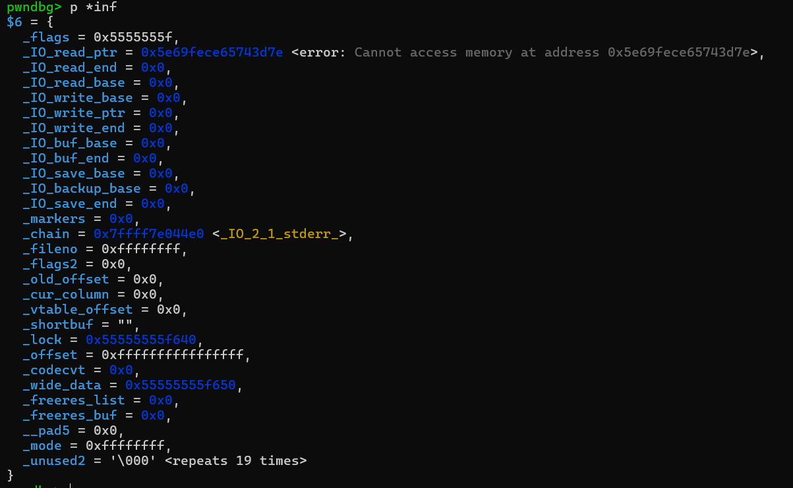

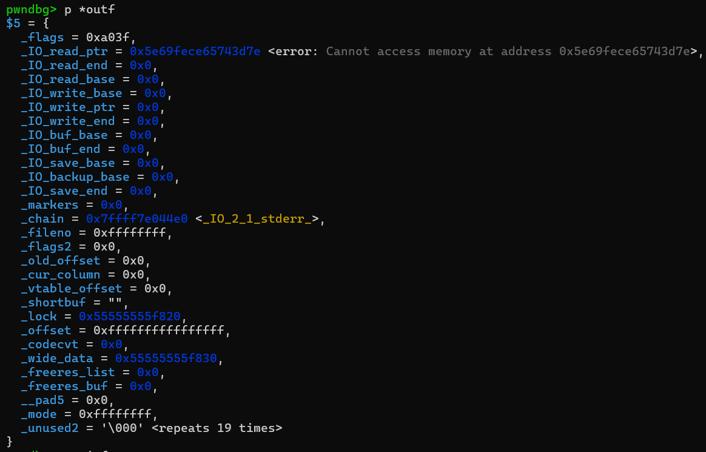


### 2.3 afl-as.h

afl-as.h 提供了两个核心部分：


1.插桩模板（trampoline）

trampoline_fmt_32 / trampoline_fmt_64：定义在条件跳转指令和分支标签处插入的汇编代码片段。

这些代码会保存寄存器状态，调用 __afl_maybe_log 函数（在 main_payload 中定义）来记录分支命中信息。

插桩后的代码会在每条关键路径上执行 shm_trace_map[prev_loc ^ cur_loc]++，实现边覆盖率（edge coverage）收集。


此处的trampoline_fmt_64便是上文在汇编文件中插入的模板

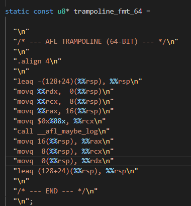


2.运行时载荷（main_payload）

main_payload_32 / main_payload_64：包含完整运行时支持逻辑：

```
__afl_maybe_log：检查共享内存（SHM）是否已映射，若未映射则调用 __afl_setup 进行初始化。

__afl_store：计算当前分支的哈希值（XOR 方式），并递增共享内存中的计数器。

__afl_setup：初始化共享内存（通过 shmat），启动 fork server（__afl_forkserver）以提升 fuzzing 效率。

__afl_forkserver：通过管道与 afl-fuzz 通信，处理子进程的 fork、执行和状态反馈。

__afl_return：恢复寄存器状态并返回。
```


### 2.4 分析vuln

使用下列指令编译vuln.c,加入-fno-stack-protector来禁用 GCC 的栈溢出保护,方便分析

```
afl-gcc /home/chipfesen/Fuzz/study/vuln.c -fno-stack-protector -g -o /home/chipfesen/Fuzz/study/vuln
```


使用ida打开,有5个__afl_maybe_log探针,而_afl_maybe_log由asl-as中的插桩代码建立

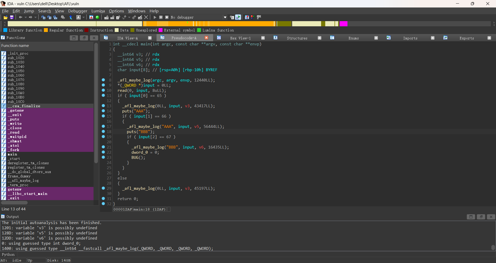


这段代码在每一个基本块前面都插入了 `call __afl_maybe_log` 指令,在64位环境下，AFL会插入 `trampoline_fmt_64` 到文件中，在32位环境下，AFL会插入`trampoline_fmt_32` 到文件中,而`trampoline_fmt_64`定义于afl-as.h,可以看到与ida中的插桩代码一样

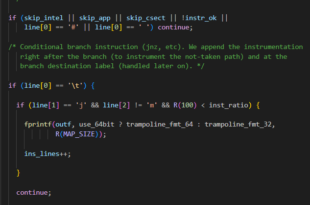

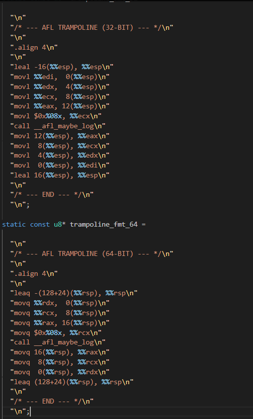


这是通过`fprintf()`将格式化字符串添加到汇编文件的相应位置的

```c
fprintf(outf, use_64bit ? trampoline_fmt_64 : trampoline_fmt_32, R(MAP_SIZE));
```

```asm
movq $0x%08x, %%rcx\n
```

`fprintf`中的R(MAP_SIZE)即为上述指令(trampoline_fmt_64)中`rcx`被设置的值

而这个随机数便是用来标识这个代码块的key


双击_afl_maybe_log来分析

```c
char __fastcall _afl_maybe_log(__int64 a1, __int64 a2, __int64 a3, __int64 a4)
{
  char v4; // of
  char v5; // al
  __int64 v6; // rdx
  __int64 v7; // rcx
  char *v9; // rax
  int v10; // eax
  void *v11; // rax
  int v12; // edi
  __int64 v13; // rax
  __int64 v14; // rax
  __int64 v15; // [rsp-10h] [rbp-180h]
  char v16; // [rsp+10h] [rbp-160h]
  __int64 v17; // [rsp+18h] [rbp-158h]

  v5 = v4;
  v6 = _afl_area_ptr;
  if ( !_afl_area_ptr )
  {
    if ( _afl_setup_failure )
      return v5 + 127;
    v6 = _afl_global_area_ptr;
    if ( _afl_global_area_ptr )
    {
      _afl_area_ptr = _afl_global_area_ptr;
    }
    else
    {
      v16 = v4;
      v17 = a4;
      v9 = getenv("__AFL_SHM_ID");
      if ( !v9 || (v10 = atoi(v9), v11 = shmat(v10, 0LL, 0), v11 == (void *)-1LL) )
      {
        ++_afl_setup_failure;
        v5 = v16;
        return v5 + 127;
      }
      _afl_area_ptr = (__int64)v11;
      _afl_global_area_ptr = v11;
      v15 = (__int64)v11;
      if ( write(199, &_afl_temp, 4uLL) == 4 )
      {
        while ( 1 )
        {
          v12 = 198;
          if ( read(198, &_afl_temp, 4uLL) != 4 )
            break;
          LODWORD(v13) = fork();
          if ( v13 < 0 )
            break;
          if ( !v13 )
            goto __afl_fork_resume;
          _afl_fork_pid = v13;
          write(199, &_afl_fork_pid, 4uLL);
          v12 = _afl_fork_pid;
          LODWORD(v14) = waitpid(_afl_fork_pid, &_afl_temp, 0);
          if ( v14 <= 0 )
            break;
          write(199, &_afl_temp, 4uLL);
        }
        _exit(v12);
      }
__afl_fork_resume:
      close(198);
      close(199);
      v6 = v15;
      v5 = v16;
      a4 = v17;
    }
  }
  v7 = _afl_prev_loc ^ a4;
  _afl_prev_loc ^= v7;
  _afl_prev_loc = (unsigned __int64)_afl_prev_loc >> 1;
  ++*(_BYTE *)(v6 + v7);
  return v5 + 127;
}
```


**获取共享内存**

```c
if ( !_afl_area_ptr )
{
    if ( _afl_setup_failure )   // 已失败过则直接返回
        return ...;
    v6 = _afl_global_area_ptr;
    if ( _afl_global_area_ptr ) // 从父进程继承
        _afl_area_ptr = _afl_global_area_ptr;
    else {
        // 1. 读取环境变量 __AFL_SHM_ID
        // 2. 通过 shmat 附加共享内存
        // 3. 失败则 _afl_setup_failure++，返回
        // 4. 成功则将共享内存指针存入 _afl_area_ptr 和 _afl_global_area_ptr
    }
}
```

共享内存 ID 由 `afl-fuzz` 通过环境变量 `__AFL_SHM_ID` 传入

成功附加后，目标程序就能通过 `_afl_area_ptr` 直接操作位图，与 `afl-fuzz` 实时通信


**进入 forkserver 循环**

进入循环前的准备：共享内存与握手

- `write(199, ...)` 相当于 **握手信号**：若写入成功，说明管道另一端是 `afl-fuzz`，继续执行 forkserver；失败则说明程序是独立运行的，直接跳过循环，正常执行业务逻辑
- 这保证了 **同一份二进制既可在 fuzzer 下工作，也能单独调试运行**

```c
// 从环境变量获取共享内存并附加
v11 = shmat( atoi(getenv("__AFL_SHM_ID")), 0, 0 );
_afl_area_ptr = v11;
_afl_global_area_ptr = v11;

// 向 fd 199 写入任意 4 字节，告知 afl-fuzz 已就绪
if ( write(199, &_afl_temp, 4) == 4 ) {
    // 进入 forkserver 主循环
}
```


 Forkserver 主循环：无限等待 → fork → 汇报 → 等待

```c
while (1) {
    // 从 fd 198 读取 4 字节（父进程发来的同步/控制信号）
    if ( read(198, &_afl_temp, 4) != 4 )
        break;

    // 创建子进程
    int pid = fork();
    if (pid < 0) break;          // fork 失败，退出

    if (pid == 0)                // 子进程
        goto __afl_fork_resume;  // 跳出循环，去执行业务代码

    // 父进程：保存子进程 PID，发送给 afl‑fuzz
    _afl_fork_pid = pid;
    write(199, &_afl_fork_pid, 4);

    // 等待子进程结束，取得退出状态
    int status;
    if ( waitpid(pid, &status, 0) <= 0 )
        break;

    // 将子进程状态发送给 afl-fuzz
    write(199, &_afl_temp, 4);   // 注意：实际写入的是 status 所在的 _afl_temp
}
```

共享内存就绪后，函数会立即进入 **forkserver 主循环**（代码中 `write(199, ...); while(1) ...` 部分）：

1. **向 `afl-fuzz` 发送“准备就绪”信号**：`write(199, &_afl_temp, 4)`
2. **阻塞等待 `afl-fuzz` 的指令**：`read(198, &_afl_temp, 4)`
   当 `afl-fuzz` 想测试一个新用例时，它会往这个管道写入 4 字节，唤醒目标进程
3. **`fork()` 出子进程**：子进程将跳转到 `__afl_fork_resume`，**退出 forkserver 循环，回到被中断的 `_afl_maybe_log` 调用处，继续执行后续的边记录和正常的程序逻辑**
4. 父进程则 **记录子进程 PID，发送给 `afl-fuzz`，然后 `waitpid` 等待子进程结束**，将其退出状态写入管道，并回到循环顶部，再次发送准备就绪信号，等待下一次测试

关键点：forkserver 循环**只存在于父进程**。子进程 (`fork() == 0`) 直接 `goto __afl_fork_resume`，跳出循环，然后执行

```c
__afl_fork_resume:
    close(198);
    close(199);
    v6 = v15;        // 恢复共享内存指针
    // 然后继续执行后面的覆盖率记录代码
```


**边覆盖率记录**

```c
v7 = _afl_prev_loc ^ a4;                // 1. 计算边哈希 (prev ⊕ cur)
_afl_prev_loc ^= v7;                    // 2. 实际是 _afl_prev_loc = cur_loc
_afl_prev_loc = _afl_prev_loc >> 1;     // 3. 右移一位，作为下一次的 prev
++*(_BYTE *)(_afl_area_ptr + v7);       // 4. 位图中对应边计数加 1
```

`v7 = _afl_prev_loc ^ a4` 将前一个基本块 ID 与当前 ID 异或，得到一个代表“转移边”的哈希值

将位图中偏移 `v7` 处的字节递增

更新 `_afl_prev_loc` 为当前 ID 右移一位（避免顺时针/逆时针循环造成边重复）


## 3. llvm_mode

### 3.1 前置知识

**LLVM** 是一个**编译器基础设施**。它提供了一套模块化的工具和库：

​	**前端（Clang）**：将 C/C++/ObjC 等源代码转换为 LLVM IR

​	**中间表示（LLVM IR）**：一种类汇编但更高层的静态单赋值（SSA）形式语言，是 LLVM 的核心资产

​	**优化器（opt）**：对 LLVM IR 进行优化变换

​	**后端（LLC）**：将 LLVM IR 转换为具体目标机器的汇编或机器码

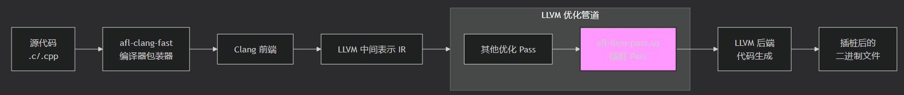


**LLVM Pass —— 自定义代码插入**

**Pass** 是 LLVM 对 IR 进行遍历和变换的基本单元，可以理解为“插件”。常见类型：

​	**ModulePass**：处理整个程序模块

​	**FunctionPass**：处理单个函数

​	**BasicBlockPass**：处理单个基本块

LLVM Pass 是一些中间过程处理 IR 的可以用户自定义的内容，可以用来遍历、修改 IR 以达到插桩、优化、静态分析等目的

代码首先由编译器前端clang处理后得到中间代码IR，然后经过各 LLVM Pass 进行优化和转换，最终交给编译器后端生成机器码


**afl-clang-fast**

`afl-clang-fast` 是 AFL（American Fuzzy Lop）**LLVM 模式**的编译器包装器（wrapper）。它利用 Clang/LLVM 的编译器中间表示（IR）层插入覆盖率探针，相比传统的汇编级插桩（`afl-gcc`），具有更高的性能、更低的侵入性，并支持持久模式等高级特性

`afl-clang-fast` 本身是一个**可执行脚本/程序**（由 `afl-clang-fast.c` 编译而成），位于 AFL 的安装目录下。它的作用就是替代 `gcc` 或 `clang`，在编译目标程序时，加上一系列必要的参数，最终调用真正的 `clang` 完成插桩和编译


AFL的llvm_mode文件夹中包含下列三个文件

**`afl-clang-fast.c`**
编译器的**包装器**。拦截编译命令，自动注入加载 LLVM Pass 所需的参数，并在链接时附上运行时库，最后调用真正的 `clang` 完成工作

**`afl-llvm-pass.so.cc`**
编译时的**插桩 Pass**。以共享库形式被 `clang` 加载，遍历代码的每个基本块，在块入口插入轻量级的 IR 指令（直接更新覆盖率位图），无需函数调用

**`afl-llvm-rt.o.c`**
运行时的**支持库**。提供共享内存初始化、forkserver 的建立与通信、持久模式等机制，让插桩代码能正常与 `afl-fuzz` 协作


`llvm_mode` 的插桩思路就是通过编写pass来实现信息记录，对每个基本块都插入探针，具体代码在 `afl-llvm-pass.so.cc` 文件中，初始化和forkserver操作通过链接完成


### 源码

### 3.2 afl-clang-fast.c

#### 3.2.1 main函数

此处的main与我们之前分析的afl-gcc.c中的main函数非常相似,此处主要用到了下列三个函数

`find_obj(argv[0]);`定位运行时资源目录

`edit_params(argc, argv);`构造编译器参数列表

`execvp(cc_params[0], (char**)cc_params);`替换进程执行真正编译器


#### 3.2.2 find_obj函数

`find_obj` 是 `afl-clang-fast.c` 中用于**定位 AFL LLVM 运行时支持库 (`afl-llvm-rt.o`) 所在目录**的核心函数

```c
/* Try to find the runtime libraries. If that fails, abort. */

static void find_obj(u8* argv0) {

  u8 *afl_path = getenv("AFL_PATH");
  u8 *slash, *tmp;

  if (afl_path) {

    tmp = alloc_printf("%s/afl-llvm-rt.o", afl_path);

    if (!access(tmp, R_OK)) {
      obj_path = afl_path;
      ck_free(tmp);
      return;
    }

    ck_free(tmp);

  }

  slash = strrchr(argv0, '/');

  if (slash) {

    u8 *dir;

    *slash = 0;
    dir = ck_strdup(argv0);
    *slash = '/';

    tmp = alloc_printf("%s/afl-llvm-rt.o", dir);

    if (!access(tmp, R_OK)) {
      obj_path = dir;
      ck_free(tmp);
      return;
    }

    ck_free(tmp);
    ck_free(dir);

  }

  if (!access(AFL_PATH "/afl-llvm-rt.o", R_OK)) {
    obj_path = AFL_PATH;
    return;
  }

  FATAL("Unable to find 'afl-llvm-rt.o' or 'afl-llvm-pass.so'. Please set AFL_PATH");

}
```

**检查环境变量 `AFL_PATH`**

```c
u8 *afl_path = getenv("AFL_PATH");
if (afl_path){
    ......
}
```

若用户设置了 `AFL_PATH`，直接在后面拼接 `/afl-llvm-rt.o`

用 `access(..., R_OK)` 检查文件是否**存在且可读**

成功则 `obj_path = afl_path`，立即返回


**从 `argv[0]` 推断自身目录**

```c
slash = strrchr(argv0, '/');

  if (slash){
      ......
  }
```

查找 `argv[0]` 中最后一个 `/` 字符

若存在，说明包装器是通过绝对或相对路径调用的（如 `/usr/local/bin/afl-clang-fast`）

截取目录部分（`/usr/local/bin`），拼接 `afl-llvm-rt.o` 并检查

成功则设置 `obj_path = dir` 并返回


**回退到编译时默认路径 `AFL_PATH`**

```c
if (!access(AFL_PATH "/afl-llvm-rt.o", R_OK)) {
    obj_path = AFL_PATH;
    return;
}
```

`AFL_PATH` 是在编译 AFL 时写入的宏，通常类似 `/usr/local/lib/afl`

直接拼接检查，成功则使用该路径


**失败处理**

```c
FATAL("Unable to find 'afl-llvm-rt.o' or 'afl-llvm-pass.so'. Please set AFL_PATH");
```

若三种方式都失败，打印错误信息并退出

提示用户通过设置 `AFL_PATH` 环境变量修复

find_obj函数的主要功能是在寻找AFL的路径以找到 `afl-llvm-rt.o` 文件


#### 3.2.3 edit_params 函数

```c
/* Copy argv to cc_params, making the necessary edits. */

static void edit_params(u32 argc, char** argv) {

  u8 fortify_set = 0, asan_set = 0, x_set = 0, bit_mode = 0;
  u8 *name;

  cc_params = ck_alloc((argc + 128) * sizeof(u8*));

  name = strrchr(argv[0], '/');
  if (!name) name = argv[0]; else name++;

  if (!strcmp(name, "afl-clang-fast++")) {
    u8* alt_cxx = getenv("AFL_CXX");
    cc_params[0] = alt_cxx ? alt_cxx : (u8*)"clang++";
  } else {
    u8* alt_cc = getenv("AFL_CC");
    cc_params[0] = alt_cc ? alt_cc : (u8*)"clang";
  }

  /* There are two ways to compile afl-clang-fast. In the traditional mode, we
     use afl-llvm-pass.so to inject instrumentation. In the experimental
     'trace-pc-guard' mode, we use native LLVM instrumentation callbacks
     instead. The latter is a very recent addition - see:

     http://clang.llvm.org/docs/SanitizerCoverage.html#tracing-pcs-with-guards */

#ifdef USE_TRACE_PC
  cc_params[cc_par_cnt++] = "-fsanitize-coverage=trace-pc-guard";
#ifndef __ANDROID__
  cc_params[cc_par_cnt++] = "-mllvm";
  cc_params[cc_par_cnt++] = "-sanitizer-coverage-block-threshold=0";
#endif
#else
  cc_params[cc_par_cnt++] = "-Xclang";
  cc_params[cc_par_cnt++] = "-load";
  cc_params[cc_par_cnt++] = "-Xclang";
  cc_params[cc_par_cnt++] = alloc_printf("%s/afl-llvm-pass.so", obj_path);
#endif /* ^USE_TRACE_PC */

  cc_params[cc_par_cnt++] = "-Qunused-arguments";

  while (--argc) {
    u8* cur = *(++argv);

    if (!strcmp(cur, "-m32")) bit_mode = 32;
    if (!strcmp(cur, "armv7a-linux-androideabi")) bit_mode = 32;
    if (!strcmp(cur, "-m64")) bit_mode = 64;

    if (!strcmp(cur, "-x")) x_set = 1;

    if (!strcmp(cur, "-fsanitize=address") ||
        !strcmp(cur, "-fsanitize=memory")) asan_set = 1;

    if (strstr(cur, "FORTIFY_SOURCE")) fortify_set = 1;

    if (!strcmp(cur, "-Wl,-z,defs") ||
        !strcmp(cur, "-Wl,--no-undefined")) continue;

    cc_params[cc_par_cnt++] = cur;

  }

  if (getenv("AFL_HARDEN")) {

    cc_params[cc_par_cnt++] = "-fstack-protector-all";

    if (!fortify_set)
      cc_params[cc_par_cnt++] = "-D_FORTIFY_SOURCE=2";

  }

  if (!asan_set) {

    if (getenv("AFL_USE_ASAN")) {

      if (getenv("AFL_USE_MSAN"))
        FATAL("ASAN and MSAN are mutually exclusive");

      if (getenv("AFL_HARDEN"))
        FATAL("ASAN and AFL_HARDEN are mutually exclusive");

      cc_params[cc_par_cnt++] = "-U_FORTIFY_SOURCE";
      cc_params[cc_par_cnt++] = "-fsanitize=address";

    } else if (getenv("AFL_USE_MSAN")) {

      if (getenv("AFL_USE_ASAN"))
        FATAL("ASAN and MSAN are mutually exclusive");

      if (getenv("AFL_HARDEN"))
        FATAL("MSAN and AFL_HARDEN are mutually exclusive");

      cc_params[cc_par_cnt++] = "-U_FORTIFY_SOURCE";
      cc_params[cc_par_cnt++] = "-fsanitize=memory";

    }

  }

#ifdef USE_TRACE_PC

  if (getenv("AFL_INST_RATIO"))
    FATAL("AFL_INST_RATIO not available at compile time with 'trace-pc'.");

#endif /* USE_TRACE_PC */

  if (!getenv("AFL_DONT_OPTIMIZE")) {

    cc_params[cc_par_cnt++] = "-g";
    cc_params[cc_par_cnt++] = "-O3";
    cc_params[cc_par_cnt++] = "-funroll-loops";

  }

  if (getenv("AFL_NO_BUILTIN")) {

    cc_params[cc_par_cnt++] = "-fno-builtin-strcmp";
    cc_params[cc_par_cnt++] = "-fno-builtin-strncmp";
    cc_params[cc_par_cnt++] = "-fno-builtin-strcasecmp";
    cc_params[cc_par_cnt++] = "-fno-builtin-strncasecmp";
    cc_params[cc_par_cnt++] = "-fno-builtin-memcmp";

  }

  cc_params[cc_par_cnt++] = "-D__AFL_HAVE_MANUAL_CONTROL=1";
  cc_params[cc_par_cnt++] = "-D__AFL_COMPILER=1";
  cc_params[cc_par_cnt++] = "-DFUZZING_BUILD_MODE_UNSAFE_FOR_PRODUCTION=1";

  /* When the user tries to use persistent or deferred forkserver modes by
     appending a single line to the program, we want to reliably inject a
     signature into the binary (to be picked up by afl-fuzz) and we want
     to call a function from the runtime .o file. This is unnecessarily
     painful for three reasons:

     1) We need to convince the compiler not to optimize out the signature.
        This is done with __attribute__((used)).

     2) We need to convince the linker, when called with -Wl,--gc-sections,
        not to do the same. This is done by forcing an assignment to a
        'volatile' pointer.

     3) We need to declare __afl_persistent_loop() in the global namespace,
        but doing this within a method in a class is hard - :: and extern "C"
        are forbidden and __attribute__((alias(...))) doesn't work. Hence the
        __asm__ aliasing trick.

   */

  cc_params[cc_par_cnt++] = "-D__AFL_LOOP(_A)="
    "({ static volatile char *_B __attribute__((used)); "
    " _B = (char*)\"" PERSIST_SIG "\"; "
#ifdef __APPLE__
    "__attribute__((visibility(\"default\"))) "
    "int _L(unsigned int) __asm__(\"___afl_persistent_loop\"); "
#else
    "__attribute__((visibility(\"default\"))) "
    "int _L(unsigned int) __asm__(\"__afl_persistent_loop\"); "
#endif /* ^__APPLE__ */
    "_L(_A); })";

  cc_params[cc_par_cnt++] = "-D__AFL_INIT()="
    "do { static volatile char *_A __attribute__((used)); "
    " _A = (char*)\"" DEFER_SIG "\"; "
#ifdef __APPLE__
    "__attribute__((visibility(\"default\"))) "
    "void _I(void) __asm__(\"___afl_manual_init\"); "
#else
    "__attribute__((visibility(\"default\"))) "
    "void _I(void) __asm__(\"__afl_manual_init\"); "
#endif /* ^__APPLE__ */
    "_I(); } while (0)";

  if (x_set) {
    cc_params[cc_par_cnt++] = "-x";
    cc_params[cc_par_cnt++] = "none";
  }

#ifndef __ANDROID__
  switch (bit_mode) {

    case 0:
      cc_params[cc_par_cnt++] = alloc_printf("%s/afl-llvm-rt.o", obj_path);
      break;

    case 32:
      cc_params[cc_par_cnt++] = alloc_printf("%s/afl-llvm-rt-32.o", obj_path);

      if (access(cc_params[cc_par_cnt - 1], R_OK))
        FATAL("-m32 is not supported by your compiler");

      break;

    case 64:
      cc_params[cc_par_cnt++] = alloc_printf("%s/afl-llvm-rt-64.o", obj_path);

      if (access(cc_params[cc_par_cnt - 1], R_OK))
        FATAL("-m64 is not supported by your compiler");

      break;

  }
#endif

  cc_params[cc_par_cnt] = NULL;

}
```


**初始化及确定编译器名称**

```c
cc_params = ck_alloc((argc + 128) * sizeof(u8*));  // 预留足够空间

name = strrchr(argv[0], '/');
if (!name) name = argv[0]; else name++;

if (!strcmp(name, "afl-clang-fast++")) {
    cc_params[0] = getenv("AFL_CXX") ? alt_cxx : "clang++";
} else {
    cc_params[0] = getenv("AFL_CC") ? alt_cc : "clang";
}
```

如果包装器名字是 `afl-clang-fast++`，则调用 `clang++`，否则调用 `clang`
支持通过 `AFL_CC`/`AFL_CXX` 指定自定义的下一阶段编译器


**选择插桩方式**

```c
#ifdef USE_TRACE_PC
  cc_params[cc_par_cnt++] = "-fsanitize-coverage=trace-pc-guard";
  // 非 Android 时增加 -mllvm -sanitizer-coverage-block-threshold=0
#else
  cc_params[cc_par_cnt++] = "-Xclang";
  cc_params[cc_par_cnt++] = "-load";
  cc_params[cc_par_cnt++] = "-Xclang";
  cc_params[cc_par_cnt++] = alloc_printf("%s/afl-llvm-pass.so", obj_path);
#endif
```

两种模式：

**传统 LLVM Pass 模式**：使用 `-Xclang -load -Xclang .../afl-llvm-pass.so` 加载自定义 LLVM pass 进行插桩

**`trace-pc-guard` 模式**（编译时定义 `USE_TRACE_PC`）：利用 Clang 自带的 SanitizerCoverage 回调，添加 `-fsanitize-coverage=trace-pc-guard`，并默认关闭基本块阈值限制（`-sanitizer-coverage-block-threshold=0`）


**处理用户参数并做标记**

```c
cc_params[cc_par_cnt++] = "-Qunused-arguments";  // 忽略未使用的参数警告

while (--argc) {
    u8* cur = *(++argv);

    // 识别 -m32 / armv7a-linux-androideabi -> bit_mode=32
    // -m64 -> bit_mode=64
    if (!strcmp(cur, "-m32")) bit_mode = 32;
    if (!strcmp(cur, "armv7a-linux-androideabi")) bit_mode = 32;
    if (!strcmp(cur, "-m64")) bit_mode = 64;

    if (!strcmp(cur, "-x")) x_set = 1;  // 记录 -x 参数（后续处理语言类型）

    // 检测是否已设置 sanitizer
    if (!strcmp(cur, "-fsanitize=address") || !strcmp(cur, "-fsanitize=memory"))
        asan_set = 1;

    if (strstr(cur, "FORTIFY_SOURCE")) fortify_set = 1;

    // 丢弃某些链接器参数（避免冲突）
    if (!strcmp(cur, "-Wl,-z,defs") || !strcmp(cur, "-Wl,--no-undefined"))
        continue;

    cc_params[cc_par_cnt++] = cur;
}
```

遍历用户参数，过滤掉会造成问题的 `-Wl,-z,defs` / `-Wl,--no-undefined`，同时记录架构、语言标志、sanitizer 使用情况等


**根据环境变量添加安全/检测选项**

```c
if (getenv("AFL_HARDEN")) {
    cc_params[cc_par_cnt++] = "-fstack-protector-all";
    if (!fortify_set)
        cc_params[cc_par_cnt++] = "-D_FORTIFY_SOURCE=2";
}

if (!asan_set) {
    if (getenv("AFL_USE_ASAN")) {
        // 互斥检查
        cc_params[cc_par_cnt++] = "-U_FORTIFY_SOURCE";
        cc_params[cc_par_cnt++] = "-fsanitize=address";
    } else if (getenv("AFL_USE_MSAN")) {
        cc_params[cc_par_cnt++] = "-U_FORTIFY_SOURCE";
        cc_params[cc_par_cnt++] = "-fsanitize=memory";
    }
}
```

`AFL_HARDEN`：启用栈保护，若未定义 `FORTIFY_SOURCE` 则加上

`AFL_USE_ASAN` / `AFL_USE_MSAN`：启用 AddressSanitizer 或 MemorySanitizer，并取消 `_FORTIFY_SOURCE`（避免冲突）。与 HARDEN 互斥


**trace-pc-guard 模式的特殊限制**

```c
#ifdef USE_TRACE_PC
  if (getenv("AFL_INST_RATIO"))
    FATAL("AFL_INST_RATIO not available at compile time with 'trace-pc'.");
#endif
```

在 `trace-pc` 模式下，编译期无法控制插桩率（需通过环境变量在运行时控制）


**优化选项**

```c
if (!getenv("AFL_DONT_OPTIMIZE")) {
    cc_params[cc_par_cnt++] = "-g";
    cc_params[cc_par_cnt++] = "-O3";
    cc_params[cc_par_cnt++] = "-funroll-loops";
}
```

默认开启 `-O3 -g -funroll-loops`，可通过 `AFL_DONT_OPTIMIZE` 禁用


**禁用内置函数**

```c
if (getenv("AFL_NO_BUILTIN")) {
    cc_params[cc_par_cnt++] = "-fno-builtin-strcmp";
    cc_params[cc_par_cnt++] = "-fno-builtin-strncmp";
    // ... 其他字符串比较函数
}
```

避免编译器将标准库比较函数内联优化，确保 fuzzer 能捕获这些比较


**注入 AFL 控制宏定义**

```c
cc_params[cc_par_cnt++] = "-D__AFL_HAVE_MANUAL_CONTROL=1";
cc_params[cc_par_cnt++] = "-D__AFL_COMPILER=1";
cc_params[cc_par_cnt++] = "-DFUZZING_BUILD_MODE_UNSAFE_FOR_PRODUCTION=1";
```

这些宏标记编译环境并启用 `__AFL_LOOP` / `__AFL_INIT` 等辅助功能


**`__AFL_LOOP` 与 `__AFL_INIT` 宏**

```c
cc_params[cc_par_cnt++] = "-D__AFL_LOOP(_A)="
    "({ static volatile char *_B __attribute__((used)); "
    " _B = (char*)\"" PERSIST_SIG "\"; "
    // 声明并调用 __afl_persistent_loop
    ...
    "_L(_A); })";

cc_params[cc_par_cnt++] = "-D__AFL_INIT()="
    "do { static volatile char *_A __attribute__((used)); "
    " _A = (char*)\"" DEFER_SIG "\"; "
    // 声明并调用 __afl_manual_init
    ...
    "_I(); } while (0)";
```

这两个宏将特殊签名字符串注入二进制，并调用运行时库中的函数：

`__AFL_LOOP` → `__afl_persistent_loop`：持久化模式循环

`__AFL_INIT` → `__afl_manual_init`：延迟初始化 forkserver

使用 `volatile` 指针和 `__attribute__((used))` 防止链接器丢弃签名，利用内联汇编别名解决 C++ 作用域问题


**处理 `-x` 参数后添加 `none`**

```c
if (x_set) {
    cc_params[cc_par_cnt++] = "-x";
    cc_params[cc_par_cnt++] = "none";
}
```

如果用户指定了 `-x`（指定后续输入语言），在所有用户参数后追加 `-x none` 以恢复自动检测，否则链接 `.o` 文件时会出错


**链接对应架构的运行时目标文件**

```c
#ifndef __ANDROID__
  switch (bit_mode) {
    case 0: cc_params[cc_par_cnt++] = ... "afl-llvm-rt.o"; break;
    case 32: ... "afl-llvm-rt-32.o"; break;
    case 64: ... "afl-llvm-rt-64.o"; break;
  }
#endif
```

根据 `-m32` / `-m64` 选择不同的 precompiled 运行时库。若无指定，默认使用 `afl-llvm-rt.o`（通常为 64 位）
最后 `cc_params[cc_par_cnt] = NULL;` 终结参数数组


#### 3.2.4 pwndbg调试

```
afl-clang-fast /home/chipfesen/Fuzz/study/vuln.c -fno-stack-protector -g -o /home/chipfesen/Fuzz/study/vuln_llvm
```


### 3.3 afl-llvm-pass.so.cc

这段代码是 AFL 的 **LLVM 插桩 Pass**，编译后生成 `afl-llvm-pass.so`，由 `afl-clang-fast` 加载到 Clang 的优化流水线中，实现自动化的边覆盖率插桩

该 Pass 遍历 LLVM IR 中的每个**基本块**，在块入口处插入代码，记录“从上一个基本块跳转到当前基本块”的**边命中信息**到共享内存。AFL 的 fuzzer (`afl-fuzz`) 通过共享内存获取覆盖率，从而指导变异


#### 3.3.1 **Pass 类定义与基本骨架**

```c++
using namespace llvm;

namespace {
  class AFLCoverage : public ModulePass {
    public:
      static char ID;
      AFLCoverage() : ModulePass(ID) { }
      bool runOnModule(Module &M) override;
  };
}

char AFLCoverage::ID = 0;
```

`AFLCoverage` 继承自 `ModulePass`，是一个模块级 Pass，会在每个 LLVM Module（通常对应一个源文件）上运行一次

**继承 `ModulePass`**

`AFLCoverage 是一个自定义的 **LLVM Pass**，继承自 `ModulePass

`ModulePass` 是 LLVM Pass 层次中 **作用域为整个模块（Module）** 的类型，意味着 `runOnModule` 会以整个编译单元（通常是一个源文件）的对象为单位执行一次

与 `FunctionPass` 不同，它可以在模块级别做一次性初始化（例如创建全局变量 `__afl_area_ptr`），也可以跨函数操作


**静态成员 `static char ID;`**

LLVM 的旧版 Pass Manager 通过一个 **静态 char 变量** 标识每个 Pass 的类型

每一个 Pass 子类都必须定义这个 `ID`，并在构造函数中传递给 `ModulePass` 的构造函数，用于 LLVM 内部的 RTTI（运行时类型识别）和 Pass 的注册/查找

这个 ID 本身可以是任意值，通常初始化为 `0`，因为 LLVM 不关心其具体数值，只要地址唯一即可


```c++
AFLCoverage() : ModulePass(ID) { }
```

向基类 `ModulePass` 传递 `ID`，完成 Pass 的注册

通常这里不做额外操作，因为真正的初始化会在 `runOnModule` 开始时进行


```c++
bool runOnModule(Module &M) override;
```

这是 Pass 的**执行入口**，必须被重写

参数 `Module &M` 代表当前正在编译的模块，可以从中获取函数列表、全局变量列表、数据布局等

返回值 `bool`：`true` 表示 IR 被修改过（例如插入了插桩指令），`false` 表示没有修改。LLVM 的 Pass Manager 会根据这个返回值决定是否继续分析或更新某些内部结构

在这个函数内部，AFL 要实现：
> 遍历所有函数、基本块；
>
> 为每个基本块生成随机 ID；
>
> 插入边覆盖率计数指令（借助 `IRBuilder`）；
>
> 可能还会设置一些全局变量（如 `__afl_prev_loc` 和 `__afl_area_ptr` 的引用）


```c++
char AFLCoverage::ID = 0;
```

在类定义外部对静态成员 `ID` 进行**定义和初始化**

这是 C++ 的标准要求：静态成员变量需要在类外分配存储空间

赋值为 `0` 或其他值无实质影响，LLVM 只用该变量的地址作为唯一的 Pass ID


#### 3.3.2 **runOnModule – 主体逻辑**

```c++
bool AFLCoverage::runOnModule(Module &M) {
  LLVMContext &C = M.getContext();
  IntegerType *Int8Ty  = IntegerType::getInt8Ty(C);
  IntegerType *Int32Ty = IntegerType::getInt32Ty(C);

  /* Show a banner */
  char be_quiet = 0;
  if (isatty(2) && !getenv("AFL_QUIET")) {
    SAYF(cCYA "afl-llvm-pass " cBRI VERSION cRST " by <lszekeres@google.com>\n");
  } else be_quiet = 1;

  /* Decide instrumentation ratio */
  char* inst_ratio_str = getenv("AFL_INST_RATIO");
  unsigned int inst_ratio = 100;
  if (inst_ratio_str) {
    if (sscanf(inst_ratio_str, "%u", &inst_ratio) != 1 || !inst_ratio ||
        inst_ratio > 100)
      FATAL("Bad value of AFL_INST_RATIO (must be between 1 and 100)");
  }
```


```c++
LLVMContext &C = M.getContext();
IntegerType *Int8Ty  = IntegerType::getInt8Ty(C);
IntegerType *Int32Ty = IntegerType::getInt32Ty(C);
```

获取 LLVM 上下文，创建常用的整数类型（`i8` 和 `i32`）

**`M.getContext()`**：每个 Module 都绑定一个 `LLVMContext`，所有 IR 对象（类型、常量、指令）都必须属于同一个 Context，保证内部一致

`IntegerType::getInt8Ty(C)` 和 `getInt32Ty(C)`：创建 8 位和 32 位整数类型

​	`Int8Ty`：用于操作 bitmap 中的单字节计数器（`area_ptr[edge]++` 时读取、增加、存回）

​	`Int32Ty`：用于 `prev_location` 和 `cur_id` 的存储与异或计算（AFL 的边哈希是 32 位操作）

这些类型之后会被用于 `IRBuilder` 创建具体的指令，确保所有操作类型一致


```c++
char be_quiet = 0;
if (isatty(2) && !getenv("AFL_QUIET")) {
    SAYF(cCYA "afl-llvm-pass " cBRI VERSION cRST " by <lszekeres@google.com>\n");
} else be_quiet = 1;
```

除非设置 `AFL_QUIET` 或 stderr 不是终端，否则打印版本信息

> **`isatty(2)`**：检查标准错误（文件描述符 2）是否连接到终端。如果被重定向到文件，则为 `false`
>
> **`getenv("AFL_QUIET")`**：如果设置了环境变量 `AFL_QUIET`（任意非空值），则静默
>
> **条件满足**（stderr 是终端且未要求安静）时，打印一条彩色信息（`SAYF` 是 AFL 的自定义输出宏），显示 pass 名称、版本和作者
>
> **`be_quiet`**：一个标志变量，后续代码可能用它来减少编译期间的日志输出（例如不打印“插桩了X个基本块”之类的统计信息）。如果 banner 未显示，则将 `be_quiet` 置为 1，表示编译过程应保持安静 


```c++
char* inst_ratio_str = getenv("AFL_INST_RATIO");
unsigned int inst_ratio = 100;
if (inst_ratio_str) {
    if (sscanf(inst_ratio_str, "%u", &inst_ratio) != 1 || !inst_ratio ||
        inst_ratio > 100)
        FATAL("Bad value of AFL_INST_RATIO (must be between 1 and 100)");
}
```

从环境变量读取 `AFL_INST_RATIO`，默认 100% 插桩。若值非法（不在 1–100 之间）则编译中断

**`AFL_INST_RATIO` 环境变量**：允许用户控制**有多少比例的基本块会被插桩**
例如 `AFL_INST_RATIO=70` 表示只有随机 70% 的基本块会被插入覆盖率探针

**默认值**：`inst_ratio = 100`，即每个基本块都插桩

解析逻辑：

​	用 `sscanf` 尝试将字符串解析为一个无符号整数

​	解析失败（返回值不是 1）或值为 0，或值大于 100，则通过 `FATAL` 报错退出

目的：

在一些极大的目标程序中，全覆盖插桩可能带来较高的性能压力

通过随机舍弃一部分块（以及与之关联的边），可以**降低运行开销**，同时仍保留大部分路径反馈能力

这个比例的作用将在后续遍历基本块时体现：每遇到一个基本块，生成随机数与比例比较，决定是否进行插桩


#### 3.3.3 **声明外部全局变量**


```c++
  GlobalVariable *AFLMapPtr =
      new GlobalVariable(M, PointerType::get(Int8Ty, 0), false,
                         GlobalValue::ExternalLinkage, 0, "__afl_area_ptr");
```

`__afl_area_ptr` 是一个 `i8*` 类型的全局指针，指向 fuzzer 分配的共享内存区域（大小为 `MAP_SIZE`）

| 参数                           | 值                 | 含义                                                         |
| ------------------------------ | ------------------ | ------------------------------------------------------------ |
| `M`                            | 当前 Module        | 将此全局变量注册到这个模块中                                 |
| `PointerType::get(Int8Ty, 0)`  | `i8*`              | 类型：指向字节（`i8`）的指针。bitmap 就是 `char*`，每个字节是一个计数器 |
| `false`                        | isConstant = false | 非常量，运行时其值会被修改（从假区域改为真正的共享内存地址） |
| `GlobalValue::ExternalLinkage` | 外部链接           | 符号可以被其他编译单元引用，链接时由 `afl-llvm-rt.o` 提供实际定义 |
| `0`                            | 无初始值           | 外部符号不需要在 IR 中提供初始值                             |
| `"__afl_area_ptr"`             | 符号名             | 与运行时库中的变量名一致，链接器会将它们关联起来             |

**作用**：

- 初始指向一块假的本地 bitmap（避免 fork server 建立前写入空指针）
- 当 `fork server` 启动后，运行时调用 `__afl_map_shm()` 将其**重新指向**由 AFL 父进程创建的共享内存（通过 `shmget`/`shmat` 或 `mmap`）
- 所有插桩代码通过这个指针 + 偏移来递增计数器


```c++
  GlobalVariable *AFLPrevLoc = new GlobalVariable(
      M, Int32Ty, false, GlobalValue::ExternalLinkage, 0, "__afl_prev_loc",
      0, GlobalVariable::GeneralDynamicTLSModel, 0, false);
```

`__afl_prev_loc` 是线程局部（TLS）的 `i32` 变量，记录上一个基本块 ID 右移一位后的值。这里通过 `GeneralDynamicTLSModel` 明确指定为线程局部

| 参数                                     | 值                   | 含义                                     |
| ---------------------------------------- | -------------------- | ---------------------------------------- |
| `M`                                      | 当前 Module          | 同上                                     |
| `Int32Ty`                                | `i32`                | 类型：32 位整数，保存上一个基本块的 ID   |
| `false`                                  | isConstant           | 非常量，每次基本块跳转都会被更新         |
| `GlobalValue::ExternalLinkage`           | 外部链接             | 由运行时库提供实际定义                   |
| `0`                                      | 无初始值             | 外部符号                                 |
| `"__afl_prev_loc"`                       | 符号名               | 与运行时库关联                           |
| `0`                                      | 无初始值（第二个）   | —                                        |
| `GlobalVariable::GeneralDynamicTLSModel` | TLS 模型             | **关键参数**，指定线程局部存储的访问模型 |
| `0`                                      | 无对齐要求           | 不强制特殊对齐                           |
| `false`                                  | 不追加到全局列表末尾 | LLVM 内部细节                            |

它们都在 AFL 运行时初始化代码中被赋予实际值


#### 3.3.4 **插桩核心执行逻辑**

**遍历所有基本块，按概率插桩**

```c++
  int inst_blocks = 0;
  for (auto &F : M)
    for (auto &BB : F) {
      BasicBlock::iterator IP = BB.getFirstInsertionPt();
      IRBuilder<> IRB(&(*IP));

      if (AFL_R(100) >= inst_ratio) continue;

      /* Make up cur_loc */
      unsigned int cur_loc = AFL_R(MAP_SIZE);
      ConstantInt *CurLoc = ConstantInt::get(Int32Ty, cur_loc);
```

双重循环遍历模块中的每个函数（`F`）和每个基本块（`BB`）

`getFirstInsertionPt()` 获取基本块内第一条指令（或 phi 节点之后）的位置，`IRBuilder` 将在该处插入新指令

`AFL_R(100)` 生成 0–99 的伪随机数，若不小于 `inst_ratio` 则跳过该基本块，实现概率插桩

`AFL_R(MAP_SIZE)` 为当前基本块随机分配一个 `[0, MAP_SIZE-1]` 的整数作为“位置标识”

`CurLoc` 是编译期常量，会被硬编码到 IR 中


**插入边覆盖率记录的核心 IR**

```c++
      /* Load prev_loc */
      LoadInst *PrevLoc = IRB.CreateLoad(AFLPrevLoc);
      PrevLoc->setMetadata(M.getMDKindID("nosanitize"), MDNode::get(C, None));
      Value *PrevLocCasted = IRB.CreateZExt(PrevLoc, IRB.getInt32Ty());

      /* Load SHM pointer */
      LoadInst *MapPtr = IRB.CreateLoad(AFLMapPtr);
      MapPtr->setMetadata(M.getMDKindID("nosanitize"), MDNode::get(C, None));
      Value *MapPtrIdx =
          IRB.CreateGEP(MapPtr, IRB.CreateXor(PrevLocCasted, CurLoc));

      /* Update bitmap */
      LoadInst *Counter = IRB.CreateLoad(MapPtrIdx);
      Counter->setMetadata(M.getMDKindID("nosanitize"), MDNode::get(C, None));
      Value *Incr = IRB.CreateAdd(Counter, ConstantInt::get(Int8Ty, 1));
      IRB.CreateStore(Incr, MapPtrIdx)
          ->setMetadata(M.getMDKindID("nosanitize"), MDNode::get(C, None));

      /* Set prev_loc to cur_loc >> 1 */
      StoreInst *Store =
          IRB.CreateStore(ConstantInt::get(Int32Ty, cur_loc >> 1), AFLPrevLoc);
      Store->setMetadata(M.getMDKindID("nosanitize"), MDNode::get(C, None));

      inst_blocks++;
    }
```


**指令序列对应逻辑：**

1. **加载上一位置**：`PrevLoc = *__afl_prev_loc`，零扩展至 i32
2. **加载共享内存基址**：`MapPtr = *__afl_area_ptr`
3. **计算边索引**：`PrevLoc ^ CurLoc`，并将结果作为偏移量，用 `GEP` 获得地址 `MapPtrIdx = MapPtr + (PrevLoc ^ CurLoc)`
4. **更新 bitmap 计数器**：从 `MapPtrIdx` 加载一个 i8 计数器，加 1，再存回
5. **更新前驱状态**：将 `cur_loc >> 1` 写入 `__afl_prev_loc`，预备下一次边计算

所有 Load/Store 指令都附加了 `nosanitize` 元数据，禁止 ASAN/MSAN 对这些访问添加检查，避免性能下降和递归插桩

使用异或（`Xor`）而非简单相加，是为了区分方向（A→B 与 B→A 大概率映射到不同计数器）


**输出统计信息**

```c++
  if (!be_quiet) {
    if (!inst_blocks) WARNF("No instrumentation targets found.");
    else OKF("Instrumented %u locations (%s mode, ratio %u%%).",
             inst_blocks, getenv("AFL_HARDEN") ? "hardened" :
             ((getenv("AFL_USE_ASAN") || getenv("AFL_USE_MSAN")) ?
              "ASAN/MSAN" : "non-hardened"), inst_ratio);
  }
  return true;
}
```

若无任何基本块被插桩，输出警告

否则打印插桩点数量，并报告当前编译模式（加固模式、ASAN/MSAN 或普通模式）和实际比例


假设基本块 A 的 `cur_loc = 12345`，基本块 B 的 `cur_loc = 54321`。执行流从 A 跳转到 B 时：

1. 在 A 结束时，`__afl_prev_loc` 被设为 `12345 >> 1 = 6172`
2. 在 B 的入口处：
   
   加载 `prev = 6172`，`cur = 54321`
   
   计算 `edge = 6172 ^ 54321 = 49973`
   
   `shared_mem[49973]++`
   
   更新 `__afl_prev_loc = 54321 >> 1 = 27160`

这样父进程通过检查 bitmap 中新出现的非零值即可判断是否产生了新的控制流边


#### 3.3.5 **Pass 注册到 LLVM 流水线**

```c++
static void registerAFLPass(const PassManagerBuilder &,
                            legacy::PassManagerBase &PM) {
  PM.add(new AFLCoverage());
}

static RegisterStandardPasses RegisterAFLPass(
    PassManagerBuilder::EP_ModuleOptimizerEarly, registerAFLPass);

static RegisterStandardPasses RegisterAFLPass0(
    PassManagerBuilder::EP_EnabledOnOptLevel0, registerAFLPass);
```

通过RegisterStandardPasses将AFLCoverage注册到两个回调点：

**`EP_ModuleOptimizerEarly`**：在优化管线早期运行，此时基本块结构尚未被大量优化，插桩信息更贴近源码

**`EP_EnabledOnOptLevel0`**：即使使用 `-O0`（无优化）也会运行，保证在调试场景下同样生效

这种双重注册确保了 AFL 的插桩在各种编译优化级别下都能正常工作


**注册回调函数**

```c++
static void registerAFLPass(const PassManagerBuilder &,
                            legacy::PassManagerBase &PM) {
  PM.add(new AFLCoverage());
}
```

这是一个**回调函数**，只有一个任务：往 Pass Manager（`PM`）里添加一个 `AFLCoverage` 实例

参数 `PassManagerBuilder &` 未使用（仅用于匹配函数签名），保留它是为了符合 LLVM 规定的回调原型。

PM.add(new AFLCoverage())：

​	`new` 分配一个 `AFLCoverage` 对象，交由 Pass Manager 管理生命周期（PM 负责析构）

​	调用后 PM 就知道在合适的时机运行这个 Pass


**在优化管线早期注册**

```c++
static RegisterStandardPasses RegisterAFLPass(
    PassManagerBuilder::EP_ModuleOptimizerEarly, registerAFLPass);
```

| 组成部分                                      | 说明                                                         |
| --------------------------------------------- | ------------------------------------------------------------ |
| `RegisterStandardPasses`                      | LLVM 提供的一个辅助类，构造函数接受一个 **ExtensionPoint** 和一个回调。构造即注册。 |
| `PassManagerBuilder::EP_ModuleOptimizerEarly` | 扩展点枚举值，表示**在模块优化管线的早期阶段**插入该 Pass。  |
| `registerAFLPass`                             | 刚才定义的回调。                                             |

**什么是 `EP_ModuleOptimizerEarly`？**

LLVM 的 Pass Manager 将优化分为多个阶段，允许外部工具在特定节点注入自定义 Pass：

```
前端 → [EP_EarlyAsPossible]
     → [EP_ModuleOptimizerEarly] ← AFL 在这里插入
     → [优化 Pass 序列（内联、DCE、Loop 优化等）]
     → [EP_ModuleOptimizerLast]
     → 后端代码生成
```

AFL 选择 **Early（早期）** 而非 **Last（最后）** 的原因是：

插桩指令**本身也是 IR 指令**，让插桩代码也能被优化，降低运行时开销

用插桩的副作用“锚定”基本块边界，防止优化破坏控制流反馈

保证覆盖率反馈的稳定性与可比性


**在 `-O0` 级别也注册**

```c++
static RegisterStandardPasses RegisterAFLPass0(
    PassManagerBuilder::EP_EnabledOnOptLevel0, registerAFLPass);
```

`EP_EnabledOnOptLevel0`：即使指定 `-O0`（无优化），该扩展点也会被触发。默认很多 Pass 在 `-O0` 时会被跳过，但此点保证**无论如何 AFL Pass 都会运行**

对于需要精确源码行映射的覆盖率工具，通常建议 `-O0`。但 AFL 使用的是边覆盖率，它更关注基本块之间的跳转关系而非源码行。AFL 在实践中通常建议 `-O2` 以获得更高的执行吞吐量，而 Early 插桩的设计正是为了在这种优化场景下同时保障覆盖率质量和运行效率


#### 3.3.6 **整体流程**

```
Clang 启动
    ↓
加载 -Xclang -load -Xclang afl-llvm-pass.so
    ↓
动态链接器调用 .so 中全局对象的构造函数
    ↓
RegisterAFLPass 和 RegisterAFLPass0 被构造
    ↓
它们向 LLVM 全局 Pass 注册表登记：
    "在 EP_ModuleOptimizerEarly 和 EP_EnabledOnOptLevel0 时，
     调用 registerAFLPass，添加 AFLCoverage"
    ↓
Clang 开始编译，到达上述扩展点时
    ↓
AFLCoverage::runOnModule() 被触发
    ↓
所有基本块被插入覆盖率探针
```


### 3.4 afl-llvm-rt.o.c

该文件与 `afl-llvm-pass.so` 共同构成 AFL 的 LLVM 插桩体系：afl-llvm-pass.so.cc负责遍历 IR，在每个基本块入口**注入覆盖率计数指令**，**本文件负责运行时环境搭建与进程生命周期管理**。两者通过 `__afl_area_ptr` 和 `__afl_prev_loc` 这两个全局符号紧密配合，来实现高效、低延迟的覆盖引导模糊测试


**全局变量声明**

```c
u8  __afl_area_initial[MAP_SIZE];
u8* __afl_area_ptr = __afl_area_initial;

__thread u32 __afl_prev_loc;
```

`__afl_area_initial`：一块本地静态分配的缓冲区，作为“后备”共享内存。在程序尚未通过 `__afl_map_shm()` 与 fuzzer 建立连接前，插桩代码的计数器增量会写到这里，防止野指针访问

`__afl_area_ptr`：指针，默认指向 `__afl_area_initial`；建立共享内存后会指向真正的 fuzzer 内存区域

`__afl_prev_loc`：线程局部变量，存储上一个基本块 ID（右移一位），用于边覆盖率计算


```c
static u8 is_persistent;
```

标记当前是否为“持久化模式”（persistent mode），由环境变量 `AFL_PERSISTENT` 控制


#### **3.4.1 __afl_map_shm  共享内存映射**

```c

/* SHM setup. */

static void __afl_map_shm(void) {

  u8 *id_str = getenv(SHM_ENV_VAR);

  /* If we're running under AFL, attach to the appropriate region, replacing the
     early-stage __afl_area_initial region that is needed to allow some really
     hacky .init code to work correctly in projects such as OpenSSL. */

  if (id_str) {

    u32 shm_id = atoi(id_str);

    __afl_area_ptr = shmat(shm_id, NULL, 0);

    /* Whooooops. */

    if (__afl_area_ptr == (void *)-1) _exit(1);

    /* Write something into the bitmap so that even with low AFL_INST_RATIO,
       our parent doesn't give up on us. */

    __afl_area_ptr[0] = 1;

  }

}
```


**读取共享内存 ID**

```c
u8 *id_str = getenv(SHM_ENV_VAR);
```

`SHM_ENV_VAR` 是一个宏（通常是 `"__AFL_SHM_ID"`），定义了环境变量名

`getenv()` 尝试读取该环境变量。这个变量由 `afl-fuzz` 在 fork 子进程前设置，包含共享内存段的 **System V shm ID**（一个整数）


**附加到共享内存**

```c
if (id_str) {
    u32 shm_id = atoi(id_str);
    __afl_area_ptr = shmat(shm_id, NULL, 0);
```

`atoi(id_str)` 将环境变量字符串转换为整数 `shm_id`

`shmat(shm_id, NULL, 0)`：System V 共享内存的经典 API


`shm_id`：要附加的共享内存段 ID（由父进程通过 `shmget()` 创建）

`NULL`：让内核自动选择附加地址

`0`：读写权限（默认）

返回值：指向共享内存段的指针

赋值给 `__afl_area_ptr`，完成从"本地占位区"到"真实共享内存"的**指针切换**


**错误处理**

```c
if (__afl_area_ptr == (void *)-1) _exit(1);
```

`shmat()` 失败时返回 `(void *) -1`

若发生这种情况，直接 `_exit(1)` 退出

使用 `_exit` 而非 `exit`：避免调用 `atexit` 注册的清理函数，也避免刷新 I/O 缓冲区，这是 fork server 场景下的安全做法


**写入哨兵字节**

```c
__afl_area_ptr[0] = 1;
```

**当 `AFL_INST_RATIO` 设置得很低时（例如 1%），程序执行过程中可能没有任何基本块被插桩，bitmap 始终全为零。** 父进程 `afl-fuzz` 在子进程结束后检查 bitmap：

如果 bitmap **全为零**，AFL 会认为"这个程序可能没有正确插桩，或者执行太短根本没跑到插桩代码"，可能会**放弃该种子甚至终止 fuzzing**

写入 `__afl_area_ptr[0] = 1` 相当于在 bitmap 中放了一个**"我还活着"的哨兵信号**，告诉父进程：共享内存通信正常，即使因插桩比例太低导致没有其他计数器被触发，也不要放弃


**函数调用时机**

`__afl_map_shm()` 通过 AFL 运行时库的初始化机制触发，通常放在 `.init_array` 段或通过 `__attribute__((constructor))` 标记的函数中，**在 `main()` 之前自动执行**。调用时序如下：

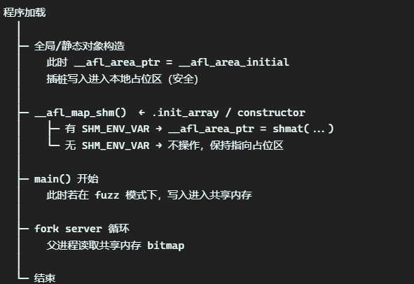


#### 3.4.2 **__afl_start_forkserver – Fork Server 逻辑**

```c
static void __afl_start_forkserver(void) {

  static u8 tmp[4];
  s32 child_pid;
  u8  child_stopped = 0;

  /* Phone home and tell the parent that we're OK. If parent isn't there,
     assume we're not running in forkserver mode and just execute program. */

  if (write(FORKSRV_FD + 1, tmp, 4) != 4) return;

  while (1) {

    u32 was_killed;
    int status;

    /* Wait for parent by reading from the pipe. Abort if read fails. */

    if (read(FORKSRV_FD, &was_killed, 4) != 4) _exit(1);

    /* If we stopped the child in persistent mode, but there was a race
       condition and afl-fuzz already issued SIGKILL, write off the old
       process. */

    if (child_stopped && was_killed) {
      child_stopped = 0;
      if (waitpid(child_pid, &status, 0) < 0) _exit(1);
    }

    if (!child_stopped) {

      /* Once woken up, create a clone of our process. */

      child_pid = fork();
      if (child_pid < 0) _exit(1);

      /* In child process: close fds, resume execution. */

      if (!child_pid) {
        close(FORKSRV_FD);
        close(FORKSRV_FD + 1);
        return;
      }

    } else {

      /* Special handling for persistent mode: if the child is alive but
         currently stopped, simply restart it with SIGCONT. */

      kill(child_pid, SIGCONT);
      child_stopped = 0;
    }

    /* In parent process: write PID to pipe, then wait for child. */

    if (write(FORKSRV_FD + 1, &child_pid, 4) != 4) _exit(1);

    if (waitpid(child_pid, &status, is_persistent ? WUNTRACED : 0) < 0)
      _exit(1);

    /* In persistent mode, the child stops itself with SIGSTOP to indicate
       a successful run. In this case, we want to wake it up without forking
       again. */

    if (WIFSTOPPED(status)) child_stopped = 1;

    /* Relay wait status to pipe, then loop back. */

    if (write(FORKSRV_FD + 1, &status, 4) != 4) _exit(1);
  }
}
```


**函数签名与变量声明**

```c
static void __afl_start_forkserver(void) {
  static u8 tmp[4];
  s32 child_pid;
  u8  child_stopped = 0;
```

| 变量            | 类型    | 存储       | 含义                                                         |
| --------------- | ------- | ---------- | ------------------------------------------------------------ |
| `tmp[4]`        | `u8[4]` | **static** | 仅用于握手阶段向父进程发送 4 字节数据。`static` 使其在 `.data`/`.bss` 段而非栈上分配 |
| `child_pid`     | `s32`   | 栈         | 当前活跃子进程的 PID。每次 `fork()` 后被赋值                 |
| `child_stopped` | `u8`    | 栈，初始 0 | **persistent 模式的状态标志**。`0` = 需要 fork 新子进程；`1` = 子进程被 SIGSTOP 暂停中，下次用 SIGCONT 唤醒即可 |

`child_stopped` 初始为 `0`，因此第一次进入循环必定走 `fork()` 路径


**握手 —— 向父进程报到**

```c
if (write(FORKSRV_FD + 1, tmp, 4) != 4) return;
```

`FORKSRV_FD` 和 `FORKSRV_FD + 1` 是两个预先打开的管道文件描述符（由 afl-fuzz 在 fork+exec 之前设置）。`FORKSRV_FD` 的值通常为 `198`（`FORKSRV_FD` 宏），写端即 `199`

`write()` 返回 `!= 4`：说明管道写端已关闭 ， **afl-fuzz 没有在监听**。这意味着程序是独立运行的（不是被 fuzz 驱动），直接 `return` 跳出函数，程序继续执行 `main()` 并正常退出

这一行实现了 **"一个二进制，双模式运行"**：被 fuzz 时自动进入 fork server 模式，独立运行时行为完全不受影响


**主循环入口 + 阻塞等待命令**

```c
  while (1) {
    u32 was_killed;
    int status;

    if (read(FORKSRV_FD, &was_killed, 4) != 4) _exit(1);
```

`while(1)` 意味着 fork server 一旦建立就永不退出，持续服务 afl-fuzz 发来的每一个 fuzz 请求

fork server 收到后，根据这个值判断是否需要特殊处理（回收僵尸、清除 persistent 状态）


`read()` 阻塞

`read()` 是**阻塞调用**。当 afl-fuzz 还没发来下一个 fuzz 请求时，fork server 会睡眠在这里

`read() != 4` → 管道断裂（afl-fuzz 崩溃或主动关闭）。`_exit(1)` 立即退出，不做任何清理


**竞态修复 —— persistent 模式下的超时 kill**

```c
if (child_stopped && was_killed) {
    child_stopped = 0;
    if (waitpid(child_pid, &status, 0) < 0) _exit(1);
}
```

`child_stopped = 0`：清除标志，本轮回退到正常 `fork()` 路径

`waitpid(child_pid, &status, 0)`：**回收僵尸子进程**。被 SIGKILL 杀死的进程如果不 wait，会变成僵尸，消耗系统资源。这里补上 wait，让内核释放进程资源


**创建或唤醒子进程**

```c
if (!child_stopped) {
    child_pid = fork();
    if (child_pid < 0) _exit(1);
```

`fork()` 复制当前进程。`fork()` 返回 `< 0`：系统资源不足（进程数达到上限等），直接退出


**子进程分支**

```c
    if (!child_pid) {
        close(FORKSRV_FD);
        close(FORKSRV_FD + 1);
        return;
    }
```

**子进程（`fork() == 0`）**：

​	关闭两个管道文件描述符 ， 子进程需要执行目标代码，不应该与 afl-fuzz 有任何通信。fork server 父进程保留管道，负责与 afl-fuzz 联络

​	`return`：从 `__afl_start_forkserver()` 返回，后续执行 `main()`。**注意这里不是 `exit`，而是正常返回，让调用栈继续走到用户程序逻辑**


**Persistent 模式**

```c
} else {
    kill(child_pid, SIGCONT);
    child_stopped = 0;
}
```

`child_stopped == 1`：子进程上次执行完毕后通过 `SIGSTOP` 自行暂停

`kill(child_pid, SIGCONT)`：发送 `SIGCONT` 信号唤醒暂停中的子进程。**不经过 fork，exec。** 子进程从暂停点继续执行，直接处理下一个输入

`child_stopped = 0`：重置标志，因为子进程现在处于运行状态


**向父进程报告子进程 PID**

```c
if (write(FORKSRV_FD + 1, &child_pid, 4) != 4) _exit(1);
```

不管是 `fork()` 还是 `SIGCONT`，此时都有一个活跃的子进程。将其 PID 通过管道告知 afl-fuzz


afl-fuzz 用这个 PID 来：

监控子进程是否超时（`kill(pid, SIGKILL)`）

关联覆盖率数据和具体的执行实例


写入失败 → afl-fuzz 连接断开 → 退出


**等待子进程状态变化**

```c
if (waitpid(child_pid, &status, is_persistent ? WUNTRACED : 0) < 0)
    _exit(1);
```

| 模式       | `is_persistent` | `options`   | 行为                                             |
| ---------- | :-------------: | ----------- | ------------------------------------------------ |
| 正常       |       `0`       | `0`         | 阻塞直到子进程**退出**（`_exit()` 或被信号杀死） |
| Persistent |      `非0`      | `WUNTRACED` | 阻塞直到子进程**退出或被信号暂停**（`SIGSTOP`）  |

在 persistent 模式下，子进程的目标代码在执行完一个输入后，调用 `raise(SIGSTOP)` 自行暂停。如果没有 `WUNTRACED` 标志，`waitpid` 会忽略 `SIGSTOP`，继续等子进程退出导致永久阻塞

加了 `WUNTRACED` 后，子进程一调用 `SIGSTOP`，`waitpid` 立即返回，fork server 可以进入下一轮循环，等待 afl-fuzz 发来下一个命令


**判断 persistent 模式的暂停信号**

```c
if (WIFSTOPPED(status)) child_stopped = 1;
```

| 宏检查                | 含义       | 何时发生                                           |
| --------------------- | ---------- | -------------------------------------------------- |
| `WIFEXITED(status)`   | 正常退出   | 子进程调用 `_exit()` 或 `return`                   |
| `WIFSIGNALED(status)` | 被信号杀死 | `SIGSEGV`（崩溃）、`SIGKILL`（超时）、`SIGABRT` 等 |
| `WIFSTOPPED(status)`  | 被信号暂停 | Persistent 模式下子进程 `raise(SIGSTOP)`           |

如果 `WIFSTOPPED(status)` 为真 → 子进程是主动暂停（persistent 模式完成一轮），设置 `child_stopped = 1`。下一轮循环将走 `SIGCONT` 路径

如果为假 → 子进程已退出（正常或崩溃），`child_stopped` 保持 `0`。下一轮循环将走 `fork()` 路径


**报告子进程最终状态，回到循环**

```c
if (write(FORKSRV_FD + 1, &status, 4) != 4) _exit(1);
```

将 `waitpid` 填充的 `status` 原样传递给 afl-fuzz


afl-fuzz 解析status：

​	`WIFEXITED(status)` → 正常退出，分析 bitmap，判断是否发现新路径

​	`WIFSIGNALED(status)` → 崩溃信号（`SIGSEGV`、`SIGABRT` 等），保存该输入为 crashing test case

​	`WIFSTOPPED(status)` → persistent 轮次完成，发送下一轮命令

写入完毕 → 回到 `while(1)` 顶部 → 阻塞在 `read(FORKSRV_FD, ...)`，等待下一个 fuzz 命令


**完整时序图**

正常模式（首轮 + 后续轮次）

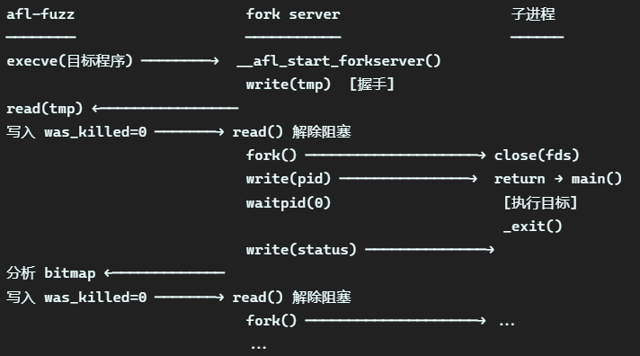


Persistent 模式（首轮 + 后续轮次）

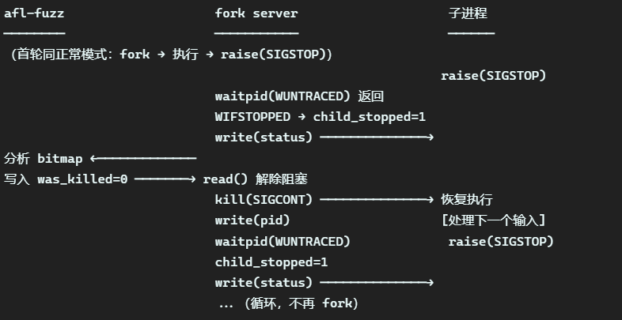


#### 3.4.3 **__afl_persistent_loop  持久化模式循环**

```c
int __afl_persistent_loop(unsigned int max_cnt) {

  static u8  first_pass = 1;
  static u32 cycle_cnt;

  if (first_pass) {

    if (is_persistent) {
      memset(__afl_area_ptr, 0, MAP_SIZE);
      __afl_area_ptr[0] = 1;
      __afl_prev_loc = 0;
    }

    cycle_cnt  = max_cnt;
    first_pass = 0;
    return 1;
  }

  if (is_persistent) {
    if (--cycle_cnt) {
      raise(SIGSTOP);
      __afl_area_ptr[0] = 1;
      __afl_prev_loc = 0;
      return 1;
    } else {
      __afl_area_ptr = __afl_area_initial;
    }
  }

  return 0;
}
```


**函数签名与静态变量**

```c
int __afl_persistent_loop(unsigned int max_cnt) {
  static u8  first_pass = 1;
  static u32 cycle_cnt;
```

**参数** `max_cnt`：用户指定的最大循环次数。通常由 `__AFL_LOOP(max_cnt)` 传入，比如 `__AFL_LOOP(10000)` 意味着最多执行 10000 次持久循环

**`static u8 first_pass = 1`**：标志位，记录是否是第一次进入该函数。初始值为 1（真）

**`static u32 cycle_cnt`**：倒计数器，初始值由 `max_cnt` 赋值，随后在每轮递减。因为是 `static`，它在多次调用间保持值


**第一次调用的处理**

```c
if (first_pass) {
    if (is_persistent) {
      memset(__afl_area_ptr, 0, MAP_SIZE);
      __afl_area_ptr[0] = 1;
      __afl_prev_loc = 0;
    }

    cycle_cnt  = max_cnt;
    first_pass = 0;
    return 1;
}
```

**为何要特殊处理第一次调用？**

在 persistent 模式中，程序启动后首先经过 fork server 建立（`__afl_start_forkserver`），然后创建一个子进程来执行目标代码。这个子进程进入用户定义的主循环（例如 `while (__AFL_LOOP(10000))`）。第一次进入循环体时，**当前进程内存中可能残留父进程或者初始化阶段产生的覆盖率数据**。为了保证每一轮 fuzz 的覆盖率统计是干净的，必须在第一次迭代开始前清空 bitmap

`first_pass` 标记就是为了执行这个**一次性初始化**


**`is_persistent` 检查**

`is_persistent` 是一个全局变量，由 AFL 运行时设置。如果目标程序被编译为 persistent 模式（通过 afl-clang-fast 的特定选项或链接相应库），该值为真。

如果不是 persistent 模式，`__afl_area_ptr` 指向共享内存，由 fork server 每轮重置，这里无需清空


**清空并设置哨兵**

`memset`：将整个共享内存 bitmap（64KB）全部清零，擦除所有之前的历史

`__afl_area_ptr[0] = 1`：写入哨兵字节（与 `__afl_map_shm()` 最后一行相同的目的）。防止因为覆盖率计数器全零而被 AFL 认为插桩未生效，进而丢弃种子

`__afl_prev_loc = 0`：重置前一个基本块 ID，确保下一轮从全新的状态开始追踪。由于这是线程局部变量，不会影响其他可能存在的线程，但现在清的是当前线程的状态


**初始化计数器并返回**

`ycle_cnt = max_cnt`：用参数设置倒计数器的初始值，例如 `max_cnt = 10000`，则 `cycle_cnt` 初始为 10000

`first_pass = 0`：清除标志，之后每次进入函数都会走另一个分支（非首次调用）


**非首次调用（后续迭代）的处理**

```c
if (is_persistent) {
    if (--cycle_cnt) {
      raise(SIGSTOP);
      __afl_area_ptr[0] = 1;
      __afl_prev_loc = 0;
      return 1;
    } else {
      __afl_area_ptr = __afl_area_initial;
    }
}
return 0;
```

从第二次调用 `__afl_persistent_loop()` 开始，`first_pass` 为 `0`，直接进入这个代码段

**递减计数器并判断**

```c
if (--cycle_cnt) {
```

先执行 `--cycle_cnt`（前置自减），然后判断剩余次数是否为非零

初始 `cycle_cnt = max_cnt`，第一次进入这里时递减为 `max_cnt - 1`，只要还有剩余次数（非零），就继续 persistent 循环


**暂停自己，等待下一轮**

```c
raise(SIGSTOP);
```

当前子进程向自己发送 `SIGSTOP` 信号，**立即暂停执行**

由于此前 `__afl_start_forkserver()` 中的 `waitpid` 使用了 `WUNTRACED` 标志，fork server 会收到子进程暂停的通知（`WIFSTOPPED(status)` 为真），然后 `child_stopped` 被设为 1

Fork server 随后向 afl-fuzz 报告状态，afl-fuzz 分析 bitmap 后，再通过管道命令 fork server 唤醒子进程（`kill(child_pid, SIGCONT)`）

暂停时，所有内存状态都被保留（共享内存 bitmap 内容依然存在，flushing 尚未发生）。Afl-fuzz 在这个窗口内读取 bitmap，判断是否有新路径


**被唤醒后的处理**

当子进程被 `SIGCONT` 唤醒后，从 `raise(SIGSTOP)` 之后的第一条语句开始继续执行

```c
__afl_area_ptr[0] = 1;
__afl_prev_loc = 0;
return 1;
```

**`__afl_area_ptr[0] = 1`**：再次写入哨兵字节。因为在上一轮执行过程中 bitmap 已经被写入各种计数，现在准备开始新一轮。写入哨兵保证即使本轮只触发极少数路径，bitmap 也不会全零

**`__afl_prev_loc = 0`**：重置上一个基本块 ID。这一步非常关键：每次循环迭代都从“干净”的控制流上下文开始，避免上一轮路径对本次边计算的影响。如果不重置，上一轮最后一个基本块的 ID 会与新一轮第一个基本块的 ID 异或，产生错误的边覆盖记录

**`return 1`**：告诉外层循环“继续执行”


**循环次数用尽时的清理**

```c
} else {
    __afl_area_ptr = __afl_area_initial;
}
```

当 `--cycle_cnt` 为 0（即已经执行了 `max_cnt` 次），进入 else 分支

**将 `__afl_area_ptr` 重定向回本地占位区域** `__afl_area_initial`

目的：**循环之后还有代码**（比如 `main()` 中 `__AFL_LOOP` 大括号之后的部分）。如果这些代码继续写入共享内存，会污染 bitmap，导致 afl-fuzz 收到不属于目标逻辑的覆盖率信号，干扰分析。通过将指针切换回“黑洞”缓冲区，后续代码的插桩写入被彻底丢弃

然后函数返回 0，告知外层循环“退出循环，不再执行”


**非 persistent 模式下的行为**

如果 `is_persistent` 为假（即程序没有启用 persistent 模式），函数直接跳过整个大 `if` 块，执行最后的 `return 0`。这意味着对于非 persistent 编译的目标，`__AFL_LOOP` 只会执行一次（第一次调用返回1，第二次调用直接返回0），循环体只运行一次，行为退化为普通的一次性程序


**loop**

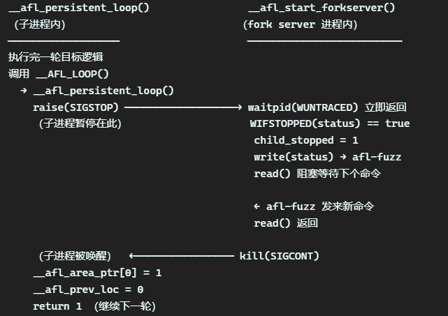


**完整执行时序（persistent 模式）**

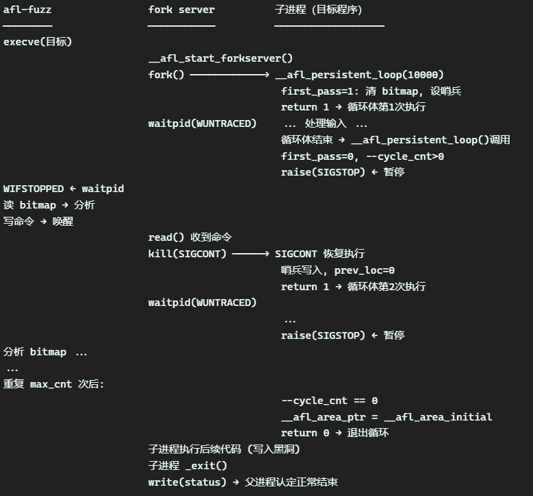


#### 3.4.4 **__afl_manual_init  延迟初始化**

```c
void __afl_manual_init(void) {
  static u8 init_done;
  if (!init_done) {
    __afl_map_shm();
    __afl_start_forkserver();
    init_done = 1;
  }
}
```

允许用户手动触发 AFL 初始化（共享内存映射 + fork server 启动）。通常用于“延迟模式”：通过环境变量 `AFL_DEFER_FORKSRV` 设置后，构造函数不会自动调用，而是由用户代码在合适的时机调用此函数

`init_done` 确保只初始化一次

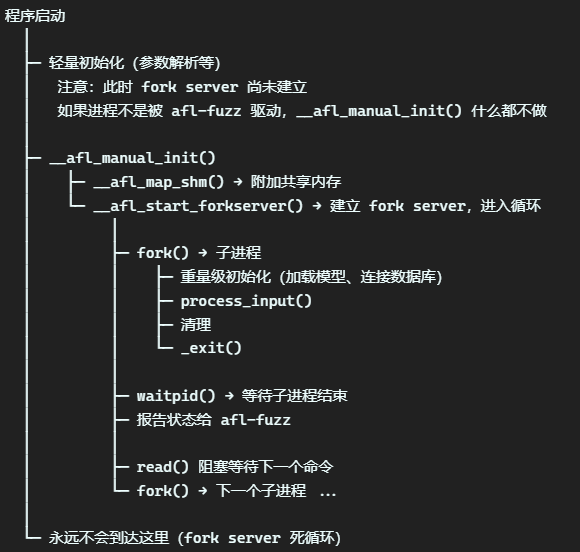


#### 3.4.5 **__afl_auto_init  自动初始化构造函数**

```c
__attribute__((constructor(CONST_PRIO))) void __afl_auto_init(void) {
  is_persistent = !!getenv(PERSIST_ENV_VAR);
  if (getenv(DEFER_ENV_VAR)) return;
  __afl_manual_init();
}
```

使用 GCC/Clang 的 `constructor` 属性，在 `main()` 之前自动运行

检查 `PERSIST_ENV_VAR`（`__AFL_PERSISTENT`）决定是否为持久化模式

若 `DEFER_ENV_VAR`（`__AFL_DEFER_FORKSRV`）存在，则跳过初始化，等待用户调用 `__afl_manual_init()`

否则直接调用 `__afl_manual_init()` 完成全部初始化


#### 3.4.6 **__sanitizer_cov_trace_pc_guard 兼容回调**

```c
void __sanitizer_cov_trace_pc_guard(uint32_t* guard) {
  __afl_area_ptr[*guard]++;
}
```

当使用 LLVM 原生的 `-fsanitize-coverage=trace-pc-guard` 插桩时，编译器会在每条边上调用此函数，参数是 `guard` 地址，其值为编译时分配的 ID

AFL 直接复用该 ID 作为共享内存索引，将对应计数器加 1，实现与传统 AFL 插桩相同的覆盖率收集效果


#### 3.4.7 __sanitizer_cov_trace_pc_guard_init 初始化回调

```c
void __sanitizer_cov_trace_pc_guard_init(uint32_t* start, uint32_t* stop) {
  u32 inst_ratio = 100;
  u8* x;

  if (start == stop || *start) return;

  x = getenv("AFL_INST_RATIO");
  if (x) inst_ratio = atoi(x);

  if (!inst_ratio || inst_ratio > 100) {
    fprintf(stderr, "[-] ERROR: Invalid AFL_INST_RATIO (must be 1-100).\n");
    abort();
  }

  *(start++) = R(MAP_SIZE - 1) + 1;

  while (start < stop) {
    if (R(100) < inst_ratio) *start = R(MAP_SIZE - 1) + 1;
    else *start = 0;
    start++;
  }
}
```


```c
void __sanitizer_cov_trace_pc_guard_init(uint32_t* start, uint32_t* stop)
```

- 这是 Clang SanitizerCoverage 规定的**标准回调**，编译器在链接时会为每个编译单元（.o 文件）自动生成对这个函数的调用
- **`start`**：指向一个 `uint32_t` 数组的起始位置，数组的每个元素对应一个插桩点（基本块或边）
- **`stop`**：指向该数组的末尾（最后一个元素的下一个位置）
- 数组的每个元素初始值为 `0`。这个函数的作用是**为每个插桩点分配一个非零的随机 ID**，作为覆盖率追踪时的"位置标识"


**变量声明**

```c
u32 inst_ratio = 100;
u8* x;
```

- `inst_ratio`：插桩比例，默认 100（全部插桩）
- `x`：用于读取环境变量


**去重与边界检查**

```c
if (start == stop || *start) return;
```

| 条件            | 含义                                                 |
| --------------- | ---------------------------------------------------- |
| `start == stop` | 数组为空，没有插桩点，直接返回                       |
| `*start`        | 数组的第一个元素已经非零，说明这个回调已经被调用过了 |


**读取插桩比例**

```c
x = getenv("AFL_INST_RATIO");
if (x) inst_ratio = atoi(x);

if (!inst_ratio || inst_ratio > 100) {
    fprintf(stderr, "[-] ERROR: Invalid AFL_INST_RATIO (must be 1-100).\n");
    abort();
}
```

从环境变量 `AFL_INST_RATIO` 读取用户设定的插桩比例

合法性检查：必须介于 1 到 100 之间

与之前 LLVM Pass 中的 `inst_ratio` 逻辑完全一致，用户可通过降低比例减少插桩开销


**强制设置第一个元素**

```c
*(start++) = R(MAP_SIZE - 1) + 1;
```

- `R(MAP_SIZE - 1)` 生成 `[0, 65534]` 的随机数，加 1 后范围为 `[1, 65535]`
- **保证非零**：因为后续用 `*start` 是否非零来判断是否已初始化，第一个元素必须非零
- **立即递增 `start`**：指针前移，后续的 `while` 循环从第二个元素开始处理


**为剩余插桩点分配 ID**

```c
while (start < stop) {
    if (R(100) < inst_ratio) *start = R(MAP_SIZE - 1) + 1;
    else *start = 0;
    start++;
}
```

| 情况                   | 概率                | 分配的值            | 含义               |
| ---------------------- | ------------------- | ------------------- | ------------------ |
| `R(100) < inst_ratio`  | `inst_ratio%`       | `[1, 65535]` 随机数 | 该位置**启用**插桩 |
| `R(100) >= inst_ratio` | `100 - inst_ratio%` | `0`                 | 该位置**禁用**插桩 |

插桩代码（`__sanitizer_cov_trace_pc_guard`）在每次基本块执行时会检查 guard 值，如果为 0 则跳过记录


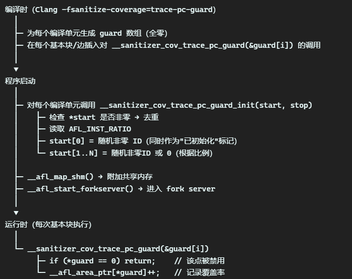


**整体工作流程总结**

| 函数                                  | 触发时机                  | 功能                                            |
| ------------------------------------- | ------------------------- | ----------------------------------------------- |
| `__afl_auto_init`                     | 程序加载时（constructor） | 判断模式，自动或延迟调用 `__afl_manual_init`    |
| `__afl_map_shm`                       | 初始化阶段                | 与 fuzzer 进程的共享内存建立映射                |
| `__afl_start_forkserver`              | 初始化阶段                | 进入 fork server 循环，替代 fuzzer 执行测试用例 |
| `__afl_persistent_loop`               | 用户代码循环中            | 无 fork 方式重复执行测试，提升吞吐量            |
| `__sanitizer_cov_trace_pc_guard`      | 每次边执行                | 更新共享内存计数器（原生 trace-pc-guard 模式）  |
| `__sanitizer_cov_trace_pc_guard_init` | LLVM 初始化时             | 随机分配 guard ID，支持插桩比例控制             |


## 4. afl-fuzz

### 概述

**在展开流程前，需了解 `afl-fuzz.c` 中定义的两个核心结构**

1. **种子队列 (`struct queue_entry`)**：一个链表结构，用于存放所有被纳入关注范围的测试用例（种子），包括初始种子和模糊测试过程中发现的有趣用例。每个节点记录了文件路径、长度、执行时间、执行路径校验和、以及是否触发新覆盖等关键元数据
2. **共享内存 Bitmap**：一块大小为 `MAP_SIZE`（通常64KB）的共享内存，是 `afl-fuzz` 与目标程序交互的核心。程序的插桩代码会将每个基本块边（edge）的命中次数（hit count）记录于此。`afl-fuzz` 通过分析这块内存来感知程序执行路径的变化


**主流程概览**

`afl-fuzz.c` 的 `main` 函数和主循环涵盖了从启动到结束的完整生命周期，可划分为以下几个关键阶段：

1. **初始化阶段** 在进入主循环前，会执行大量准备工作，包括：解析命令行参数（如输入/输出目录、超时时间、并行模式等）；设置信号处理器以在用户终止时清理环境；初始化共享内存（`setup_shm`）；加载初始测试用例到队列中（`read_testcases`）；以及设定CPU亲和性以提升性能等

2. **Dry Run（试运行）与校准** 通过 `perform_dry_run` 函数对初始队列中的所有用例进行“校准”（`calibrate_case`）。此过程会启动目标程序并运行每个用例多次（默认8次），主要目的是：

   > **检查程序稳定性**：核实单个用例多次运行是否产生一致的路径，识别出行为多变的用例。
   >
   > **确认覆盖率有效**：确认程序确实产生了覆盖率反馈。
   >
   > **建立性能基线**：记录每个用例的执行时间，用于后续的种子打分和优先级排序。
   >
   > **初始化 Fork Server**：在第一次运行目标程序时，会启动独立的 `fork server` 进程，用于后续所有测试的快速执行

   

3. **主模糊循环（Fuzzing Loop）** 这是模糊测试持续运行的核心，其逻辑是一个无限循环，主要包含以下操作：

   > **精简队列（`cull_queue`）**：应用一种贪婪算法，从庞大的种子队列中选出一个较小的“favored”子集，使其依然能覆盖当前已知的所有代码边。这种方法能在不牺牲覆盖率的情况下，将算力集中在更有代表性的种子上
   >
   > **选择与变异（`fuzz_one`）**：这是循环的灵魂。函数会从队列中挑选一个种子，并对其进行一系列确定性和随机性的变异操作。确定阶段包括位翻转（bit flips）、简单算术运算（arithmetic）、插入已知有趣整数值（known integers）等；随机阶段则包括随机位翻转、随机字节设置、拼接（splicing，将两个种子片段组合）等
   >
   > **执行与追踪（`run_target`）**：将变异生成的新测试用例写入文件（或标准输入），然后通过 `fork server` 启动一个子进程执行目标程序。子进程运行完成后，其覆盖率和执行状态（正常退出、超时、崩溃）将被返回 
   >
   > 分析结果并更新队列：分析执行返回的状态和共享内存中的 bitmap 数据。如果发现：
   >
   > > **崩溃（Crash）**：将触发崩溃的用例保存到 `crashes/` 目录，并将其加入队列以进行更深入的崩溃模式探索。
   > >
   > > **超时（Timeout）**：如果用例执行时间过长，通常会被丢弃，除非处于特殊模式
   > >
   > > **新路径（New Path）**：如果 `has_new_bits` 分析发现当前用例触发了一个全新的边（edge），或者命中次数（hit count bucket）出现了新的范围，就将该用例视为“有趣（interesting）”的，将其添加到种子队列中。这是AFL实现反馈驱动、逐步深入探索程序状态空间的核心机制
   
   
   
4. **终止与清理** 当用户发出中断信号或发现特定目标时，循环终止，程序会保存当前状态并清理资源。


### 4.1 fuzz准备阶段

该文件代码八千行过多,所以我们从核心函数开始分析,这里先从main函数开始分析


#### 4.1.1 参数解析

```
s32 opt;
```

`getopt` 的返回值，接收当前解析到的选项字符（`'i'`/`'o'`/`'t'`...）。循环条件 `> 0`，为 `-1` 时解析结束


```c
u64 prev_queued = 0;
```

记录**上一轮结束时的路径总数**，用来判断"本轮有没有新发现"。主循环里 `queued_paths == prev_queued` 成立 → 整轮无新路径 → 触发 splice/累加 `cycles_wo_finds`


```c
u32 sync_interval_cnt = 0, seek_to;
```

`sync_interval_cnt`：同步计数器，`!(++cnt % SYNC_INTERVAL)` 时执行 `sync_fuzzers`，控制并行实例交换用例的节奏

`seek_to`：**断点续跑偏移量**。`find_start_position()` 算好恢复起点，主循环一轮开始时用 

```c
while(seek_to) { current_entry++; seek_to--; queue_cur = queue_cur->next; }
```

 跳到上次中断的条目


```c
u8 *extras_dir = 0;
```

`-x` 字典目录路径，仅当 `-x` 传入时才非空


```c
u8 mem_limit_given = 0;
```

标记 `-m` 是否显式给出。关键作用：`-Q`（QEMU）分支里 

```c
if (!mem_limit_given) mem_limit = MEM_LIMIT_QEMU;
```

用户没给内存限制时，QEMU 模式自动改用更大的默认值


```c
u8 exit_1 = !!getenv("AFL_BENCH_JUST_ONE");
```

`!!` 把"存在/不存在"折叠成 0/1。设了 `AFL_BENCH_JUST_ONE` → 基准模式，主循环里 `if (exit_1) stop_soon = 2;`，**跑完一条输入就程序性停止**。


```c
char** use_argv;
```

实际执行目标用的 argv。QEMU 模式下由 `get_qemu_argv()` 重写（在前面包一层 qemu），否则指向 `argv + optind`。之后所有执行相关的函数（`fuzz_one`/`perform_dry_run`/`run_target`）都传它


```c
struct timeval tv;
struct timezone tz;
```

`gettimeofday(&tv, &tz)` 的接收结构，取当前时间（秒+微秒）作为随机种子：`srandom(tv.tv_sec ^ tv.tv_usec ^ getpid())`


```c
SAYF(cCYA "afl-fuzz " cBRI VERSION cRST " by <lcamtuf@google.com>\n");
```

`SAYF`是 `printf` 的封装


```c
doc_path = access(DOC_PATH, F_OK) ? "docs" : DOC_PATH;
```

> `access(path, F_OK)` 检查文件是否存在：
>
> **返回 0（存在）** → 取 `"docs"`（当前目录下的相对路径）
> 
>**返回非 0（不存在）** → 取编译期默认绝对路径 `DOC_PATH`


```c
gettimeofday(&tv, &tz);                    // 取当前时间
srandom(tv.tv_sec ^ tv.tv_usec ^ getpid());// 混合秒+微秒+pid 做种子
```

> `srandom()` 初始化 `rand()` 的伪随机序列。三个因子：
>
> ​	`tv_sec`：秒级时间
>
> ​	`tv_usec`：微秒级（两个进程同一秒启动也能区分）
>
> ​	`getpid()`：进程 PID（同名同秒并发运行也不会重复）


#### 4.1.2 while循环与switch

##### 4.1.2.1 入口

```c
while ((opt = getopt(argc, argv, "+i:o:f:m:b:t:T:dnCB:S:M:x:QV")) > 0)
    switch (opt) {......}
```

> 每次取一个选项，直到返回 `-1` 停止
>
> 格式串里**冒号 = 带参**（`i:o:f:m:b:t:T:x:M:S:`），无冒号 = 纯开关（`dnCBQV`）
>
> `+` 前缀禁止参数重排，保证 `-n -d` 这类开关与带参选项混排不出错
>
> `switch(opt)` 每个 case 对应一个选项


下列是switch语句的分析

```c
switch (opt) { .......}
```

**简单赋值类 case**

##### **4.1.2.2 -i  （输入目录）**

```c
case 'i': /* input dir */
	if (in_dir) FATAL("Multiple -i options not supported");
	in_dir = optarg;
	if (!strcmp(in_dir, "-")) in_place_resume = 1;
	break;
```

特例：`-i -` 表示**原地续跑**，直接在上一次的输出目录里继续，不重新搬运种子

后续部分**`-o` / `-f` / `-x` / `-T` / `-S`** 为纯赋值：`out_dir`（输出目录）、`out_file`（目标输入文件）、`extras_dir`（字典）、`use_banner`（横幅）、`sync_id`（从实例 ID）。`-S` 与 `-M` 共用 `sync_id` 变量，所以**互斥**


**复杂逻辑类 case**

##### **4.1.2.3 -M  （主实例 + 可选分片）**

```c
case 'M': { /* master sync ID */
    u8* c;
    if (sync_id) FATAL("Multiple -S or -M options not supported");
	sync_id = ck_strdup(optarg);                // 深拷贝原串
	if ((c = strchr(sync_id, ':'))) {           // 找冒号 → 存在分片语法
    	*c = 0;                                 // 原地截断: "master:2/8"→"master"
    	if (sscanf(c+1, "%u/%u", &master_id, &master_max) != 2 ||  // 解析 "2/8"
       		 !master_id || !master_max ||        // 编号不能为 0,总数不能为 0
       		 master_id > master_max ||           // id 不能超总数
       		 master_max > 1000000)               // 上限 100 万
       		 FATAL("Bogus master ID passed to -M");  // 任一为真 → FATAL("Bogus master ID passed to -M") 直接退出
}
force_deterministic = 1;                    // 主实例强制跑全量确定性阶段
```

strchr  加上  *c=0` 是"原地拆分字符串"的惯用法；主实例通过 `exec_cksum % master_max 切分队列，让多个主实例各负责一部分路径

```c
sscanf(c+1, "%u/%u", &master_id, &master_max) != 2
```

> `sscanf` 返回**成功赋值（%u 转换）的字段数**。`"%u/%u"` 严格要求 `数字/数字`：
>
> ​	`"2/8"` → 解析出 2、8，返回 `2` 
>
> ​	`"abc/def"`、`"2/8extra"`、只有一个数字 → 返回 `< 2` 

`%u` 只接受无符号十进制，拒绝负数，所以无需额外检查符号。斜杠 `/` 是格式串里的**字面字符**，必须逐字匹配


##### **4.1.2.4 -t  （超时）**

```c
case 't': { /* timeout */
	u8 suffix = 0;

     if (timeout_given) FATAL("Multiple -t options not supported");

     if (sscanf(optarg, "%u%c", &exec_tmout, &suffix) < 1 ||
         optarg[0] == '-') FATAL("Bad syntax used for -t");

     if (exec_tmout < 5) FATAL("Dangerously low value of -t");

     if (suffix == '+') timeout_given = 2; else timeout_given = 1;
     break;
```


```c
if (sscanf(optarg, "%u%c", &exec_tmout, &suffix) < 1 ||
    optarg[0] == '-') FATAL("Bad syntax used for -t");
```

两个判定：

> **`sscanf(...) < 1`**  必须解析出数字  `"%u%c"` 的行为：
>
> ​	`"1000"` → 解析出 `exec_tmout=1000`，`suffix` 保持初始值 `0`，返回 `1`
>
> ​	`"1000+"` → 解析出 `exec_tmout=1000`，再读一个字符存进 `suffix='+'`，返回 `2`
>
> ​	`"abc"` → 第一个 `%u` 就失败，返回 `0` → FATAL

`suffix` 预初始化为 `0`，是为了"没有后缀"时能明确区分"没读到"（0）和"读到 `+`"（`'+'`）

**`optarg[0] == '-'`**  拒绝负号开头 `-t -1000`、`-t -` 这种都直接报语法错误。`%u` 本身只认无符号数，但对 `"-1000"` 它会把 `-` 当分隔符而可能解析出 `1000`，所以这里**显式拦掉负号**，避免 `-t -1` 被误读成 `1ms`


```c
if (exec_tmout < 5) FATAL("Dangerously low value of -t");
```

5ms 以下是不可用的：`setitimer` 的定时粒度 + forkserver 握手开销决定了下限。`-t 1` 会导致绝大多数输入被误判超时


```c
if (suffix == '+') timeout_given = 2; else timeout_given = 1;
```

`timeout_given` 从此变成**三态标志**：

| 值   | 来源       | 语义                           |
| :--- | :--------- | :----------------------------- |
| `0`  | 未给 `-t`  | 交给 `find_timeout()` 自动校准 |
| `1`  | `-t 1000`  | **严格**：超时即致命错误       |
| `2`  | `-t 1000+` | **容忍**：超时条目跳过，不中断 |


##### **4.1.2.5 -m  （内存）**

```c
case 'm': { /* mem limit */

          u8 suffix = 'M';

          if (mem_limit_given) FATAL("Multiple -m options not supported");
          mem_limit_given = 1;		// 标记显式给出

          if (!strcmp(optarg, "none")) { mem_limit = 0; break; } 

          if (sscanf(optarg, "%llu%c", &mem_limit, &suffix) < 1 ||
              optarg[0] == '-') FATAL("Bad syntax used for -m");

          switch (suffix) {

            case 'T': mem_limit *= 1024 * 1024; break;
            case 'G': mem_limit *= 1024; break;		
            case 'k': mem_limit /= 1024; break;		
            case 'M': break;						 

            default:  FATAL("Unsupported suffix or bad syntax for -m");

          }
          if (mem_limit < 5) FATAL("Dangerously low value of -m");

          if (sizeof(rlim_t) == 4 && mem_limit > 2000)			
            FATAL("Value of -m out of range on 32-bit systems");
        }
        break;
```

```c
u8 suffix = 'M';                          // 默认后缀 = MB
if (mem_limit_given) FATAL("Multiple -m options not supported");
mem_limit_given = 1;
if (!strcmp(optarg, "none")) { mem_limit = 0; break; }
```

> **`suffix = 'M'` 预置**很关键：与 `-t` 的 `suffix=0` 不同，因为 `-m` 的**默认单位就是 MB，**用户写 `-m 100` 就该理解为 100 MB。预置 `'M'` 让"没写后缀"直接落入 `case 'M': break`（不变换）
>
> `mem_limit_given` ：防重哨兵 + 给 `-Q` 用的"用户是否显式给了内存"标记
>
> `-m none` → `mem_limit = 0`，语义是"**不限制**"（后续所有 `if (mem_limit)` 判断都把它当"关掉内存限制"）


```c
if (sscanf(optarg, "%llu%c", &mem_limit, &suffix) < 1 ||
    optarg[0] == '-') FATAL("Bad syntax used for -m");
```

> 用 **`%llu`**（64 位）解析，因为 `mem_limit` 是 `u64`，支持大内存值
>
> `%llu%c` 模式：数字 + 可选单位字符。`"50"` → 返回 1，suffix 保持 `'M'`；`"2G"` → 返回 2，suffix=`'G'`
>
> `optarg[0] == '-'`：拦负号，同 `-t`


```c
switch (suffix) {
    case 'T': mem_limit *= 1024 * 1024; break;   // TB → MB
    case 'G': mem_limit *= 1024;        break;   // GB → MB
    case 'k': mem_limit /= 1024;        break;   // KB → MB
    case 'M': break;                             // 本身是 MB
    default:  FATAL("Unsupported suffix or bad syntax for -m");
}
```

| 输入      | 换算              | 结果(MB)            |
| --------- | ----------------- | ------------------- |
| `-m 100`  | 100 × 1（默认 M） | 100                 |
| `-m 2G`   | 2 × 1024          | 2048                |
| `-m 1T`   | 1 × 1024 × 1024   | 1048576             |
| `-m 512k` | 512 ÷ 1024        | 0.5 → 0（注意截断） |
| `-m none` | 特例              | 0 = 不限制          |


```c
if (mem_limit < 5) FATAL("Dangerously low value of -m");
if (sizeof(rlim_t) == 4 && mem_limit > 2000)
    FATAL("Value of -m out of range on 32-bit systems");
```

> `< 5`：5MB 以下连动态链接器都跑不起来
>
> **32 位系统限制**：`sizeof(rlim_t) == 4` 表示 `setrlimit` 上限类型只有 4 字节（最大 ~2GB）。此时 `mem_limit > 2000` 已无意义（虚拟内存上限），直接报错。注意这是**运行时判断但编译期可确定**的写法，用条件语句而非 `#if` 是为了同一份代码兼容 32/64 位平台

**`init_forkserver()`（2034 行）**：

```c
if (mem_limit) {
    r.rlim_max = r.rlim_cur = ((rlim_t)mem_limit) << 20;   // MB → 字节
    setrlimit(RLIMIT_AS, &r);   // 或 RLIMIT_DATA (OpenBSD)
}
```

`mem_limit`（MB）左移 20 位 = ×2²⁰ = 转成字节，作为子进程的地址空间上限，是**防 OOM 崩溃**的关键。

**`-Q` 联动**（7969 行）：

```c
if (qemu_mode) {
    if (!mem_limit_given) mem_limit = MEM_LIMIT_QEMU;}
```

QEMU 模式每个执行要多带一个模拟器进程，内存占用大。用户**没显式给 `-m`** 时自动放宽到 `MEM_LIMIT_QEMU`；给了就尊重用户的选择


##### **4.1.2.6 -b  （CPU 绑定）**

```c
case 'b': { /* bind CPU core */

          if (cpu_to_bind_given) FATAL("Multiple -b options not supported");
          cpu_to_bind_given = 1;

          if (sscanf(optarg, "%u", &cpu_to_bind) < 1 ||
              optarg[0] == '-') FATAL("Bad syntax used for -b");

          break;
```

> **防重**：同 `-t`/`-m` 模板，`cpu_to_bind_given` 兼作哨兵
>
> **`%u` 纯数字，无后缀**：核心编号就一个整数，不需要单位换算
>
> **负号拦截**：防止 `-b -1` 被 `%u` 部分解析
>
> 与 `-t`/`-m` 的区别：**没有下限检查**，`-b 0` 合法（CPU 0 是第一个核），校验交给下游 `bind_to_free_cpu()` 

**下游  bind_to_free_cpu()（412 行）**

`main()` 里 `-b` 解析后，`get_core_count()` 拿到核数，然后进入 `bind_to_free_cpu()`。它会先扫描 `/proc/<pid>/status` 里的 `Cpus_allowed_list`，标记所有已被进程占用的核（`cpu_used[]`），然后：

```c
if (cpu_to_bind_given) {                        // 用户给了 -b
    if (cpu_to_bind >= cpu_core_count)
        FATAL("core id should be between 0 and %u");  // 越界检查
    if (cpu_used[cpu_to_bind])
        FATAL("core #%u is not free!");               // 占用检查
    i = cpu_to_bind;                                  // 用用户指定的核
} else {
    for (i = 0; i < cpu_core_count; i++)
        if (!cpu_used[i]) break;                      // 自动找第一个空闲核
}
if (i == cpu_core_count)
    FATAL("No more free CPU cores");                  // 全被占了
cpu_aff = i;
CPU_ZERO(&c); CPU_SET(i, &c);
sched_setaffinity(0, sizeof(c), &c);                  // 实际绑定
```

**`-b` 在这里的语义**：用户指定核心 + **强校验**（越界/被占用都直接 FATAL）。不指定 `-b` 时 AFL 自动挑选空闲核


##### **4.1.2.7 -d  （跳过确定性）**

```c
      case 'd': /* skip deterministic */

        if (skip_deterministic) FATAL("Multiple -d options not supported");
        skip_deterministic = 1;
        use_splicing = 1;
        break;
```

核心是两个全局标志

**`skip_deterministic` 的下游影响（fuzz_one，5149 行）**

```c
if (skip_deterministic || queue_cur->was_fuzzed || queue_cur->passed_det)
    goto havoc_stage;   // 直接跳过全部确定性阶段，进入 havoc
```

它砍掉的是 `fuzz_one()` 里**最耗时**的一段：`bitflip`(6 级) → `arith` → `interest` → `extras`。这些阶段每个都要**穷举整个输入空间**，代价是 `O(文件大小 × 位数)` 次执行，非常慢。`-d` 跳过它们，只做随机化的 `havoc`，执行次数锐减，**吞吐量大增**，但丢失了系统的穷举搜索

**`use_splicing = 1` 的作用**

`splice` 是 `fuzz_one` 末尾的"最后手段"：随机选另一条队列输入，在差异区间拼接，再进 havoc。它本来的触发条件（主循环 8120 行）是：

```c
if (queued_paths == prev_queued) {        // 整轮无新发现
    if (use_splicing) cycles_wo_finds++;
    else use_splicing = 1;                // 第一次无发现 → 开启 splice
}
```

正常情况下，AFL 要等**一整轮无收获**才打开 splice。但 `-d` 场景下逻辑是：

> 确定性阶段被跳过 → 系统性的穷举发现机制没了 → 发现新路径的能力打折 → 没必要等一整轮，于是直接从第一轮就把 splice 打开，尽早提供额外的重组式变异。

这就是为什么 `-d` 会**连带 `use_splicing = 1`**的原因，因为它是"补偿确定性阶段缺失"的配套开关


##### **4.1.2.8 -B  （加载位图)**

```c
case 'B': /* load bitmap */
	if (in_bitmap) FATAL("Multiple -B options not supported");
	in_bitmap = optarg;
	read_bitmap(in_bitmap);   // 解析阶段就立即读入
	break;
```

防重 + 立即执行 `read_bitmap`，与其他"存起来后面用"的选项不同（`-x` 存 `extras_dir` 到后面 `load_extras` 才读）

**`read_bitmap()`：一次文件读取**

```c
EXP_ST void read_bitmap(u8* fname) {        // 886行
    s32 fd = open(fname, O_RDONLY);
    ck_read(fd, virgin_bits, MAP_SIZE, fname);   // 读进 virgin_bits
    ...
}
```

**把历史 bitmap 原样载入 `virgin_bits`**

关键在 `virgin_bits` 的语义和 `setup_shm` 的联动


**核心机制：`setup_shm()` 的分支**

```c
EXP_ST void setup_shm(void) {               // 1371行
    if (!in_bitmap) memset(virgin_bits, 255, MAP_SIZE);   // ← 无 -B
    memset(virgin_tmout, 255, MAP_SIZE);                  // hang 专用
    memset(virgin_crash, 255, MAP_SIZE);                  // crash 专用
    ...
}
```

**`virgin_bits` 每个字节初始为 0xFF（全 1）**，含义是"该路径还没被探索"。每次执行后 `has_new_bits()` 把见过的位清 0：

```c
static inline u8 has_new_bits(u8* virgin_map) {   // 907行
    ... current = trace_bits; virgin = virgin_map;
    // 有 current 位为 1 而 virgin 位为 0 → 新路径
}
```

> **无 `-B`**：`memset` 把 `virgin_bits` 置全 1 → 所有路径都是"新"的，从头积累
>
> **有 `-B`**：跳过 `memset`，`virgin_bits` 保持 `read_bitmap` 载入的历史状态 → 旧路径对应的位**已经是 0** → `has_new_bits` 对它们返回 0 → **永远不会被当作新发现重复入库**

配合 `write_bitmap()`（863 行，把 `virgin_bits` 存成 `fuzz_bitmap`）形成闭环：

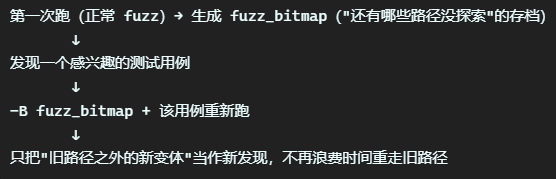


##### **4.1.2.9 -C	(crash 模式)**

```c
case 'C': /* crash mode */
  if (crash_mode) FATAL("Multiple -C options not supported");
  crash_mode = FAULT_CRASH;
  break;
```

crash_mode **赋值是 `FAULT_CRASH`**（枚举值 2）

**`crash_mode = FAULT_CRASH` 的深层含义**

看全局定义（127 行）：`static u8 crash_mode`，初始 0。而 `FAULT_CRASH` 来自故障枚举（330 行）：

```c
enum { FAULT_NONE=0, FAULT_TMOUT=1, FAULT_CRASH=2, FAULT_ERROR=3, FAULT_NOINST=4, FAULT_NOBITS=5 };
```

把它赋成 `FAULT_CRASH` 后，整个代码里形如 **`fault == crash_mode`** 的比较就变成"**这次执行是否崩溃**"。它把"找崩溃"从一种特殊处理**统一成普通的路径寻找**，崩溃被当成"目标路径"来 hunt


**下游的三处联动**

**`save_if_interesting()`（3170 行）**

```c
if (fault == crash_mode) {                 // 只有崩溃才进来
    if (!(hnb = has_new_bits(virgin_bits))) {
        if (crash_mode) total_crashes++;   // 非新路径的崩溃也计数
        return 0;
    }
    ... add_to_queue(...)                  // 崩溃被当成新路径入库！
}
```

注意：**崩溃样本会被 `add_to_queue` 加入变异队列继续 fuzz**。`-C` 模式下，AFL 把"会崩溃的输入"当成普通种子，继续 mutate 它去找更多崩溃变体，这就是 crash mode 的狩猎逻辑。

**`calibrate_case()`（2627 行）**

```c
if (stop_soon || fault != crash_mode) goto abort_calibration;
```

标定时**只有崩溃才算有效执行**，不崩溃的执行直接废弃重试

**`perform_dry_run()`（2784 行）**

```c
case FAULT_NONE:
    if (crash_mode) FATAL("Test case '%s' does *NOT* crash", fn);
```

干跑时如果初始种子**不崩溃**，`-C` 模式直接 FATAL，种子必须都是会崩溃的


**互斥检查（main 里，8001 行）**

```c
if (dumb_mode) {
    if (crash_mode) FATAL("-C and -n are mutually exclusive");
    if (qemu_mode)  FATAL("-Q and -n are mutually exclusive");
}
```

这段**只**检查 `-C`/`-Q` 与 `-n` 的矛盾

所以`-C` 只与 `-n`（dumb）互斥，**不**与 `-Q` 互斥。理由：崩溃去重依赖 bitmap 签名（`virgin_crash`），而 dumb 模式无插桩、没有可靠 bitmap，无法区分"新崩溃"和"同一个崩溃"

典型用法是"**崩溃 triage 后的再挖掘**"：


##### **4.1.2.10 -n	(dumb 模式)**

```c
case 'n': /* dumb mode */
  if (dumb_mode) FATAL("Multiple -n options not supported");
  if (getenv("AFL_DUMB_FORKSRV")) dumb_mode = 2; else dumb_mode = 1;
  break;
```

> 防重用 `dumb_mode` 本身做哨兵（初始 0）
>
> `dumb_mode` 三态：
>
> ​	`0`：正常模式（目标已插桩）
>
> ​	`1`：纯 dumb（每次 fork+exec）
>
> ​	`2`：dumb + 目标带了 dumb forkserver

**`AFL_DUMB_FORKSRV` 决定dumb_mode为 1 还是 2**

普通目标的 forkserver 握手桩是插桩汇编注入的但是  dumb 目标没有这段汇编，目标自身**不会**启动 forkserver。但可以给目标 `LD_PRELOAD` 一个库（如 `afl-dumb-fork-server.so`），它 hook 掉目标进程，让它在启动时用 `FORKSRV_FD`/`FORKSRV_FD+1` 两个约定 fd 与 AFL 完成握手，然后驻留 fork 子进程。`AFL_DUMB_FORKSRV` 环境变量就是告诉 AFL：" dumb 目标已经被预加载库包裹，可以走 forkserver 通道"


**下游关键分歧：`run_target()`（2313 行）**

```c
if (dumb_mode == 1 || no_forkserver) {
    child_pid = fork();           // 每次调用都 fork+execv（最慢）
    ...
    execv(target_path, argv);
} else {
    write(fsrv_ctl_fd, ...);      // 走 forkserver 通道
    read(fsrv_st_fd, &child_pid, 4);
}
```

| 模式             | 执行方式                    | 速度         |
| :--------------- | :-------------------------- | :----------- |
| `dumb_mode == 0` | 插桩目标自带 forkserver     | 最快         |
| `dumb_mode == 2` | preload 库模拟的 forkserver | 快           |
| `dumb_mode == 1` | 每次 `fork+execv`           | 慢一个数量级 |

这就是 1 和 2 存在的意义：**`2` 让 dumb 目标也能享受 forkserver 的性能**，代价是必须有人给目标注入模拟库


**无插桩带来的连锁能力损失**

`dumb_mode` 在代码里出现在所有"依赖 bitmap 反馈"的分支前：

| 位置                            | 效果                                                         |
| :------------------------------ | :----------------------------------------------------------- |
| `setup_shm`（1392）             | `if (!dumb_mode) setenv(SHM_ENV_VAR,...)`，不暴露插桩环境，防止 dumb 目标误判 |
| `fuzz_one` 自动字典（5219）     | 跳过 token 提取（无路径可比较）                              |
| `fuzz_one` effector map（5376） | 全部字节都当有效（无法判断"翻转无影响"）                     |
| `trim_case`（5117）             | 跳过精简（`cksum == exec_cksum` 无从比较）                   |
| `cull_queue`（1322）            | `if (dumb_mode) return;` 跳过精英策略                        |
| `save_if_interesting`（3230）   | 崩溃/hang 跳过 bitmap 去重                                   |

净效果：dumb 模式会退化成**纯随机变异 + 盲收集**，没有路径增量、去重、精简，只能靠 `havoc` 乱撞


**互斥检查（main，8001 / 8017 行）**

```c
if (dumb_mode) {
    if (crash_mode) FATAL("-C and -n are mutually exclusive");   // 无 bitmap 无法 crash 去重
    if (qemu_mode)  FATAL("-Q and -n are mutually exclusive");   // QEMU 会注入插桩，矛盾
}
if (dumb_mode == 2 && no_forkserver)
    FATAL("AFL_DUMB_FORKSRV and AFL_NO_FORKSRV are mutually exclusive");
```

**使用场景**

> 当目标**无法插桩**时兜底：
>
> ​	闭源/无源码二进制，且不想用 `-Q`
>
> ​	自带的汇编工具链无法处理的目标
>
> ​	作者在 README 里也强调：**先试 `-Q`，实在不行才用 `-n`**，因为 dumb 模式效率低得多


##### **4.1.2.11 -q	(QEMU 模式)**

```c
case 'Q': /* QEMU mode */
  if (qemu_mode) FATAL("Multiple -Q options not supported");
  qemu_mode = 1;
  if (!mem_limit_given) mem_limit = MEM_LIMIT_QEMU;
  break;
```

第三行是**全文里 `mem_limit_given` 被使用的第二处**（第一处在 `-m` case）


**`mem_limit_given` 联动：为什么 QEMU 要 200MB**

```c
// config.h
#define MEM_LIMIT      25        // 32位 原生默认 (65行)
#define MEM_LIMIT      50        // 64位 原生默认 (67行)
#define MEM_LIMIT_QEMU 200       // QEMU 默认 (72行)
```

> 逻辑：
>
> ​	用户显式给了 `-m`（`mem_limit_given=1`）→ **使用用户的选择**，不覆盖
>
> ​	用户未给 → 用 `MEM_LIMIT_QEMU`（200MB）代替默认的 25/50MB

**为什么 QEMU 需要 4~8 倍内存**：QEMU 用户态模拟器里，目标程序的"虚拟内存"全部由 QEMU 进程承担，包括模拟的 guest 内存 + JIT 翻译缓存（TCG）。同一个程序在 QEMU 下跑，宿主侧实际占用远高于原生。25MB 的限制在 QEMU 下连动态链接都过不去（`init_forkserver` 的 OOM 诊断里就专门提到这个坑）

`mem_limit_given` 这个"用户是否显式给过 -m"的哨兵，在此发挥第二职责，**自动放宽但不越权**


**QEMU 模式原理**

常规路径：`afl-gcc` 编译时静态插桩（汇编注入基本块计数）。`-Q` 路径**不需要目标源码**：

> 目标二进制（未插桩）→ afl-qemu-trace（打了补丁的用户态 QEMU）
>
>    在翻译/执行每条指令时动态插桩 → 同样更新共享内存 bitmap

插桩从"编译期"挪到"运行期"，代价是**每条指令都经翻译层，慢 2~5 倍**，所以 `show_init_stats` 里对 QEMU 模式的"过慢告警阈值"也放宽了（4432 行：`avg_us > (qemu_mode ? 50000 : 10000)`）


**下游 argv 重写：`get_qemu_argv()`（7675 行）**

`main` 里（8065 行）用它对 `use_argv` 做整体替换：

```c
use_argv = get_qemu_argv(argv[0], argv + optind, argc - optind);
```

它构造的新 argv：

```c
setenv("QEMU_LOG", "nochain", 1);        // 稳定性 workaround（关掉 chaining 优化）
new_argv[0] = afl-qemu-trace;            // 前面换成 QEMU 包装器
new_argv[1] = "--";
new_argv[2] = target_path;               // 原目标变成它的参数
new_argv[3..] = 原目标参数
```

查找 `afl-qemu-trace` 依次尝试：`AFL_PATH` 环境变量 → afl-fuzz 自己所在目录 → 编译期 `BIN_PATH`，都找不到就 FATAL 提示去 `qemu_mode/README.qemu` 构建。**注意 `target_path` 同时被替换成 QEMU 包装器**，这样 `init_forkserver` 里 `execv(target_path, argv)` 实际启动的是 `afl-qemu-trace`，由它再拉起真实目标


**互斥与边界**

```c
if (qemu_mode) FATAL("-Q and -n are mutually exclusive");
```

`-Q` 与 `-n` 互斥：QEMU 模式本身就是"给未插桩目标加插桩"，和 dumb 的"放弃插桩"语义直接矛盾。但它**不**与 `-C` 互斥，QEMU 下 crash 判定仍靠 bitmap 签名，机制完整可用


##### **4.1.2.12 -V	(打印版本号)**

```c
case 'V': /* Show version number */
  /* Version number has been printed already, just quit. */
  exit(0);
default:
```

`main` 的第一行输出就是：

```c
SAYF(cCYA "afl-fuzz " cBRI VERSION cRST " by <lcamtuf@google.com>\n");
```

运行到此处时已经打印了版本号,所以此处直接exit即可


##### **4.1.2.13 default**

```c
default:
  usage(argv[0]);
```

getopt遇到未在格式串里声明的选项时返回 '?'，落入 default 分支 → usage(argv[0])

| 分支      | 退出码 | 含义          |
| --------- | ------ | ------------- |
| `-V`      | `0`    | 成功查询      |
| `usage()` | `1`    | 参数/配置错误 |


##### 4.1.2.14 **解析后的校验**

```c
if (optind == argc || !in_dir || !out_dir) usage(argv[0]);
```

> 两个硬性要求：
>
> `optind == argc`：**getopt 之后必须剩有位置参数**，最后一个位置参数就是被模糊的目标二进制（及其参数）。
>
> `in_dir` / `out_dir` 缺一不可


#### 4.1.3 setup_signal_handlers函数

`setup_signal_handlers()` 是 `main()` 在参数校验后调用的第一个初始化函数，职责是**为整个 fuzzing 过程配置信号处理**。它用 `sigaction()` 而不是简单的 `signal()`，就是为了规避跨平台差异（函数头注释点了 Solaris 的 `siginterrupt()`/`SA_RESETHAND` 坑）


##### **结构体统一初始化**

```c
sa.sa_handler   = NULL;

sa.sa_flags     = SA_RESTART;

sa.sa_sigaction = NULL;

sigemptyset(&sa.sa_mask);
```

> `sa_handler`/`sa_sigaction` 置空：后续每个信号都只重设 `sa_handler`，其余字段复用同一个结构体，这是"批量注册"的写法，不用重复写 5 行
>
> **`SA_RESTART` **：信号处理返回后**自动重启被中断的系统调用**（如 `read`/`write`/`waitpid`）。没有它，forkserver 管道上的 `read()` 被 `SIGWINCH` 这类信号打断后可能返回 `EINTR` 导致 `RPFATAL` 误判
>
> `sigemptyset` 清空阻塞掩码：处理信号期间不额外屏蔽任何信号


##### **四组信号，按用途划分**

**1.停止类：`SIGHUP` / `SIGINT` / `SIGTERM` → `handle_stop_sig`**

```c
static void handle_stop_sig(int sig) {       // 6833

  stop_soon = 1;                             // 置全局停止标志

  if (child_pid > 0) kill(child_pid, SIGKILL);    // kill当前被测进程

  if (forksrv_pid > 0) kill(forksrv_pid, SIGKILL); // kill forkserver

}
```

`Ctrl-C`（SIGINT）、关闭终端（SIGHUP）、`kill`（SIGTERM）都走这里。置 `stop_soon=1` 后，主循环和 `run_target` 都会检查这个 `volatile` 标志及时退出；同时**主动清场**（kill子进程和 forkserver），避免留下僵尸/孤儿进程


**2.超时：`SIGALRM` → `handle_timeout`**

```c
if (child_pid > 0) { child_timed_out = 1; kill(child_pid, SIGKILL); }

else if (child_pid == -1 && forksrv_pid > 0) {

    child_timed_out = 1; kill(forksrv_pid, SIGKILL);

}
```

这是 `run_target()` 的执行超时机制：`setitimer` 定时，到点触发 `SIGALRM`，杀掉跑超时的目标并把 `child_timed_out` 置位，父进程据此识别 `FAULT_TMOUT`。注意 `child_pid == -1` 分支处理"forkserver 启动握手超时"的场景


**3.界面类：`SIGWINCH` → `handle_resize`**

```c
static void handle_resize(int sig) { clear_screen = 1; }
```

窗口尺寸变化时标记需要重绘，`show_stats()` 据此刷新布局


**4.跳过类：`SIGUSR1` → `handle_skipreq`**

```c
skip_requested = 1;
```

外部进程可用 `kill <pid> -USR1` 请求**放弃当前正在 fuzz 的输入**（`common_fuzz_stuff` 里检查该标志后 `goto abandon_entry`）


**5.忽略类：`SIGTSTP` / `SIGPIPE` → `SIG_IGN`**

> `SIGTSTP`（`Ctrl-Z`）：**故意忽略**，防止 fuzzer 被暂停。因为 forkserver 里持有共享内存和管道，进程组被挂起会导致整个模糊测试僵死，不如直接忽略让用户用别的方式停（比如 `SIGTERM`）
>
> `SIGPIPE`：忽略"写已关闭管道"的默认终止行为。forkserver 通信时若对端提前退出，`write` 会返回 `EPIPE` 而不是让整个进程被信号杀死，从而能走 `RPFATAL` 正常报错


| 信号                  | handler         | 作用               |
| --------------------- | --------------- | ------------------ |
| SIGHUP/SIGINT/SIGTERM | handle_stop_sig | 停止 fuzzer + 清场 |
| SIGALRM               | handle_timeout  | 执行超时杀子进程   |
| SIGWINCH              | handle_resize   | 窗口重绘           |
| SIGUSR1               | handle_skipreq  | 跳过当前输入       |
| SIGTSTP/SIGPIPE       | SIG_IGN         | 防止挂起/误杀      |


#### 4.1.4 check_asan_opts函数

`check_asan_opts()` 在 `setup_signal_handlers()` 之后被调用，作用是：**如果用户手动设置了 `ASAN_OPTIONS`/`MSAN_OPTIONS`，校验其中必须包含 AFL 正常运行依赖的关键项，否则直接报错退出**


##### **为什么必须检查**

AFL 在 forkserver 里这样设置 sanitizer 环境（`init_forkserver`，2103 行）：

```c
setenv("ASAN_OPTIONS", "abort_on_error=1:detect_leaks=0:symbolize=0:...", 0);

setenv("MSAN_OPTIONS", "exit_code=" STRINGIFY(MSAN_ERROR) ":...", 0);
```

注意 `setenv` 的**最后一个参数是 `0`**：`setenv(name, value, overwrite=0)` 表示**如果变量已存在就不覆盖**。也就是说，**用户自定义的 `ASAN_OPTIONS` 会完全顶掉 AFL 的默认配置**。如果用户漏掉关键项，AFL 对崩溃/超时的判定就会失灵，而 fuzzer 自己还不知道。所以必须先做白名单式检查


##### **四道检查的含义**

> **ASAN 必须包含 `abort_on_error=1`** 这是最致命的一项。ASAN 默认检测到内存错误时 `exit(0)` 或正常返回，**不产生任何信号**。而 AFL 识别崩溃靠的是 `waitpid` 拿到的 `WIFSIGNALED(status)` 信号：
>
> 有 `abort_on_error=1` → ASAN 走 `abort()` → 触发 `SIGABRT` → AFL 识别为 `FAULT_CRASH` 
>
> 没有 → 进程"正常"退出 → AFL 以为执行成功，**崩溃静默丢失** 

**ASAN 必须包含 `symbolize=0`** 关闭堆栈符号化。理由很实际：AFL 只读共享内存里的 bitmap，根本不需要符号化后的堆栈；符号化会大幅拖慢执行速度，从而降低 exec/s 吞吐。对 fuzzer 而言是纯开销

**MSAN 必须包含 `exit_code=86`（MSAN_ERROR）** MSAN 的差异：它**不支持 `abort_on_error=1`**（代码注释里也写明这一点）。所以改用另一种约定，出错时返回固定退出码 `86`（config.h:299）。AFL 在 `run_target` 里通过退出码识别 MSAN 报错：

```c
status == MSAN_ERROR → 判为崩溃
```

用户漏掉 `exit_code=86` 的话，MSAN 报错会返回默认码（比如 1），同样无法被识别

**MSAN 必须包含 `symbolize=0`** 理由与 ASAN 相同，性能


##### **实现细节**

**检查方式：`strstr` 子串匹配**

```
if (!strstr(x, "abort_on_error=1")) FATAL(...)
```

是**宽松的子串包含判断**，不是解析键值对。好处是快、不易误伤用户写 `abort_on_error=1:detect_leaks=0` 这种长串的情况；代价是 `abort_on_error=1foo` 这种畸形串也能骗过检查，但对 AFL 的用途来说够用了


**`STRINGIFY(MSAN_ERROR)` 的宏技巧**

```c
#define STRINGIFY_INTERNAL(x) #x

#define STRINGIFY(x) STRINGIFY_INTERNAL(x)
```

直接写 `#MSAN_ERROR` 会得到字面量字符串 `"MSAN_ERROR"`。**两级宏展开**才能先让 `MSAN_ERROR` 展开成 `86`，再 `#` 字符串化为 `"86"`。这样既保证了和 `MSAN_OPTIONS` 里写入的值（`setenv` 处同样用 `STRINGIFY(MSAN_ERROR)`）**一字不差地一致**，又不用在代码里硬编码魔法数字


函数定位小结

| 调用时机 | 在 `setup_signal_handlers()` 之后、参数互斥检查附近 |
| :------- | :-------------------------------------------------- |
| 防护对象 | forkserver 里 `setenv(...,0)` 不覆盖用户配置的漏洞  |
| 失败代价 | ASAN 崩溃变"正常退出"，模糊测试失去意义             |
| 处理方式 | 缺关键项直接 `FATAL`，不自动补救                    |


#### 4.1.5 fix_up_sync函数

当用户通过 `-M`（主实例）或 `-S`（从实例）参数指定了 `sync_id` 后，`fix_up_sync` 的核心任务就是**对输出目录（`out_dir`）进行重构**。它会执行以下两步操作：

**设置同步目录**：将全局变量 sync_dir 的值设置为用户通过 -o 指定的原始输出目录。

**调整工作目录**：将全局变量 out_dir 的值修改为 原始输出目录/sync_id


```c
if (sync_id) fix_up_sync();   // main 7994 行
```

`sync_id` 非空（给了 `-S` 或 `-M`）才调用。注意它**先于** `-i`/`-o` 目录检查执行，因为它会**改写 `out_dir`**，后面的检查基于修复后的路径


```c
/* Validate and fix up out_dir and sync_dir when using -S. */

static void fix_up_sync(void) {

  u8* x = sync_id;

  if (dumb_mode)
    FATAL("-S / -M and -n are mutually exclusive");

  if (skip_deterministic) {

    if (force_deterministic)
      FATAL("use -S instead of -M -d");
    else
      FATAL("-S already implies -d");

  }

  while (*x) {

    if (!isalnum(*x) && *x != '_' && *x != '-')
      FATAL("Non-alphanumeric fuzzer ID specified via -S or -M");

    x++;

  }

  if (strlen(sync_id) > 32) FATAL("Fuzzer ID too long");

  x = alloc_printf("%s/%s", out_dir, sync_id);

  sync_dir = out_dir;
  out_dir  = x;

  if (!force_deterministic) {
    skip_deterministic = 1;
    use_splicing = 1;
  }
}
```


##### **与 dumb 模式互斥**

```c
if (dumb_mode) FATAL("-S / -M and -n are mutually exclusive");
```

并行同步的本质是**实例间交换"覆盖了新路径"的测试用例**，交换的判定依赖 bitmap（`sync_fuzzers` 扫描别人 queue 里的 `id:xxx` 文件后直接导入）。dumb 模式没有可靠 bitmap，导入导出都失去意义 → 禁止组合


#####  **组合检查**

```c
if (skip_deterministic) {                          // 用户给了 -d
    if (force_deterministic)                       // 且是 -M
        FATAL("use -S instead of -M -d");          // 矛盾
    else                                           // 且是 -S
        FATAL("-S already implies -d");            // 冗余
}
```

两个标志的关系（由 `-d`/`-M` case 设置）：

| 标志                  | 谁置位 | 语义           |
| :-------------------- | :----- | :------------- |
| `skip_deterministic`  | `-d`   | 跳过确定性阶段 |
| `force_deterministic` | `-M`   | 强制确定性阶段 |

`-M` 在 case 里 `force_deterministic = 1`，而本函数结尾又会让 `-S` 隐含 `skip_deterministic`。所以三种用户输入被区分对待：

- `-M -d`：**矛盾**（`-M` 要确定性，`-d` 不要）→ 报"应该用 `-S`"
- `-S -d`：**冗余**（`-S` 本来就跳过）→ 报"隐含了"
- `-M` / `-S` 单独用：合法


##### **ID 合法性校验**

```c
while (*x) {
    if (!isalnum(*x) && *x != '_' && *x != '-')
        FATAL("Non-alphanumeric fuzzer ID...");
    x++;
}
if (strlen(sync_id) > 32) FATAL("Fuzzer ID too long");
```

白名单：**字母数字 + `_` + `-`**，长度 ≤32。sync_id会进入文件系统路径（`sync_dir/<id>/queue/...`），不校验的话，-S '../../etc'  这类输入能把同步目录写到任意位置


##### **目录重构：把 `out_dir` 下钻一层**

```c
x = alloc_printf("%s/%s", out_dir, sync_id);
sync_dir = out_dir;    // 原来的 out_dir → 共享同步根
out_dir  = x;          // 新的 out_dir → out/<id> 本实例工作区
```

并行目录结构成型：

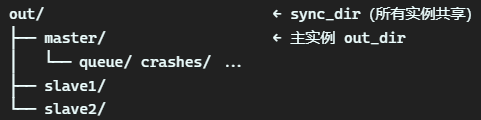

`synchronization` 的关键就在这：`sync_fuzzers()` 扫描 `sync_dir` 下**其他实例**的 `queue/`，把它们的发现导入自己队列，实现成果互通


##### **默认行为归一化：`-S` 隐含 `-d`**

```c
if (!force_deterministic) {       // 非主实例（-S）
    skip_deterministic = 1;
    use_splicing = 1;
}
```

主实例 `-M`（`force_deterministic=1`）→ 保持全量确定性，负责**穷举精搜**

从实例 `-S` → 自动 `skip_deterministic` + `use_splicing`，退化成**纯随机快扫**


#### 4.1.6 前置校验

```c
  if (!strcmp(in_dir, out_dir))
    FATAL("Input and output directories can't be the same");
```

路径相同则报错。AFL 启动后会把种子复制进 `out_dir/queue` 并**改写文件名**（`pivot_inputs`），若输入目录就是输出目录，`read_testcases` 扫到的"种子"和 `pivot` 生成的文件互相污染。

这行在 `fix_up_sync()` **之后**。因为 `fix_up_sync` 已把 `out_dir` 改写成 `out/<id>`，这里比较的是**修复后的 out_dir**，用户写的 `-o out` 与 `-i out` 相等会在这里被拦下


```c
  if (dumb_mode) {
    if (crash_mode) FATAL("-C and -n are mutually exclusive");
    if (qemu_mode)  FATAL("-Q and -n are mutually exclusive");
  }
```

**dumb 互斥**:`-C`/`-Q` 与 `-n` 的矛盾检查


#### 4.1.7 AFL_* 环境变量批处理

这是命令行之外的配置入口

##### **覆盖型开关（存在即置位）**

```c
if (getenv("AFL_NO_FORKSRV"))    no_forkserver    = 1;   // 禁用 forkserver
if (getenv("AFL_NO_CPU_RED"))    no_cpu_meter_red = 1;   // 禁用 UI 红色警示
if (getenv("AFL_NO_ARITH"))      no_arith         = 1;   // 跳过算术变异
if (getenv("AFL_SHUFFLE_QUEUE")) shuffle_queue    = 1;   // 打乱队列
if (getenv("AFL_FAST_CAL"))      fast_cal         = 1;   // 快速标定
```

5 条完全同构：**存在即置全局标志**。各自的下游落点：

| 环境变量            | 全局标志           | 下游效果                                                     |
| :------------------ | :----------------- | :----------------------------------------------------------- |
| `AFL_NO_FORKSRV`    | `no_forkserver`    | `run_target` 退化为每次 fork+exec；`init_forkserver` 不再调用 |
| `AFL_NO_CPU_RED`    | `no_cpu_meter_red` | `show_stats` 里 CPU 超载时不显示红字                         |
| `AFL_NO_ARITH`      | `no_arith`         | `fuzz_one`：`if (no_arith) goto skip_arith;` 跳过 ±N 变异    |
| `AFL_SHUFFLE_QUEUE` | `shuffle_queue`    | `read_testcases` 里按序把 queue 条目打乱                     |
| `AFL_FAST_CAL`      | `fast_cal`         | `calibrate_case`：`stage_max = fast_cal ? 3 : CAL_CYCLES;` 标定只跑 3 次 |

**注意它们与命令行选项共用全局标志**，比如 `AFL_NO_FORKSRV` 和 `-n` 一样影响 forkserver，`no_arith` 和 `-d` 场景下 skip。环境变量是给"无法改命令行"的场景用的（脚本批量启动、其他工具包装）


##### **带值校验型**

```c
if (getenv("AFL_HANG_TMOUT")) {
    hang_tmout = atoi(getenv("AFL_HANG_TMOUT"));
    if (!hang_tmout) FATAL("Invalid value of AFL_HANG_TMOUT");
}
```

`hang_tmout` 是**独立的** hang 复验超时（区别于 `exec_tmout`）。它在 `save_if_interesting` 里用：判断一个执行是真 hang 还是只是慢（用更宽松的 `hang_tmout` 复跑一次）。`atoi` 解析，**解析结果为 0 → 非法**（0ms 没意义）


##### **互斥追加**

```c
if (dumb_mode == 2 && no_forkserver)
    FATAL("AFL_DUMB_FORKSRV and AFL_NO_FORKSRV are mutually exclusive");
```

前面分析过的：`dumb_mode==2` 声称"有 forkserver 桩"，`no_forkserver` 会要求禁用 forkserver，属于自相矛盾


##### **preload 库注入**

```c
if (getenv("AFL_PRELOAD")) {
    setenv("LD_PRELOAD", getenv("AFL_PRELOAD"), 1);          // Linux
    setenv("DYLD_INSERT_LIBRARIES", getenv("AFL_PRELOAD"), 1); // macOS
}
if (getenv("AFL_LD_PRELOAD"))
    FATAL("Use AFL_PRELOAD instead of AFL_LD_PRELOAD");
```

`AFL_PRELOAD` 是要预加载到目标进程的库（比如 interposer 库、`libdislocator` 内存分配器）。同时设 Linux（`LD_PRELOAD`）和 macOS（`DYLD_INSERT_LIBRARIES`）两个变量，一份配置跨平台生效。

`setenv` 第三个参数 **`1` = 强制覆盖**已存在的 `LD_PRELOAD`，AFL 的 preload 必须生效，不能与用户已有的冲突（这也是为什么它会顶掉用户配置）。

**`AFL_LD_PRELOAD` 拒绝**：这是旧版本变量名，作者直接 FATAL 并提示改用 `AFL_PRELOAD`，**主动废弃旧命名**，防止用户用错变量名后 preload 静默失效、fuzz 出诡异结果


#### 4.1.8 save_cmdline函数

将启动 fuzzer 时的完整命令行参数，保存为一个字符串副本

```c
save_cmdline(argc, argv);		// 在环境变量处理之后、get_core_count 之前调用
```

把 `main` 收到的**原始命令行参数**拼接成一个连续字符串，存进全局 `orig_cmdline`。它是"一次性存档"，之后 `main` 还会改动 argv（`fix_up_banner`、QEMU 重写等），所以要在这里先定格原始快照


##### **算总长度**

```c
u32 len = 1, i;                       // 1 给结尾 NUL 预留
u8* buf;
for (i = 0; i < argc; i++)
    len += strlen(argv[i]) + 1;       // 每个参数：字符 + 1（空格）
```

`len = 1 + Σ(strlen_i + 1) = 1 + Σstrlen_i + argc`。实际需要 `Σstrlen_i + (argc-1) + 1`（参数间空格 + 结尾 NUL），**分配比实际多 1 字节**，多算的最后一个参数是空格


##### **`ck_alloc`：AFL 的带检查分配器**

```c
buf = orig_cmdline = ck_alloc(len);
```

`ck_alloc`（alloc-inl.h）是 `malloc` 的封装：分配失败直接 `FATAL` 退出。配合 `alloc_report()` 做**分配计数与泄漏检查**，这也是 `main` 结尾调用 `alloc_report()` 能报告是否有内存泄漏的前提（分配器内部记账）


##### **复制**

```c
buf = orig_cmdline = ck_alloc(len);   // 一次性分配
for (i = 0; i < argc; i++) {
    u32 l = strlen(argv[i]);
    memcpy(buf, argv[i], l);
    buf += l;
    if (i != argc - 1) *(buf++) = ' ';  // 参数间插空格
}
*buf = 0;                              // 结尾 NUL 收尾
```

等价于 C 的 `asprintf("%s %s %s ...")`，但手写的原因：**AFL 不依赖 GNU 扩展**（保证可移植），且用 `memcpy` + 长度拷贝比 `strcat` 循环的 O(n²) 高效


##### **下游用途：为什么值得存档一份命令行**

**`write_crash_readme()`（3114 行）**首次崩溃时写的说明文件：

```c
orig_cmdline, DMS(mem_limit << 20)   // 3152 行
```

记录"崩溃发生时的完整调用 + 内存限制"，方便复现和取证

**`write_stats_file()`（3421 行）**`fuzzer_stats` 里的 `command_line` 字段：

```c
orig_cmdline, slowest_exec_ms        // 3495 行
```

`fuzzer_stats` 是每轮刷新的状态文件（`afl-whatsup` 等工具会解析），记录 `command_line` 让你**知道这个 out 目录是哪条命令跑出来的**，在多实例并行、长时间挂机后这是唯一可靠的"跑的是什么"的依据


#### 4.1.9 fix_up_banner函数

主要作用是**生成并设置一个用于界面显示的“横幅”（banner）名称**

```c
fix_up_banner(argv[optind]);   // save_cmdline 之后、check_if_tty 之前
```


##### **决定横幅**

```c
if (!use_banner) {                       // 1 用户没给 -T
    if (sync_id) {                       // 2 并行实例 → 用实例 ID
        use_banner = sync_id;
    } else {                             // 3 单机 → 用目标 basename
        u8* trim = strrchr(name, '/');
        if (!trim) use_banner = name; else use_banner = trim + 1;
    }
}
```

| 优先级 | 条件                     | 横幅内容                      |
| ------ | ------------------------ | ----------------------------- |
| 1      | `-T` 给了 `use_banner`   | 用户指定文字                  |
| 2      | `-S`/`-M` 给了 `sync_id` | 实例 ID（`master`/`slave1`…） |
| 3      | 两者皆无                 | 目标程序 basename             |

**2 **：并行时 `afl-whatsup` 和 UI 都要区分每个实例。用 `sync_id`（比如 `-S slave3`）当横幅，一眼看出"这是第 3 个从实例"

**3** ：

```c
u8* trim = strrchr(name, '/');          // 找最后一个 '/'
if (!trim) use_banner = name;           // 无 '/'（当前目录 ./prog）→ 整个路径
else       use_banner = trim + 1;       // 有 '/' → 取 '/' 之后（basename）
```

`strrchr` 找**最后**一个斜杠，`+1` 跳过它取 basename。比如 `/home/user/tools/img2pdf` → `img2pdf`。没斜杠时直接整个用（`strrchr` 返回 NULL）


##### **长度截断**

```c
if (strlen(use_banner) > 40) {
    u8* tmp = ck_alloc(44);
    sprintf(tmp, "%.40s...", use_banner);
    use_banner = tmp;
}
```

> 超 40 字符 → 截断为前 40 字符 + `...`
>
> `ck_alloc(44)`：40（正文）+ 3（`...`）+ 1（NUL）= 44，恰好
>
> `%.40s` 是 printf 的**精度限制**，最多写 40 个字符，不会溢出
>
> 为什么是 40：`show_stats` 的 UI 是固定宽度布局，横幅太长会顶破右边的指标列

注意 `use_banner` 原来若指向 `sync_id`/`argv`（非堆上），截断时 `ck_alloc` 了新 buffer 并**重新指向**，原来的是 `-T` 传入的堆上字符串或 argv 的栈上字符串，`use_banner` 指向新副本后原指针不再被引用，没有泄漏问题（AFL 的 allocator 会记账）


#### 4.1.10 check_if_tty函数

> **检查环境变量**：首先检查是否存在 `AFL_NO_UI` 环境变量，如果存在，直接将 `not_on_tty` 设置为 1 并返回，跳过后续检查
>
> **尝试获取窗口大小**：调用 `ioctl` 系统请求 `TIOCGWINSZ` 读取终端窗口大小
>
> **判断执行结果**：如果 `ioctl` 调用失败并返回错误码 `ENOTTY`（即当前文件描述符不关联终端），则将 `not_on_tty` 设置为 1
>
> **默认状态**：如果环境变量不存在且 `ioctl` 成功（或错误码不是 `ENOTTY`），则 `not_on_tty` 保持默认值 0，表示在终端中运行

```c
check_if_tty();   // fix_up_banner 之后、get_core_count 之前
```

检测 stdout 是否连接终端，结果存进全局 `not_on_tty`（0=是 tty，1=不是）。这个标志影响全流程的**输出形态**


##### **环境变量显式禁用**

```c
if (getenv("AFL_NO_UI")) {
    OKF("Disabling the UI because AFL_NO_UI is set.");
    not_on_tty = 1;
    return;
}
```

读取环境变量AFL_NO_UI，存在的话设置not_on_tty = 1


##### **ioctl 实际检测**

```c
f (ioctl(1, TIOCGWINSZ, &ws)) {          // 获取 stdout 的终端窗口尺寸
    if (errno == ENOTTY) {                // 失败原因是"不是 tty"
        OKF("Looks like we're not running on a tty...");
        not_on_tty = 1;
    }
    return;
}
```

> `ioctl(1, TIOCGWINSZ, &ws)` 尝试获取终端窗口大小。三种结果：
>
> **成功（返回 0）**：是 tty → 不置位，保持交互模式（`ws` 虽然没用到，但能拿尺寸就说明是终端）
>
> **失败且 `errno == ENOTTY`**：fd 不是终端（管道、文件）→ 置 `not_on_tty`
>
> **失败且其他 errno**（如 `EBADF`/`ENOTTY` 以外的）：**静默返回**，不置位，不确定时按"是 tty"处理，保守不改变行为

用 `ioctl(TIOCGWINSZ)` 而非 `isatty()` 的考量：`ioctl` 能**同时确认"是 tty"和拿到窗口尺寸**，一步到位；`isatty` 只能回答布尔问题。且 `errno` 区分了"确实不是 tty"和"其他错误"


##### **`not_on_tty` 的下游影响**

**1 main 的交互"反悔窗口"**（8085 行）

```c
if (!not_on_tty) {
    sleep(4);          // 交互模式故意睡 4 秒，让用户有机会 Ctrl-C
    start_time += 4000;
}
```

非 tty 直接跳过，脚本跑 fuzz 时不该为了等待而浪费 4 秒

**2 文本 vs 界面输出**

```c
// 主循环 / fuzz_one 里
if (not_on_tty) ACTF("Entering queue cycle %llu.", queue_cycle);   // 普通一行日志
// 否则 show_stats() 画实时刷新界面（光标定位、进度条）
```

`show_stats` 内部大量 `not_on_tty` 分支：非 tty 时不画 ANSI 定位刷新的界面，只周期性输出一行状态

**3 fuzzer_stats / 干跑输出**：`perform_dry_run` 的详细统计在非 tty 时也会改变格式


#### 4.1.11 get_core_count函数

get_core_count用于获取并记录当前系统的逻辑CPU核心数量

**调用时机**在`check_if_tty()` 之后、`bind_to_free_cpu()` 之前


##### **CPU 核数的四路平台检测**

```c
#if defined(__APPLE__) || defined(__FreeBSD__) || defined (__OpenBSD__)
    // *BSD/macOS 走 sysctl
#   ifdef __APPLE__
        sysctlbyname("hw.logicalcpu", ...)      // macOS 专用接口
#   else
        sysctl({CTL_HW, HW_NCPU}, ...)          // FreeBSD/OpenBSD 通用接口
#   endif
#else
#   ifdef HAVE_AFFINITY                          // 即 __linux__
        cpu_core_count = sysconf(_SC_NPROCESSORS_ONLN);  // 一次调用搞定
#   else
        // 无 sysconf 的系统：解析 /proc/stat
        while (fgets(tmp, ...))
            if (!strncmp(tmp, "cpu", 3) && isdigit(tmp[3])) cpu_core_count++;
#   endif
#endif
```

| 平台            | 手段                                    |
| --------------- | --------------------------------------- |
| macOS           | `sysctlbyname("hw.logicalcpu")`         |
| FreeBSD/OpenBSD | `sysctl(CTL_HW, HW_NCPU)`               |
| Linux           | `sysconf(_SC_NPROCESSORS_ONLN)`（最优） |
| 其他            | 解析 `/proc/stat` 数 `cpuN` 行          |


##### **当前负载估算**

```c
  if (cpu_core_count > 0) {

    cur_runnable = (u32)get_runnable_processes();
```

get_runnable_processes()

```c
// *BSD/macOS
if (getloadavg(&res, 1) != 1) return 0;   // 1 分钟负载均值
// Linux —— 不用 loadavg，读 /proc/stat 的实时进程数
while (fgets(tmp, ...))
    if (!strncmp(tmp, "procs_running ", 14) || !strncmp(tmp, "procs_blocked ", 14))
        val += atoi(tmp + 14);
// 指数滑动平均（EMA）平滑瞬时抖动
res = res * (1.0 - 1.0/AVG_SMOOTHING) + ((double)val) * (1.0/AVG_SMOOTHING);
```

 Linux 直接取 `/proc/stat` 里 `procs_running`（正在运行）+ `procs_blocked`（在等待 I/O）的实时值，再经 EMA 平滑。`static double res` 跨调用保留，形成连续滑动平均


##### **负载判断与并行建议**

```c
if (cpu_core_count > 1) {
    if (cur_runnable > cpu_core_count * 1.5)
        WARNF("System under apparent load, performance may be spotty.");
    else if (cur_runnable + 1 <= cpu_core_count)
        OKF("Try parallel jobs - see %s/parallel_fuzzing.txt.", doc_path);
}
```

> 两个阈值：
>
> `cur_runnable > 核数 × 1.5` → **过载警告**
>
> `cur_runnable + 1 <= 核数` → **有空闲核**（`+1` 是给"即将启动的 afl-fuzz"自己留的位子）

中间区间（负载 1.5x 到接近饱和）时不提示

**macOS/\*BSD 的 `cur_runnable++`**：loadavg 是过去 1 分钟的快照，不含当前进程自己，所以要补上再比较


##### **错误处理**

```c
} else {
    cpu_core_count = 0;
    WARNF("Unable to figure out the number of CPU cores.");
}
```

探测失败（如 `/proc/stat` 打不开）则置 0 并警告。下游 `bind_to_free_cpu` 里 `cpu_core_count < 2` 会提前 return，且安全降级使得不会因核数未知而崩溃


##### **下游：`cpu_core_count`**

`bind_to_free_cpu()`（412）里三处依赖：

```c
if (cpu_core_count < 2) return;                     // 单核：绑定无意义，直接放弃
if (cpu_to_bind >= cpu_core_count) FATAL(...);      // -b 越界校验
for (i = 0; i < cpu_core_count; i++) if (!cpu_used[i]) break;  // 遍历找空闲核
```


#### 4.1.12 bind_to_free_cpu函数

扫描系统里哪些核已被进程占用，然后把自己绑定到第一个空闲核

```c
#ifdef HAVE_AFFINITY
  bind_to_free_cpu();
#endif /* HAVE_AFFINITY */
```


##### **1. 三道提前退出（防御性判断）**

```c
if (cpu_core_count < 2) return;                 // 单核的话绑定没有意义
if (getenv("AFL_NO_AFFINITY")) { WARNF(...); return; }   // 用户显式禁用
d = opendir("/proc");
if (!d) { WARNF(...); return; }                // 无法访问 /proc：降级
```

> **单核**：绑定没有意义，静默返回
>
> **`AFL_NO_AFFINITY`**：在容器、受限环境里 `sched_setaffinity` 会失败，用户可显式跳过
>
> **`/proc` 打不开**：没有扫描依据，安全降级为"不绑定"

注意这里是 `WARNF`+`return`（**降级继续**），只有后面真正的绑定失败才 `FATAL`（**中断**）


##### **2. 扫描前的随机延迟（Jitter）**

```c
usleep(R(1000) * 250);     // 0~250ms 随机
```

多个 AFL 实例**同一时刻启动**时，如果不加随机延迟，它们会**同时**扫到"全部空闲"然后**抢同一个核**。随机化错开扫描时机，降低竞争概率


##### **3. 核心：扫描 `/proc` 标记已占用核**

```c
while ((de = readdir(d))) {                       // 遍历 /proc 下的目录项
    if (!isdigit(de->d_name[0])) continue;        // 只处理纯数字目录 = 进程 PID
    fn = alloc_printf("/proc/%s/status", de->d_name);
    ...
    while (fgets(tmp, MAX_LINE, f)) {
        if (!strncmp(tmp, "VmSize:\t", 8)) has_vmsize = 1;   // 用户态进程标记
        if (!strncmp(tmp, "Cpus_allowed_list:\t", 19) &&      // 找 CPU 允许列表
            !strchr(tmp, '-') && !strchr(tmp, ',') &&         // 且是单个核（非范围/列表）
            sscanf(tmp + 19, "%u", &hval) == 1 &&             // 解析出核号
            hval < sizeof(cpu_used) &&                        // 在 4096 上限内
            has_vmsize) {                                     // 且是用户态进程
            cpu_used[hval] = 1;                               // 标记该核被占用
            break;
        }
    }
    ...
}
```

**`isdigit(de->d_name[0])`**：`/proc` 里除进程 PID 外还有 `cpuinfo`、`meminfo`、`self`、`sys` 等非数字目录，只处理数字开头（进程）的

**`has_vmsize` 过滤内核线程**：`VmSize`（虚拟内存）只有用户态进程才有，内核线程（如 `kworker`）没有。内核线程往往被绑到某核（如 `kworker/0`），会干扰判断，所以只统计**有 VmSize 的真实进程**

> **`!strchr(tmp,'-') && !strchr(tmp,',')`**：`Cpus_allowed_list` 有三种形态：
>
> `0` → 单核（我们要的）
>
> `0-3` → 范围
>
> `0,2,4` → 列表 只接受**单核形态**，范围/列表直接跳过（它们绑了多核，不好归属）

**`hval < sizeof(cpu_used)`**：`cpu_used[4096]`，`sizeof` = 4096，防越界（假设最多 4k 核，函数头注释也写了）

扫描完后，`cpu_used[i] == 1` 表示核 `i` 已被某个用户态进程钉住


##### **4. 选择目标核**

```c
if (cpu_to_bind_given) {                        // 用户给了 -b
    if (cpu_to_bind >= cpu_core_count)
        FATAL("core id should be between 0 and %u");   // 越界
    if (cpu_used[cpu_to_bind])
        FATAL("core #%u is not free!");               // 被占用
    i = cpu_to_bind;                                  // 用指定核
} else {
    for (i = 0; i < cpu_core_count; i++)
        if (!cpu_used[i]) break;                      // 自动找第一个空闲核
}
if (i == cpu_core_count)
    FATAL("No more free CPU cores");                  // 全被占
```

- **`-b` 指定**：两个强校验（越界、占用）都过才用，否则 FATAL
- **自动模式**：`for` 找第一个 `cpu_used[i]==0` 的空闲核
- **全占**：`i == cpu_core_count`（循环走完没找到）→ FATAL 并提示 `AFL_NO_AFFINITY` 逃生


##### **5. 实际绑定**

```c
cpu_aff = i;                       // 记录绑定到哪，供 show_stats 显示
CPU_ZERO(&c);                      // 清空 cpu_set_t
CPU_SET(i, &c);                    // 只留目标核
if (sched_setaffinity(0, sizeof(c), &c))
    PFATAL("sched_setaffinity failed");   // 系统调用失败
```

`cpu_set_t` 是 Linux 位图类型：`CPU_ZERO` 清零，`CPU_SET` 置位，`sched_setaffinity` 让当前进程只跑在核 `i`。`cpu_aff` 记录给 UI 显示"绑定到 #N"


流程如下

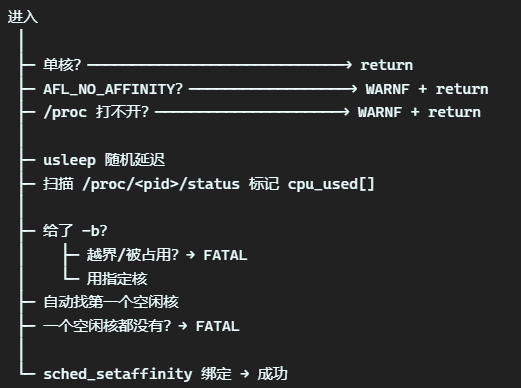


#### 4.1.13 check_crash_handling函数

检测系统是否把 core dump 转发给外部崩溃报告程序，确保系统在目标程序崩溃时，能以最快速度将信息反馈给 Fuzzer，避免将崩溃误判为超时

AFL 检测崩溃靠 `waitpid()` 拿到子进程的终止信号（如 `SIGABRT`/`SIGSEGV`）。但系统如果配置了**外部崩溃处理器**（Linux 的 `apport`/`systemd-coredump`、macOS 的 `ReportCrash`），它在进程崩溃后还要**介入处理**（收集日志、上传），这会让 `waitpid` 的返回**大幅延迟**。延迟一长，AFL 的 `SIGALRM` 超时先到 ，**崩溃被误判成超时**（`FAULT_TMOUT` 而非 `FAULT_CRASH`），这样的话整个 fuzz 的崩溃检测就出错了


##### Linux 分支（`/proc/sys/kernel/core_pattern`）

```c
s32 fd = open("/proc/sys/kernel/core_pattern", O_RDONLY);
if (fd < 0) return;                    // 读不到 → 跳过检查（安全降级）
ACTF("Checking core_pattern...");
if (read(fd, &fchar, 1) == 1 && fchar == '|') {   // 首字符是 '|'
    ...警告 + FATAL...
}
```

> **判定依据**：`core_pattern` 文件的首字符
>
> 以 `|` 开头那么 core dump 被**管道送给外部程序**（Ubuntu 的 `apport`、`systemd-coredump` 这种）
>
> 如果是其他开头（如 `core`）则直接写文件，`waitpid` 能立即拿到信号

只读 1 个字节判断首字符即可因为`|` 是管道处理器最明确的特征。`fd < 0` 时（无 `/proc`、权限不足）**跳过检查**，这与 `bind_to_free_cpu` 一样是"探测失败就降级"


##### macOS 分支（`launchctl` 查 ReportCrash）

```c
if (system("launchctl list 2>/dev/null | grep -q '\\.ReportCrash$'")) return;
```

> 逻辑细节：
>
> `launchctl list` 列出加载的守护进程，`grep -q '\.ReportCrash$'` 找 `ReportCrash`
>
> **grep 找到**（退出码 0）→ `system` 返回 0 → `if(0)` 假 → **不 return** → 继续打印警告
>
> **grep 没找到**（退出码 1）→ `if(1)` 真 → return，**无问题**

所以是"**检测到 ReportCrash → 警告**"，与 Linux 分支语义一致


##### **两处警告后的统一收尾**

```c
if (!getenv("AFL_I_DONT_CARE_ABOUT_MISSING_CRASHES"))
    FATAL("Crash reporter detected");    // Linux 是 "Pipe at the beginning of 'core_pattern'"
```

如果设了它 那么只警告不 FATAL，这样会让 fuzzer 继续跑（明知崩溃检测可能延迟）


##### **与 `RLIMIT_CORE=0` 的分工**

AFL 在 `init_forkserver`/`run_target` 里已经 `setrlimit(RLIMIT_CORE, 0)` 禁掉子进程 core dump。那为什么还要这个检查？

| 措施                     | 防什么                                                   |
| ------------------------ | -------------------------------------------------------- |
| `RLIMIT_CORE=0`          | 防止子进程写 core 文件（慢、SIGKILL 时残留）             |
| `check_crash_handling()` | 防止**外部程序拦截崩溃信号**（延迟 `waitpid`，误判超时） |

因为两者是不同层面，`RLIMIT_CORE` 控制"**本进程不产出** core"，而外部崩溃处理器是"**系统拦截**崩溃事件"，即使没有 core 文件它也会介入


#### 4.1.14 check_cpu_governor函数

检测 CPU 频率调节器（governor）是否处于"按需变频"状态，如果是，则警告并默认拒绝运行

```c
check_cpu_governor();
```

`check_cpu_governor()` 读 `scaling_governor` 和 min/max 频率，若 CPU 处于"可动态变频"状态（ondemand 且 min≠max）就 FATAL 并给出切到 performance 的命令，防止短命 fuzz 子进程跑在低频拖垮吞吐；`AFL_SKIP_CPUFREQ` 提供逃生口


##### **前置逃生口与降级**

```c
if (getenv("AFL_SKIP_CPUFREQ")) return;    // 用户主动跳过检查
f = fopen("/sys/devices/system/cpu/cpu0/cpufreq/scaling_governor", "r");
if (!f) return;                            // 无 cpufreq 子系统则跳过
```

> **`AFL_SKIP_CPUFREQ`**：逃生口。在有些环境中（虚拟机、容器、无法提权）改不了 governor，用户可显式跳过
>
> **读不到 `scaling_governor`** 则直接返回：说明系统**没有可调节的频率**（固定频率的 CPU、无 cpufreq 的虚拟化平台）

只检查 `cpu0`，注释隐含假设所有核的 governor 相同，实际系统基本如此，省去遍历


##### **判定逻辑树**

```c
if (!fgets(tmp, 128, f)) PFATAL("fgets() failed");
if (!strncmp(tmp, "perf", 4)) return;      // performance → 没问题
```

> 读到 governor 名字，看前 4 个字符是否为 `perf`：
>
> **`performance`** → 固定最高频，无问题，直接返回
>
> ondemand / powersave / schedutil 等 → 可能变频，继续深入检查


##### **min/max 频率的辅助判断**

```c
f = fopen(".../scaling_min_freq", "r");
if (f) { if (fscanf(f, "%llu", &min) != 1) min = 0; fclose(f); }
f = fopen(".../scaling_max_freq", "r");
if (f) { if (fscanf(f, "%llu", &max) != 1) max = 0; fclose(f); }
if (min == max) return;                    // 频率范围是单点 → 无调节空间
```

即使 governor 是 ondemand状态，如果 **min == max**（比如某些固定频率的核），那么实际也没法变频，同样无问题。只有 **min < max**（有真实调节空间）才构成风险

两处 `fscanf` 失败都安全回退 `min=0`/`max=0`，若读不到就当作"0"，后面 `0 == 0` 会触发 return（当作无问题）


##### **FATAL 消息与修复指引**

```c
SAYF(... "cd /sys/devices/system/cpu
          echo performance | tee cpu*/cpufreq/scaling_governor\n"
        "...replace 'performance' with 'ondemand'... set AFL_SKIP_CPUFREQ..." ...,
     min / 1024, max / 1024);
FATAL("Suboptimal CPU scaling governor");
```

> `min / 1024, max / 1024`：文件里的频率单位是 **kHz**，消息里显示成 **MHz**（÷1024）
>
> 修复命令很具体：`echo performance | tee cpu*/cpufreq/scaling_governor` 一次把**所有核**设为 performance；恢复时把 `performance` 换回 `ondemand`
>
> 三条路都给全了：**改 performance / 改回 ondemand / 设 AFL_SKIP_CPUFREQ**，外加"不改会有性能下降"的提醒


##### **与 `check_crash_handling` 的模式对比**

这两个环境自检函数结构高度一致，都是：

|          | check_cpu_governor       | check_crash_handling                    |
| -------- | ------------------------ | --------------------------------------- |
| 检查对象 | CPU 频率调节器           | 外部崩溃处理器                          |
| 危害     | 短命进程跑低频，吞吐暴跌 | waitpid 延迟，崩溃误判超时              |
| 判定     | governor≠perf 且 min≠max | core_pattern 首字符为 `|`               |
| 逃生口   | `AFL_SKIP_CPUFREQ`       | `AFL_I_DONT_CARE_ABOUT_MISSING_CRASHES` |
| 默认动作 | FATAL                    | FATAL                                   |
| 降级     | 读不到 `/sys` → return   | 读不到 `/proc` → return                 |


#### 4.1.15 setup_post函数

负责动态加载一个可选的"后处理器"插件，用 `AFL_POST_LIBRARY` 环境变量指定一个共享库，把它导出的 `afl_postprocess` 函数挂到全局 `post_handler` 上

```c
setup_post();
```

`setup_post()` 用 `AFL_POST_LIBRARY` 指定的共享库，`dlopen`+`dlsym` 挂载 `afl_postprocess` 插件，并做一次冒烟测试确保它不出错；之后每次变异执行前 `common_fuzz_stuff` 都先经它变换（可改写 buffer/长度，也可丢弃），让随机变异能落到目标可解析的合法格式上


##### **触发条件**

```c
u8* fn = getenv("AFL_POST_LIBRARY");
if (!fn) return;                    // 没设环境变量则什么都不做
```

**非侵入式插件**：不设环境变量就是普通的 afl-fuzz；设了才加载后处理器。`post_handler` 全局指针默认是 NULL（290 行：`static u8* (*post_handler)(u8* buf, u32* len);`），没有它时所有下游 `if (post_handler)` 判断自动绕过


##### **动态加载三步**

```c
dh = dlopen(fn, RTLD_NOW);                       // 1.加载 .so
if (!dh) FATAL("%s", dlerror());                 // 失败则报告 dlopen 错误
post_handler = dlsym(dh, "afl_postprocess");     // 2.找导出符号
if (!post_handler) FATAL("Symbol 'afl_postprocess' not found.");
```

> **`dlopen(fn, RTLD_NOW)`**：`RTLD_NOW` 要求**立即解析所有符号**。配合失败即 `FATAL`
>
> **`dlsym(dh, "afl_postprocess")`**：按名字查找导出函数。找不到则FATAL。插件的 API 契约就是**导出一个 `afl_postprocess` 函数**
>
> **`dlerror()`**：返回最近一次 `dlopen`/`dlsym` 的错误描述，直接打进 FATAL 消息


##### **早失败原则**

```c
/* Do a quick test. It's better to segfault now than later =) */
u32 tlen = 6;
post_handler("hello", &tlen);
```

加载完成后**立刻用一个短字符串调一次**插件。目的注释说得很清楚：**"宁可现在段错误，也不要以后段错误"**，如果插件本身有 bug（越界、空指针），在 fuzz 跑了几百万次执行后出错，比启动时出错难排查得多


##### **下游消费：每次执行前的钩子**

`common_fuzz_stuff()`（4654 行）:  每个变异 buffer 在写盘/执行前经过后处理：

```c
EXP_ST u8 common_fuzz_stuff(char** argv, u8* out_buf, u32 len) {
    u8 fault;
    if (post_handler) {
        out_buf = post_handler(out_buf, &len);   // 变换输入
        if (!out_buf || !len) return 0;          // 返回空且丢弃这次执行
    }
    write_to_testcase(out_buf, len);             // 之后才写盘然后执行
    ...
}
```

**API 契约**：

| 项                       | 说明                                                       |
| ------------------------ | ---------------------------------------------------------- |
| 入参                     | `u8* buf`（变异后 buffer）、`u32* len`（长度指针）         |
| 出参                     | 变换后的 buffer（**可以是新分配的内存**）+ 更新后的 `*len` |
| 返回 `NULL` 或 `*len==0` | 本次执行被**丢弃**（插件认为这个变异不配运行）             |


#### 4.1.16 setup_shm函数

setup_shm()是 **AFL 插桩协作机制的地基**，它创建共享内存，并让目标程序能找到

```c
setup_shm();
```

创建 64KB 共享内存段并挂载为本进程的 `trace_bits`，同时初始化三个 `virgin_*` 位图、注册 `atexit` 清理、把段 id 通过 `__AFL_SHM_ID` 环境变量传给插桩目标，从此 afl-fuzz 与目标共享同一块路径覆盖内存


##### **总览**

```c
EXP_ST void setup_shm(void) {               // 1371行
  if (!in_bitmap) memset(virgin_bits, 255, MAP_SIZE);    // 1
  memset(virgin_tmout, 255, MAP_SIZE);                   // 2
  memset(virgin_crash, 255, MAP_SIZE);                   // 3
  shm_id = shmget(IPC_PRIVATE, MAP_SIZE, IPC_CREAT|IPC_EXCL|0600);  // 4 创建
  if (shm_id < 0) PFATAL("shmget() failed");
  atexit(remove_shm);                                    // 5 清理
  shm_str = alloc_printf("%d", shm_id);
  if (!dumb_mode) setenv(SHM_ENV_VAR, shm_str, 1);       // 6 传给目标
  ck_free(shm_str);
  trace_bits = shmat(shm_id, NULL, 0);                   // 7 本进程挂载
  if (trace_bits == (void *)-1) PFATAL("shmat() failed");
}
```

一共做了四件事，初始化位图，创建 shm，通过环境变量告诉目标，自己挂载


##### **1~3 三个 virgin 位图初始化**

```c
memset(virgin_bits,  255, MAP_SIZE);    // 无 -B 时
memset(virgin_tmout, 255, MAP_SIZE);
memset(virgin_crash, 255, MAP_SIZE);
```

三个全局数组（153–155 行），每个字节 `0xFF` 表示"该路径还没探索过"，之后 `has_new_bits()` 会把见到的位清零：

| 位图           | 用途         | 谁清零                                |
| -------------- | ------------ | ------------------------------------- |
| `virgin_bits`  | 新路径判定   | 每次执行后                            |
| `virgin_tmout` | 新 hang 判定 | `save_if_interesting` 的 timeout 分支 |
| `virgin_crash` | 新崩溃判定   | `save_if_interesting` 的 crash 分支   |

**`if (!in_bitmap)` 条件**：`-B` 加载历史 bitmap 时（`read_bitmap` 已写入 `virgin_bits`），跳过 memset，保留历史状态


##### **4 shmget创建共享段**

```c
shm_id = shmget(IPC_PRIVATE, MAP_SIZE, IPC_CREAT | IPC_EXCL | 0600);
```

| 参数                   | 含义                                    |
| ---------------------- | --------------------------------------- |
| `IPC_PRIVATE`          | 让内核**自动分配全新 id**，每次运行隔离 |
| `MAP_SIZE`             | 段大小 64KB                             |
| `IPC_CREAT | IPC_EXCL` | 创建 + 排他（已存在则失败）             |
| `0600`                 | 仅创建者读写                            |

> IPC_EXCL配合 IPC_PRIVATE保证绝不会撞上残留的旧段。失败则PFATAL


##### **5 atexit(remove_shm) 清理**

```c
static void remove_shm(void) { shmctl(shm_id, IPC_RMID, NULL); }   // 1230行
```

进程退出（含 `FATAL` 路径，因为 `FATAL` 走 `exit()`）时自动删除共享段，防止"共享内存泄漏"占满系统。`shm_id` 是全局，atexit handler 直接引用


##### **6 环境变量传递：目标怎么找到这块内存**

```c
setenv(SHM_ENV_VAR, shm_str, 1);      // "__AFL_SHM_ID" = "12345"
```

协作流程如下图所示

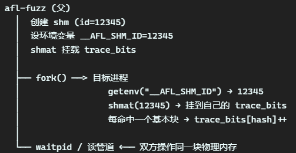

插桩汇编（`afl-as` 注入）在目标启动时读环境变量拿 id，`shmat` 挂载，之后每次执行命中的基本块边都自增对应字节。父进程跑完一次后读 `trace_bits` 就是完整路径覆盖图


##### **dumb 模式特殊处理**

```c
if (!dumb_mode) setenv(...);
```

dumb 模式不设环境变量。原因（1388–1391 行注释）：有些 dumb 目标会检测到插桩环境而改变行为（这类程序常会看 `__AFL_*` 环境变量、`LD_PRELOAD` 等并做出反应），暴露反而干扰。dumb 目标本身不写 bitmap，`trace_bits` 全零，AFL 也不读它做路径判定。


##### **7`shmat` 本进程挂载**

```c
trace_bits = shmat(shm_id, NULL, 0);
```

`NULL` 让内核选地址，返回指针存入全局 `trace_bits`。之后所有读 bitmap 的地方（`run_target` 的 `classify_counts`、`hash32`、`has_new_bits`）都操作这块内存


#### 4.1.17 init_count_class16函数

为运行时 bitmap 折叠预计算的查找表

```c
init_count_class16();
```

`init_count_class16()` 把 8 位对数桶表 `count_class_lookup8`（0/1/2/4/8/16/32/64/128 指数映射）组合成 128KB 的 16 位查找表，让 `classify_counts` 在每次执行后的 hot path 上**一次查表折叠 2 字节**、跳过稀疏空块，把 bitmap 的命中次数抖动折叠成稳定分类值，保证路径判定和崩溃去重的正确性


##### **bitmap 里的值是"命中次数"**

AFL 插桩在每个基本块/边命中时对共享内存 bitmap 的某个字节**自增**。所以 `trace_bits[i]` 存的是"这条路径被执行了多少次"（封顶 255）

如果直接用原始次数，同样的路径这次跑 100 次、下次跑 101 次，bitmap 值就不同导致 `has_new_bits` 会**误判为新路径**，污染队列和去重逻辑。

所以可以把次数折叠成粗粒度分类值，量级变化才产生新值，微小抖动忽略，这就是"计数分类"


##### **`count_class_lookup8`：8 位对数桶表（1143 行）**

```c
static const u8 count_class_lookup8[256] = {
  [0]           = 0,
  [1]           = 1,
  [2]           = 2,
  [3]           = 4,
  [4 ... 7]     = 8,
  [8 ... 15]    = 16,
  [16 ... 31]   = 32,
  [32 ... 127]  = 64,
  [128 ... 255] = 128
};
```

用 C99 **指定初始化器**（`[0]`、`[4 ... 7]` 区间写法）定义，一次建好：

| 原始命中次数 | 分类值 | 桶宽 |
| ------------ | ------ | ---- |
| 0            | 0      | 1    |
| 1            | 1      | 1    |
| 2            | 2      | 1    |
| 3            | 4      | 1    |
| 4–7          | 8      | 4    |
| 8–15         | 16     | 8    |
| 16–31        | 32     | 16   |
| 32–127       | 64     | 96   |
| 128–255      | 128    | 128  |

这是**指数增长的桶**：低次数区分细（1/2/3 各自独立），高次数区分粗（32~127 全归 64）。命中 0 次 / 1 次 / 几次 / 很多次是四个量级，桶内抖动不产生新路径


##### **`init_count_class16`：组合成 16 位表**

```c
EXP_ST void init_count_class16(void) {
  u32 b1, b2;
  for (b1 = 0; b1 < 256; b1++) 
    for (b2 = 0; b2 < 256; b2++)
      count_class_lookup16[(b1 << 8) + b2] = 
        (count_class_lookup8[b1] << 8) | count_class_lookup8[b2];
}
```

用 8 位表填充 16 位表 `count_class_lookup16[65536]`。对每个 16 位值，高字节查一次表、低字节查一次表，结果拼回 16 位

这就是一个**双字节折叠表**：`lookup16[0x1203] = (lookup8[0x12] << 8) | lookup8[0x03]`。`65536 × 2 字节 = 128KB`，初始化只需 256×256 = 65536 次查找，成本可忽略


##### **运行时消费：`classify_counts()`（1175 行）**

折叠发生在每次执行后的 hot path，`run_target` 末尾调用：

```c
static inline void classify_counts(u64* mem) {    // 64 位版本
  u32 i = MAP_SIZE >> 3;                          // bitmap 按 8 字节一块
  while (i--) {
    if (unlikely(*mem)) {                         // 稀疏优化：整块为 0 跳过
      u16* mem16 = (u16*)mem;
      mem16[0] = count_class_lookup16[mem16[0]];  // 每块 4 个 u16 各查一次
      mem16[1] = count_class_lookup16[mem16[1]];
      mem16[2] = count_class_lookup16[mem16[2]];
      mem16[3] = count_class_lookup16[mem16[3]];
    }
    mem++;
  }
}
```

**这就是 `init_count_class16` 存在的意义**：16 位表让**一次查表处理 2 字节**，8 字节块只需 4 次查表（如果用 8 位表要 8 次），hot path 查表次数减半。`unlikely(*mem)` 针对稀疏 bitmap（绝大多数块全零）跳过空块，进一步提速


##### **为什么选择16 位而不选择 32 位**

| 位数 | 表大小              | 单次覆盖         |
| ---- | ------------------- | ---------------- |
| 8    | 256 × 1B = 256B     | 1 字节           |
| 16   | 65536 × 2B = 128KB  | 2 字节           |
| 32   | 2³² × 4B = **16GB** | 4 字节（不现实） |

32 位表会直接爆内存；16 位是"查表效率 × 内存占用"的折中。这也是为什么分类必须**预计算成表**而不是运行时逐字节 if-else，hot path 上查表比分支判断快得多


#### 4.1.18 setup_dirs_fds函数

把输出目录的完整目录树建好，并打开几个通用文件描述符

```c
setup_dirs_fds();
```

`setup_dirs_fds()` 建好整个输出目录树（queue + 元数据 `.state` + crashes/hangs + 并行 `.synced`），用 `flock` 保证单实例写独占、智能处理已存在的旧目录，并提前打开 `/dev/null`、`/dev/urandom` 和 `plot_data` 等全程复用的 fd


##### **out_dir 本体：新建与已存在（两条路径）**

```c
if (sync_id && mkdir(sync_dir, 0700) && errno != EEXIST)
    PFATAL(...);                       // 并行模式先建共享同步根
if (mkdir(out_dir, 0700)) {            // 尝试创建
    if (errno != EEXIST) PFATAL(...);  // 失败且不是"已存在" → 致命
    maybe_delete_out_dir();            // 已存在 → 处理旧数据
} else {                               // 全新创建成功
    if (in_place_resume)
        FATAL("Resume attempted but old output directory not found");  // resume 矛盾
    out_dir_fd = open(out_dir, O_RDONLY);
    if (out_dir_fd < 0 || flock(out_dir_fd, LOCK_EX | LOCK_NB))
        PFATAL("Unable to flock() output directory.");   // 加独占锁
}
```

| 情况                | 路径                                                         |
| ------------------- | ------------------------------------------------------------ |
| 目录全新            | 加 `flock` 独占锁，防两个实例写同一目录                      |
| 目录已存在          | `maybe_delete_out_dir()`：加锁 → 读 `fuzzer_stats` 判断是否活跃 → 决定删或问 |
| resume 但目录不存在 | FATAL（续跑的前提是旧目录在）                                |

> **`maybe_delete_out_dir`（3684）** 的智能之处：
>
> 先 `flock`，`EWOULDBLOCK`（已被其他 afl-fuzz 占用）→ 直接 FATAL
>
> 读 `fuzzer_stats` 里的 `start_time`/`last_update`，若 fuzzing 超过 `OUTPUT_GRACE` 分钟 → **拒绝自动删除**（数据珍贵，防误删）
>
> 数据太旧/非活跃 → 询问用户是否清空

**`flock` 是"单实例锁"**：同一 `out_dir` 只允许一个 fuzzer 写。`#ifndef __sun` 是因为 Solaris 的 `flock` 语义差异，跳过


##### **queue 及 `.state` 元数据目录树**

```c
mkdir(out_dir/queue, 0700);                       // 测试用例
mkdir(out_dir/queue/.state/, 0700);               // 元数据根
mkdir(out_dir/queue/.state/deterministic_done/);  // 确定性完成标记
mkdir(out_dir/queue/.state/auto_extras/);         // 自动字典
mkdir(out_dir/queue/.state/redundant_edges/);     // 冗余边
mkdir(out_dir/queue/.state/variable_behavior/);   // 可变行为
```

> `.state` 子目录用于 **resume 元数据**，每条 queue 输入对应一个标记文件：
>
> `deterministic_done/`：记录哪些条目已完成确定性阶段（resume 时不重跑）
>
> `auto_extras/`：自动字典 token 存档
>
> `redundant_edges/`：被标记为冗余的路径
>
> `variable_behavior/`：表现出可变行为的路径

这是"**队列本体 + 状态持久化**"分离的设计：`queue/id:000001` 是输入本身，`.state/` 里是它"经历过的状态"


##### **并行同步标记目录**

```c
if (sync_id) {
    mkdir(out_dir/.synced/, 0700);    // resume 时允许已存在
}
```

`.synced/` 记录"本实例已同步过哪些其它实例"，避免重复导入


##### **crashes 与 hangs**

```c
mkdir(out_dir/crashes, 0700);
mkdir(out_dir/hangs, 0700);
```

崩溃样本（`save_if_interesting` 的 crash 分支）和 hang 样本（timeout 分支）**的落盘目录**


##### **通用文件描述符**

```c
dev_null_fd = open("/dev/null", O_RDWR);
dev_urandom_fd = open("/dev/urandom", O_RDONLY);
```

> **提前打开、全程复用**两个特殊设备：
>
> `dev_null_fd`：子进程的 stdout/stderr 重定向目标（`dup2(dev_null_fd, 1/2)`）
>
> `dev_urandom_fd`：随机数源（`R()` 宏的随机性基础）

**为什么提前打开**：forkserver 每次 `fork()` 后子进程直接继承这些 fd，无需每次重新 `open`，这样可以减少每次执行的系统调用开销。这也是"持久 fd"优化的例子


##### **plot_data：gnuplot 输出**

```c
tmp = "%s/plot_data"; open(O_WRONLY|O_CREAT|O_EXCL, 0600);
plot_file = fdopen(fd, "w");
fprintf(plot_file, "# unix_time, cycles_done, cur_path, paths_total, ...");
```

建 `plot_data` 文件并写入 CSV 表头（字段名一行注释），后续 `maybe_update_plot_file` 每轮追加一行数据，配合 `afl-plot` 画覆盖率曲线


##### **完整目录树**

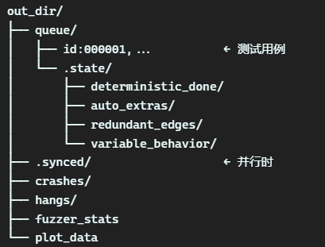


#### 4.1.19 read_testcases函数

`read_testcases()` 把输入目录变成内存队列

```c
read_testcases();
```

`read_testcases()` 扫描 `-i` 目录（自动纠正 `-i 旧输出` 的误用），`scandir+alphasort` 保证种子顺序确定，逐个过滤普通文件/非空/非 README、校验 1MB 上限、检测 `deterministic_done` 元数据，最后 `add_to_queue` 建起带 `next_100` 跳表的双链表队列，如果是空目录则直接 FATAL

扫描 in_dir → 排序/可选打乱 → 逐个过滤校验 → add_to_queue 入队 → 空则报错


##### 1 自动修正输入目录（非原地续跑检测）

```c
fn = alloc_printf("%s/queue", in_dir);
if (!access(fn, F_OK)) in_dir = fn; else ck_free(fn);
```

如果用户传的 `-i` 目录里**存在 `queue` 子目录**（说明 `in_dir` 其实是一个旧的**输出**目录），就自动把输入目录修正为 `in_dir/queue`。场景：

> afl-fuzz -i old_out_dir ...     # 用户误把旧输出目录当种子目录
> → 自动改成扫描 old_out_dir/queue 里的测试用例

这让"从旧输出继续"的错误用法被自动消化，无需用户手动指出 `queue` 子目录


##### 2 `scandir + alphasort`：确定性顺序

```c
nl_cnt = scandir(in_dir, &nl, NULL, alphasort);
```

注释说明了为什么不用 `readdir`：**readdir 的返回顺序在文件系统间/不同运行间不稳定**，而种子处理顺序影响 fuzz 结果的可复现性。`scandir` 一次拿到全部条目，`alphasort` 按字母序排列，**同样的种子目录每次运行以同样顺序入队**

失败时给出提示（"需要至少一个 <1KB 的普通文件"）后 `PFATAL`


##### 3 可选打乱

```c
if (shuffle_queue && nl_cnt > 1) shuffle_ptrs((void**)nl, nl_cnt);
```

`AFL_SHUFFLE_QUEUE` 时打乱扫描数组，让多个实例从不同起点开始（配合并行）


##### 4 逐个文件处理循环

```c
for (i = 0; i < nl_cnt; i++) {
    fn  = in_dir/<name>;                        // 完整路径
    dfn = in_dir/.state/deterministic_done/<name>;   // 元数据标记路径
    if (lstat(fn, &st) || access(fn, R_OK)) PFATAL(...);
    if (!S_ISREG(st.st_mode) || !st.st_size || strstr(fn, "/README.testcases")) {
        continue;                               // 过滤
    }
    if (st.st_size > MAX_FILE) FATAL("too big"); // 1MB 上限
    if (!access(dfn, F_OK)) passed_det = 1;      // 已完成确定性 → 标记
    add_to_queue(fn, st.st_size, passed_det);
}
```

**过滤条件**（`continue` 跳过）：

| 条件                              | 含义                                     |
| --------------------------------- | ---------------------------------------- |
| `!S_ISREG(st.st_mode)`            | 非普通文件（顺带处理 `.`/`..`/符号链接） |
| `!st.st_size`                     | 空文件                                   |
| `strstr(fn, "/README.testcases")` | README 说明文件                          |

**`MAX_FILE` 限制**：超过 1MB 的种子直接 `FATAL`

**`passed_det` 检测**（1503 行注释）：检查 `in_dir/.state/deterministic_done/<name>` 是否存在，**resume 时不重跑已完成的确定性阶段**。这是上次会话的元数据，`dfn` 是它的路径


##### 5 `add_to_queue()` 入队（804 行）

```c
static void add_to_queue(u8* fname, u32 len, u8 passed_det) {
    struct queue_entry* q = ck_alloc(sizeof(struct queue_entry));
    q->fname      = fname;
    q->len        = len;
    q->depth      = cur_depth + 1;     // 初始种子 depth = 1
    q->passed_det = passed_det;
    ...
    if (queue_top) { queue_top->next = q; queue_top = q; }
    else q_prev100 = queue = queue_top = q;      // 首元素
    queued_paths++; pending_not_fuzzed++;         // 全局计数
    if ((queued_paths - 1) % 100 == 0 && queued_paths > 1) {
        q_prev100->next_100 = q;                  // 每 100 个挂跳表指针
        q_prev100 = q;
    }
    last_path_time = get_cur_time();
}
```

> **双链表 + `next_100` 跳表**：每 100 个条目挂一个"百米指针"，`sync_fuzzers` 找随机目标、主循环遍历大队列时能跳步定位，不必逐节点走（之前 splice 代码里 `target = target->next_100; tid -= 100;` 就用它）
>
> `depth` 从 1 起（`cur_depth+1`，初始 `cur_depth=0`），种子是最浅层
>
> 全局计数 `queued_paths`、`pending_not_fuzzed` 即时更新


##### 6 空队列与收尾

```c
if (!queued_paths) FATAL("No usable test cases in '%s'", in_dir);
last_path_time = 0;
queued_at_start = queued_paths;   // 记住初始种子数
```

一个有效种子都没有 → FATAL（fuzzer 没有种子无从开始）

`queued_at_start` 记录初始数量，供 UI/统计显示"本轮新发现"（`queued_discovered` 等对比基线）


#### 4.1.20 load_auto函数

`load_auto` 函数是 AFL 启动时的一个重要步骤，它的核心作用是**加载 fuzzer 在之前的运行中自动发现的“字典”（tokens）**

```
load_auto();
```

`load_auto()` 按 `auto_%06u` 编号扫描 `in_dir/.state/auto_extras/`，读到第一个缺失文件即止，用"多读 1 字节"廉价过滤超长 token，合法的 3~32 字节 token 经 `maybe_add_auto`（去重、排序、驱逐）回填 `a_extras`，与 `save_auto` 构成自动字典的跨会话持久化闭环


| 常量              | 值   | 含义                    |
| ----------------- | ---- | ----------------------- |
| `MIN_AUTO_EXTRA`  | 3    | token 最短 3 字节       |
| `MAX_AUTO_EXTRA`  | 32   | token 最长 32 字节      |
| `USE_AUTO_EXTRAS` | 50   | 实际使用的 token 数上限 |
| `MAX_AUTO_EXTRAS` | 500  | 缓存池上限（50×10）     |


##### 读取循环

```c
for (i = 0; i < USE_AUTO_EXTRAS; i++) {          // 最多 50 个
    u8  tmp[MAX_AUTO_EXTRA + 1];                 // 33 字节
    fn = alloc_printf("%s/.state/auto_extras/auto_%06u", in_dir, i);
    fd = open(fn, O_RDONLY, 0600);
    if (fd < 0) {
        if (errno != ENOENT) PFATAL(...);        // 非"文件不存在" → 致命
        ck_free(fn);
        break;                                   // 第一个缺失的文件即止
    }
    len = read(fd, tmp, MAX_AUTO_EXTRA + 1);     // 读 33 字节
    if (len >= MIN_AUTO_EXTRA && len <= MAX_AUTO_EXTRA)
        maybe_add_auto(tmp, len);                // 长度合法 → 加入
    ...
}
```

**文件名约定**：`auto_000000`、`auto_000001`…… 按索引连续编号。**打开失败 `ENOENT` → `break`**：文件编号连续，第一个缺失的编号就是"没有了"的信号，不需要检查全部 50 个


##### 超长检测：多读一个字节

```c
len = read(fd, tmp, MAX_AUTO_EXTRA + 1);   // 32+1=33 字节
```

**故意多读 1 字节**（注释 1957 行）：如果文件里 token 长度恰好合法，读 33 字节最多返回 32（文件只有 32 字节）；如果 token **超长**（>32），`read` 会返回 33 → `len > MAX_AUTO_EXTRA` → **被 `if` 过滤掉**。一行检测超长，无需先 stat 文件大小


##### 长度过滤

```c
if (len >= MIN_AUTO_EXTRA && len <= MAX_AUTO_EXTRA)
    maybe_add_auto(tmp, len);
```

只接受 3~32 字节的 token。过短（<3）或超长（>32）都丢弃，与 `fuzz_one` 里自动提取时同样的长度约束保持一致


##### `maybe_add_auto`：回填与去重（1803 行）

`load_auto` 调用它把读到的 token 塞回 `a_extras`，它会做 4 层过滤：

| 层   | 条件                                      | 目的                        |
| ---- | ----------------------------------------- | --------------------------- |
| 1    | 全相同字节（`mem[0]^mem[i]` 全 0）        | 无信息量的 run 值           |
| 2    | 命中 `interesting_16/32`（含 SWAP）       | 与内置边界值重复            |
| 3    | 命中 `extras[]`（用户字典，大小写不敏感） | 与手动字典重复              |
| 4    | 命中已有 `a_extras[]`                     | 重复 token → 只 `hit_cnt++` |

新 token 时：池未满（<500）追加；满了则**随机驱逐下半部**一个（`MAX_AUTO_EXTRAS/2 + UR(...)`），再排序，先按使用次数降序（`compare_extras_use_d`），前 50 个按长度升序。**"高频 token 上位、低频随机淘汰"** 的池维护策略


##### 与 `save_auto()` 的对称

```c
// save_auto (1909) —— 写 out_dir
for (i = 0; i < MIN(USE_AUTO_EXTRAS, a_extras_cnt); i++)
    open("%s/.state/auto_extras/auto_%06u", out_dir, O_WRONLY|O_CREAT|O_TRUNC, 0600)
    ck_write(fd, a_extras[i].data, a_extras[i].len, fn);
```

|      | save_auto                     | load_auto                    |
| ---- | ----------------------------- | ---------------------------- |
| 方向 | 内存 → 磁盘                   | 磁盘 → 内存                  |
| 路径 | `out_dir/.state/auto_extras/` | `in_dir/.state/auto_extras/` |
| 数量 | 前 `USE_AUTO_EXTRAS`（50）个  | 读到第一个缺失为止           |
| 触发 | 仅 `auto_changed` 时          | 启动时                       |

`if (!auto_changed) return;`**只在 token 池发生变化时才写盘**，避免每次退出都做 50 次无意义 I/O。`auto_changed` 在 `maybe_add_auto` 里置位


#### 4.1.21 pivot_inputs函数

`pivot_inputs()` 把初始种子从 `in_dir` **迁移进 `out_dir/queue`**，并改名为 AFL 的规范格式

```c
pivot_inputs();
```

`pivot_inputs()` 遍历队列，对每个种子判断"名字已合规且 ID 匹配"（命中则 `resuming_fuzz=1`、复用原名并尝试恢复深度），否则生成 `id:%06u,orig:<原名>`；`link_or_copy` 硬链接优先迁移文件，`mark_as_det_done` 同步元数据标记，最后 `-i -` 时清理临时目录，把种子正式"落地"为 out 目录下的队列文件

> 遍历队列 → 给每个种子决定新名字 → 硬链接/复制 → 转存 passed_det 元数据 → 可选清理


##### 1 resume 命名优化

```c
while (q) {
	u8  *nfn, *rsl = strrchr(q->fname, '/');
	u32 orig_id;
	if (rsl) rsl++; else rsl = q->fname;  // basename
	if (!strncmp(rsl, "id:", 3) &&                       // 名字符合 "id:%06u" 规范
	    sscanf(rsl + 3, "%06u", &orig_id) == 1 &&        // 能解析出 ID
 	   orig_id == id) {                                 // 且 ID 与当前应赋的一致
       u8* src_str;
       u32 src_id;
 	   resuming_fuzz = 1;                               // ← 判定"这是续跑"
 	   nfn = alloc_printf("%s/queue/%s", out_dir, rsl); // 直接用原名
  	  ...
}
```

文件名已经是 AFL 格式（`id:000012,...`）、解析出的 ID 又恰好等于当前遍历序号 `id`，说明这个文件**就是上次会话生成的队列文件**，直接复用原名 → `out_dir/queue/<原名>`。命中这个分支就置 `resuming_fuzz = 1`（全局标志，影响后续标定超时放宽、部分统计）。


**深度恢复**：既然名字是 AFL 格式，那么里面可能带父路径信息：

```c
src_str = strchr(rsl + 3, ':');                      // 寻找 "id:000012,src:000045" 里的 src:
if (src_str && sscanf(src_str + 1, "%06u", &src_id) == 1) {
    struct queue_entry* s = queue;
    while (src_id-- && s) s = s->next;  		    // 按 src_id 找父条目
    if (s) q->depth = s->depth + 1;                  // 深度 = 父深度 + 1
    if (max_depth < q->depth) max_depth = q->depth;
}
```

队列按 id 顺序排列，`src:000045` 就是来自第 45 个条目，线性走到那里就能恢复**层级深度**


##### 2 新命名：`id:NNNNNN,orig:<原名>`

```c
use_name = strstr(rsl, ",orig:");            // 若原名已是 AFL 格式，截取 orig: 之后
if (use_name) use_name += 6; else use_name = rsl;
nfn = alloc_printf("%s/queue/id:%06u,orig:%s", out_dir, id, use_name);
```

`orig:` 字段**保留用户原文件名**作为子串以方便回溯这个队列文件来自哪个种子。`strstr(",orig:")` 处理种子本身已是旧输出文件的情况，避免 `orig:` 嵌套

`SIMPLE_FILES` 编译时退化为 `id_%06u`（无装饰，给不支持特殊字符文件名的系统用）


##### 3 `link_or_copy`：硬链接优先

```c
    link_or_copy(q->fname, nfn);
    ck_free(q->fname);
    q->fname = nfn;
```

转向新的队列条目


```c
static void link_or_copy(u8* old_path, u8* new_path) {   // 2947
    s32 i = link(old_path, new_path);     //  先试硬链接
    if (!i) return;                        //    成功 → 零拷贝
    // 失败（跨文件系统 EXDEV）→ 复制：
    ...open 读写... ck_alloc(64KB) ... 循环 read/write ...
}
```

**`link()` 硬链接**：`out_dir/queue/id:...` 与 `in_dir/<种子>` 指向**同一 inode**，这样不占额外磁盘、创建快

**失败回退复制**：`in_dir` 与 `out_dir` 跨文件系统时 `link` 返回 `EXDEV`，退化为 64KB 块逐块复制


##### 4 转存 passed_det 元数据

```c
if (q->passed_det) mark_as_det_done(q);   // 3056 行
q = q->next;
id++;
```

`mark_as_det_done`（726）在**新位置**重写确定性完成标记：

```c
fn = alloc_printf("%s/queue/.state/deterministic_done/%s", out_dir, fn + 1);
fd = open(fn, O_WRONLY | O_CREAT | O_EXCL, 0600);   // 空标记文件
close(fd);
q->passed_det = 1;
```

种子迁移后，元数据标记也要跟着出现在 `out_dir` 下，resume 时才能再次读到（`read_testcases` 就是查这个目录）


##### 5 `nuke_resume_dir()`

```c
if (in_place_resume) nuke_resume_dir();   // 3063 行
```

`-i -` 原地续跑时，清理用过的临时目录（`nuke_resume_dir` 在 3644 行，`unlink`/`rmdir` 旧文件）


##### 与前后函数的关系

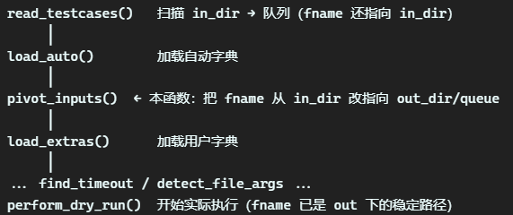

为什么必须迁移，因为后续 fuzz 中每条队列文件的 `fname` 要被 `open` 无数次，且 `crashes/`、`hangs/` 的样本也要复用这套命名。种子留在 `in_dir` 不迁到 `out_dir` 的话，`out_dir` 就不自包含、resume 也没法用


#### 4.1.22 AFL队列文件名的编码规范

> id:000012,src:000045,op:havoc,pos:4,val:+5

各字段含义：

| 字段      | 含义                                | 示例                              |
| --------- | ----------------------------------- | --------------------------------- |
| `id:`     | 该条目在队列中的序号（6 位补零）    | `id:000012` = 第 12 个条目        |
| `src:`    | **父条目** id，它由哪个条目变异而来 | `src:000045` = 来自第 45 个条目   |
| `+NNNNNN` | splice 拼接时第二个父条目           | `src:000012+000034`               |
| `op:`     | 发现它的变异阶段                    | `op:havoc`/`op:flip1`/`op:arith8` |
| `pos:`    | 变异发生在哪个偏移                  | `pos:4`                           |
| `val:`    | 变异写入的值                        | `val:+5`                          |
| `rep:`    | 重复类操作（无 pos 时）             | `rep:64`                          |
| `+cov`    | 触发**新覆盖**（hnb==2）的路径      | `...+cov`                         |
| `sync:`   | 从其他实例同步来的                  | `sync:slave1,src:000012`          |


生成点在 `describe_op()`（3073 行），`save_if_interesting` 拼接时用：

```c
fn = alloc_printf("%s/queue/id:%06u,%s", out_dir, queued_paths, describe_op(hnb));
```

`id` 号直接取当前 `queued_paths`（新条目就是第 N 个）；`describe_op` 拼出 `src:...` 等溯源字段


**id: 和 src: 的具体含义**

**`id:000012`** 类似身份编号。这个文件在队列链表里的位置（第 12 个）。`save_if_interesting` 生成时就是 `queued_paths` 的当前值，所以**编号递增且唯一**

**`src:000045`** 类似血缘关系。这个条目**不是凭空来的**，它是第 45 个条目经过某次变异后产生了新覆盖，于是被保留下来的`src` 就是那次变异的"母体"id


**这套编码的三种用途**

1 可读的溯源：

```
id:000012,src:000045,op:havoc,pos:4,val:+5
```

一眼可以读出是第 12 个文件，是把第 45 个文件在偏移 4 处做了 `+5` 的 havoc 变异发现的。排查崩溃（`crashes/id:000321,sig:06,src:...`）时，可以沿 `src` 链回溯到最初种子，理解哪个变异组合引爆了这个 bug


2 深度恢复（pivot_inputs 里用，3016 行）：

```c
src_str = strchr(rsl + 3, ':');                  // 找 ",src:000045"
if (src_str && sscanf(src_str + 1, "%06u", &src_id) == 1) {
    s = queue; while (src_id-- && s) s = s->next;  // 线性走到第 45 个
    if (s) q->depth = s->depth + 1;                // 深度 = 父深度 + 1
}
```

resume 续跑时，靠 `src:` 恢复**变异层级**，`id:000012` 的深度是 `src:000045` 那个条目的深度 +1。初始种子的名字没有 `src:`（就是 `orig:`），深度固定 1


3 去重与追溯：`sync:slave1` 标记并行导入的用例来源，`+cov` 标记"这算新覆盖"，用于统计（`queued_with_cov`）


#### 4.1.23 load_extras函数

```c
if (extras_dir) load_extras(extras_dir);    // main 8053 行
```

`extras_dir` 由 `-x` 选项填充（用户给了才非空）。没给 `-x` 就完全跳过

> 解析 @ 分级 → 判定"目录 or 单文件" → 逐个 token 读入 → 排序 → 报告/警告


##### 1 `@` 后缀：词典分级语法

```c
u32 ... dict_level = 0;
if ((x = strchr(dir, '@'))) {       // 目录路径里带 @
    *x = 0;                          // "dict@3" → 截断成 "dict"
    dict_level = atoi(x + 1);        // 级别 = 3
}
ACTF("Loading extra dictionary from '%s' (level %u)...", dir, dict_level);
```

`@` 标记**词典级别**。配合 `load_extras_file` 里 token 行内的 `token@2` 语法，每条 token 可以带级别号，`atoi(lptr+1) > dict_level` 的 token 被跳过。效果为**同一个词典文件可按需要加载不同子集**（比如高级别 token 更长/更专业，低级别只取核心）

> 注意区分两种 `@`：
>
> **路径上的 `@`**（`-x dict@3`）→ `dict_level`，整体级别门槛
>
> **token 行内的 `@`**（`"foo"@2`）→ 该 token 自己的级别


##### 2 两种输入形态：目录 or 单文件

```c
d = opendir(dir);
if (!d) {
    if (errno == ENOTDIR) {                    // 路径不是目录 → 是单个文件
        load_extras_file(dir, &min_len, &max_len, dict_level);   // 按行解析
        goto check_and_sort;
    }
    PFATAL("Unable to open '%s'", dir);
}
if (x) FATAL("Dictionary levels not supported for directories.");   // 目录不能带 @
```

**`opendir` 失败的 `errno == ENOTDIR` 分支**：说明 `-x` 给的其实是**单个词典文件**，走 `load_extras_file`（按行解析 `name="value"` 格式，处理 `\xNN` 转义、注释、级别过滤）。否则按**目录**处理，每个文件就是一个 token

目录带 `@` 分级 → FATAL（目录没法逐行标级别）


##### 3 目录形态：遍历每个文件

```c
while ((de = readdir(d))) {
    fn = "%s/%s";
    if (lstat(fn, &st) || access(fn, R_OK)) PFATAL(...);
    if (!S_ISREG(st.st_mode) || !st.st_size) continue;   // 过滤 . .. 非普通/空文件
    if (st.st_size > MAX_DICT_FILE)                       // 单个 token >128 字节
        FATAL("Extra '%s' is too big (limit is %s)");
    if (min_len > st.st_size) min_len = st.st_size;       // 跟踪大小范围
    if (max_len < st.st_size) max_len = st.st_size;
    extras = ck_realloc_block(extras, (extras_cnt+1) * sizeof(extra_data));
    extras[extras_cnt].data = ck_alloc(st.st_size);
    extras[extras_cnt].len  = st.st_size;
    ck_read(fd, extras[extras_cnt].data, st.st_size, fn); // 整文件 = 一个 token
    extras_cnt++;
}
```

**目录模式下"每个文件 = 一个 token"**，整个文件内容就是字典词条。过滤和限制：

非普通文件/空文件 → 跳过（顺带处理 `.`/`..`）

超过 `MAX_DICT_FILE`（128 字节）→ FATAL（不是跳过，作者认为超限词典是配置错误）

`min_len`/`max_len` 记录范围供最后报告


##### 4 `check_and_sort` 收尾

```c
check_and_sort:
    if (!extras_cnt) FATAL("No usable files in '%s'", dir);
    qsort(extras, extras_cnt, sizeof(extra_data), compare_extras_len);
    OKF("Loaded %u extra tokens, size range %s to %s.", ...);
    if (max_len > 32)
        WARNF("Some tokens are relatively large - consider trimming.");
    if (extras_cnt > MAX_DET_EXTRAS)      // >200
        WARNF("More than %u tokens - will use them probabilistically.");
```

**空词典 → FATAL**：`-x` 给了但没读到任何 token，配置等于白给

**按长度排序**（`compare_extras_len`）：让下游"按长度精确匹配"的查重（`maybe_add_auto` 的二分式优化）和确定性阶段遍历有序

两条警告：

​	token >32 字节 → 提示精简（大 token 变异时命中率低）

​	token >200 个 → 提示确定性阶段会**概率性**使用（`MAX_DET_EXTRAS` 上限，超出部分进 havoc 概率池）


#### 4.1.24 find_timeout函数

**只在用户没给 `-t` 时**调用，`find_timeout` 是 fuzzer 在校准（calibration）阶段用于动态调整单个测试用例超时时间的机制或标志

```c
if (!timeout_given) find_timeout();   // main 8055 行
```

`find_timeout()` 在续跑且未给 `-t` 时，从旧会话 `fuzzer_stats` 里 `strstr`+`atoi` 恢复上次的 `exec_timeout`（读不到或值过小就回退默认 1000ms），置 `timeout_given=3` 标记"恢复值"，目的是让超时在 resume 间保持稳定，不因反复自动校准而膨胀；所需符号全部由文件头部已包含的系统头（fcntl/unistd/stdlib/string）和 AFL 自己的 config/alloc-inl 提供


##### 1 `resuming_fuzz` 门卫

```c
if (!resuming_fuzz) return;
```

非续跑直接返回（用默认 `EXEC_TIMEOUT`）


##### 2 路径选择：两个续跑场景

```c
if (in_place_resume) fn = alloc_printf("%s/fuzzer_stats", out_dir);
else fn = alloc_printf("%s/../fuzzer_stats", in_dir);
```

| 场景                  | 读哪的 fuzzer_stats                        |
| --------------------- | ------------------------------------------ |
| `-i -`（原地续跑）    | `out_dir/fuzzer_stats`（就在当前工作目录） |
| `-i 旧输出`（非原地） | `in_dir/../fuzzer_stats`                   |

非原地时 `in_dir` 经 `read_testcases` 自动修正后指向旧输出的 `queue/` 子目录，所以 `../fuzzer_stats` 回到旧输出**根目录**拿 stats 文件。`../` 正是 queue 的父目录


##### 3 解析

```c
fd = open(fn, O_RDONLY);
if (fd < 0) return;                             // 读不到 → 放弃恢复
i = read(fd, tmp, sizeof(tmp) - 1); (void)i;   // 读最多 4095 字节
close(fd);
off = strstr(tmp, "exec_timeout      : ");     // 精确匹配字段名
if (!off) return;                              // 字段不在 → 放弃
ret = atoi(off + 20);                          // 值在 20 字符后
```

`strstr` 精确匹配 `write_stats_file` 写出的格式（12 字符字段名 + 6 空格 + `: `，共 **20 字节**），所以 `atoi(off + 20)` 直接指向数字

字段缺失（版本不匹配、文件损坏）→ 静默返回，保持默认超时


##### 4 安全校验

```c
if (ret <= 4) return;    // 太小 → 弃用恢复值
exec_tmout = ret;
timeout_given = 3;
```

ret <= 4拒绝荒谬的小值（也顺带覆盖 `atoi` 解析失败返回 0 的情形）。合法则 `exec_tmout = ret` 并置 timeout_given = 3


##### 5 `timeout_given = 3`：新增的"已恢复"状态

| 值    | 来源       | 含义             |
| ----- | ---------- | ---------------- |
| 0     | 未指定     | 用默认 1000ms    |
| 1     | `-t 1000`  | 用户严格         |
| 2     | `-t 1000+` | 用户容忍         |
| **3** | 本函数     | **从旧会话恢复** |

为什么不能复用 1 或 0？因为`timeout_given=1` 会让后续 `perform_dry_run` 在超时时直接 FATAL（严格语义），而恢复的超时不该这么苛刻，timeout_given != 0 只是让干跑代码知道超时是确定的，不要自动校准，但 3 区别于用户显式的 1/2，避免误触发严格模式的行为差异


#### 4.1.25 detect_file_args函数

`detect_file_args()` 检查目标程序的命令行参数，判断是否存在 `@@` 占位符

若存在 `@@`，AFL 会认为目标程序需要文件路径作为输入，于是将 `@@` 替换为临时文件名，并通过该文件传递变异后的数据

若不存在 `@@`，AFL 默认目标程序从 `stdin` 读取数据，所有测试用例通过管道写入目标程序的标准输入

```c
detect_file_args(argv + optind + 1);
```

`detect_file_args` 扫描目标程序参数里的 `@@`，用 `getcwd` 拼出的绝对路径把 `out_file`（默认 `out_dir/.cur_input`）替换进去，让目标从 AFL 每次写入的文件读输入，`@@` 与 `-f` 配套

`argv[optind]` 是目标程序本身，`+1` 跳过它。所以只扫描**目标程序的命令行参数**（`argv[optind+1]` 起），不含目标程序和 AFL 自己的选项


##### `@@` 约定

AFL 的标准调用形式：

```
afl-fuzz -i seeds -o out ./target @@
```

`@@` 是**占位符**，运行前被替换成 afl-fuzz 写变异输入的临时文件路径。目标程序收到真实文件路径，从文件读输入


##### **1. 取当前工作目录**

```c
u8* cwd = getcwd(NULL, 0);
if (!cwd) PFATAL("getcwd() failed");
```

`getcwd(NULL, 0)` 让 libc 自动分配足够大的 buffer。为后面拼绝对路径准备。结束时 `free(cwd)`，getcwd 的内存不经过 AFL 分配器，只能用原始 `free`


##### **2. 遍历参数，寻找 `@@`**

```c
while (argv[i]) {
    u8* aa_loc = strstr(argv[i], "@@");
    if (aa_loc) { ... }
    i++;
}
```

逐参数扫描直到 NULL 结尾，`strstr` 寻找第一个 `@@`


##### **3. 确定输入文件（`out_file`）**

```c
if (!out_file)
    out_file = alloc_printf("%s/.cur_input", out_dir);
```

用户没给 `-f` → 默认临时文件是 **`out_dir/.cur_input`**。`out_file` 是 AFL 每次写变异输入的那个文件（`write_to_testcase` 的目标）


##### **4. 绝对路径化 `aa_subst`**

```c
if (out_file[0] == '/') aa_subst = out_file;      // 已经是绝对路径 → 直接使用
else aa_subst = alloc_printf("%s/%s", cwd, out_file);   // 相对路径 → 拼接 cwd
```

防止目标程序内部 `chdir` 导致相对路径失效。`aa_subst` 是新分配的 buffer（相对时）


##### **5. 字符串替换**

```c
*aa_loc = 0;                                          //  在 "@@" 处截断 argv[i]
n_arg = alloc_printf("%s%s%s", argv[i], aa_subst, aa_loc + 2);  //  拼接
argv[i] = n_arg;                                      //  替换参数
*aa_loc = '@';                                        //  恢复旧 buffer（防御性）
```

> 三段拼接：
>
> `*aa_loc = 0`：把 `argv[i]` 里的 `@@` 就地改成 NUL，让 `alloc_printf` 的 `%s` 只取 `@@` **之前**的部分
>
> `aa_loc + 2`：`@@` **之后**的部分（跳过两个字符）
>
> `argv[i] = n_arg` 后旧 buffer 被遗弃，`*aa_loc = '@'` 把它恢复原状

例：`"./target --input @@ --quiet"` → `"./target --input /path/out/.cur_input --quiet"`


##### **6. 内存清理**

```c
if (out_file[0] != '/') ck_free(aa_subst);
```

`aa_subst` 只有在"相对路径新分配"时才需要释放；绝对路径时它只是 `out_file` 的别名，不能 free


##### 与下游的衔接

替换后的 `argv` 是 `use_argv`（QEMU 模式下还要再包一层 qemu），最终传给目标：

> ​	**每次执行**：`write_to_testcase(out_buf, len)` 把变异 buffer 写入 `out_file`（`out_file` 非空时走 `unlink+open+write`，见 2512 行）
>
> ​	**目标进程**：`argv` 里的替换路径让它 `open(".../out/.cur_input")` 读到 AFL 刚写入的数据
>

**无 `@@` 的情况**：目标从 stdin 读，AFL 用 `setup_stdio_file()` 准备临时输入文件并通过 `dup2(out_fd, 0)` 传给 stdin（`run_target` 2076 行）


##### `@@` 与 `-f` 的关系

| 配置      | out_file                  | 效果                    |
| --------- | ------------------------- | ----------------------- |
| `-f file` | 用户指定                  | `@@` 替换成该文件路径   |
| 只用 `@@` | 默认 `out_dir/.cur_input` | 同上，文件由 AFL 自动选 |
| 都不用    | `setup_stdio_file()`      | 目标从 stdin 读         |

`-f` 决定"文件叫什么"，`@@` 决定"目标在哪读"，两者配套使用，`detect_file_args` 把默认文件名的确定和占位符替换一起做了


#### 4.1.26 setup_stdio_file函数

setup_stdio_file负责初始化测试用例输入通道，根据目标程序是使用标准输入（stdin）还是命令行文件参数（`@@`）来准备相应的文件描述符，供后续写入变异数据

```c
if (!out_file) setup_stdio_file();		// main 8059 行
```

如果到这里时 `out_file` 仍为空，说明**既没 `-f`、也没 `@@`**（`detect_file_args` 遇 `@@` 会置 `out_file`）。目标既不从指定文件读，也不从 `@@` 占位路径读，只能从 **stdin** 读


```c
u8* fn = alloc_printf("%s/.cur_input", out_dir);   // 1. 临时文件路径
unlink(fn);                                        // 2. 删旧文件
out_fd = open(fn, O_RDWR | O_CREAT | O_EXCL, 0600); // 3. 排他创建
if (out_fd < 0) PFATAL("Unable to create '%s'", fn);
ck_free(fn);
```

**1. 文件位置**：`out_dir/.cur_input`，放在输出目录里，与其他工作文件在一起

**2. `unlink(fn)` 先删**（忽略错误）：清掉上次会话可能残留的旧文件，为 `O_EXCL` 铺路

**3. `open(O_RDWR | O_CREAT | O_EXCL, 0600)`**：

> `O_RDWR`：AFL 要写、子进程要读
>
> `O_CREAT`：不存在则创建
>
> `O_EXCL`：**排他**，文件已存在则失败（配合上一步 unlink，确保拿到一个"自己的"新文件，不被劫持）
>
> `0600`：仅当前用户读写

**`out_fd` 是全局持久 fd**（141 行 `static s32 out_fd`）：整个会话只打开这一次，后续每次执行复用同一个 fd


#### 4.1.27 check_binary函数

用于验证用户指定的目标程序是否符合模糊测试的要求

```c
check_binary(argv[optind]);
```

`check_binary` 按 PATH 定位目标并校验可执行性，mmap 后检查格式（非脚本/ELF·Mach-O）、检测 `__AFL_SHM_ID` 插桩特征（未插桩报错并建议 -Q/-n）、验证 ASAN/MSAN 与 persistent/deferred 签名并同步到全局状态

> PATH 查找 → 基础校验（普通文件/可执行/非空）→ /tmp 检查
> → mmap 验证格式（非脚本/ELF或Mach-O）→ 插桩检测 → qemu互斥
> → ASAN检测 → persistent/deferred 签名检测


##### 1. PATH 查找（两种路径）

```c
if (strchr(fname, '/') || !(env_path = getenv("PATH"))) {
    target_path = ck_strdup(fname);                 // 含 '/' 或没 PATH → 直接用
    if (stat(...) || !S_ISREG || !(mode&0111) || size < 4)
        FATAL("not found or not executable");
} else {
    while (env_path) {                              // 遍历 PATH 冒号分隔元素
        cur_elem = ...复制一个目录元素...;
        target_path = alloc_printf("%s/%s", cur_elem, fname);
        if (!stat(target_path, &st) && S_ISREG && 可执行 && >=4字节) break;
        ck_free(target_path); target_path = 0;      // 没找到 → 换下一个
    }
    if (!target_path) FATAL("not found or not executable");
}
```

**fname 含 `/`**（`./target`、`/usr/bin/x`）→ 显式路径，直接校验

**纯文件名**（`target`）→ 像 shell 一样按 `PATH` 逐个目录试

校验条件四合一：`stat` 成功 + 普通文件 + 可执行位（`0111`）+ 至少 4 字节

结果存入全局 `target_path`，就是**forkserver 里的 `execv(target_path, argv)` **


##### 2. `/tmp` 检查：常见事故现场

```c
if ((!strncmp(target_path, "/tmp/", 5) && !strchr(target_path + 5, '/')) ||
    (!strncmp(target_path, "/var/tmp/", 9) && !strchr(target_path + 9, '/')))
    FATAL("Please don't keep binaries in /tmp or /var/tmp");
```

`/tmp` 根目录下的二进制被直接拒绝，**/tmp 通常挂 noexec**（权限上可执行但内核拒绝跑），且可能被清理。作者用一条 `strncmp`+`strchr` 精确定位"直接放在 /tmp 下"（排除 `/tmp/subdir/target`）


##### 3. mmap 后格式检查

```c
fd = open(target_path, O_RDONLY);
f_data = mmap(0, f_len, PROT_READ, MAP_PRIVATE, fd, 0);
...
if (f_data[0] == '#' && f_data[1] == '!')
    FATAL("Program '%s' is a shell script");       // shebang
#ifndef __APPLE__
if (f_data[0] != 0x7f || memcmp(f_data+1, "ELF", 3))
    FATAL("not an ELF binary");
#else
if (f_data[0] != 0xCF || f_data[1] != 0xFA || f_data[2] != 0xED)
    FATAL("not a 64-bit Mach-O binary");
#endif
```

**`#!` = shell script**：用 `mmap` 只读映射整个文件（不拷入内存），检查前两字节。shell wrapper 会把每次执行拖慢 20 倍+，必须拦下。

**ELF 魔数**（`0x7f 'E' 'L' 'F'`）确认是真正的原生二进制；macOS 检查 Mach-O 魔数（`0xCF 0xFA 0xED`）


##### 4. 插桩检测：核心判据

```c
if (!qemu_mode && !dumb_mode &&
    !memmem(f_data, f_len, SHM_ENV_VAR, strlen(SHM_ENV_VAR) + 1)) {
    ...FATAL("No instrumentation detected");
}
if (qemu_mode &&
    memmem(f_data, f_len, SHM_ENV_VAR, strlen(SHM_ENV_VAR) + 1)) {
    ...FATAL("Instrumentation found in -Q mode");
}
```

**`memmem` 在整个二进制里搜 `"__AFL_SHM_ID"` 字符串**。原理：`afl-gcc`/`afl-as` 注入的插桩汇编会在目标里嵌入 `__AFL_SHM_ID` 环境变量名（运行时 `getenv` 用它拿共享内存 id）。**二进制里含这个字符串 = 被插桩过**

> 非 qemu、非 dumb 且搜不到 → FATAL（带详细指引：推荐 QEMU 或 -n）
>
> qemu 模式搜到 → FATAL（"已被插桩却用 QEMU，纯属浪费"），反向检查


##### 5. ASAN/MSAN 检测

```c
if (memmem(f_data, f_len, "libasan.so", 10) ||
    memmem(f_data, f_len, "__msan_init", 11)) uses_asan = 1;
```

二进制里出现 `libasan.so`（动态链接的 ASAN 运行时）或 `__msan_init`（MSAN）→ 置 `uses_asan`。下游用它调整诊断消息（如 `-m` 太低时的提示"ASAN 需要更多内存"）


##### 6. persistent / deferred 模式签名

```c
if (memmem(f_data, f_len, PERSIST_SIG, strlen(PERSIST_SIG)+1)) {
    OKF("Persistent mode binary detected.");
    setenv(PERSIST_ENV_VAR, "1", 1);
    persistent_mode = 1;                       // 目标循环处理输入
} else if (getenv("AFL_PERSISTENT")) {
    WARNF("AFL_PERSISTENT is no longer supported...");   // 旧环境变量弃用警告
}
if (memmem(f_data, f_len, DEFER_SIG, ...)) {
    OKF("Deferred forkserver binary detected.");
    setenv(DEFER_ENV_VAR, "1", 1);
    deferred_mode = 1;                         // __AFL_INIT 推迟 forkserver 启动
} else if (getenv("AFL_DEFER_FORKSRV")) {
    WARNF("...no longer supported...");
}
```

**persistent 模式**：目标内嵌 `__AFL_LOOP` 循环，一次 exec 处理多轮输入（吞吐暴涨）。检测到签名就 `setenv` 对应变量，让运行时 hooks 生效

**deferred 模式**：`__AFL_INIT()` 让 forkserver 在目标内部某处才启动（跳过初始化阶段）。同理

两种旧环境变量（`AFL_PERSISTENT`/`AFL_DEFER_FORKSRV`）被**弃用**，作者从"靠环境变量开关"改为"从二进制签名自动检测"，旧变量只会误导，直接警告


##### 7. 收尾

```c
if (munmap(f_data, f_len)) PFATAL("unmap() failed");
```

`mmap` 的映射用完 `munmap` 释放


### 4.2 第一轮fuzz

#### 4.2.1 get_cur_time函数

`get_cur_time()` 是 AFL 全代码库的**时间基准函数**，`start_time = get_cur_time()` 标记 fuzzing 的开始时刻

```c
start_time = get_cur_time();
```

`get_cur_time()` 用 `gettimeofday` 取秒+微秒换算成毫秒（`1000ULL` 防溢出），`start_time` 用它标记模糊开始基准线，供时长统计、`fuzzer_stats`、首轮超时提示等消费


```c
static u64 get_cur_time(void) {
  struct timeval tv;
  struct timezone tz;
  gettimeofday(&tv, &tz);                    // 1. 取当前时间
  return (tv.tv_sec * 1000ULL) + (tv.tv_usec / 1000);   // 2. 换算毫秒
}
```

**1. `gettimeofday(&tv, &tz)`**：`tv` 拿到秒（`tv_sec`）+ 微秒（`tv_usec`）。 `tz`（时区）在现代 Linux 上已被忽略，但作者仍传了 `struct timezone`用于兼容旧系统接口

**2. 毫秒换算**：

`tv.tv_sec * 1000ULL`：秒 → 毫秒。`1000ULL` 强制 **u64 运算**，防止 `tv_sec`乘 `1000` 时在 32 位 int 下溢出

`tv.tv_usec / 1000`：微秒 → 毫秒（整数除法截断）

返回 **Unix 毫秒时间戳**。精度毫秒级，满足 fuzzing 的计时需求


#### 4.2.2 get_qemu_argv函数

**非 QEMU**：`argv + optind`，跳过 AFL 选项，`argv[optind]` 是目标二进制

**QEMU**：调 `get_qemu_argv` 重写，在目标前插一层 qemu

```c
  if (qemu_mode)
    use_argv = get_qemu_argv(argv[0], argv + optind, argc - optind);
  else
    use_argv = argv + optind;
```

调用点按 qemu 与否决定 `use_argv`，为QEMU 时 `get_qemu_argv` 构造 `afl-qemu-trace -- target 参数...` 的新 argv（含稳定性 workaround、按 `AFL_PATH`→同目录→`BIN_PATH` 三级找 qemu），并把 `target_path` 同步改成 qemu 包装器；此后所有执行都通过这个重写后的 argv 运行


##### `get_qemu_argv` 构造的 argv 布局

```c
new_argv[0] = /path/to/afl-qemu-trace    // qemu 包装器
new_argv[1] = "--"                       // qemu 的分隔符（后面是 guest 命令）
new_argv[2] = target_path                // 真实目标
new_argv[3..] = 原目标参数               // 原样搬移
NULL                                     // ck_alloc 清零保证
```

**`target_path` 被同步改成 afl-qemu-trace**（54 行），forkserver 里 `execv(target_path, argv)` 启动的是 qemu 而非目标，由 qemu 再拉起真实目标。这也是 `new_argv[2]` 复用 `target_path` 的原因（此时它已被替换）


##### 逐段实现

**1. 分配与稳定性 workaround**

```c
new_argv = ck_alloc(sizeof(char*) * (argc + 4));   // +4 余量（3 插入位 + 安全垫）
setenv("QEMU_LOG", "nochain", 1);                  // 关掉 QEMU 的 chaining 优化
```

`ck_alloc` 清零分配，所以数组天然以 NULL 结尾（拷贝段之外全 0）。`QEMU_LOG=nochain` 是实测出的稳定性修复，某些目标的指令翻译在 chaining 优化下会出问题


**2. 参数搬迁**

```c
memcpy(new_argv + 3, argv + 1, sizeof(char*) * argc);
```

`argv`（调用点传入 `argv+optind`）段里：`argv[0]` 是目标、`argv[1..]` 是参数。拷贝 `argv+1` 起的指针数组到 `new_argv+3`。`sizeof(char*) * argc` 多拷贝一个指针（原段尾部 NULL），落到 `new_argv[3+argc]`，正好也是 NULL


**3. 寻找 afl-qemu-trace：三处候选**

```c
// 1. AFL_PATH 环境变量
tmp = getenv("AFL_PATH");
if (tmp) { cp = "%s/afl-qemu-trace"; if (access(cp, X_OK)) FATAL; return; }


// 2. afl-fuzz 自己所在目录（own_loc = argv[0] 的目录）
own_copy = ck_strdup(own_loc); rsl = strrchr(own_copy, '/');
if (rsl) { *rsl = 0; cp = "%s/afl-qemu-trace"; if (!access) return; }


// 3. 编译期安装路径 BIN_PATH
if (!access(BIN_PATH "/afl-qemu-trace", X_OK)) return;
// 全部失败 → 提示 + FATAL
```

优先级：`AFL_PATH` > afl-fuzz 同目录 > `BIN_PATH`。每个都 `access(X_OK)` 确认存在且可执行。`own_loc` 是 afl-fuzz 自身的路径（`argv[0]`），取其目录找同级的 `afl-qemu-trace`，方便从源码树直接运行


**4. 失败提示**：找不到时给出完整指引（`qemu_mode/README.qemu` 构建方法、`AFL_PATH` 设置、以及"没有 QEMU 还能用 afl-gcc 插桩或 -n"的替代方案）后 `FATAL`


#### 4.2.3 perform_dry_run函数

`perform_dry_run()` 是启动前的全面体检，对每个初始种子跑一次真实标定，把配置/种子的所有问题在 fuzz 开始前暴露出来

```c
perform_dry_run(use_argv);
```

`perform_dry_run` 逐个读入初始种子、`calibrate_case` 真实标定，按故障类型分层处置，超时按 `-t` 三态（严格 FATAL / 容忍跳过）、崩溃按 `-C`/`AFL_SKIP_CRASHES` 放行、无插桩/无法执行直接 FATAL、无覆盖则警告计数；收尾统计失败比例，把"跳过"的决策以 `cal_failed` 标记固化给后续主循环，确保所有配置问题在正式 fuzz 前暴露


##### 主循环：读种子 + 标定

```c
while (q) {
    fd = open(q->fname, O_RDONLY);                   // 以只读方式打开当前队列项对应的种子文件
    use_mem = ck_alloc_nozero(q->len);               // 分配一块与文件大小相同的内存缓冲区
    if (read(fd, use_mem, q->len) != q->len)         // 将整个文件读入缓冲区，若读取字节数不等于预期长度则报错
        FATAL("Short read from '%s'", q->fname);     // 种子文件必须完整读出
    res = calibrate_case(argv, q, use_mem, 0, 1);    // 调用校准函数，handicap=0, from_queue=1
    ck_free(use_mem);                                // 释放临时缓冲区
    if (stop_soon) return;                           // Ctrl-C 中断干跑
    if (res == crash_mode || res == FAULT_NOBITS)    // 判断校准结果是否为崩溃探索模式或未产生有效覆盖率
        SAYF("len = %u, map size = %u, exec speed = %llu us");
    switch (res) { ... }                             // 根据校准结果进行后续处理
    if (q->var_behavior) WARNF("Instrumentation output varies across runs.");
    q = q->next;                                     // 移动到队列中的下一个测试用例
}
```

每个种子读入内存 → `calibrate_case` 标定（多次执行取 `exec_cksum`、测 `exec_us`/`bitmap_size`、检测可变行为）

**`Short read` 即 FATAL**：种子文件与队列记录的 `len` 不一致属于致命不一致

有异常结果才打印详细参数（正常执行不打扰）

`stop_soon` 中途可退


##### switch(res)：每种故障的处置

**`FAULT_NONE`（正常）**

```c
if (q == queue) check_map_coverage();      // 第一个种子额外检查覆盖率
if (crash_mode) FATAL("Test case '%s' does *NOT* crash", fn); // -C 下种子必须会崩溃
```

第一个种子时 `check_map_coverage()`（2726 行）核算 bitmap 覆盖密度，确认插桩真的产生了覆盖


**`FAULT_TMOUT`（超时）**

按 `timeout_given` 三态分流：

```c
if (timeout_given) {
    if (timeout_given > 1) {                       // -t 1000+ 容忍
        WARNF("Test case results in a timeout (skipping)");
        q->cal_failed = CAL_CHANCES;               // 标记"不再重试标定"
        cal_failures++;
        break;                                     // 跳过，继续
    }
    FATAL("Test case '%s' results in a timeout", fn);   // -t 严格 → 报错
} else {
    FATAL("Test case '%s' results in a timeout", fn);           
}
```


**`FAULT_CRASH`（崩溃）**

```c
if (crash_mode) break;                                    // -C 下崩溃是预期
if (skip_crashes) { ...跳过... cal_failures++; break; }   // AFL_SKIP_CRASHES 容忍
...诊断消息（种子自身/内存不足/macOS forkserver）...
FATAL("results in a crash");
```

非 `-C` 模式默认崩溃种子是**致命问题**（诊断消息枚举了三种可能：种子本身就会崩溃、`-m` 太低 OOM、macOS fork 语义），`AFL_SKIP_CRASHES` 提供逃生口。

**`FAULT_ERROR` / `FAULT_NOINST`** → 分别 `FATAL`（无法执行/无插桩）


**`FAULT_ERROR` （错误）**

```c
FATAL("Unable to execute target application ('%s')", argv[0]);
```


**`FAULT_NOINST`（没有插桩）**

```c
FATAL("No instrumentation detected");
```


**`FAULT_NOBITS`（无新覆盖）**

```c
useless_at_start++;
if (!in_bitmap && !shuffle_queue)
    WARNF("No new instrumentation output, test case may be useless.");
```

种子没触发任何新覆盖，标记"初始无用种子"计数，警告但不中断（可能只是插桩路径与已有种子重复）


##### 收尾统计

```c
if (cal_failures) {
    if (cal_failures == queued_paths)
        FATAL("All test cases time out%s, giving up!", skip_crashes ? " or crash" : "");
    WARNF("Skipped %u test cases (%0.02f%%) due to timeouts%s.", ...);
    if (cal_failures * 5 > queued_paths)
        WARNF(cLRD "High percentage of rejected test cases, check settings!");
}
OKF("All test cases processed.");
```

**全部失败** → FATAL（没有可用种子）

**部分失败** → 警告百分比

**>20%**（`*5 > queued_paths`）→ 醒目提示设置可能有问题


##### 与后续 `fuzz_one` 的衔接

`q->cal_failed = CAL_CHANCES` 是关键状态传递，被跳过的种子标记为"标定失败次数已达上限"，`fuzz_one` 里（5087 行）：

```c
if (queue_cur->cal_failed) {
    if (queue_cur->cal_failed < CAL_CHANCES) {
        res = calibrate_case(...);   // 还有重试机会才重新标定
    }
    ...goto abandon_entry;           // 否则直接跳过该条目
}
```

所以干跑里被 `-t+`/`AFL_SKIP_CRASHES` 跳过的种子，主循环也不会再碰，一次性决定，不会反复烧 CPU


#### 4.2.4 calibrate_case函数

`calibrate_case()` 对新入队条目做多次执行体检，算出路径签名 `exec_cksum`、速度 `exec_us`、覆盖量 `bitmap_size`，用轨迹比对识别可变行为（延长轮次确认）、用 `has_new_bits` 识别新覆盖，最后 `update_bitmap_score` 登记进 `top_rated` 并返回 fault；所有 `stage_*` 全局状态进出成对保存恢复

```c
static u8 calibrate_case(char** argv, struct queue_entry* q, u8* use_mem,
                                     u32 handicap, u8 from_queue)
```

> `argv`：目标执行参数（传给 `run_target`）
>
> `q`：被标定的队列条目
>
> `use_mem`：该条目的输入内容
>
> `handicap`：滞后轮数（新发现条目传 `queue_cycle-1`，越晚发现滞后越大，`calculate_score` 据此补权重）
>
> `from_queue`：是否来自队列初检（干跑传 1，新路径传 0）
>
> 返回 `u8`：故障码（`FAULT_*`）


三个调用点（`from_queue` 区分）：

| 场景                             | from_queue | handicap      |
| -------------------------------- | ---------- | ------------- |
| `perform_dry_run` 初始种子       | 1          | 0             |
| `save_if_interesting` 新发现路径 | 0          | queue_cycle-1 |
| `fuzz_one` 标定失败重试          | 0          | queue_cycle-1 |

**多次执行**同一输入，得出 `exec_cksum`（路径签名）、`exec_us`（速度）、`bitmap_size`（覆盖量）、是否**可变行为**、是否**新覆盖**，最后 `update_bitmap_score` 登记


##### 函数签名与变量声明

```c
static u8 calibrate_case(char** argv, struct queue_entry* q, u8* use_mem,
                         u32 handicap, u8 from_queue) {
  static u8 first_trace[MAP_SIZE];
  u8  fault = 0, new_bits = 0, var_detected = 0, hnb = 0,
      first_run = (q->exec_cksum == 0);
  u64 start_us, stop_us;
  s32 old_sc = stage_cur, old_sm = stage_max;
  u32 use_tmout = exec_tmout;
  u8* old_sn = stage_name;
```

> `first_trace`（static）: 首份轨迹快照，64KB 放数据段
>
> `first_run` : 由 `exec_cksum==0` 推导，贯穿全函数的分水岭
>
> `old_sc/old_sm/old_sn` : 借用 `stage_*` 全局槽位前的"存档"，函数末尾成对恢复
>
> `use_tmout` : 局部超时，默认继承全局 `exec_tmout`，可被下一步放宽


##### 超时放宽

```c
if (!from_queue || resuming_fuzz)
    use_tmout = MAX(exec_tmout + CAL_TMOUT_ADD,
                    exec_tmout * CAL_TMOUT_PERC / 100);
```

单分支 `if`（无 else），只改局部变量。新路径标定（`from_queue==0`）或续跑时，把超时放宽到"加 50ms"与"乘 125%"的较大者，防间歇延迟误判


##### 尝试计数与阶段设置

```c
  q->cal_failed++;
  stage_name = "calibration";
  stage_max  = fast_cal ? 3 : CAL_CYCLES;
```

两条独立赋值。进入即计一次尝试；借用全局 `stage_*` 显示校准进度，`fast_cal` 时只跑 3 轮、否则 8 轮


##### forkserver 首次启动

```c
  if (dumb_mode != 1 && !no_forkserver && !forksrv_pid)
    init_forkserver(argv);
```

三个条件的守卫单分支。首次真实执行前把 forkserver 拉起来（三重排除：纯 dumb / 显式禁用 / 已启动）。**位于计时起点之前**，启动耗时不计入标定


##### 非首次预载

```c
  if (q->exec_cksum) {
    memcpy(first_trace, trace_bits, MAP_SIZE);
    hnb = has_new_bits(virgin_bits);
    if (hnb > new_bits) new_bits = hnb;
  }
```

仅重试标定（已有签名）时：把当前轨迹存为基线，先探一次新覆盖并 `max` 累计，因为 `has_new_bits` 会就地清零 `virgin_bits`，返回值必须立即保存


##### 主执行循环

```c
start_us = get_cur_time_us();		                            //记录本次校准循环开始时间
  for (stage_cur = 0; stage_cur < stage_max; stage_cur++) {		//进入校准执行循环，最多执行 stage_max 次
    u32 cksum;					                               //用于存储当前执行后覆盖率位图的哈希值
    if (!first_run && !(stage_cur % stats_update_freq)) show_stats();  //如果不是第一次运行且到达统计更新频率，则刷新显
      															 //示状态信息（如执行速度、路径数等）
    write_to_testcase(use_mem, q->len);						  //将测试用例数据写入目标程序的输入通道
    fault = run_target(argv, use_tmout); //实际执行目标程序，传入命令行参数 argv 和超时时间 use_tmout，返回执行结果状态码
    if (stop_soon || fault != crash_mode) goto abort_calibration;//如果用户停止或执行结果非预期的崩溃模式则退出校准循环
    if (!dumb_mode && !stage_cur && !count_bytes(trace_bits)) {  //检查覆盖率位图是否全为零
      fault = FAULT_NOINST;
      goto abort_calibration;					//如果位图全零，认为目标程序未正确插桩，设置错误码 FAULT_NOINST 并退出
    }
    cksum = hash32(trace_bits, MAP_SIZE, HASH_CONST);//计算当前覆盖率位图的哈希值，用于判断多次执行之间覆盖率是否发生变化
    if (q->exec_cksum != cksum) {                 //如果当前哈希值与队列项之前记录的哈希值不同则说明覆盖率发生了变化
      hnb = has_new_bits(virgin_bits);            //计算本次执行相对于全局未覆盖位图新发现的路径数
      if (hnb > new_bits) new_bits = hnb;         //更新本次校准过程中发现的最大新路径数
      if (q->exec_cksum) {                        //如果队列项之前已有哈希值说明覆盖率发生了波动
        u32 i;
        for (i = 0; i < MAP_SIZE; i++) {          //遍历整个覆盖率位图，检查每个字节的稳定性
          if (!var_bytes[i] && first_trace[i] != trace_bits[i]) {  
            var_bytes[i] = 1;                     //标记该字节为不稳定
            stage_max    = CAL_CYCLES_LONG;       //将最大执行次数增加到 CAL_CYCLES_LONG
          }
        }
        var_detected = 1;                         //设置标志表示检测到覆盖率不稳定
      } else {                                    //如果这是第一次执行（q->exec_cksum 为0），则记录初始状态
        q->exec_cksum = cksum;                    //保存当前哈希值作为队列项的基准哈希
        memcpy(first_trace, trace_bits, MAP_SIZE);//将本次覆盖率位图复制到 first_trace，作为后续比较的基准
      }
    }
  }
```

外层 `for` 包着一条**顺序流水线**（写→跑→判→哈希），内嵌两层条件

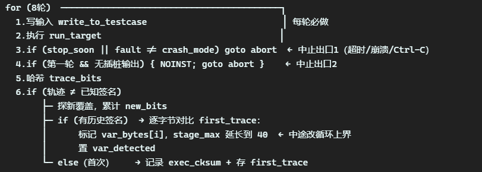

> 结构要点：
>
> **3. 的中止语义是 `fault != crash_mode`**：正常模式任何故障都中止，`-C` 模式则要求"必须崩溃"
>
> **4. 只查第一轮**（`!stage_cur`），一次判断完是否插桩
>
> **6. 的嵌套分叉**：首次（记录）vs 非首次（比对），是对称的 if/else
>
> **内层 `for` 直接改外层 `stage_max`**：发现可变行为后让外层多跑 32 轮，C 里循环上界可在循环体内修改


##### 成功收尾统计

```c
  stop_us = get_cur_time_us();                      //记录校准循环结束的时间（微秒）
  total_cal_us     += stop_us - start_us;           //将本次校准所花费的总时间累加到全局统计变量 total_cal_us
  total_cal_cycles += stage_max;                    //将本次校准执行的总循环次数（stage_max）累加到全局统计
  q->exec_us     = (stop_us - start_us) / stage_max;//计算该测试用例的平均执行时间（微秒），存入队列项 q 的 exec_us 字段
  q->bitmap_size = count_bytes(trace_bits);         //统计当前覆盖率位图 trace_bits 中非零字节的数量，存入队列项
  q->handicap    = handicap;                        //将传入的性能惩罚值 handicap 保存到队列项，用于后续模糊测试的调度
  q->cal_failed  = 0;                               //标记该测试用例校准成功
  total_bitmap_size += q->bitmap_size;              //将当前用例的覆盖率大小累加到全局总覆盖率大小
  total_bitmap_entries++;                           //增加已校准的队列项计数
  update_bitmap_score(q);                           //根据该用例的覆盖率，更新全局的最佳用例评分表（top_rated）
```

顺序赋值段。两类目的地：

> **全局**（`total_cal_*`/`total_bitmap_*`）→ 供 `calculate_score` 算全局平均值
>
> **条目**（`exec_us`/`bitmap_size`/`handicap`/`cal_failed=0`）→ 本条目的标定成果

关键：`update_bitmap_score(q)` 在此段末尾，**`goto abort` 会跳过整段**，所以 `top_rated` 只收成功标定的条目


##### 无覆盖告警

```c
  if (!dumb_mode && first_run && !fault && !new_bits) fault = FAULT_NOBITS;
```

四条件并列的单分支，属于"成功路径的追加判断"。首次 + 无故障 + 零新覆盖 → 升级为 `FAULT_NOBITS` 警告


##### 汇合收尾

```c
abort_calibration:                           //当校准循环需要提前结束时（如超时、崩溃、无插桩等），跳转到这里执行收尾工作
  if (new_bits == 2 && !q->has_new_cov) {    //检查本次校准是否发现了新的覆盖，且该队列项之前未被标记过包含新覆盖
    q->has_new_cov = 1;                      //标记该队列项具有新覆盖
    queued_with_cov++;                       //增加全局计数器 queued_with_cov，统计有多少队列项带来了新覆盖
  }
  if (var_detected) {                        //如果在校准过程中检测到该测试用例的覆盖率在多次执行间不稳定
    var_byte_count = count_bytes(var_bytes); //统计不稳定的字节数量（即覆盖率位图中发生变化的字节数）
    if (!q->var_behavior) {                  //如果该队列项之前没有被标记为可变行为
      mark_as_variable(q);                   //调用函数将该队列项标记为“可变行为”，会影响后续调度策略
      queued_variable++;                     //增加全局计数器 queued_variable，统计有多少队列项表现出可变行为
    }
  }
  stage_name = old_sn;                       //恢复之前保存的 stage 相关变量
  stage_cur  = old_sc;
  stage_max  = old_sm;
  if (!first_run) show_stats();              //如果不是第一次运行，则刷新显示统计信息
  return fault;                              //返回最终故障状态码
```

一个标签 + 三条并列收尾 + return。任何路径（主循环的 `goto` 或正常走完）都汇合到这里统一善后：

1. `new_bits == 2`（新边）→ 打 `has_new_cov` 标记并计数
2. `var_detected` → 统计不稳定字节、给条目打 `var_behavior` 标记、计数
3. **恢复 `stage_\*` 三兄弟**（与开头的存档成对）
4. 返回 `fault`


##### 函数结构

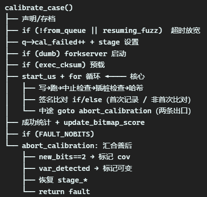

##### 函数控制流程图

[图片源自]: https://paper.seebug.org/1732#2-3-calibrate-case-%E5%87%BD%E6%95%B0

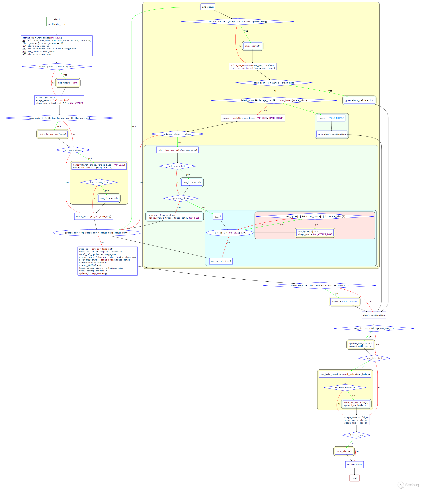


#### 4.2.5 init_forkserver函数

负责启动目标程序并建立高效执行通道，通过 `fork()` + `exec()` 启动目标程序，并利用管道与其内部的 forkserver 桩代码通信，使得后续每次测试用例的执行只需 `fork()` 一次即可

`init_forkserver` 创建两对管道后 fork，子进程完成资源限制、fd 重定向、管道映射（`FORKSRV_FD`/`FORKSRV_FD+1`）、环境预设后 `execv` 让目标驻留成 forkserver；父进程则设握手超时读 4 字节 ，成功后每次执行只需走管道命令

##### 结构总览

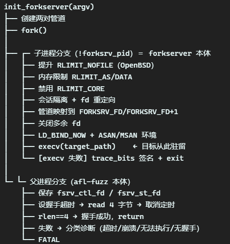


##### 1. 创建两对管道

```c
static struct itimerval it;          // 握手超时的定时器
int st_pipe[2], ctl_pipe[2];         // 两对管道
int status;
s32 rlen;
if (pipe(st_pipe) || pipe(ctl_pipe)) PFATAL("pipe() failed");
```

**两对管道分工**：

> `st_pipe`（status）：子进程 → 父进程，报告执行状态
>
> `ctl_pipe`（control）：父进程 → 子进程，下发"运行一次"的命令

这是 forkserver 全部通信通道，从此父进程不再 fork/exec，只写命令、读结果


##### 2. fork() 分支

```c
forksrv_pid = fork();
if (forksrv_pid < 0) PFATAL("fork() failed");
```

fork 一次，父进程继续往下，子进程成为常驻 forkserver


##### 3. 子进程分支：forkserver 本体的初始化

```c
if (!forksrv_pid) {
    struct rlimit r;
```


###### 3.1 提升文件描述符上限

```c
if (!getrlimit(RLIMIT_NOFILE, &r) && r.rlim_cur < FORKSRV_FD + 2) {
    r.rlim_cur = FORKSRV_FD + 2;
    setrlimit(RLIMIT_NOFILE, &r);
}
```

调整进程可打开文件描述符数量的软限制，确保其至少能容纳 forkserver 所需的专用文件描述符


###### 3.2 内存限制（防止 OOM）

```c
if (mem_limit) {
    r.rlim_max = r.rlim_cur = ((rlim_t)mem_limit) << 20;   // MB → 字节
#ifdef RLIMIT_AS
    setrlimit(RLIMIT_AS, &r);          // Linux：虚拟地址空间上限
#else
    setrlimit(RLIMIT_DATA, &r);        // OpenBSD：匿名映射由 RLIMIT_DATA 覆盖
#endif
}
```

`mem_limit`（`-m`）从 MB 左移 20 位转字节，作为子进程地址空间硬上限，OOM 崩溃被阻止在这里


###### 3.3 禁用 core dump

```c
r.rlim_max = r.rlim_cur = 0;
setrlimit(RLIMIT_CORE, &r);
```

core dump 慢且干扰崩溃判定（注释：SIGKILL 前可能残留半成品），直接禁用


###### 3.4 会话隔离与标准 fd 重定向

```c
setsid();                        // 脱离原会话/进程组
dup2(dev_null_fd, 1);            // stdout → /dev/null
dup2(dev_null_fd, 2);            // stderr → /dev/null
if (out_file) {
    dup2(dev_null_fd, 0);        // 目标读文件 → stdin 置 /dev/null
} else {
    dup2(out_fd, 0);             // 目标读 stdin → 接收 out_fd（.cur_input）
    close(out_fd);
}
```

`setsid()` 让 forkserver 自成会话，避免 Ctrl-C 等信号连带到整个进程组。stdout/stderr 丢弃（fuzzer 不看目标输出），stdin 按输入模式接收


###### 3.5 管道映射到约定 fd（关键）

```c
if (dup2(ctl_pipe[0], FORKSRV_FD) < 0) PFATAL("dup2() failed");
if (dup2(st_pipe[1], FORKSRV_FD + 1) < 0) PFATAL("dup2() failed");
```

插桩代码（afl-as.h）在目标启动时 `getenv` 拿 shm 后，就硬编码从 `FORKSRV_FD`（198）读命令、向 `FORKSRV_FD+1`（199）写状态。`dup2` 把这两个约定 fd 接到管道上，这就是父进程与目标之间"无 exec、纯管道"协作的接线点。通信协议：

```
父       → FORKSRV_FD    （198）：4 字节命令（"跑一次"）
子/目标  → FORKSRV_FD+1   （199）：4 字节状态（PID / 退出状态）
```


###### 3.6 关闭多余 fd

```c
    close(ctl_pipe[0]);
    close(ctl_pipe[1]);
    close(st_pipe[0]);
    close(st_pipe[1]);

    close(out_dir_fd);
    close(dev_null_fd);
    close(dev_urandom_fd);
    close(fileno(plot_file));
```

只留 dup 过去的两端，其余全关**，**子进程持最小 fd 集


###### 3.7 运行时环境（性能 + sanitizer）

```c
if (!getenv("LD_BIND_LAZY")) setenv("LD_BIND_NOW", "1", 0);   // 链接立即绑定，减少 fork 后工作
setenv("ASAN_OPTIONS", "abort_on_error=1:detect_leaks=0:symbolize=0:allocator_may_return_null=1", 0);
setenv("MSAN_OPTIONS", "exit_code=" STRINGIFY(MSAN_ERROR) ":symbolize=0:...", 0);
```

`LD_BIND_NOW`：fork 前就把符号绑定完，fork 后不再做动态链接工作

ASAN/MSAN 默认项（`setenv` 第三参 0 = 不覆盖用户已有值，对应 `check_asan_opts` 的校验）


###### 3.8 启动目标并驻留

```c
execv(target_path, argv);
```

execv 成功后目标就成了 forkserver，插桩汇编接手，写 4 字节握手、阻塞在 read 上等待命令


###### 3.9 execv 失败标志

```c
*(u32*)trace_bits = EXEC_FAIL_SIG;    // 复用 bitmap 前 4 字节当错误通道
exit(0);
```

若 `execv` 失败（目标不存在、无权限），落到这两行：在共享内存 `trace_bits` 写入签名并退出。父进程在 4.3 里检测该签名判"无法执行"


##### 4. 父进程分支：握手与验证

```c
close(ctl_pipe[0]); close(st_pipe[1]);       // 关掉自己不需要的端
fsrv_ctl_fd = ctl_pipe[1];                   // 写命令端
fsrv_st_fd  = st_pipe[0];                    // 读状态端
```

父进程持有的两端存入全局，`run_target` 每次执行都用它们


###### 4.1 握手超时保护

```c
it.it_value.tv_sec  = ((exec_tmout * FORK_WAIT_MULT) / 1000);
it.it_value.tv_usec = ((exec_tmout * FORK_WAIT_MULT) % 1000) * 1000;
setitimer(ITIMER_REAL, &it, NULL);           // 启动定时器
rlen = read(fsrv_st_fd, &status, 4);         // 阻塞等握手
it.it_value.tv_sec = 0; it.it_value.tv_usec = 0;
setitimer(ITIMER_REAL, &it, NULL);           // 取消定时器
```

握手不能无限等，用 `setitimer` 定时，超时触发 `SIGALRM`（`handle_timeout` 关闭 forkserver 并置 `child_timed_out`）


###### 4.2 成功判定

```c
if (rlen == 4) { OKF("All right - fork server is up."); return; }
```

读到 **4 字节**（插桩代码发的）→ 一切就绪


###### 4.3 失败分类诊断（按序排除）

```c
if (child_timed_out)                          // 握手超时
    FATAL("Timeout while initializing fork server (adjusting -t may help)");
if (waitpid(forksrv_pid, &status, 0) <= 0)    // 回收看退出状态
    PFATAL("waitpid() failed");
if (WIFSIGNALED(status)) {                    // 目标被信号杀死（崩溃）
    if (mem_limit && mem_limit < 500 && uses_asan)
        SAYF("ASAN + 内存限制太紧...");        // 已知场景：ASAN 需更多内存
    else if (!mem_limit)
        SAYF("二进制自身崩溃 / macOS fork 问题...");
    else
        SAYF("当前内存限制导致动态链接 OOM...");
    FATAL("Fork server crashed with signal %d", WTERMSIG(status));
}
if (*(u32*)trace_bits == EXEC_FAIL_SIG)       // execv 失败
    FATAL("Unable to execute target application ('%s')", argv[0]);
...                                           // 其余：未完成握手
FATAL("Fork server handshake failed");
```

**诊断优先级**：超时 → 崩溃（按 ASAN/OOM/自身崩三场景细分）→ exec 失败 → 无握手（含 deferred 未调用 `__AFL_INIT()` 的情形，见消息里的 `DEFER_ENV_VAR` 分支）。每类都给出可操作的排查建议，是"诊断即文档"的完整实现


##### 握手后的执行模型


##### 函数控制流程图

[图片来源]: https://paper.seebug.org/1732#2-4-init-forkserve-%E5%87%BD%E6%95%B0


##### 通信状态

fuzzer 并不直接 fork 子进程来执行目标程序，而是与目标程序内嵌的 forkserver 通信，由 forkserver 完成 fork 和后续执行，而目标程序内嵌的 forkserver 来自 AFL 在编译目标程序时注入的运行时初始化代码


**执行时序**


#### 4.2.6 has_new_bits函数

判断当前测试用例产生的覆盖率位图（`trace_bits`）是否包含了**此前从未出现过的新的边（edge）**，并负责更新全局的“未覆盖位图”（`virgin_bits`）

```c
static inline u8 has_new_bits(u8* virgin_map) {
```

`has_new_bits` 逐字块检查当前 `trace_bits` 与 `virgin_*` 的交集，有从未见过的字节（`vir[i]==0xff`）就返回 2（新边），只在已见字节上出现新的计数 bit 返回 1（计数变化），同时用 `*virgin &= ~*current` 就地清零已见位；配合 64 位批量 + 稀疏跳过保证"每次执行后调用"的性能

| 返回 | 含义                                                         |
| ---- | ------------------------------------------------------------ |
| `0`  | 无新东西（路径全见过，计数也没变）                           |
| `1`  | 仅计数变化，tuple 之前见过，但这次命中次数跃升到新的分类级别 |
| `2`  | 全新 tuple，出现了从未见过的边                               |


##### 批量处理与双位宽

```c
#ifdef WORD_SIZE_64
  u64* current = (u64*)trace_bits;
  u64* virgin  = (u64*)virgin_map;
  u32  i = (MAP_SIZE >> 3);        // 65536/8 = 8192 次迭代，每次 8 字节
#else
  u32* current = (u32*)trace_bits;
  ...
  u32  i = (MAP_SIZE >> 2);        // 每次 4 字节
#endif
```

用 **64 位字批量** + `static inline` 减少开销。`MAP_SIZE=65536` → 64 位版只需 8192 次迭代


##### 主循环：稀疏优化

```c
while (i--) {
  if (unlikely(*current) && unlikely(*current & *virgin)) {
    ...
    *virgin &= ~*current;    // 就地清零命中位
  }
  current++; virgin++;
}
```

**`if` 的两个条件**：

> 1. `*current` 非零：这块 8 字节有执行轨迹（稀疏 bitmap 绝大多数块全 0 → 跳过）
> 2. `*current & *virgin` 非零：当前轨迹里有 virgin **还没清过**的位

**绝大多数情况**都落在这两者之外（无轨迹 / 轨迹位全被 virgin 清过），一次迭代几乎不做内层工作。这是"每执行必调"函数能跑得快的关键。`unlikely()` 提示 CPU 分支预测走快路径


##### 内层：区分"新 tuple" vs "仅计数变化"

```c
if (ret < 2) {                    // 还没判到最高级(2)，才需要细看
  u8* cur = (u8*)current;
  u8* vir = (u8*)virgin;
  if ((cur[0] && vir[0] == 0xff) || ...) ret = 2;   // 有"全新"字节
  else ret = 1;                                     // 否则只是计数变化
}
```

逐字节检查 8 个字节里是否有 `cur[i] != 0` **且** `vir[i] == 0xff`：

> `vir[i] == 0xff`：该字节**从未被命中过**（virgin 还是初始全 1）→ 全新 tuple → `ret = 2`
>
> 否则：tuple 见过，只是这次命中了 virgin 里还留着的另一个 count bit → `ret = 1`

**`ret < 2` 的保护**：一旦已判为 2（新 tuple），后续块不再花时间细查（`2` 是最高优先级，无需再确认）


##### 就地清零副作用

```c
*virgin &= ~*current;
```

把这次轨迹命中的位**从 virgin 永久清 0**。同一路径第二次跑，`*current & *virgin` 为 0，直接跳过


##### bitmap_changed 联动

```c
if (ret && virgin_map == virgin_bits) bitmap_changed = 1;
```

判定有新东西、且操作的是主 `virgin_bits`（非 tmout/crash）→ 置全局 `bitmap_changed`。这个标志驱动 UI 的"map coverage"显示和 `write_bitmap` 的写盘时机


##### 调用点全景

| 调用处                          | 传入 map       | 目的                           |
| ------------------------------- | -------------- | ------------------------------ |
| `save_if_interesting` 正常路径  | `virgin_bits`  | 判断是否有新覆盖 → 是否入队    |
| `save_if_interesting` 崩溃分支  | `virgin_crash` | 崩溃签名去重                   |
| `save_if_interesting` hang 分支 | `virgin_tmout` | hang 签名去重                  |
| `calibrate_case`                | `virgin_bits`  | 标定时记录新覆盖（`new_bits`） |
| `save_auto` 相关                | `virgin_bits`  | ...                            |

返回 `2` 时调用方通常额外标记（如 `+cov`、`queued_with_cov++`）；返回 `1` 只算"有变化但不显著"


#### 4.2.7 show_stats函数

把 fuzzer 的全部运行状态排版成一个终端仪表盘，同时兼任"周期性落盘"和"退出条件检查"的调度点

```c
static void show_stats(void) {
```

`show_stats()` 节流刷新后先算平滑 exec 速度、bitmap 覆盖密度与稳定性，顺带执行每分钟左右的三类落盘和环境变量触发的退出检查；交互模式下再把它排成一个"process timing / map coverage / stage progress / fuzzing strategy"分栏的 ANSI 仪表盘，用颜色表达运行状态，底部显示 CPU 利用率


##### 1. 前置计算

节流

```c
static u64 last_stats_ms, last_plot_ms, last_ms, last_execs;
static double avg_exec;                    // 跨调用状态
cur_ms = get_cur_time();
if (cur_ms - last_ms < 1000 / UI_TARGET_HZ) return;   // 不到目标频率直接返回
if (cur_ms - start_time > 10 * 60 * 1000) run_over10m = 1;   // 10 分钟标记
```

`static` 变量记住上次调用时间，`UI_TARGET_HZ`（约 5Hz）控制刷新节流，`fuzz_one` 里每 N 次执行调一次它，大部分调用在此被拦下


**平滑 exec 速度（EMA）**

```c
if (!last_execs) {
    avg_exec = total_execs * 1000 / (cur_ms - start_time);   // 首次：全程平均
} else {
    cur_avg = (total_execs - last_execs) * 1000 / (cur_ms - last_ms);  // 瞬时速度
    if (cur_avg * 5 < avg_exec || cur_avg / 5 > avg_exec) avg_exec = cur_avg; // 5x突变快速重置
    avg_exec = avg_exec * (1 - 1/AVG_SMOOTHING) + cur_avg * (1/AVG_SMOOTHING); // EMA
}
last_ms = cur_ms; last_execs = total_execs;
```

指数滑动平均（EMA）平滑抖动；若瞬时速度与均值差 5 倍以上（如 CPU 被抢占/释放）则**立即重置**而非慢速跟随


**计算调用方的刷新频率**

```c
stats_update_freq = avg_exec / (UI_TARGET_HZ * 10);
if (!stats_update_freq) stats_update_freq = 1;
```

算出"每多少 exec 刷一次 UI"写回全局，`common_fuzz_stuff`/`fuzz_one` 靠 `stage_cur % stats_update_freq` 决定何时调 `show_stats`。让高频执行少刷屏、低频执行多刷屏，维持稳定刷新率


**bitmap 统计**

```c
t_bytes = count_non_255_bytes(virgin_bits);      // 被探索过的 tuple 数（virgin 被清过的字节）
t_byte_ratio = t_bytes * 100 / MAP_SIZE;         // 已探索 tuple 密度
stab_ratio = t_bytes ? 100 - var_byte_count*100/t_bytes : 100;   // 稳定性
```

`virgin_bits` 非 0xff 的字节 = 被命中过的 tuple。`stab_ratio` = 稳定路径占比（减掉可变字节）


##### 2. 周期性落盘

```c
if (cur_ms - last_stats_ms > STATS_UPDATE_SEC * 1000) {     // 约每分钟
    write_stats_file(t_byte_ratio, stab_ratio, avg_exec);   // fuzzer_stats
    save_auto();                                            // 自动字典存盘
    write_bitmap();                                         // 写 fuzz_bitmap
}
if (cur_ms - last_plot_ms > PLOT_UPDATE_SEC * 1000)
    maybe_update_plot_file(t_byte_ratio, avg_exec);         // gnuplot 追加
```

UI 刷新顺带驱动了**三类周期性落盘**，stats 文件、自动 token、绘图数据，全部靠 `static` 时间戳节流


##### 3. 退出条件检查

```c
if (!dumb_mode && cycles_wo_finds > 100 && !pending_not_fuzzed &&
    getenv("AFL_EXIT_WHEN_DONE")) stop_soon = 2;    // 无新发现且无待测 → 自动结束
if (total_crashes && getenv("AFL_BENCH_UNTIL_CRASH")) stop_soon = 2;  // 首个崩溃即停
if (not_on_tty) return;                              // 非终端：不再画 UI
```

`AFL_EXIT_WHEN_DONE`（跑完即退）、`AFL_BENCH_UNTIL_CRASH`（崩溃即退）两个环境变量在 UI 刷新点被检查，`show_stats` 成了除主循环外的第二个控制中枢


##### 4. UI 绘制（核心）

**清屏与横幅**

```c
if (clear_screen) { SAYF(TERM_CLEAR CURSOR_HIDE); clear_screen = 0; check_term_size(); }
if (term_too_small) { ...提示 resize...; return; }
// 居中横幅
banner_len = (crash_mode ? 24 : 22) + strlen(VERSION) + strlen(use_banner);
banner_pad = (80 - banner_len) / 2;
sprintf(tmp+banner_pad, "%s " VERSION " (%s)", crash_mode ? "peruvian were-rabbit"
        : "american fuzzy lop", use_banner);
```

**表格框架**：UI 固定 80 列，用 ANSI box 宏拼边框：

```c
#define bSTG  bSTART cGRA    // 开始灰底
#define bH2   bH bH          // 双横线（H=盒线横）
#define bH10  bH5 bH5
#define bLT   ...            // 左上角等
```

`"process timing" │ "overall results"` 一左一右两个框头，下面每组数据一行两个字段对齐。四组：

> 1. **process timing / overall results**：run time、last new path、cycles done、total paths、crashes、hangs
> 2. **cycle progress / map coverage**：now processing、map density、paths timed out、count coverage
> 3. **stage progress / findings in depth**：now trying、favored paths、stage execs、new edges、total execs、crashes
> 4. **fuzzing strategy yields / path geometry**：bit/byte flips、arithmetics、known ints、dictionary、havoc（各阶段 finds/cycles 比）+ levels/pending/own finds/stability/trim

**数据排版技巧**，变长数值先入 `tmp` 再定宽输出：

```c
sprintf(tmp, "%s%s", DI(unique_crashes), (unique_crashes >= KEEP_UNIQUE_CRASH) ? "+" : "");
SAYF(" uniq crashes : %s%-6s ", unique_crashes ? cLRD : cRST, tmp);
```

避免 `%d` 变长打乱列对齐；`DI()` 用人眼可读缩写（12k、1.5M）。崩溃超过保留上限加 `+` 后缀

**色彩即状态**（process timing 右列颜色）：

```c
if (queue_cycle == 1 || min_wo_finds < 15) tmp = cMGN;     // 首轮/近期有发现：紫
else if (cycles_wo_finds < 25 || min_wo_finds < 30) tmp = cYEL; // 还有发现：黄
else if (cycles_wo_finds > 100 && !pending_not_fuzzed && min_wo_finds > 120) tmp = cLGN; // 可停：绿
else tmp = cLBL;                                            // 默认：蓝
```

颜色把"现在该不该停"编码进 UI，一眼可读。`min_wo_finds` = 距上次发现路径的分钟数


##### 5. 底部 CPU 利用率

```c
if (cpu_core_count) {
    cur_runnable = get_runnable_processes();
    cur_utilization = cur_runnable * 100 / cpu_core_count;
    if (cpu_core_count > 1 && cur_runnable + 1 <= cpu_core_count) cpu_color = cLGN; // 有空闲：绿
    if (!no_cpu_meter_red && cur_utilization >= 150) cpu_color = cLRD;              // 过载：红
    SAYF(SP10 "...[cpu%03u:%s%3u%%...]\r");   // \r 覆盖刷新
} else SAYF("\r");
fflush(0);
```

末行用 `\r`（回车不换行）原地覆盖刷新 CPU 占用。`AFL_NO_CPU_RED` 关红色告警


#### 4.2.8 write_to_testcase函数

负责将变异后的测试用例数据写入目标程序输入通道

```c
static void write_to_testcase(void* mem, u32 len) {
```

`write_to_testcase` 把变异 buffer 写入目标输入，`-f`/`@@` 模式每次 `unlink+O_EXCL` 重建文件让目标按路径读，stdin 模式复用持久 `out_fd` 用 `lseek`+`ftruncate` 原地覆写让目标从 stdin 读；它与 `run_target` 成对出现，是每次真实执行前"喂数据"的唯一入口


**两种模式由 `out_file` 空/非空分流**

模式 A：`out_file` 非空（`-f` 指定，或 `@@` 自动确定）

```c
unlink(out_file);                                    // 删除旧的
fd = open(out_file, O_WRONLY | O_CREAT | O_EXCL, 0600);   // 排他重建
... ck_write(fd, mem, len, out_file);
close(fd);                                           // 用完即关
```

目标程序从命令行拿到的路径打开这个文件读取输入


模式 B：`out_file` 为空（stdin 模式，`setup_stdio_file` 准备的 `.cur_input`）

```c
lseek(fd, 0, SEEK_SET);          // 持久 fd 回到文件头
ck_write(fd, mem, len, out_file);   // 覆盖写入
ftruncate(fd, len);              // 截断到新长度（新数据可能比旧短）
lseek(fd, 0, SEEK_SET);          // 再回开头（子进程 dup2 后从 0 读）
```

复用全局持久 `out_fd`，不 open/close，子进程的 stdin 通过 `dup2(out_fd, 0)` 指向它


|          | 模式 A（-f / @@）        | 模式 B（stdin）     |
| -------- | ------------------------ | ------------------- |
| fd 处理  | 每次 `unlink+open+close` | 复用持久 `out_fd`   |
| 目标读取 | open 文件路径            | `dup2` 到 stdin     |
| 代价     | 每次 3 次系统调用        | 少（仅 lseek/写入） |
| 长度处理 | 天然新文件               | 需 `ftruncate`      |


#### 4.2.9 run_target函数

负责实际执行目标程序，进行超时监控，并返回状态信息

```c
static u8 run_target(char** argv, u32 timeout) {
```

`run_target` 先清空 `trace_bits`，按 dumb/forkserver 两条路径派发子进程，用 `setitimer` 守护超时，等待结果后按"信号（区分超时 SIGKILL/真崩溃）→ MSAN 退出码 → exec 失败签名 → 正常"的顺序判定 fault，同时完成计数折叠、用时记录与 `total_execs` 累计，每次执行的状态闭环，`fault` 交给 `save_if_interesting` 决定测试用例的去留


##### 1. 函数头与 static 状态

```c
static struct itimerval it;       // 复用的超时定时器
static u32 prev_timed_out = 0;    // 上次执行是否超时（跨调用保留）
static u64 exec_ms = 0;           // 最近一次执行用时
int status = 0;                   // waitpid 状态
u32 tb4;                          // trace_bits 前 4 字节快照
child_timed_out = 0;              // 全局：本次超时标志复位
memset(trace_bits, 0, MAP_SIZE);  // 清空本次执行前的轨迹
MEM_BARRIER();                    // 屏障：memset 后的 trace_bits 视作 volatile
```


##### 2. 路径 A：dumb / 无 forkserver ，每次 fork+exec

```c
if (dumb_mode == 1 || no_forkserver) {
    child_pid = fork();
    ...
    if (!child_pid) {              // ← 子进程分支
        if (mem_limit) { r.lim = mem_limit << 20; setrlimit(RLIMIT_AS/DATA); }
        setrlimit(RLIMIT_CORE, 0);
        setsid();
        dup2(dev_null_fd, 1); dup2(dev_null_fd, 2);     // stdout/stderr → /dev/null
        if (out_file) dup2(dev_null_fd, 0);             // 读文件 → stdin 置空
        else { dup2(out_fd, 0); close(out_fd); }        // 读 stdin → 接 out_fd
        close(dev_null_fd); close(out_dir_fd); close(dev_urandom_fd);
        close(fileno(plot_file));                       // 只留最小 fd 集
        setenv("ASAN_OPTIONS", "...", 0);               // 第 3 参 0 = 不覆盖用户配置
        setenv("MSAN_OPTIONS", "...", 0);
        execv(target_path, argv);                       // 换目标
        *(u32*)trace_bits = EXEC_FAIL_SIG;              // exec 失败才走到这
        exit(0);
    }
}
```

子进程的配置与 `init_forkserver` 里几乎重复，同一套 rlimit/重定向/env，只是这里每次执行都做。注意 ASAN env 用 `setenv(..., 0)` 不覆盖用户值，与 `check_asan_opts` 的校验闭环。`EXEC_FAIL_SIG` 写进共享内存 `trace_bits`，让父进程用 `tb4` 识别 exec 失败


##### 3. 路径 B：forkserver ，管道请求

```c
if ((res = write(fsrv_ctl_fd, &prev_timed_out, 4)) != 4) {
    if (stop_soon) return 0;                    // Ctrl-C 中断：静默返回
    RPFATAL(res, "...request new process...");  // 否则按错误码报 FATAL
}
if ((res = read(fsrv_st_fd, &child_pid, 4)) != 4) {
    if (stop_soon) return 0;
    RPFATAL(res, "...");
}
if (child_pid <= 0) FATAL("Fork server is misbehaving (OOM?)");
```

**`prev_timed_out` 随命令传出**：forkserver 读到上次超时状态调整行为（afl-as.h 侧）

每次管道错误**先查 `stop_soon`**：用户 Ctrl-C 时管道可能已被信号处理器清理，此时静默返回 0 而非误报 OOM

`child_pid <= 0` 判定 forkserver fork 孙进程失败（多为 OOM）


##### 4. 超时守护

```c
it.it_value.tv_sec  = timeout / 1000;
it.it_value.tv_usec = (timeout % 1000) * 1000;
setitimer(ITIMER_REAL, &it, NULL);
```

`timeout` 参数来自调用方（`exec_tmout`，标定时可放宽的 `use_tmout`）。到点触发 `SIGALRM` → `handle_timeout`


##### 5. 等待结果

```c
if (dumb_mode == 1 || no_forkserver) {
    if (waitpid(child_pid, &status, 0) <= 0) PFATAL("waitpid() failed");
} else {
    if ((res = read(fsrv_st_fd, &status, 4)) != 4) { ...同上 stop_soon/RPFATAL... }
}
if (!WIFSTOPPED(status)) child_pid = 0;   // 正常终止 → 清 PID
```

**`WIFSTOPPED` 的分支**：若孙进程是**被暂停**（如调试器 `SIGSTOP`）而非终止，保留 `child_pid`，让信号处理器还能对"仍在跑"的进程做超时清理；正常终止则清零


##### 6. 计时与折叠

```c
getitimer(ITIMER_REAL, &it);
exec_ms = timeout - (剩余时间换算);    // 倒算实际用时，不额外 gettimeofday
setitimer(ITIMER_REAL, 0);            // 取消定时器
total_execs++;
MEM_BARRIER();                        // 此后 trace_bits 恢复普通内存语义
tb4 = *(u32*)trace_bits;              // 折叠前快照（保留 EXEC_FAIL_SIG 原始值）
classify_counts(...);                 // 计数值折叠成单 bit
prev_timed_out = child_timed_out;     // 记录，供下次命令携带
```


##### 7. fault 判定（顺序即优先级）

```c
if (WIFSIGNALED(status) && !stop_soon) {
    kill_signal = WTERMSIG(status);
    if (child_timed_out && kill_signal == SIGKILL) return FAULT_TMOUT;  // 超时被杀
    return FAULT_CRASH;                                                 // 真崩溃
}
if (uses_asan && WEXITSTATUS(status) == MSAN_ERROR) {   // MSAN 退出码特判
    kill_signal = 0;
    return FAULT_CRASH;
}
if ((dumb_mode == 1 || no_forkserver) && tb4 == EXEC_FAIL_SIG)
    return FAULT_ERROR;                                 // exec 没起来
if (!(timeout > exec_tmout) && slowest_exec_ms < exec_ms)
    slowest_exec_ms = exec_ms;                          // 记录最慢样本
return FAULT_NONE;
```

| 判定          | 条件                                   | 意义                              |
| ------------- | -------------------------------------- | --------------------------------- |
| `FAULT_TMOUT` | 信号退出 + `child_timed_out` + SIGKILL | 被超时机制杀的                    |
| `FAULT_CRASH` | 其他信号退出                           | 真崩溃（SIGSEGV/SIGABRT...）      |
| `FAULT_CRASH` | MSAN 特殊退出码 86                     | MSAN 不支持 abort_on_error 的补偿 |
| `FAULT_ERROR` | `tb4 == EXEC_FAIL_SIG`                 | exec 根本没成功（仅路径 A）       |
| `FAULT_NONE`  | 其余                                   | 正常执行                          |

**`slowest_exec_ms` 只在用"用户定义超时"时才记录**（`!(timeout > exec_tmout)` 排除标定放宽超时的场景，避免污染"最慢非超时执行"统计）


##### 8. 调用点回顾

```c
// common_fuzz_stuff（主模糊路径）
write_to_testcase(out_buf, len);
fault = run_target(argv, exec_tmout);   // → save_if_interesting
// calibrate_case（标定路径）
write_to_testcase(use_mem, q->len);
fault = run_target(argv, use_tmout);    // → 判定标定结果
```


##### 函数的控制流程图

[图片来源]: https://paper.seebug.org/1732#2-5-run-target-%E5%87%BD%E6%95%B0


#### 4.2.10 count_bytes函数

`count_bytes()` 统计 bitmap 里**非零字节的个数**（即命中了多少个 tuple）

```c
static u32 count_bytes(u8* mem) {
```

`count_bytes` 把 bitmap 按 32 位字遍历、用 `FF()` 掩码逐字节判断非零，稀疏字整字跳过，统计出命中了多少条不同边，是校准、覆盖度打分和稳定性统计的字节级计数基础

```c
#define FF(_b)  (0xff << ((_b) << 3))     // FF(0)=0xff, FF(1)=0xff00, FF(2)=0xff0000, FF(3)=0xff000000
static u32 count_bytes(u8* mem) {
  u32* ptr = (u32*)mem;                   // 按 32 位字读取
  u32  i   = (MAP_SIZE >> 2);             // 65536/4 = 16384 次迭代
  u32  ret = 0;
  while (i--) {
    u32 v = *(ptr++);
    if (!v) continue;                     // 整字为 0 → 跳过
    if (v & FF(0)) ret++;                 // 字节0 非零？
    if (v & FF(1)) ret++;
    if (v & FF(2)) ret++;
    if (v & FF(3)) ret++;                 // 逐字节掩码判断
  }
  return ret;
}
```


##### 逐段拆解

`FF(_b)` 宏：`0xff << (_b*8)` 生成第 `_b` 个字节的掩码。`v & FF(0)` 判断最低字节是否非零，`FF(3)` 判断最高字节，比逐字节 `mem[i] != 0` 快

按字批量 + 稀疏跳过：

```
if (!v) continue;    // 4 字节整体为 0 → 一次跳 4 个字节
```

bitmap 极稀疏（大多数字全 0），一条 `if` 让整字跳过，是主要的性能来源。非零字再拆 4 个字节分别掩码计数。

统计的是字节数而非bit 数：`ret` 累加的是非零字节个数，因为 AFL 的 bitmap 每个字节代表一条边/tuple（命中几次都折叠在该字节），所以"非零字节数" = "命中的不同边数"


##### 与相邻计数函数的分工

| 函数                  | 数什么              | 典型用途                                                  |
| --------------------- | ------------------- | --------------------------------------------------------- |
| `count_bytes`         | **非零**字节数      | `trace_bits` 覆盖量、`var_bytes` 不稳定字节数、无插桩检测 |
| `count_non_255_bytes` | 非 0xff 字节数      | `virgin_bits`（被清过=探索过的 tuple）                    |
| `count_bits`          | 置位的 **bit** 总数 | UI 里的 bits/tuple、总覆盖 bit                            |

注意区分：`count_bytes(trace_bits)` 数执行**覆盖了多少边**；`count_non_255_bytes(virgin_bits)` 数累积**探索了多少边**（virgin 从 0xff 被逐位清）


##### 调用点

```c
// calibrate_case —— 三个用途
if (!dumb_mode && !stage_cur && !count_bytes(trace_bits))   // 首次执行无输出 → 无插桩
    fault = FAULT_NOINST;
q->bitmap_size = count_bytes(trace_bits);    // 条目覆盖量（calculate_score 打分用）
var_byte_count = count_bytes(var_bytes);     // 不稳定字节总数（稳定性计算）
```

`q->bitmap_size` 是 `calculate_score` 的输入之一（覆盖越多分越高），也是 `save_if_interesting`/`show_stats` 显示覆盖率的依据


#### 4.2.11 update_bitmap_score函数

用于维护最佳种子评分表，评估每个队列项（种子）的覆盖率，为每条边（edge）选出执行速度最快的种子，从而指导后续的种子调度和变异，提高模糊测试效率

```c
static void update_bitmap_score(struct queue_entry* q) {
```

`update_bitmap_score` 遍历本次执行覆盖的位，用 `exec_us × len` 的优劣因子与 `top_rated[i]` 的现任代表竞争，更小更快者胜出并接替代表位，通过 `tc_ref` 引用计数管理共享的压缩轨迹 `trace_mini`，置 `score_changed` 通知 `cull_queue` 重算精英集；它和 cull 一起实现"每个已见路径只留一个最划算的输入代表"的最小覆盖策略

```c
static void update_bitmap_score(struct queue_entry* q) {
  u32 i;
  u64 fav_factor = q->exec_us * q->len;       // "优劣因子"：耗时 × 大小

  for (i = 0; i < MAP_SIZE; i++)
    if (trace_bits[i]) {                      // 只处理被本次执行覆盖的位
       if (top_rated[i]) {                    // 该位已有代表
         if (fav_factor > top_rated[i]->exec_us * top_rated[i]->len) continue;  // 不如它 → 放弃
         if (!--top_rated[i]->tc_ref) {       // 顶掉它 → 它少一个引用
           ck_free(top_rated[i]->trace_mini); // 引用归零 → 释放它的压缩轨迹
           top_rated[i]->trace_mini = 0;
         }
       }
       top_rated[i] = q;                       // 成为该位的新代表
       q->tc_ref++;                            // trace_mini 被多引用一次
       if (!q->trace_mini) {                   // 懒生成压缩轨迹
         q->trace_mini = ck_alloc(MAP_SIZE >> 3);
         minimize_bits(q->trace_mini, trace_bits);
       }
       score_changed = 1;                      // 通知 cull_queue 重算
     }
}
```

##### 为什么需要"最优代表"

`top_rated[MAP_SIZE]` 是 AFL 维持**最小路径覆盖集**的数据基础：

> bitmap 每个字节代表一条已见路径
>
> 同一条路径可能被几十个输入触发，但 fuzz 它们大多冗余
>
> 目标：**每个 bitmap 位只保留一个"最优"条目作代表**，代表集就是"能触发全部已见路径的最小子集"


##### 优劣因子

```c
u64 fav_factor = q->exec_us * q->len;
```

**`exec_us`（执行耗时）× `len`（输入大小）** 越小越好：

> 执行快 → 变异便宜 → 给它更多 air time 划算
>
> 输入小 → 变异空间小、更"浓缩" → 更可能撞出新路径

所以 `top_rated[i]` 里始终是"又小又快的那个"


##### 逐位处理：只关心被本条目覆盖的位

```c
for (i = 0; i < MAP_SIZE; i++)
    if (trace_bits[i]) { ... }
```

遍历 65536 字节，只处理 `trace_bits[i] != 0`（本次执行命中的路径位）。一个条目通常覆盖几十~几百个位，可能成为其中**多个位的代表**


##### 替换逻辑与引用计数

```c
if (top_rated[i]) {                                   // 已有代表
    if (fav_factor > 旧代表的 fav_factor) continue;    // 我更差 → 放弃这个位
    if (!--top_rated[i]->tc_ref) {                    // 我更好 → 顶掉旧代表
        ck_free(top_rated[i]->trace_mini);            // 它若不再被任何位引用 → 释放
        top_rated[i]->trace_mini = 0;
    }
}
top_rated[i] = q;    // 我上位
q->tc_ref++;         // 我的引用 +1
```

**`tc_ref`（trace ref count）**：`q->trace_mini`（压缩轨迹）被多少个 `top_rated[]` 槽位引用。一个条目的轨迹数据只存一份，多个位共用，靠引用计数管理生命周期，当某条目在所有位都被顶掉（`tc_ref` 归零），它的 `trace_mini` 才被释放


##### trace_mini 懒生成

```c
if (!q->trace_mini) {
    q->trace_mini = ck_alloc(MAP_SIZE >> 3);    // 8192 字节
    minimize_bits(q->trace_mini, trace_bits);   // 压缩
}
```

`minimize_bits`（1241）：把 64KB 的 `trace_bits` 压成 8KB，**每个 bitmap 字节的"是否非零"压成 1 个 bit**：

```c
if (*(src++)) dst[i >> 3] |= 1 << (i & 7);
```

懒分配 + 只算一次：条目第一次当代表时才生成，之后多个位共享同一份压缩数据（这也是 `tc_ref` 存在的意义）。`cull_queue` 就是靠这份压缩数据做快速位运算


##### score_changed 联动

```
score_changed = 1;
```

只要有代表被替换/新增，就置位，`cull_queue` 的门卫条件是 `if (dumb_mode || !score_changed) return;`。**置位让 cull 知道"该重算精英集了"**；cull 跑完会清零


##### 函数控制流程图

[图片来源]: https://paper.seebug.org/1732#2-6-updatescore-%E5%87%BD%E6%95%B0


##### 与 cull_queue 的完整协作


### 4.3 主循环之前

#### 4.3.1 cull_queue函数

用于精简种子队列的函数，从队列里挑出能覆盖全部已探索路径的最小条目子集，标记为 `favored`，其余标冗余

```c
cull_queue();
```

`cull_queue()` 每轮从 `top_rated[]` 用 `temp_v` 位图贪心挑选能覆盖全部已探索路径的最小条目集，标记 `favored`（其余标冗余），让 `fuzz_one` 把更多变异时间给"覆盖独特路径"的精英输入


##### 门卫条件

```c
if (dumb_mode || !score_changed) return;   // dumb 无 bitmap；计分没变则无需重算
score_changed = 0;
```

`score_changed` 只在 `update_bitmap_score` 里有条目**替换胜者**时置位，没变化就跳过整个 O(MAP_SIZE) 的 cull


##### 1. temp_v 位图：还剩哪些位没被覆盖

```c
static u8 temp_v[MAP_SIZE >> 3];       // 8192 字节 = 65536 位
memset(temp_v, 255, MAP_SIZE >> 3);    // 全 1 = "所有位都还没被解决"
```

`temp_v` 是**压缩位图**：每个 bit 对应 `trace_bits` 的一个字节（某条路径）。全 1 表示"还没被任何已选条目覆盖"


##### 2. 清空旧状态

```c
queued_favored = 0; pending_favored = 0;
while (q) { q->favored = 0; q = q->next; }
```

`favored` 是每轮重新计算的，先全部清零再重选


##### 3. 贪心选择核心

```c
for (i = 0; i < MAP_SIZE; i++)
    if (top_rated[i] && (temp_v[i >> 3] & (1 << (i & 7)))) {     // 该位还没被解决
        u32 j = MAP_SIZE >> 3;
        while (j--)
            if (top_rated[i]->trace_mini[j])
                temp_v[j] &= ~top_rated[i]->trace_mini[j];       // 移除该条目覆盖的所有位
        top_rated[i]->favored = 1;                               // 标记精英
        queued_favored++;
        if (!top_rated[i]->was_fuzzed) pending_favored++;        // 未模糊过的精英计数
    }
```

**贪心逻辑拆解**：

1. 从头遍历 `top_rated[]`，找到第一个"仍有未解决位（`temp_v` 对应位为 1）"的条目
2. **选中它** → 用它的 `trace_mini`（压缩位图）把 `temp_v` 里它覆盖的所有位置 0，这些位"被解决了"
3. 继续找下一个还有未解决位的条目……

**效果**：每个 bitmap 位被"首个未解决的 `top_rated` 代表"覆盖后不再重复考虑。最终选出的 favored 集合**覆盖了全部已探索路径**，且是贪心意义下的**最小覆盖集**，通常远小于队列总数

`i >> 3` 和 `1 << (i & 7)`：位 i 存放在字节 `i>>3` 的第 `(i&7)` 位，位图压缩索引的惯用写法


##### 4. 标记冗余

```c
while (q) { mark_as_redundant(q, !q->favored); q = q->next; }
```

非 favored 条目 → `fs_redundant` 标记（`mark_as_redundant` 会在 `.state/redundant_edges/` 写标记文件）。供 UI（显示 redundant 计数）和统计使用


##### 5. `favored` 的下游消费：air time

`fuzz_one` 开头的跳过概率（5024 行）正是这套策略的受益者：

```c
if (pending_favored) {                       // 还有未模糊的精英
    if ((queue_cur->was_fuzzed || !queue_cur->favored) &&
        UR(100) < SKIP_TO_NEW_PROB) return 1;   // 非精英/已模糊 → 高概率跳过
} else if (!dumb_mode && !queue_cur->favored && queued_paths > 10) {
    ...按概率跳过非精英...
}
```

**精英条目跳过概率低、获得更多变异时间；冗余条目大概率被直接跳过**，CPU 集中在"覆盖了独特路径"的输入上


##### 完整机制图


##### 例子

假设队列里有 4 个用例,各自的执行代价(`exec_us × len`)是:A=10 < B=20 < C=30 < D=40(越小越优)。它们在目标程序里**触发(置位)的 bitmap 字节位**如下:

| 用例 | 覆盖的位 `trace_bits` | `trace_mini`(压缩后 8 bit) |
| ---- | --------------------- | -------------------------- |
| A    | {0,1,2,5}             | `0b0010_0111`              |
| B    | {1,2,3}               | `0b0000_1110`              |
| C    | {3,4,5,6}             | `0b0111_1000`              |
| D    | {6,7}                 | `0b1100_0000`              |

**第一步 `update_bitmap_score` 已经跑完**,规则是"命中了第 i 字节的用例里,代价最小者当选 `top_rated[i]`"。逐字节判定:

> 位 0:A 唯一命中 → `A`
>
> 位 1、2:A、B 都命中,A 更快 → `A`
>
> 位 3:B、C 都命中,B 更快 → `B`
>
> 位 4:C 唯一命中 → `C`
>
> 位 5:A、C 都命中,A 更快 → `A`
>
> 位 6:C、D 都命中,C 更快 → `C`
>
> 位 7:D 唯一命中 → `D`

得到冠军表:`top_rated = [ A, A, A, B, C, A, C, D ]`


**第二步 `cull_queue` 逐行走查**

进入函数前:`temp_v` 全部置 1,表示"8 条边都还需要被覆盖";所有 `favored` 清零。

| 扫描 i | `top_rated[i]` | 该位还需覆盖? | 动作     | `temp_v` 变化                  | 剩余需求  | favored   |
| ------ | -------------- | ------------- | -------- | ------------------------------ | --------- | --------- |
| 0      | A              | 需要          | **选 A** | 抹掉 A 的 {0,1,2,5}            | {3,4,6,7} | {A}       |
| 1      | A              | 已被抹掉      | 跳过     | —                              | {3,4,6,7} | {A}       |
| 2      | A              | 已被抹掉      | 跳过     | —                              | {3,4,6,7} | {A}       |
| 3      | B              | 需要          | **选 B** | 抹掉 B 的 {1,2,3}(只剩 3 有用) | {4,6,7}   | {A,B}     |
| 4      | C              | 需要          | **选 C** | 抹掉 C 的 {3,4,5,6}            | {7}       | {A,B,C}   |
| 5      | A              | 已被抹掉      | 跳过     | —                              | {7}       | {A,B,C}   |
| 6      | C              | 已被抹掉      | 跳过     | —                              | {7}       | {A,B,C}   |
| 7      | D              | 需要          | **选 D** | 抹掉 D 的 {6,7}                | ∅         | {A,B,C,D} |

**扫描是"从位 0 往上"的**:哪个位先暴露出"还没有任何已选输入能盖住它",那个位的冠军就被收编。所以选中顺序是 A→B→C→D,完全由字节下标驱动,不是由输入先后或大小驱动

**选中谁就抹掉谁的"全部"覆盖**:A 只在 i=0 被选,但因为它还盖着位 1、2、5,后面扫描到 i=1、i=2、i=5 时 `temp_v` 里这些位早已是 0,条件 `top_rated[i] && (temp_v[i>>3] & (1<<(i&7)))` 不成立,直接跳过,**A 覆盖过的边不会再触发第二次选择**

**冠军重合不影响**:i=3 选了 B、i=4 选了 C、i=7 选了 D,分别补上了 A 没盖到的位 3、4、6、7


#### 4.3.2 show_init_stats函数

用于向用户展示模糊测试开始前的初始统计信息

```c
show_init_stats();
```

单趟遍历队列算出执行耗时和覆盖的 min/max/平均,连同 `favored/variable/total` 用例数一起打印,然后对全新启动,按大小/数量/无用程度分级警告(50KB、10KB、20/100 个文件等阈值),对慢目标给出提示;没给 `-t` 时按"平均耗时 × 5/3/2、盖住最慢单次、取整 20ms、封顶 1s"自动推导 `exec_tmout`;按速度档位把 `havoc_div` 抬到 2/5/10 降低慢目标的开销;dumb 模式顺手放宽 `hang_tmout`


##### 全局平均耗时

```c
if (total_cal_cycles) avg_us = total_cal_us / total_cal_cycles;
```

从校准阶段累加的全局量算"单次执行平均耗时"。

​	`total_cal_cycles == 0` 时**跳过除法防除零**,`avg_us` 保持 0;

​	注意是 **u64 整数除法**,直接截断小数(微秒级误差,可忽略)


##### 单遍链表遍历取极值

```c
while (q) {
  if (!min_us || q->exec_us < min_us) min_us = q->exec_us;
  if (q->exec_us > max_us) max_us = q->exec_us;
  if (!min_bits || q->bitmap_size < min_bits) min_bits = q->bitmap_size;
  if (q->bitmap_size > max_bits) max_bits = q->bitmap_size;
  if (q->len > max_len) max_len = q->len;
  q = q->next;
}
```

一趟 `O(队列长度)` 求出全语料的执行耗时和覆盖大小的 min/max,以及最大输入长度。`min_*` 的赋值带 `!min_us` 判空,避免把 0 误当"最小值已确定"。这里 `bitmap_size` 是每个输入在校准时统计的**命中位图字节数**,`len` 是文件字节数


##### 慢目标检测与降载

```c
if (avg_us > (qemu_mode ? 50000 : 10000))
  WARNF(cLRD "The target binary is pretty slow! ...");
if (avg_us > 50000) havoc_div = 10;
else if (avg_us > 20000) havoc_div = 5;
else if (avg_us > 10000) havoc_div = 2;
```

两层逻辑:

1. **警告阈值**:qemu 模拟模式放宽到 50ms(模拟执行天然慢一个量级),否则 10ms;
2. **实际副作用 `havoc_div`**:按平均耗时三档切成 2/5/10。它默认是 1(180 行),在 havoc 阶段用作 `stage_max = HAVOC_CYCLES * perf_score / havoc_div / 100`(6131 行),**越慢的二进制,每用例投的 havoc 次数越少**,保证慢目标也能在合理时间内滚完一轮。档位划分与执行速度的对应关系注释里给了(0-19 / 20-49 / 50-100 execs/sec)


##### 仅"全新启动"的语料质量警告

整段包在 `if (!resuming_fuzz)`,**续跑不重复提醒**,按严重度分级:

| 条件                             | 警告                         | 级别   |
| -------------------------------- | ---------------------------- | ------ |
| `max_len > 50KB`                 | test cases huge,看 perf_tips | 红(重) |
| `max_len > 10KB`                 | test cases big               | 黄(轻) |
| `useless_at_start && !in_bitmap` | 有看起来没用的输入           | 红     |
| `queued_paths > 100`             | 输入文件太多,建议裁剪        | 红     |
| `queued_paths > 20`              | 输入不少,建议从小开始        | 黄     |

判定都是**经验阈值**,对应头部注释里说的 "hardcoded constants"


##### 核心统计输出

```c
OKF("Here are some useful stats:\n\n"
    "    Test case count : %u favored, %u variable, %u total\n"
    "       Bitmap range : %u to %u bits (average: %0.02f bits)\n"
    "        Exec timing : %s to %s us (average: %s us)\n",
    queued_favored, queued_variable, queued_paths, ...);
```

格式化输出三行。几个实现细节:

​	`avg_us` 这里被 `DI()` 宏处理(数千/数百万加分隔符的人类可读格式);

​	平均位图大小是**浮点**:`(double)total_bitmap_size / total_bitmap_entries`,分母为 0 时退化为除以 1,避免除零;

​	`queued_favored` 在紧邻的 `cull_queue()` 里刚算完,此时打出来正是"首批重点用例数"


##### 执行超时推导

分三种情况(`timeout_given` 状态机):

情况 A:`!timeout_given`(用户没给 `-t`)→ 自动算 `exec_tmout`(69-91 行):

```c
if (avg_us > 50000) exec_tmout = avg_us * 2 / 1000;
else if (avg_us > 10000) exec_tmout = avg_us * 3 / 1000;
else exec_tmout = avg_us * 5 / 1000;
exec_tmout = MAX(exec_tmout, max_us / 1000);
exec_tmout = (exec_tmout + 20) / 20 * 20;       /* 向上取整到 20ms */
if (exec_tmout > 1000) exec_tmout = 1000;        /* 上限 1s */
timeout_given = 1;
```

公式逻辑:快程序给 5×平均、慢程序只给 2-3×(注释解释:慢程序调度抖动影响小、且等待耐心有限),同时取 `max` 保证盖住**最慢单次执行**(单位为 ms),再向上取整到 `EXEC_TM_ROUND=20ms` 的整数倍,封顶 `EXEC_TIMEOUT=1000ms`。末尾把 `timeout_given` 置 1,标记"已自动推导",防止后续被当成"没设超时"

情况 B:`timeout_given == 3`(续跑,超时来自上一轮 `fuzzer_stats`)(92-96 行):只打印沿用提示,**不重新缩放**,防止续跑中随机波动把超时一次次养大


##### dumb 模式挂起超时

```c
if (dumb_mode && !getenv("AFL_HANG_TMOUT"))
  hang_tmout = MIN(1000, exec_tmout * 2 + 100);
```

仅 dumb 模式生效:无插桩、**重跑每个疑似超时用例代价极高**,所以挂起判定默认放宽到 `2×exec_tmout+100ms`,封顶 1s。用户显式设了 `AFL_HANG_TMOUT` 则不覆盖


##### 收尾

```c
OKF("All set and ready to roll!");
```

提示初始化完成,函数返回,主流程接着 `find_start_position()` 进入 fuzz 主循环


#### 4.3.3 find_start_position函数

在续跑(fuzzing resume)时,从上一轮遗留的 `fuzzer_stats` 文件里读出中断时的队列游标 `cur_path`,把它换算成本轮该从队列第几个入口继续处理的下标并返回;读不到或数值不合法就返回 0,让主循环从头开始

```c
  seek_to = find_start_position();
```


##### 声明区

```c
static u8 tmp[4096];   /* Ought to be enough for anybody. */
u8  *fn, *off;
s32 fd, i;
u32 ret;
```

`tmp` 是 `static` 的 4096 字节栈外缓冲

`off` 后面会指向 `tmp` 里命中的子串位置,`ret` 是最终返回的队列下标


##### 非 resume 直接返回

```c
if (!resuming_fuzz) return 0;
```

`resuming_fuzz` 在 `read_testcases()` 里发现输入文件名形如 `id:000000,...`(即输入目录里躺的是上一轮产物)时被置 1(3010 行)。普通冷启动读的是手工种子,直接返回 0 = "从头开始"


##### 拼出上一轮 stats 文件的路径

```c
if (in_place_resume) fn = alloc_printf("%s/fuzzer_stats", out_dir);
else fn = alloc_printf("%s/../fuzzer_stats", in_dir);
fd = open(fn, O_RDONLY);
ck_free(fn);
if (fd < 0) return 0;
```

两种 resume 方式决定文件在哪:

> in-place(`-i-`):上一轮的输出目录就是本轮的输出目录,stats 就在 `out_dir/fuzzer_stats`;
>
> 非 in-place:本轮把上一轮的队列目录当输入(`in_dir`),而上一轮的 stats 写在与 `queue/` 平级的目录里,所以要往上一级找:`in_dir/../fuzzer_stats`

路径拼完立刻 `ck_free`,然后只读打开;打开失败(比如上一轮没留下 stats)则同样 `return 0` 


##### 整读 + 关闭

```c
i = read(fd, tmp, sizeof(tmp) - 1); (void)i; /* Ignore errors */
close(fd);
```

一次 `read` 读 `sizeof-1` 字节,不保证一次读全(对常规文件一般一次就够,但对管道/异常 fd 可能是半截);


##### 定位目标字段

```c
off = strstr(tmp, "cur_path          : ");
if (!off) return 0;
```

在缓冲里寻找 `"cur_path          : "`。这个字符串的空格数必须和写文件时一字不差,`write_stats_file` 用 20 列对齐写键名(`"cur_path          : %u\n"`,3464 行)。找不到字段(版本不符/文件被截断)照样 `return 0`


##### 解析数值 + 越界保护

```c
ret = atoi(off + 20);
if (ret >= queued_paths) ret = 0;
return ret;
```

`off + 20`:键名区正好 20 个字符(`cur_path` 8 个 + 10 个空格 + `": "` 2 个),所以偏移 20 就指向数字开头,`atoi` 取出 `cur_path`;

保护句:若解析出的下标 ≥ 本轮实际的队列长度 `queued_paths`,强制归 0。这是防止两轮语料不一致,比如上一轮跑到第 200 个,但这轮输入被清理/裁剪后只剩 150 个,直接拿 200 去走链表会越界。所以归 0  从队头重新开始,安全降级


##### 消费方

`main()` 里 `seek_to = find_start_position();`(8076),在主循环第一轮(此时 `queue_cur == NULL`)被消费(8104-8108):

```c
while (seek_to) {
  current_entry++;
  seek_to--;
  queue_cur = queue_cur->next;
}
```

`seek_to` 是跳过多少条的计数:从头指针前进 `seek_to` 步,把 `queue_cur` 和 `current_entry` 一起挪到上一轮中断的入口,然后 `seek_to` 减到 0,只在第一轮生效,此后每轮都老老实实从队头重新开始刷


#### 4.3.4 write_stats_file函数

把 AFL 当时的完整运行状态(进度、队列、覆盖率、稳定性、崩溃数、运行模式、命令行等约 30 个字段,外加峰值内存)以"键名对齐到 20 列"的纯文本形式整体重写进 `<out_dir>/fuzzer_stats`,供外部工具、无人值守监控以及进程续跑机制读取;并且通过 `last_*` 缓存机制,让"拿不到实时指标"的调用(启动、收尾)也能落一份内容完整的快照

```c
write_stats_file(0, 0, 0);
```


##### 三处调用语境

先定位 `(0,0,0)` 的含义

全文件只有三个调用点:

| 调用点  | 语境                                                         | 实参                                              |
| ------- | ------------------------------------------------------------ | ------------------------------------------------- |
| 4000 行 | `show_stats()` 里,约每 60 秒(`STATS_UPDATE_SEC`)周期性刷一次 | 真实算出的 `(t_byte_ratio, stab_ratio, avg_exec)` |
| 8078 行 | 启动阶段,dry-run + `cull_queue` 刚结束,刚建好目录            | `(0, 0, 0)`                                       |
| 8165 行 | 收尾阶段,结束掉 forkserver 后最后一次落盘                    | `(0, 0, 0)`                                       |

所以 `(0,0,0)` 是"调用方此刻手头没有现成的覆盖率/稳定性/执行速度指标"的哨兵写法


##### 声明区

```c
static double last_bcvg, last_stab, last_eps;   /* 上次的真实值缓存 */
static struct rusage usage;
```

`static` 三个缓存 + 一个 rusage 结构。`usage` 也是 static,因为后面要贯穿打印使用


##### 重建文件

```c
fd = open(fn, O_WRONLY | O_CREAT | O_TRUNC, 0600);
f = fdopen(fd, "w");
```

每次调用都是 `O_TRUNC` 整文件覆盖重写,保证文件永远是"当前最新快照",而不是增量(文件本身只有 1.5KB 上下,分钟级重写成本可忽略);

一旦打开失败直接PFATAL退出


##### last_* 缓存回填

`(0,0,0)` 的关键所在

```c
if (!bitmap_cvg && !stability && !eps) {
  bitmap_cvg = last_bcvg;   /* 三个参数全为 0 = 调用方没算 → 用缓存 */
  stability  = last_stab;
  eps        = last_eps;
} else {
  last_bcvg = bitmap_cvg;   /* 有真实值 → 更新缓存 */
  last_stab = stability;
  last_eps  = eps;
}
```

**启动时**(8078)传 `(0,0,0)`:静态缓存初值全 0 → 写一份"全零起步"的快照,`cycles_done=0、paths_found=0` 等;

**运行中**(4000)传真实值:进 `else`,刷新缓存;

**收尾时**(8165)再传 `(0,0,0)`:此时缓存里是最后一次周期刷新的真实覆盖率/稳定性/eps,于是最终文件里这些指标是整轮运行的收尾真值,不会因为收尾时刻没现成指标而写成 0


##### 主体 30 个字段

一个大 `fprintf` 把监控需要的所有量按**键名 20 列对齐**(键名 + 空格补到 18 + `": "`)打出来。字段可分成四组:

> 1. **进程与轮次**:`start_time / last_update / fuzzer_pid`(都 `/1000` 转成秒);`cycles_done`(`queue_cycle ? queue_cycle-1 : 0`,即"已完整跑完的轮数",首轮进行中显示 0);`execs_done / execs_per_sec`;
> 2. **队列与覆盖**:`paths_total/favored/found/imported`、`max_depth`、`cur_path`(= `current_entry`,**注释标明 "Must match find_start_position()"**)、`pending_favs/pending_total/variable_paths`、`stability/bitmap_cvg`;
> 3. **崩溃/挂起时序**:`unique_crashes / unique_hangs`、`last_path / last_crash / last_hang`(都 `/1000`)、`execs_since_crash`(= `total_execs - last_crash_execs`)、`exec_timeout`(**注释标明 "Must match find_timeout()"**)、`slowest_exec_ms`;
> 4. **运行环境快照**:`afl_banner/use_banner`、`afl_version: VERSION`(编译期宏)、`target_mode`,由 6 个布尔开关 `qemu/dumb/no_forkserver/crash/persistent/deferred` 拼成,全关时输出 `"default"`;最后 `command_line: orig_cmdline` 把本次完整命令行也归档

**格式耦合点**:`exec_timeout` 与 `cur_path` 这两行是和上一轮分析的 `find_timeout()` / `find_start_position()` 之间的"读写契约",读者靠"20 列对齐 + `off+20`"精确定位数字,这也是注释专门标 Must match 的原因


##### `peak_rss` 追加与 getrusage 的前置条件

主体打印完后,单独处理峰值内存:

```c
if (getrusage(RUSAGE_CHILDREN, &usage))  WARNF("getrusage failed");
else if (usage.ru_maxrss == 0)
  fprintf(f, "peak_rss_mb : not available while afl is running\n");
else
#ifdef __APPLE__    fprintf(f, "peak_rss_mb : %zu\n", usage.ru_maxrss >> 20);
#else               fprintf(f, "peak_rss_mb : %zu\n", usage.ru_maxrss >> 10);
#endif
```

1. 用 `RUSAGE_CHILDREN` 拿的是**所有已回收子进程的累计峰值 RSS**。而 fuzz 主循环里 forkserver 一直活着、子进程没被 `waitpid` 回收,拿不到数据,所以运行中的周期调用大多走进 `ru_maxrss == 0` 分支,写 "not available while afl is running";
2. 这就是为什么**收尾调用(8165)之前必须先关闭 forkserver 并 `waitpid`(8160 行)**:收尾时这次调用才会写出真实的峰值内存;
3. `ru_maxrss` 单位因平台而异:macOS 是**字节**(右移 20 = ÷1M 得 MB),Linux 是 **KB**(右移 10 = ÷1K 得 MB),所以两套 `#ifdef`


##### `fclose(f)`

关闭文件流


#### 4.3.5 save_auto函数

把内存中按"命中数 → 长度"排序后选定的前 50 个自动字典 token,以 `auto_000000…auto_000049` 的独立裸二进制文件覆盖式写入 `<out_dir>/queue/.state/auto_extras/`,使 fuzz 进程自动学到的有效输入 token 能在会话间持久化,供下次启动 `load_auto` 恢复

```c
save_auto();
```


##### 三个调用时机

| 调用点  | 语境                                                         |
| ------- | ------------------------------------------------------------ |
| 4001 行 | `show_stats` 周期块里,约每 60 秒与 `write_stats_file`/`write_bitmap` 一起刷 |
| 8079 行 | 启动阶段(`load_auto` 之后)持久化一次                         |
| 8166 行 | 收尾阶段,进程退出前兜底落盘                                  |


##### 脏标记守卫

```c
if (!auto_changed) return;
auto_changed = 0;
```

检查全局标志 `auto_changed`。如果为 `0`(自上次保存后没有新 extras 被添加),直接返回,避免不必要的磁盘 I/O。若为 `1`,表示有新的 extras 需要保存,立即清除标志,准备写入


##### 遍历保存前 50

```c
for (i = 0; i < MIN(USE_AUTO_EXTRAS, a_extras_cnt); i++) {
```

只保存 `0 .. 49` 这 50 个。结合上面的排序,`i` 既是数组下标又是文件编号,它编码了"当前优先级",不是内容的哈希。500 个候选里落选的 450 个备胎不落盘:续跑时靠重新挖掘来重建


##### 拼路径 + 打开文件

```c
u8* fn = alloc_printf("%s/queue/.state/auto_extras/auto_%06u", out_dir, i);
fd = open(fn, O_WRONLY | O_CREAT | O_TRUNC, 0600);
if (fd < 0) PFATAL("Unable to create '%s'", fn);
```

文件名 `auto_000000` ~ `auto_000049`(`%06u`),与 `load_auto` 的读侧(1937 行起,遍历 `USE_AUTO_EXTRAS` 个 `auto_%06u`)严格对称;

`O_TRUNC` 覆盖式写:每个 token 一个独立文件,上次残留的旧版同编号内容被直接顶掉

打不开就 `PFATAL` 直接退出


##### 写内容 + 收尾

```c
ck_write(fd, a_extras[i].data, a_extras[i].len, fn);
close(fd);
ck_free(fn);
```

将第 `i` 个 extra 的数据和长度写入文件,`ck_write` 是 AFL 的安全写入函数,会自动处理部分写入和错误检查

token 以裸二进制落盘,`data` 直接写、不带头部;读侧靠文件字节数反推 `len`(所以 `O_TRUNC` 至关重要,长度是隐式的)

`ck_free(fn)` 立刻释放路径串,循环内不泄漏


### 4.4 主循环

#### 4.4.1 TTY 缓冲窗口

这段代码是**主循环入口前的"刹车区"**:先看启动阶段是否已收到停止信号(8081),没有的话在交互终端下留一个 4 秒窗口让用户最后过目初始统计、并在窗口前/中/后都提供干净的 Ctrl-C 退出路径,同时把这段人工等待从 `start_time` 里扣掉,保证后续一切基于运行时长的统计和启发式判断不被这 4 秒污染;非 TTY 环境则直接跳过等待立刻开工

```c
  if (stop_soon) goto stop_fuzzing;

  /* Woop woop woop */

  if (!not_on_tty) {
    sleep(4);
    start_time += 4000;
    if (stop_soon) goto stop_fuzzing;
  }
```

`sleep(4)` 	给用户留的反应时间

`start_time += 4000` 	把人为暂停从计时里剔除


#### 4.4.2 while循环

这段 `while (1)` 主循环是 AFL fuzzer 的**核心调度引擎**

> **精简队列**：每次循环开始调用 `cull_queue()`,标记 `favored` 种子,移除冗余测试用例,集中资源变异高价值种子
>
> **遍历队列**：顺序处理队列中的每个种子,调用 `fuzz_one()` 对当前种子进行变异并执行目标程序
>
> **队列周期管理**：当遍历完所有种子后(`!queue_cur`),进入新的周期(`queue_cycle++`),重置指针和计数器，并显示统计信息
>
> **策略调整**：如果经过一个完整周期没有发现新路径(`queued_paths == prev_queued`),则启用或增加 `splicing` 重组策略,以尝试更复杂的变异组合
>
> **同步协作**：在并行模糊测试(`sync_id`)时,定期(每 `SYNC_INTERVAL` 次执行)与其他 fuzzer 同步队列,分享发现的新测试用例
>
> **停止控制**：检查 `stop_soon` 和 `exit_1` 标志,处理用户中断或优雅退出
>
> **推进指针**：处理完当前种子后，将 `queue_cur` 后移,准备处理下一个

```c
while (1) {

    u8 skipped_fuzz;                       // 声明变量，用于记录 fuzz_one() 是否跳过了当前测试（例如因超时或插桩失败）

    cull_queue();                          // 精简队列：标记 favored 种子，减少后续变异时的冗余

    if (!queue_cur) {                      // 如果当前队列指针为空，表示已完成一轮所有种子的遍历，需要开始新的队列周期

      queue_cycle++;                       // 队列周期计数加 1，表示开始新一轮
      current_entry     = 0;               // 当前处理的队列项索引重置为 0
      cur_skipped_paths = 0;               // 本周期内跳过的路径数计数器清零
      queue_cur         = queue;           // 将队列指针指向队列头部，准备从第一个种子开始

      while (seek_to) {                    // 如果设置了 seek_to（用于从上次中断处继续），则跳过前面的若干队列项
        current_entry++;                   // 当前索引递增
        seek_to--;                         // 剩余需跳过的数量递减
        queue_cur = queue_cur->next;       // 队列指针后移
      }

      show_stats();                        // 在终端上显示当前统计信息（如路径数、执行速度等）

      if (not_on_tty) {                    // 如果输出不是终端（例如重定向到文件），则打印简单提示
        ACTF("Entering queue cycle %llu.", queue_cycle);
        fflush(stdout);                    // 刷新标准输出，确保信息及时写出
      }

      /* 如果经过一个完整队列周期没有发现新路径，则尝试启用 splicing 重组策略 */
      if (queued_paths == prev_queued) {   // 当前队列中的总路径数与上一周期相同，说明没有新发现

        if (use_splicing) cycles_wo_finds++; // 如果已开启 splicing，则累计无发现周期数
        else use_splicing = 1;             // 否则启用 splicing

      } else cycles_wo_finds = 0;          // 有新发现，重置无发现周期计数

      prev_queued = queued_paths;          // 更新上一周期的路径数，供下轮比较

      if (sync_id && queue_cycle == 1 && getenv("AFL_IMPORT_FIRST"))
        sync_fuzzers(use_argv);            // 如果是同步模式且这是第一个周期，并且设置了 AFL_IMPORT_FIRST，则立即从其他 fuzzer 导入测试用例
    }

    skipped_fuzz = fuzz_one(use_argv);     // 对当前队列项执行一次变异和测试，返回是否被跳过

    if (!stop_soon && sync_id && !skipped_fuzz) {   // 如果未收到停止信号、处于同步模式且本次未跳过
      
      if (!(sync_interval_cnt++ % SYNC_INTERVAL))
        sync_fuzzers(use_argv);            // 每经过 SYNC_INTERVAL 次执行，与其他 fuzzer 同步一次队列
    }

    if (!stop_soon && exit_1) stop_soon = 2;  // 如果设置了 exit_1 标志（例如目标程序收到 SIGTERM）且尚未停止，则设置停止状态为 2（正常退出）

    if (stop_soon) break;                  // 如果收到停止信号（stop_soon 非零），跳出主循环

    queue_cur = queue_cur->next;           // 移动到下一个队列项
    current_entry++;                       // 当前处理索引递增
}
```


| 名称                 | 声明处          | 性质      | 含义                                                         |
| -------------------- | --------------- | --------- | ------------------------------------------------------------ |
| `queue_cur`          | 全局            | 链表游标  | 当前正在处理的队列条目;为 NULL = 上一轮已刷完                |
| `queue`              | 全局            | 只读      | 队列链表头(永不改变)                                         |
| `queue_cycle`        | 全局            | 只在此 ++ | 已经启动的第几轮(首轮进行中 = 1);`cycles_done = queue_cycle-1` 才是"已刷完的轮数" |
| `current_entry`      | 全局            | 每轮复位  | 本轮内已处理到第几条(0 起),写 stats 的 `cur_path` 用的就是它 |
| `cur_skipped_paths`  | 全局            | 每轮复位  | 本轮内被跳过的条目数(fuzz_one 内部 ++)                       |
| `skipped_fuzz`       | 本块局部        | 每条一次  | `fuzz_one` 的返回值:1=本条被跳过/放弃,0=正常处理完           |
| `prev_queued`        | main 局部(7781) | 每轮刷新  | "上一轮结束时的队列长度",用于判断本轮有无新发现              |
| `cycles_wo_finds`    | 全局            | 每轮调整  | 连续"无收获"的轮数(splicing 已开启后累计)                    |
| `use_splicing`       | 全局            | 只置 1    | 是否启用输入重组(随机拼接两条输入的变异)                     |
| `seek_to`            | main 局部(7782) | 一次性    | 续跑断点:从 `find_start_position()` 读回,前进这么多个条目后归零 |
| `sync_id / sync_dir` | 全局            | —         | 并行模式(`-M/-S`)下本实例的 ID 与同步目录;非并行时为空       |
| `sync_interval_cnt`  | main 局部       | —         | 距上次同步已 fuzz 了多少条                                   |
| `exit_1`             | main 局部(7785) | —         | `!!getenv("AFL_BENCH_JUST_ONE")` 基准模式标志                |
| `stop_soon`          | 全局            | —         | 停止请求:1=信号(SIGINT/SIGTERM),2=程序化完成(EXIT_WHEN_DONE/BENCH) |


##### 1.每条处理前:`cull_queue()`

```c
cull_queue();                          // 精简队列：标记 favored 种子，减少后续变异时的冗余
```

上一条 `fuzz_one` 可能发现了新路径 → `update_bitmap_score()` 置了 `score_changed`。这里的 cull 会立刻重算 `top_rated[]`、更新 favored 集合。这样当本轮稍后轮到那些"新晋最优"条目时,调度逻辑已按新身份看待它们。若 `score_changed == 0`(绝大多数情况),`cull_queue` 第一条语句就 return,开销极小


##### 2.轮首块:`if (!queue_cur)`

`queue_cur == NULL` 只有两种时刻:循环刚开始(游标未初始化)或上一轮把队列刷到底(最后一条的 `next` 为 NULL)。两种情况都意味着"要从头开一轮"

**(a) 开新轮 + 复位**

```c
      queue_cycle++;                       // 队列周期计数加 1，表示开始新一轮
      current_entry     = 0;               // 当前处理的队列项索引重置为 0
      cur_skipped_paths = 0;               // 本周期内跳过的路径数计数器清零
      queue_cur         = queue;           // 将队列指针指向队列头部，准备从第一个种子开始
```

`queue_cycle++`:记一次"启动第 N 轮";`current_entry`、`cur_skipped_paths` 归零;游标回到链表头。注意:**queue_cycle 只在这里自增**,所以整个第一遍刷队列期间它恒等于 1


**(b) 续跑断点跳转**

```c
 while (seek_to) {                         // 如果设置了 seek_to（用于从上次中断处继续），则跳过前面的若干队列项
        current_entry++;                   // 当前索引递增
        seek_to--;                         // 剩余需跳过的数量递减
        queue_cur = queue_cur->next;       // 队列指针后移
      }
```

`seek_to` 是 `find_start_position()` 从上一轮 `fuzzer_stats` 的 `cur_path` 字段解析出的断点,含义是"跳过前 N 条、从第 N 条继续"。这里把 `queue_cur` 和 `current_entry` 同步推进 N 步(两个计数器必须保持一致,否则 stats/断点语义错位)。推进完 `seek_to` 归零,只对重启后的第一轮生效,之后每轮都从队头开始


**(c) 刷新屏幕**

```c
      show_stats();                        // 在终端上显示当前统计信息（如路径数、执行速度等）
      if (not_on_tty) {                    // 如果输出不是终端（例如重定向到文件），则打印简单提示
        ACTF("Entering queue cycle %llu.", queue_cycle);
        fflush(stdout);                    // 刷新标准输出，确保信息及时写出
      }
```

UI 模式:用 `show_stats()` 重绘整屏进度(此时会显示"Entering queue cycle N"之类的行内状态)。非 TTY(无人值守/脚本):只打一行日志并 `fflush`,确保即时可见。注意 `show_stats()` 内部本身又包含 `write_stats_file`(每 ~60 秒一次),所以监控文件也主要在此被周期刷新


**(d) 停滞检测 → splicing 进化**

```c
      /* 如果经过一个完整队列周期没有发现新路径，则尝试启用 splicing 重组策略 */
      if (queued_paths == prev_queued) {     // 当前队列中的总路径数与上一周期相同，说明没有新发现
        if (use_splicing) cycles_wo_finds++; // 如果已开启 splicing，则累计无发现周期数
        else use_splicing = 1;               // 否则启用 splicing
      } else cycles_wo_finds = 0;            // 有新发现，重置无发现周期计数
      prev_queued = queued_paths;            // 更新上一周期的路径数，供下轮比较
```

注意比较的粒度是上一整轮结束时的队列长度

> 若本轮无新路径且 splicing **尚未开启** → 开启(此时还不算空轮数)
>
> 若本轮无新路径且 splicing **已开启** → `cycles_wo_finds++`,连续空轮计数,供 `AFL_EXIT_WHEN_DONE`(4017 行 `cycles_wo_finds > 100` 且无 pending)和 UI 里"颜色提示"(4093 行)使用
>
> 只要有新路径,不管 splicing 状态如何都只是清零计数(已开启的 splicing 不会被关掉)

最后 `prev_queued = queued_paths`,为下一轮比较做准备。`prev_queued` 初值 0,而启动后 `queued_paths >= 1`,所以**第一轮结束必然走"有收获"分支**,首个空轮判断要从第二轮起才算数


**(e) 并行首轮导入**

```c
if (sync_id && queue_cycle == 1 && getenv("AFL_IMPORT_FIRST"))
  sync_fuzzers(use_argv);// 如果是同步模式且这是第一个周期，并且设置了 AFL_IMPORT_FIRST，则立即从其他 fuzzer 导入测试用例
```

`sync_id` 非空说明本进程是 `-M/-S` 并行组的一员。若设了 `AFL_IMPORT_FIRST`,就在**第一轮开刷之前**先做一次 `sync_fuzzers`,把已经跑起来的兄弟实例队列里的路径导进来,避免各自从孤立种子出发浪费重复劳动。`queue_cycle == 1` 限定只在首轮这一次触发


##### 3.核心:`fuzz_one()` 处理当前条目

```c
skipped_fuzz = fuzz_one(use_argv);     // 对当前队列项执行一次变异和测试，返回是否被跳过
```

`fuzz_one` 对 `queue_cur` 指向的**这一个输入**运行全套阶段(校准补跑 → 确定性位翻转/算术/interest/字典 → havoc → splice),内部可能调用目标二进制成千上万次

返回 1 = 本条被跳过/放弃,常见来源:

> 调度跳过:非 favored / 已 fuzz 过的条目按概率跳过(5020-5045 行的 `SKIP_TO_NEW_PROB` 等逻辑在 `fuzz_one` **开头**就 return 1)
>
> 连超时次数超限 `TMOUT_LIMIT` → `cur_skipped_paths++` 后 return 1(4669-4672)
>
> 用户发 SIGUSR1(`skip_requested`)要求放弃当前条 → return 1(4679-4684)
>
> 中途收到 `stop_soon` → return 1(4665)
>
> 返回 **0** = 正常处理完,**并不代表有新发现**,是否有新路径由内部的 `save_if_interesting()` 累加到 `queued_discovered`,返回值里不含这层信息

所以 `skipped_fuzz` 对主循环而言是**"算不算有效 fuzz 工作量"**的标记,只被同步节流用到


##### 4.并行同步节流

```c
    if (!stop_soon && sync_id && !skipped_fuzz) {   // 如果未收到停止信号、处于同步模式且本次未跳过
      if (!(sync_interval_cnt++ % SYNC_INTERVAL))
        sync_fuzzers(use_argv);            // 每经过 SYNC_INTERVAL 次执行，与其他 fuzzer 同步一次队列
    }
```

三此判断全过才可能同步:

​	`!stop_soon`:已请求停止就不做无谓的目录扫描;

​	`sync_id`:非并行实例直接跳过;

​	`!skipped_fuzz`:**只有真正 fuzz 过的条目才推进同步计数**,被调度跳过的一堆条目不该稀释同步节奏

`sync_interval_cnt++` 后若能被 `SYNC_INTERVAL=5`(config.h 217 行)整除,就调 `sync_fuzzers()`。该函数(6695 行起)扫描 `sync_dir` 下其它实例的输出目录,把它们的 `queue/` 里新增的测试用例导进本地队列(用 `out_dir/.synced/<名字>` 记录每个兄弟上次同步到的 ID 去重)。`sync_interval_cnt` 的 `%5` 让高频的兄弟间交换变成低频批处理


##### 5.退出判定

```c
    if (!stop_soon && exit_1) stop_soon = 2;  // 如果设置了 exit_1 标志（例如目标程序收到 SIGTERM）且尚未停止，则设置停止状态为 2（正常退出）
    if (stop_soon) break;                     // 如果收到停止信号（stop_soon 非零），跳出主循环
```

`exit_1` 即 `AFL_BENCH_JUST_ONE`(7785 行):置位时,**只要第一条输入被 fuzz 完**(即使是被跳过的也会走到这)就把 `stop_soon` 设为 2。`stop_soon == 2` 是"程序化完成",后续收尾代码(8155-8166)会主动结束 forkserver/当前子进程、`waitpid` 回收、写最终 bitmap 和 stats,基准测试测量"处理单条输入"的开销与吞吐

`stop_soon` 为 1(用户 Ctrl-C / SIGTERM,经 `handle_stop_sig` 6833 行置位)或 2 都 break

`exit_1` 分支只在"尚未 stop"时写 2,紧接着的 `if (stop_soon) break` 在同一次迭代里就把它消费掉,所以不需要等到下一轮


##### 6.游标推进

```c
    queue_cur = queue_cur->next;           // 移动到下一个队列项
    current_entry++;                       // 当前处理索引递增
```

**这里无条件推进**,即使本条被跳过也推进(跳过的"代价"由 `cur_skipped_paths` 记录,不影响遍历)。走到最后一条后 `queue_cur` 变 NULL → 下次迭代进轮首块开新一轮;`current_entry` 则继续单调+1,直到下轮开头被清零。而 stats 文件里 `cur_path = current_entry`,这是 `find_start_position` 续跑读取的断点(格式耦合点)


##### 一轮的完整时序推演

一个"启动 → 第一轮 → 第二轮"的例子(假设 3 个初始种子,无续跑、无并行、用户中途 Ctrl-C):

| 迭代 | `queue_cur` | 发生的事                                                     |
| ---- | ----------- | ------------------------------------------------------------ |
| #1   | NULL        | cull(空转)→ 轮首:`queue_cycle 0→1`,游标=head#0,`show_stats` → `fuzz_one(#0)` → 推进到 #1 |
| #2   | #1          | cull(若 #0 有新发现则刷新 favored)→ 非轮首 → `fuzz_one(#1)` → 推进到 #2 |
| #3   | #2          | cull → `fuzz_one(#2)` → `next=NULL`,推进到 NULL              |
| #4   | NULL        | cull → 轮首:`queue_cycle 1→2`,游标回 head#0;`queued_paths` 若没增加 → 若无 splicing 则 `use_splicing=1`;有增加则 `cycles_wo_finds=0` → `fuzz_one(#0)`… |

第 #4 步起进入第二轮,每轮的"停滞判断"就发生在轮首。若用户在第二轮中途 Ctrl-C:`handle_stop_sig` 置 `stop_soon=1`,`fuzz_one` 内 4665 行 return 1 → 同步闸关闭 → `break`,`queue_cur` 停在被打断的条目(非 NULL)→ 8151 行 `show_stats()` 刷最后一屏 → 8153 起结束进程/回收/最终落盘 → `stop_fuzzing:` 打印 "Testing aborted by user"


##### 退出路径汇总

| `stop_soon` | 置位来源                                 | 触发路径                                    |
| ----------- | ---------------------------------------- | ------------------------------------------- |
| 0           | —                                        | 永不退出(死循环刷队列)                      |
| 1           | SIGINT/SIGTERM(`handle_stop_sig`)        | 下一次检查点 `break` → 用户中止收尾         |
| 2           | `AFL_EXIT_WHEN_DONE`(4017,内部轮中置位)  | `break` → 程序化收尾(杀进程+waitpid 拿 rss) |
| 2           | `AFL_BENCH_JUST_ONE`(`exit_1`,本条 8142) | 处理完第一条即 `break` → 同上               |

`break` 之后的收尾(8150-8166):`if (queue_cur) show_stats();` → (仅 stop_soon==2 时)kill 子进程与 forkserver → `waitpid` → `write_bitmap()` + `write_stats_file(0,0,0)` + `save_auto()` 保证状态落盘 → 落到 `stop_fuzzing:` 标签打印总结


##### 函数控制流程图

[图片来源]: https://paper.seebug.org/1732#3-2-%E4%B8%BB%E5%BE%AA%E7%8E%AF


### 4.5 主循环后

#### 4.5.1 sync_fuzzers函数

`sync_fuzzers()` 用于**并行模糊测试**时，**在多个 fuzzer 实例之间同步测试用例队列**。通过读取其他 fuzzer 输出目录中的新测试用例，并将它们导入到当前 fuzzer 的队列中，来实现不同 fuzzer 之间的协作与共享

```c
sync_fuzzers(use_argv);
```

##### 1. 函数入口 + 打开同步根目录 + 初始化

```c
/* Grab interesting test cases from other fuzzers. */    
// (原文注释)目的:从其它并行 fuzzer 抓取有价值的测试用例

static void sync_fuzzers(char** argv) {                   // 函数定义:argv 用于 run_target() 执行被测程序

  DIR* sd;                                                // 同步根目录的目录流
  struct dirent* sd_ent;                                  // 目录项指针(每个 = 一个兄弟 fuzzer 的输出子目录)
  u32 sync_cnt = 0;                                       // 本次同步到第几个兄弟(仅作 UI 计数)

  sd = opendir(sync_dir);                                 // 打开同步根目录(并行模式 shared 目录,由 -M/-S 决定)
  if (!sd) PFATAL("Unable to open '%s'", sync_dir);       // 打不开 → 致命(并行目录缺失属于环境错误)

  stage_max = stage_cur = 0;                              // 清空 UI 阶段计数:本"阶段"无固定迭代上限
  cur_depth = 0;                                          // 深度标记清零(导入的用例深度由 add_to_queue 另行算)

  /* Look at the entries created for every other fuzzer in the sync directory. */   
    // (原文注释)下面逐个查看同步目录里每个兄弟的输出
```

进入函数、打开并行同步目录并做初始化。`sync_dir` 是多个实例共享的总目录;这里把本函数伪装成 UI 上的一个"阶段"(stage),`stage_max/cur` 清零,随后对目录里**除自己外**的每一个条目开始处理。任何一步做不了(如目录不存在)直接 `PFATAL` 退出


##### 2. 外层遍历兄弟 → 过滤 + 进度文件 → 内层逐个试跑导入

```c
  while ((sd_ent = readdir(sd))) {                        // 外层循环:遍历同步目录里所有条目

    static u8 stage_tmp[128];                             // 每个兄弟一行的 UI 名缓冲(static 复用以省栈)

    DIR* qd;                                              // 该兄弟 queue/ 目录句柄
    struct dirent* qd_ent;                                // 该兄弟 queue/ 里的条目(= 一个测试用例文件)
    u8 *qd_path, *qd_synced_path;                         // 兄弟队列路径 / 本地进度记录文件路径
    u32 min_accept = 0, next_min_accept;                  // 上次同步到的最小用例号 / 本次将写回的新进度

    s32 id_fd;                                            // .synced 进度文件的 fd

    /* Skip dot files and our own output directory. */    
      // (原文注释)跳过隐藏文件与本实例自己的输出目录

    if (sd_ent->d_name[0] == '.' || !strcmp(sync_id, sd_ent->d_name)) continue;  
      // ". 开头" 或 "名字==自己 sync_id" → 直接跳

    /* Skip anything that doesn't have a queue/ subdirectory. */    
      // (原文注释)没有 queue/ 子目录的条目不算是 fuzzer,跳过

    qd_path = alloc_printf("%s/%s/queue", sync_dir, sd_ent->d_name);   // 拼出该兄弟的 queue/ 路径

    if (!(qd = opendir(qd_path))) {                       // 打不开 → 不是合格兄弟(或正在初始化)
      ck_free(qd_path);                                   // 释放路径
      continue;                                           // 换下一个兄弟
    }                                                     // 否则继续处理该兄弟

    /* Retrieve the ID of the last seen test case. */     
      // (原文注释)读出上次从这个兄弟同步到哪了

    qd_synced_path = alloc_printf("%s/.synced/%s", out_dir, sd_ent->d_name);  // 本地进度文件:<out>/.synced/<兄弟名>

    id_fd = open(qd_synced_path, O_RDWR | O_CREAT, 0600); // 以 读写+建 打开进度文件(第一次会自动创建,0600)

    if (id_fd < 0) PFATAL("Unable to create '%s'", qd_synced_path);   // 建/开失败 → 致命

    if (read(id_fd, &min_accept, sizeof(u32)) > 0)        // 读 4 字节历史进度;读到才用(首跑时文件为空则保持 0)
      lseek(id_fd, 0, SEEK_SET);                          // 读到后把指针拨回开头,为稍后覆盖写做准备

    next_min_accept = min_accept;                         // 本次新进度从旧进度起算

    /* Show stats */                                      
      // (原文注释)给 UI 一个可见的阶段名

    sprintf(stage_tmp, "sync %u", ++sync_cnt);            // 阶段名 = "sync N"
    stage_name = stage_tmp;                               // 指向该名称
    stage_cur  = 0;                                       // 执行计数清零
    stage_max  = 0;                                       // 无预定上限

    /* For every file queued by this fuzzer, parse ID and see if we have looked at
       it before; exec a test case if not. */              
      // (原文注释)逐文件解析 ID:凡是没看过的都运行一次

    while ((qd_ent = readdir(qd))) {                      // 内层循环:遍历该兄弟 queue/ 里的每个用例

      u8* path;                                           // 该用例完整路径
      s32 fd;                                             // 用例文件 fd
      struct stat st;                                     // 文件信息(主要取大小)

      if (qd_ent->d_name[0] == '.' ||                     // 跳过隐藏文件,或
          sscanf(qd_ent->d_name, CASE_PREFIX "%06u", &syncing_case) != 1 ||  // 文件名不匹配 id:XXXXXX(SIMPLE_FILES:id_XXXXXX),或
          syncing_case < min_accept) continue;            // 用例号比上次进度还小 = 早已导入过 → 跳过

      /* OK, sounds like a new one. Let's give it a try. */    
        // (原文注释)是新用例,试一下

      if (syncing_case >= next_min_accept)                // 若它比当前记录的进度号还新
        next_min_accept = syncing_case + 1;               // 推进进度 = 该号 + 1(下次从它之后开始)

      path = alloc_printf("%s/%s", qd_path, qd_ent->d_name);   // 拼用例完整路径

      /* Allow this to fail in case the other fuzzer is resuming or so... */   
        // (原文注释)对方可能在重启/并发写,读不到就容忍

      fd = open(path, O_RDONLY);                          // 只读打开该用例
      if (fd < 0) {                                       // 打开失败(竞争删除/改名)
         ck_free(path);                                   // 释放路径
         continue;                                        // 放弃这个,继续下一个
      }                                                   // 否则继续

      if (fstat(fd, &st)) PFATAL("fstat() failed");       // 取元信息失败 → 致命

      /* Ignore zero-sized or oversized files. */         
        // (原文注释)忽略空文件与超过 MAX_FILE 的巨型文件

      if (st.st_size && st.st_size <= MAX_FILE) {         // 0 < 大小 ≤ MAX_FILE 才值得试跑

        u8  fault;                                        // 存放 run_target 返回的运行结果类型
        u8* mem = mmap(0, st.st_size, PROT_READ, MAP_PRIVATE, fd, 0);   // 只读映射文件内容

        if (mem == MAP_FAILED) PFATAL("Unable to mmap '%s'", path);     // 映射失败 → 致命

        /* See what happens. We rely on save_if_interesting() to catch major
           errors and save the test case. */               
          // (原文注释)是否有价值交给 save_if_interesting 判定并保存

        write_to_testcase(mem, st.st_size);               // 把内容写入共享测试文件(目标程序从这读输入)
        fault = run_target(argv, exec_tmout);             // 用当前超时真跑一次目标

        if (stop_soon) return;                            // 运行期间被叫停 → 立即结束整个同步(不等收尾)

        syncing_party = sd_ent->d_name;                   // 打上"来源兄弟"标签(供 add_to_queue 记录来源)
        queued_imported += save_if_interesting(argv, mem, st.st_size, fault);  // 判定+入队;成功导入数累加到 queued_imported
        syncing_party = 0;                                // 清来源标签

        munmap(mem, st.st_size);                          // 解除映射(逐用例释放,不长驻)
        if (!(stage_cur++ % stats_update_freq)) show_stats();   // 每 stats_update_freq 次导入刷一次 UI

      }                                                   // 大小合法分支结束

      ck_free(path);                                      // 释放用例路径
      close(fd);                                          // 关闭用例文件

    }                                                     // 内层循环结束(该兄弟新用例处理完)
```

做了三件事:

1. **断点续同步**:读 `<out_dir>/.synced/<兄弟名>` 里上次同步到的"最小用例号" `min_accept`,本次只处理号 ≥ 它的用例
2. **逐新用例试跑**:内层遍历兄弟 `queue/`,对文件名能解析出 `id:XXXXXX`、且 `syncing_case ≥ min_accept`、打开成功、`0 < 大小 ≤ MAX_FILE` 的用例,写入共享测试文件并 `run_target()` 真跑一次
3. **导入判定**:跑完后靠 `save_if_interesting()` 决定留不留,只有产生**新覆盖/崩溃/挂起**的才进本地队列(用 `syncing_party` 标记来源),并用 `queued_imported` 统计导入数量;同时实时把"见过的最大用例号+1"记进 `next_min_accept`,稍后写回进度文件


##### 3. 写回进度 + 清理 + 函数返回

```c
    ck_write(id_fd, &next_min_accept, sizeof(u32), qd_synced_path);   // 把本次进度(下次从该号继续)安全写回 .synced 文件

    close(id_fd);                                         // 关闭进度文件
    closedir(qd);                                         // 关闭兄弟 queue/ 目录
    ck_free(qd_path);                                     // 释放兄弟队列路径
    ck_free(qd_synced_path);                              // 释放进度文件路径

  }                                                       // 外层循环结束(所有兄弟处理完)

  closedir(sd);                                           // 关闭同步根目录

}                                                         // 函数结束
```

对当前兄弟收尾,把 `next_min_accept` 用 `ck_write`(带完整性检查的写)落盘,作为下次同步的断点;然后逐个关闭目录、释放两处动态路径。回到外层循环处理下一个兄弟;全部兄弟扫完后关闭根目录,函数返回。调用方(主循环)仅在 `sync_id` 且每 `SYNC_INTERVAL=5` 条有效 fuzz 后、或 `AFL_IMPORT_FIRST` 首轮时调用它


#### 4.5.2 fuzz_one函数

`fuzz_one` 是 AFL 的"单输入变异引擎":对 `queue_cur` 指向的一条样本,先按调度策略决定是否跳过;然后装载、必要时补校准与修剪、按 `calculate_score` 定预算;在预算内依次执行"逐位翻→算术→interesting→字典"的全套确定性阶段(其间构建 effector map 省算力、搭便车挖自动字典),再进入以"2~256 次随机操作堆叠"为单位、撞新即加码的随机 havoc;僵局时允许用另一条样本杂交最多 15 次后继续 havoc;最后统一记账、释放资源,以 `0`(成功 fuzz)或 `1`(跳过/放弃)返回


一次 `fuzz_one` 调用 = 处理 `queue_cur` 指向的一个输入。过程分为 6 大段


返回值(函数头注释 + 12 行 `u8 ret_val = 1`):默认 1(跳过/放弃),只有完整跑完正常路径的 1667 行才置 0


##### 1. 函数头注释 + 签名 + 局部变量(源 4999-5013)

```c
/* Take the current entry from the queue, fuzz it for a while. This      
   function is a tad too long... returns 0 if fuzzed successfully, 1 if   
   skipped or bailed out. */  
// (原文注释)函数用途:取出队列当前条目并 fuzz 一段时间
// (原文注释)自嘲"太长了";说明返回值:0=成功fuzz,1=跳过/放弃
// (原文注释)本函数唯一的对外契约

static u8 fuzz_one(char** argv) {                                        
    // 函数定义:入参是执行目标所需的 argv(全局队列游标 queue_cur 指向待处理条目)

  s32 len, fd, temp_len, i, j;                                            
    // 有符号长度/文件描述符/临时长度/循环下标(len 用 s32 以便判 <0)
  u8  *in_buf, *out_buf, *orig_in, *ex_tmp, *eff_map = 0;                 
    // 输入/输出缓冲、原始 mmap 指针、字典插入临时缓冲、effector map(默认 NULL)
  u64 havoc_queued,  orig_hit_cnt, new_hit_cnt;                          
    // havoc 中"开始时的队列数"与阶段前后收获计数(u64 避免溢出)
  u32 splice_cycle = 0, perf_score = 100, orig_perf, prev_cksum, eff_cnt = 1; 
    // splice轮数;变异强度评分(默认100);原始评分;上一cksum;有效块计数(初1因为首字节恒标记)

  u8  ret_val = 1, doing_det = 0;                                         
    // 返回值默认1(放弃)="默认失败、显式成功";doing_det:是否做了确定性阶段

  u8  a_collect[MAX_AUTO_EXTRA];                                          
    // 自动字典 token 收集缓冲(最多 MAX_AUTO_EXTRA=32 字节)
  u32 a_len = 0;                                                          
    // 当前收集到的 token 长度
```


##### 2. 调度预筛(源 5015-5051)

```c
#ifdef IGNORE_FINDS                                                        
// 编译开关 IGNORE_FINDS:忽略之后发现的新输入

  /* In IGNORE_FINDS mode, skip any entries that weren't in the           
     initial data set. */                                                
// (原文注释)IGNORE_FINDS 模式下跳过不属于最初语料的条目

  if (queue_cur->depth > 1) return 1;                                     
// 深度>1 = 非初始种子 → 直接返回1(跳过),ret_val 保持默认1

#else                                                                      
// 未定义 IGNORE_FINDS 走下面默认调度

  if (pending_favored) {                                                   
      // 还有"未被 fuzz 过的新晋 favored"时进入高优先级保护

    /* If we have any favored, non-fuzzed new arrivals in the queue,      
       possibly skip to them at the expense of already-fuzzed or non-favored
       cases. */    
      // (原文注释)如果队列里有 favored 且未 fuzz 的新输入,为它们让路:以牺牲"已fuzz/非favored"为代价跳过去

    if ((queue_cur->was_fuzzed || !queue_cur->favored) &&                  
        // 当前条"已fuzz过 或 不是favored" → 属于可牺牲对象
        UR(100) < SKIP_TO_NEW_PROB) return 1;                             
      // 且掷出的概率 <99%(SKIP_TO_NEW_PROB) → 跳过本条

  } else if (!dumb_mode && !queue_cur->favored && queued_paths > 10) {    
      // 无pending时:非dumb、非favored、队列>10条才考虑跳

    /* Otherwise, still possibly skip non-favored cases, albeit less often.
       The odds of skipping stuff are higher for already-fuzzed inputs and 
       lower for never-fuzzed entries. */  
      // (原文注释)否则仍可能跳过非favored条目,但没那么频繁
      // (原文注释)已fuzz的输入跳过概率更高,未fuzz过的概率更低

    if (queue_cycle > 1 && !queue_cur->was_fuzzed) {                      
        // 区分"新的非重点输入"(过了首轮且没被fuzz过)

      if (UR(100) < SKIP_NFAV_NEW_PROB) return 1;                         
        // 以75%(SKIP_NFAV_NEW_PROB)跳过 → 新输入较少被跳

    } else {                                                              
        // 否则 = 老输入(首轮内 或 已被fuzz过)

      if (UR(100) < SKIP_NFAV_OLD_PROB) return 1;                         
        // 以95%(SKIP_NFAV_OLD_PROB)跳过 → 旧输入基本被跳

    }                                                                     
      // 结束新旧分支

  }                                                                       
// 结束两个跳过策略外层 if-else

#endif /* ^IGNORE_FINDS */                                                 
// 预筛结束
```


##### 3. 非 TTY 日志(源 5053-5057)

```c
  if (not_on_tty) {                                                       
      // stdout 非终端(脚本/重定向/AFL_NO_UI)才打日志
    ACTF("Fuzzing test case #%u (%u total, %llu uniq crashes found)...",  
      // 打印:正在 fuzz 第几条、队列总数、唯一崩溃数
         current_entry, queued_paths, unique_crashes);                    
      // 实参:本轮内条目序号 / 累计路径数 / 唯一崩溃数
    fflush(stdout);                                                       
      // 立即冲刷,保证无人值守日志实时可见
  }                                                                       
// 结束日志块
```


##### 4. 装载输入(源 5059-5081)

```c
  /* Map the test case into memory. */                                    
// (原文注释)把测试用例映射进内存

  fd = open(queue_cur->fname, O_RDONLY);                      // 只读打开当前条目的磁盘文件

  if (fd < 0) PFATAL("Unable to open '%s'", queue_cur->fname);// 打不开 → 致命错误(环境问题,不可跳过)

  len = queue_cur->len;                                       // 本地 len = 该条文件长度(后续 trim 可能改小)

  orig_in = in_buf = mmap(0, len, PROT_READ | PROT_WRITE, MAP_PRIVATE, fd, 0);
// 私有可写映射:改 in_buf 不落盘;orig_in 记住原始基址

  if (orig_in == MAP_FAILED) PFATAL("Unable to mmap '%s'", queue_cur->fname);// mmap 失败 → 致命

  close(fd);                                                  // 映射完成后立即关 fd(mmap 已持有引用)

  /* We could mmap() out_buf as MAP_PRIVATE, but we end up clobbering every 
     single byte anyway, so it wouldn't give us any performance or memory usage
     benefits. */    
// (原文注释)输出缓冲也可以 mmap MAP_PRIVATE,但我们会把每个字节都改掉,那样省不下任何性能或内存故用普通堆分配

  out_buf = ck_alloc_nozero(len);                             // 输出缓冲 = 普通分配且不清零(反正马上会被改遍)

  subseq_tmouts = 0;                                          // 连续超时计数归零:对每个新输入重新计数

  cur_depth = queue_cur->depth;                               // 记录当前输入在发现链中的深度(供 UI/调度参考)
```


##### 5. 补校准(源 5083-5111)

```c
  /*******************************************                         
   * CALIBRATION (only if failed earlier on) *                          
   *******************************************/                           

  if (queue_cur->cal_failed) {                                   // 该条在校准环节失败过才进入

    u8 res = FAULT_TMOUT;                                        // res 初值设为 FAULT_TMOUT(占位,避免误判"成功")

    if (queue_cur->cal_failed < CAL_CHANCES) {                   // 失败次数还没到上限 CAL_CHANCES=3 时给重试机会

      /* Reset exec_cksum to tell calibrate_case to re-execute the testcase
         avoiding the usage of an invalid trace_bits.                      
         For more info: https://github.com/AFLplusplus/AFLplusplus/pull/425 */
   // (原文注释)重置 exec_cksum,让 calibrate_case 重新执行用例避免沿用上次无效的 trace_bits见 AFLplusplus PR #425 的修复

      queue_cur->exec_cksum = 0;                                 // 关键:置0 → calibrate_case 判断 trace 无效会强制重跑

      res = calibrate_case(argv, queue_cur, in_buf, queue_cycle - 1, 0);
       // 重新校准:测耗时/稳定性/覆盖率并更新 bitmap_score(轮次用 queue_cycle-1)

      if (res == FAULT_ERROR)                                    // 校准返回"目标进程出错"
        FATAL("Unable to execute target application");           // → 目标根本跑不了,致命退出

    }                                                            // 重试机会耗尽则不重校(cal_failed 保持)

    if (stop_soon || res != crash_mode) {                        // 被叫停,或本次结果与当前模式不符(如正常模式下它崩溃)
      cur_skipped_paths++;                                       // 计入本轮"跳过条目"统计
      goto abandon_entry;                                        // 放弃本条,统一跳到收尾标签
    }                                                            // 否则可继续(校准这条已被认可)

  }                                                              // 结束 cal_failed 分支
```


##### 6. 修剪(源 5113-5135)

```c
  /************                                                  
   * TRIMMING *                                                     
   ************/                                                          

  if (!dumb_mode && !queue_cur->trim_done) {                           // 非 dumb 且没修剪过才修剪(trim_done 一次即止)

    u8 res = trim_case(argv, queue_cur, in_buf);                       // 用幂次块长二分收缩,去掉不影响覆盖的冗余字节

    if (res == FAULT_ERROR)                                            // 修剪过程目标进程出错
      FATAL("Unable to execute target application");                   // → 致命

    if (stop_soon) {                                                   // 修剪期间收到停止请求
      cur_skipped_paths++;                                             // 计入跳过统计
      goto abandon_entry;                                              // 放弃本条
    }                                                                  // 否则继续

    /* Don't retry trimming, even if it failed. */                     // (原文注释)修剪不重试,即使失败

    queue_cur->trim_done = 1;                                          // 标记修剪已尝试(落盘副作用),防止下次重来

    if (len != queue_cur->len) len = queue_cur->len;                   // 修剪可能改短文件 → 本地 len 同步成新长度

  }                                                                    // 结束修剪块
```


##### 7.拷贝 + 计分 + 跳过确定性(源 5137-5158)

```c
  memcpy(out_buf, in_buf, len);                       // 把(可能已修剪的)原始输入拷进输出缓冲作为变异起点

  /*********************                                                 
   * PERFORMANCE SCORE *                                                
   *********************/                                                 

  orig_perf = perf_score = calculate_score(queue_cur);// 按位图大小/耗时/深度算强度分;orig_perf 留给 splice 复位用

  /* Skip right away if -d is given, if we have done deterministic fuzzing on
     this entry ourselves (was_fuzzed), or if it has gone through deterministic
     testing in earlier, resumed runs (passed_det). */     
 // (原文注释)满足任一条件就直接跳过确定性:-d 已给、本会话已 fuzz(was_fuzzed)、或续跑会话已做过确定性测试(passed_det)

  if (skip_deterministic || queue_cur->was_fuzzed || queue_cur->passed_det)// 三种情况之一成立
    goto havoc_stage;                                                      // → 跳过全部确定性阶段,直接进随机 havoc

  /* Skip deterministic fuzzing if exec path checksum puts this out of scopefor this master instance. */      
 // (原文注释)若 exec 路径校验和使本条超出本实例负责范围,也跳过确定性(-M/-S 并行分片)

  if (master_max && (queue_cur->exec_cksum % master_max) != master_id - 1)// 并行分区判定:本条 cksum 不归本 master_id 负责
    goto havoc_stage;                             // → 也直接进 havoc

  doing_det = 1;                                  // 走到这说明要跑确定性阶段 → 置位(影响后续 havoc 的基准迭代量与统计)
```


##### 8.变异操作

###### 1). SIMPLE BITFLIP —— 逐位穷举翻转(确定性打底)

目的:用系统化穷举保证"每个字节的每一位被单独翻转一次"都被真正试过,这是覆盖率发现的最底层、最可靠手段;同时顺带做两件几乎免费的事,**挖自动字典**和**构建 effector map**

**六个子阶段**(按破坏规模从小到大):

| 子阶段    | 操作                         | 执行数    |
| --------- | ---------------------------- | --------- |
| flip 1/1  | 逐位翻 1 bit                 | `len×8`   |
| flip 2/1  | 相邻翻 2 bit                 | `len×8-1` |
| flip 4/1  | 相邻翻 4 bit                 | `len×8-3` |
| flip 8/8  | 整字节 XOR `0xFF`            | `len`     |
| flip 16/8 | 相邻 2 字节 XOR `0xFFFF`     | `len-1`   |
| flip 32/8 | 相邻 4 字节 XOR `0xFFFFFFFF` | `len-3`   |

**关键机制**:

> 每次"翻→跑一次目标→翻还原",一个变异体如果撞出新边,`common_fuzz_stuff` 内部的 `save_if_interesting` 会立刻把它加进队列
>
> 在 flip 1/1 每字节最低位翻转时做**自动字典检测**:记录 trace 哈希,若"改动首尾字节不影响路径、而内部某段字节恒定地产生独特路径",就判定为类似 `IHDR` 的格式签名,收集进 `a_collect` 交给 `maybe_add_auto`,字典挖掘几乎零成本地寄生在已付过账的 exec 上
>
> flip 8/8 时判断"整字节翻转路径是否变化",**顺手建立 effector map**(每 8 个输入字节对应 1 个 map 标记);map 太稠密(>90%)就整体标记。后续 flip16/32、算术、interesting、字典全部靠它跳过"无效应字节"
>
> flip 16/32 也要先查 effector map,相关字节都无效就跳过

**适用场景**:格式里任意一位的差异都可能改变解析路径的"全盲"目标;也保证后续阶段从"已知每个单点都被试过"出发


###### 2. ARITHMETIC —— 对小整数字段做 ± 常量

**目的**:专门对付"值需要通过数值比较才能进入新分支"的情况(长度、计数、校验、位移量、CRC 附近等),对字段加/减一个小常量(1..`ARITH_MAX`=35)。

**三个子阶段** arith 8/16/32(即针对 1/2/4 字节宽度的字段),16/32 位都再拆成**小端 LE + 大端 BE** 两遍。

**关键过滤**(决定"这一下到底试不试"):

> 只在结果"**不可能是 bitflip 的产物**"(`could_be_bitflip`)时才执行,如果最终值靠翻几个 bit 就能得到,算术阶段就不重复跑
>
> 16/32 位还要求运算是**跨字节**的:加要让低字节进位(`(orig&0xff)+j > 0xff`)、减要让低字节借位(`(orig&0xff) < j`),否则这次"16 位加减"实际上只动了低 8 位 = arith8 已试过,直接跳过
>
> 同样 consult effector map

**适用场景**:输入里嵌着会被解析器当作整数的字段,这类目标通常用 ±1、±35 就能迈过边界检查


###### 3. INTERESTING VALUES —— 写入内置"魔法数"

**目的**:把字节/字/双字覆盖成 AFL 内置的**容易踩坑的数值表**(`interesting_8/16/32`):0、1、0x7F、0x80、0xFF、1<<n、0x7FFF/0x8000/0xFFFF、0x7FFFFFFF/0x80000000/0xFFFFFFFF 等边界/符号/溢出值。这些值专治溢出、下溢、符号位判断、空指针路径。

**子阶段** int8/int16/int32:对每个位置、表里每个值尝试;16/32 位同样分小端/大端写一遍。

**关键过滤**,"更简单的阶段能产生就ok":

```c
could_be_bitflip(...)  ||   // 翻几 bit 是否能得到?
could_be_arith(...)    ||   // ±常量是否能得到
could_be_interest(...)      // (16/32位)更小宽度插值是否能得到
```

任一成立就跳过;大小端对称的值(如 0xFFFF 正反一样)只试一遍

**适用场景**:解析器把字节当成枚举/标志/长度后做 `switch`/比较的格式,写入这些"危险值"往往直接命中未覆盖的边界分支


###### 4. DICTIONARY STUFF —— 用已知 token 覆盖/插入

**目的**:当目标需要特定格式关键字(文件头 `IHDR`、`PNG`、HTTP 方法、魔数)才能进入深层解析时,与其逐字节碰运气,不如直接用已知 token **覆盖**或**插入**,一把到位

**token 来源两类**:

​	**用户字典 `extras[]`**(`-x file` 提供),按长度升序排好

​	**自动字典 `a_extras[]`**(之前 bitflip 挖出来的,只取排序后前 `USE_AUTO_EXTRAS`=50)

**三个子阶段**:

| 阶段                 | 动作                              | 特征                                             |
| -------------------- | --------------------------------- | ------------------------------------------------ |
| user extras (over)   | 在每个偏移用 token 覆盖原字节     | 等长覆盖;靠"只还原最后写的最长 token"省 memcpy   |
| user extras (insert) | 在每个位置插入 token,尾部整体后移 | 变长;受 `MAX_FILE` 限制;用 `ex_tmp` 增量构造前缀 |
| auto extras (over)   | 用前 50 个自动 token 覆盖         | 同上,只对自动字典                                |

**跳过条件**:token 放不进剩余空间、与原地内容相同、覆盖 span 的 effector map 全无效应(说明那段跟路径无关)、`extras_cnt > MAX_DET_EXTRAS`(200)时按概率抽样降负荷

**适用场景**:有明确"关键字/魔术字节"的格式。这也是 AFL 能靠一把字典极速突防 `-x` 目标的根本原因


###### 5. RANDOM HAVOC —— 随机堆叠式"轰炸"

**目的**:放弃确定性穷举,做**大跨度随机变异**;是每条输入在后轮、以及所有"跳过确定性"输入的主要变异方式,也负责把确定性阶段发现的"好种子"快速探索开

**预算**(决定跑几轮):

```c
(doing_det ? 1024 : 256) × perf_score / havoc_div / 100   // 下限 16
```

刚做完确定性、已"了解"这条输入 → 用 1024 基次充分轰炸;纯 havoc → 256;

`perf_score`(最大 16×)放大、`havoc_div`(慢目标 2/5/10)缩小;

**撞出新路径就让 stage_max 和 perf_score 一起翻倍**(上限 `HAVOC_MAX_MULT`),越有货越追加预算;

splice 模式下改用 `SPLICE_HAVOC=32` 的小基次


**单次试验 = 2~256 次随机操作堆叠**(`1 << (1+UR(HAVOC_STACK_POW2))`),每次从 17 个操作里随机挑,可重复可叠加:

| 操作  | 内容                                               |
| ----- | -------------------------------------------------- |
| 0     | 随机翻 1 bit                                       |
| 1-3   | 写 interesting 8/16/32(随机端序)                   |
| 4-9   | 对 8/16/32 位随机 ±1..35(随机端序)                 |
| 10    | 随机字节 XOR 1..255(排除 XOR 0 的空操作)           |
| 11-12 | **删除一块**(比插入更常被选中,防文件膨胀)          |
| 13    | **插入一块**:75% 克隆文件内片段 / 25% 填常量       |
| 14    | **覆盖一块**:75% 用另一段块拷贝 / 25% 填常量       |
| 15-16 | 字典 overwrite / 字典 insert(仅当字典存在才掷得到) |

长度用 `temp_len` 跟踪(删/插会变),**每次试验后都恢复原输入再叠加下一组**,保证试验彼此独立

**适用场景**:文件较长、需要一次跨很远才能撞到新边,以及确定性阶段之后继续深挖,它是把"单点扰动"放大成"整段重构"的随机引擎


###### 6. SPLICING —— 双输入"杂交"作为最后手段

**目的**:前面所有阶段都找不到新东西(一整轮无发现 → 主循环把 `use_splicing` 置 1)时,把**当前输入与另一个随机输入杂交**,各取一半拼成新样本,期望"两份各自有用的部分组合出新行为",然后再交给 havoc 继续变异

**流程**:

1. 条件:`use_splicing` 开启、`splice_cycle++ < SPLICE_CYCLES`(15 轮上限)、`queued_paths > 1`、当前输入长度 > 1
2. 随机挑一个目标条目:不能是它自己(`while (tid == current_entry)`);挑到太短(<2 字节)或又落到自身的会顺延,实在挑不到就 `goto retry_splicing` 重试
3. `locate_diffs` 找出两条输入**第一个与最后一个不同字节**的区间;若差异太小(`f_diff<0 / l_diff<2 / f_diff==l_diff`)说明两文件太像或太不像,换目标
4. 切点 `split_at` **随机落在差异区间内**(取当前输入前缀 + 目标输入后缀),拼成杂交体
5. `goto havoc_stage` 以 `splice N` 的 stage 描述(基次 `SPLICE_HAVOC`,且 `perf_score` 复位为 `orig_perf`)让 havoc 轰炸杂交体
6. 每轮换一个新目标,最多 15 轮后彻底放弃本条

`IGNORE_FINDS` 编译配置下整个 splicing 段被 `#endif` 裁掉

**适用场景**:长时间没有新覆盖、纯变异进入平台期,用遗传式重组给输入空间注入"新鲜血液",是 AFL 后期的"抢救措施"


**横向对比**

| 阶段        | 策略       | 扰动粒度              | 目的                             | 预算来源          |
| ----------- | ---------- | --------------------- | -------------------------------- | ----------------- |
| BITFLIP     | 确定性穷举 | 1/2/4 bit、1/2/4 字节 | 全覆盖打底 + 挖字典 + 建 eff map | `len` 线性        |
| ARITHMETIC  | 确定性     | ±1..35 跨字节         | 过数值边界/校验                  | `len × 2/4 × 35`  |
| INTERESTING | 确定性     | 覆盖内置危险值        | 触发溢出/符号边界                | `len × 表长`      |
| DICTIONARY  | 确定性     | 已知 token 覆盖/插入  | 直击格式关键字                   | `len × token 数`  |
| HAVOC       | 随机       | 2~256 次堆叠操作      | 大跨度突变 + 反馈加码            | 256/1024 × 强度分 |
| SPLICING    | 随机(最后) | 双输入切接后 havoc    | 僵局时基因重组                   | 最多 15 轮        |

顺序也暗含策略:先**便宜的系统化**(确定性保证不漏单点)→ 再**昂贵但有针对性**(eff map 保证只打"有效字节")→ 随机阶段用 `perf_score` 决定打多久 → 僵局时开 splice 换血。需要的话,我可以就其中任意一个阶段(给出源码行号区间)再按"逐字原文 + 每行注释"的方式展开


##### 9. 函数尾:成功置位 + abandon_entry 统一收尾(源 6663-6690)

```c
#endif /* !IGNORE_FINDS */                                  // splicing 段结束(IGNORE_FINDS 下该段被整体编译掉)

  ret_val = 0;                                              // 关键:完整走到这里的函数才会"成功"——默认失败在此改为成功

abandon_entry:                                              // 统一收尾标签:全函数所有 goto abandon_entry 都汇聚到这里

  splicing_with = -1;                                       // 复位"正在拼接对象"标记(UI 用),表示已离开 splice 上下文

  /* Update pending_not_fuzzed count if we made it through the calibration
  cycle and have not seen this entry before. */     
// (原文注释)如果本条顺利通过了校准环节且之前从没见过 → 更新 pending 计数

  if (!stop_soon && !queue_cur->cal_failed && !queue_cur->was_fuzzed) {   
      // 未被中断 且 校准没失败 且 确实没 fuzz 过 → 才记账
    queue_cur->was_fuzzed = 1;                 // 标记本条已被 fuzz(后续不再当新输入)
    pending_not_fuzzed--;                      // 待 fuzz 总数减一
    if (queue_cur->favored) pending_favored--; // 若它是 favored,未 fuzz 的 favored 计数也减一
  }                                            // 记账结束

  munmap(orig_in, queue_cur->len);             // 解除输入 mmap(原始长度);无论 in_buf 被 splice 换过与否都基于 orig_in

  if (in_buf != orig_in) ck_free(in_buf);     // 若 in_buf 被 trim/splice 换成了堆缓冲 → 单独释放,避免重复释放 orig_in
  ck_free(out_buf);                           // 释放输出缓冲
  ck_free(eff_map);                           // 释放 effector map(未分配时为 NULL,安全 free)

  return ret_val;                             // 返回 0(成功 fuzz)或 1(跳过/放弃)给主循环

#undef FLIP_BIT                               // 取消阶段内定义的翻转位宏,防止泄漏到其它函数

}                                             // 函数体结束
```


### 4.6 进程收尾

#### 4.6.1 临终收尾

```c
  if (queue_cur) show_stats();        // 若游标非空(即是被 stop 打断、而非正常走到队尾死循环) → 再刷一次统计,定格最终画面

  /* If we stopped programmatically, we kill the forkserver and the current runner.   
     If we stopped manually, this is done by the signal handler. */   
// (原文注释)若为程序化停止,需要主动kill forkserver 与当前正在跑的子进程若为手动停止(Ctrl-C),信号处理函数已做过这件事

  if (stop_soon == 2) {              // 仅当 stop_soon == 2(程序化停止:AFL_EXIT_WHEN_DONE / AFL_BENCH_JUST_ONE)才进来
      if (child_pid > 0) kill(child_pid, SIGKILL);
      // 当前正在跑的被测子进程还在 → 强制 SIGKILL(child_pid 默认 -1,没跑则跳过)
      if (forksrv_pid > 0) kill(forksrv_pid, SIGKILL);  // forkserver 进程还在 → 一并 SIGKILL(默认 0,未启动则跳过)
  }                                                  // 手动停止(==1)时这里不用做:handle_stop_sig 里已经 kill 过这两个

  /* Now that we've killed the forkserver, we wait for it to be able to get rusage stats. */  
// (原文注释)kill forkserver 后 waitpid 回收,这样才拿得到 rusage 统计
  if (waitpid(forksrv_pid, NULL, 0) <= 0) {         // 回收 forkserver 子进程;waitpid 出错/未成功(≤0)
    WARNF("error waitpid\n");                       // 只警告,不致命(尽力回收)
  }                                                 // 回收结束

  write_bitmap();                                   // 把累计的 virgin_bits 覆盖图写盘(供重启/外部分析)
  write_stats_file(0, 0, 0);                        // 用(0,0,0)哨兵参数触发"沿用 last_* 缓存" → 写入最终 fuzzer_stats
  save_auto();                                      // 把内存里的自动字典 token 最终落盘(和之前 60 秒周期是同一函数)

stop_fuzzing:                 // 统一收尾标签(此后是打印结束语与最终统计;这里开始的每一处 goto stop_fuzzing 都会跳过本段)
```


##### 1. 定格屏幕

```c
if (queue_cur) show_stats();
```

主循环 `break` 时 `queue_cur` 一般停在"被打断的那条"上(非空),所以这里再调一次 `show_stats` 把最终状态打印出来,给用户/日志一个准确的收尾画面。条件判断是为了防御:极端情况下 `break` 发生在 `queue_cur` 已被置空的位置时(理论上循环体不会,但保底)就不再打印了


##### 2. 区分两种退出原因

这是关键分支:`stop_soon` 有**两档语义**:

| `stop_soon` | 来源                                                         | 谁负责杀进程                                                 |
| ----------- | ------------------------------------------------------------ | ------------------------------------------------------------ |
| **1**       | 用户 Ctrl-C / SIGTERM(经 `handle_stop_sig`)                  | **信号处理函数已经关闭过**(6837-6838 行也 kill child 与 forkserver) |
| **2**       | 程序化完成(`AFL_EXIT_WHEN_DONE`、`AFL_BENCH_JUST_ONE`、首轮停滞判断等把 2 赋值) | **这里补充**                                                 |


##### 3.  回收并"解锁"rusage

```c
if (waitpid(forksrv_pid, NULL, 0) <= 0) WARNF("error waitpid\n");
```

**必须先回收 forkserver 子进程,`getrusage(RUSAGE_CHILDREN)` 才能拿到它累计的峰值内存**。这是 `write_stats_file` 里 `peak_rss` 字段能写出真值的前提,两处代码互相呼应。失败则 `WARNF` 


##### 4. 收尾一致性

1. `write_bitmap()`:把整份 `virgin_bits`(已见覆盖图)写盘,`-i-` 续跑/外部工具依赖它
2. `write_stats_file(0, 0, 0)`:再次用"三参全零 = 沿用 `last_*` 缓存"的哨兵写法,让最终 `fuzzer_stats` 里有最后一次周期刷新的真实覆盖率/稳定性/eps,而不是 0;此时又因为刚 `waitpid` 过,`peak_rss` 也能写出真值
3. `save_auto()`:自动字典最后落盘一次,确保学到但还没到 60 秒周期的 token 不丢

先等进程回收完(保证 rss 有效)再做文件操作,且放在 `stop_fuzzing:` 标签之前,之后的 `goto stop_fuzzing`(比如启动早期就直接退出、还没进主循环的那些路径)会跳过这里,因为那些情况没有可回收的进程、也没有需要保存的运行中状态(早期 8078/8079 已经落过一次盘)。


#### 4.6.2 stop_fuzzing

`stop_fuzzing:` 是 main() 的统一退场标签:打印"Testing aborted: programmatically / by user"的结束横幅(并恢复光标),若"首轮跑了 30 分钟还没刷完"则黄字提示结果可能不完整并指向续跑文档,随后关闭 plot 文件、销毁队列与字典、释放目标路径与实例名字符串、做一次分配诊断,最后以状态码 0 说再见并退出进程,至此,一条 fuzz 会话从"开工制动区"到"收尸落盘"再到"资源清理"的全生命周期闭环完成

```c
stop_fuzzing:                          // 统一退出标签:前面 8153-8166 已经做好"kill进程+落盘",这里做最后的输出与资源清理

  SAYF(CURSOR_SHOW cLRD "\n\n+++ Testing aborted %s +++\n" cRST,
       // 恢复光标显示(CURSOR_SHOW),用红字打印"测试中止:程序化 / 用户"
       stop_soon == 2 ? "programmatically" : "by user"); // 三目:==2 显示"programmatically",否则(==1 等)显示"by user"

  /* Running for more than 30 minutes but still doing first cycle? */   
// (原文注释)跑了 30 分钟还在第一轮?给出提示

  if (queue_cycle == 1 && get_cur_time() - start_time > 30 * 60 * 1000) {  
      // 仍是首轮(queue_cycle==1)且运行时长 > 30 分钟才提示

    SAYF("\n" cYEL "[!] " cRST                                      // 黄字 [ ! ] 警告
           "Stopped during the first cycle, results may be incomplete.\n"  // 文案:停在第一轮,结果可能不完整
           "    (For info on resuming, see %s/README.)\n", doc_path);      // 提示续跑方法看文档;%s 填充 doc_path

  }                                                      // 提示结束

  fclose(plot_file);                                     // 关闭 plot 数据文件(吞吐/路径数曲线,供外部分析)
  destroy_queue();                                       // 释放整个队列链表及每个条目的各类缓冲区/映射
  destroy_extras();                                      // 释放用户字典 extras[] 与自动字典 a_extras[] 的全部 token
  ck_free(target_path);                                  // 释放目标程序路径字符串
  ck_free(sync_id);                                      // 释放并行实例名(-M/-S 的名字)字符串

  alloc_report();                                        // 打印内存分配/泄漏诊断(若开了对应的调试开关)

  OKF("We're done here. Have a nice day!\n");            // 绿色 OK 文案:"收工,祝愉快"

  exit(0);                                               // 以成功状态码结束进程(无论是否真的"成功 fuzz",都不报错退出)

}                                                        // main() 函数结束

#endif /* !AFL_LIB */                                    // 这段 main 整体受 AFL_LIB 编译开关保护(库模式不含 main)
```


##### 1.打印结束横幅 + 区分两种退出原因

```c
SAYF(... "+++ Testing aborted %s +++", stop_soon == 2 ? "programmatically" : "by user");
```

`CURSOR_SHOW` 宏把被 UI(非 TTY 下 AFL 会隐藏光标)恢复显示,避免退出后终端残留隐藏光标

三目再次区分 `stop_soon`:**2 → "programmatically"**(`AFL_EXIT_WHEN_DONE`/`AFL_BENCH_JUST_ONE`/停滞等程序自己要求的正常结束),**其余 → "by user"**(Ctrl-C/SIGTERM)


##### 2. 首轮过早停止的提示

```c
if (queue_cycle == 1 && get_cur_time() - start_time > 30 * 60 * 1000) { ... }
```

两个条件**同时**成立才提示:**还在第一轮**(`queue_cycle == 1`,即整批种子连一遍都没刷完)且**已跑了 30 分钟以上**。这种情况说明:要么语料太多太大、要么目标太慢、要么是被用户提前叫停,结果大概率是"浅尝辄止",所以黄字提醒"Stopped during the first cycle, results may be incomplete",并指向 `doc_path/README` 教怎么续跑(`-i-`)。注意 `start_time` 在开头"制动区"被 `+= 4000` 校准过,这里的 30 分钟计时不受那 4 秒 TTY 暂停污染


##### 3.资源清理四连

```c
fclose(plot_file);
destroy_queue();
destroy_extras();
ck_free(target_path);
ck_free(sync_id);
```

`plot_file`:`<out>/plot_data` 的 FILE*,平时每个周期往里写一行吞吐/路径数,收尾关掉

`destroy_queue()`:整条队列链表 + 每个 `queue_entry` 的文件缓冲/`trace_mini` 等全部释放

`destroy_extras()`:用户 `extras[]` 与自动 `a_extras[]` 两池 token 的 data 释放(前面分析过 1989-1990 行会逐个 `ck_free` 自动 token)

`ck_free(target_path)`、`ck_free(sync_id)`:两个动态字符串,被测程序路径、并行实例名


顺序遵循"从大到小、先文件后内存",因为 `queue`/`extras` 的释放不依赖 `sync_id` 等,而 `plot_file` 必须最后由 `fclose` 冲刷,所以先关闭


##### 4. 诊断 + 告别 + 退出

```c
alloc_report();
OKF("We're done here. Have a nice day!\n");
exit(0);
```

`alloc_report()`:若编译期开了内存分配追踪(DEBUG 之类),这里打印分配统计/泄漏告警;不开则基本无输出

`OKF("…Have a nice day!")`:AFL 标志性的收工话

`exit(0)`:无论本次运行是"自然完成"还是"被用户打断",都以**状态码 0 退出**,因为打断也是预期路径之一(它们全汇到同一个 `stop_fuzzing:`),不是错误,所以不返回非零。这也是后面 `#endif /* !AFL_LIB */` 之前 main 的最后一行


## 总结

这篇文档主要对afl的源码进行了一些分析,总体来看afl通过给目标程序插桩,记录每次执行走了哪些"边"(边覆盖),再用遗传式算法不断变异输入,并只保留了能发现新覆盖的个体来测试。最后出于时间问题以及个人水平问题后续并未深入对afl-fuzz.c继续进行dbg调试。


## 参考文献

1. https://paper.seebug.org/1732
2. https://lcamtuf.coredump.cx/afl/
3. https://bbs.kanxue.com/thread-265936-1.htm
4. https://bbs.kanxue.com/thread-249912.htm#msg_header_h3_2
